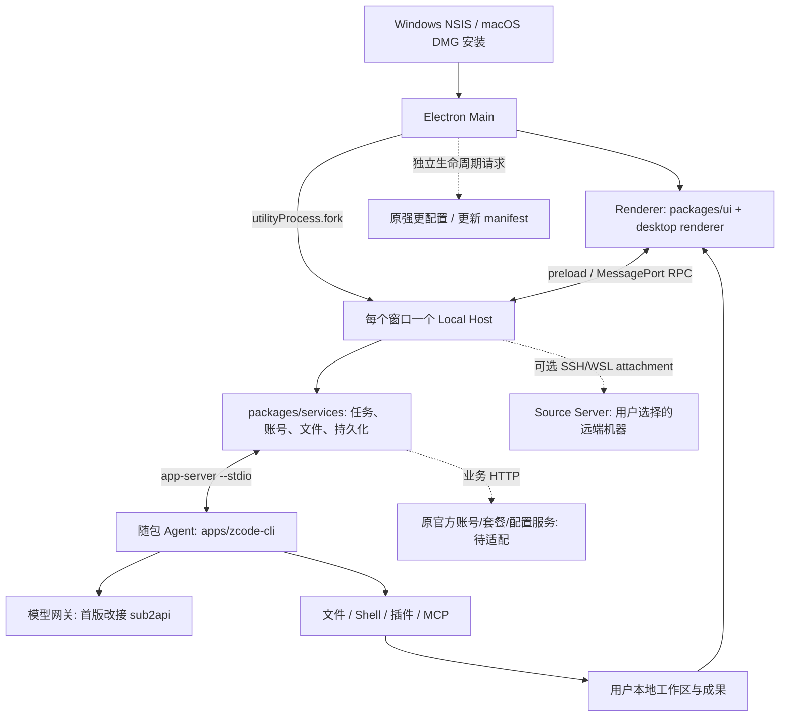

# 桌面架构、双平台运行与发行

调查日期：2026-11-10—2026-11-11。基线：`main` / `a9fe401eede6e6e5e01be9048679c206fe6f02d9`，根发行版本 `3.17.2`（`package.json:3`），Agent 子工作区版本 `0.17.1`（`apps/zcode-cli/package.json:3`）。本文是源码调查，不表示桌面包已构建或能力已在干净系统验证。

证据标记：**S** 当前源码实现；**D** 文档或界面声明，运行未验证；**N** fork 需新增或修改；**U** 本轮无法确定，需构建或运行验证。未特别注明的路径相对仓库根目录。

## 结论

- **S** 值得继承的是 Electron 桌面容器、window-scoped Host、共享业务服务、stdio Agent 进程、浏览器和成果面板、原生模块封装、已有打包完整性检查。接入 sub2api 不需要重写执行循环，也不需要把 `packages/server` 部署到 sub2api 服务器。
- **S/N** 当前源码能把 Agent 自身装进桌面包，但未提供覆盖所有开发与办公任务的一套通用工具链。Electron Node 与随包 npm 的 MCP 回退不能等价为任意终端任务都拥有 Node/npm；Python、Git 和办公转换器也不能从“Agent 内置”推导为已具备。
- **S/N** 原产品身份、启动强更、更新 manifest、官方业务 endpoint 是独立维度。只换显示名称或关闭普通自动更新不足以形成独立品牌发行物。
- **U** 本轮没有安装依赖、构建 Electron、运行安装包、签名、公证或实际更新；Windows 最低支持系统及各架构的最终可用性仍需发行验收。

## 主要目录与依赖边界

以下职责由当前源码与各包 `package.json` 的 workspace dependencies 交叉确认。顶层地图可见 `README.md:218`。

| 模块                                                                                          | 运行位置与职责                                                                                         | 主要依赖/证据                                                                                                                                                                           |
| --------------------------------------------------------------------------------------------- | ------------------------------------------------------------------------------------------------------ | --------------------------------------------------------------------------------------------------------------------------------------------------------------------------------------- |
| `packages/desktop`                                                                            | Electron Main：窗口、原生能力、进程生命周期、浏览器、IPC；Host：本地业务与远端连接；Renderer：React UI | **S** 依赖 client、server、services、rpc、provider、provider-node、shared、ui；`packages/desktop/package.json:73`；入口 `src/main/index.ts:2141`                                        |
| `packages/ui`                                                                                 | Desktop/Web 共享 React 组件、hooks、Zustand store                                                      | **S** `packages/ui/package.json`；业务通过服务接口访问，平台经 `IPlatformService`；`AGENTS.md:55`                                                                                       |
| `packages/web`                                                                                | 浏览器前端，包括远控客户端                                                                             | **S** 依赖 client、shared、ui；`packages/web/package.json`；不是模型计费后端                                                                                                            |
| `packages/services`                                                                           | 业务服务、Repo/持久化、账号与 provider、任务/session、文件/Git/终端、插件等                            | **S** 在 Host/Server 侧实例化；`packages/desktop/src/host/index.ts:3880`；`packages/services/package.json`                                                                              |
| `packages/client` / `packages/rpc`                                                            | Agent 客户端及业务 RPC、MessagePort/WebSocket 传输                                                     | **S** `packages/client/package.json`、`packages/rpc/package.json`；桌面 Host 通过 MessagePort 接入                                                                                      |
| `packages/shared` / `packages/model-option-map`                                               | 跨端协议、schema、共享类型与模型选项                                                                   | **S** `packages/shared/package.json`；stdio 协议 `packages/shared/src/zcode-protocol/index.ts`                                                                                          |
| `packages/provider` / `packages/provider-node`                                                | Provider registry、配置解析与 Node 侧存储/接入能力                                                     | **S** 两包 `package.json`；它们属于客户端产品模型配置层，不是 sub2api 网关本体                                                                                                          |
| `packages/server`                                                                             | 可复用的 HTTP/WebSocket transport、Web 页面托管、远端连接支撑                                          | **S** `src/index.ts:1` 导出 `createHttpServer`；`src/http.ts:344` 接收已构建 `ServiceCollection`，`:369` 建立 replayable WS；既可本机运行，也可在受控远端运行，不是官方账户云服务的实现 |
| `packages/zcode-server-cli`                                                                   | Source Server 的命令、运行目录、守护与远端资产组装                                                     | **S** `src/index.ts:1`；`src/server-core/http.ts:213` 默认 loopback，非 loopback 拒绝监听；无需因做本地品牌桌面产品而另行公网部署                                                       |
| `apps/zcode-cli`                                                                              | Agent CLI/TUI、bootstrap、core、adapters、工具/权限、模型调用、内置插件与技能                          | **S** 子工作区及其 `packages/*`；桌面执行它的 app-server stdio 模式；详细执行链见 `02-agent-execution.md`                                                                               |
| `packages/web-share` / `packages/share-ui`                                                    | 分享页面与共享展示 UI                                                                                  | **S** 对应包目录；首版可关闭入口，非本地执行核心                                                                                                                                        |
| `packages/android`                                                                            | Android 外壳/远控相关资源                                                                              | **S** `build.gradle.kts`；不在 Windows/macOS 首版目标内，不需为裁掉入口而立刻删目录                                                                                                     |
| `packages/zcode-cua`                                                                          | Computer Use 的宿主适配接口                                                                            | **S** 当前开源实现是不可用占位：`NOTICE.md:24`、`packages/zcode-cua/index.js:3`；不能据包名承诺原生桌面操控                                                                             |
| `packages/stream-animate` / `packages/e2e-report` / `packages/formal-proof` / `apps/dev-docs` | 流式动画、E2E 报告、验证材料及开发文档                                                                 | **S/U** 支撑包而非账户后端；首切片保留，是否随品牌产品发行逐项按实际打包闭包判断                                                                                                        |
| `scripts` / `config` / `third-party`                                                          | 工程门禁、构建、静态默认配置、第三方声明                                                               | **S** 发行时不可只复制 Renderer；打包脚本还准备 Agent、插件、原生依赖与声明                                                                                                             |

## 安装启动与本地服务

1. **S** `app.whenReady()` 从 `packages/desktop/src/main/index.ts:2141` 启动，Main 初始化平台设施、设置、遥测、协议、浏览器等。`:2634` 在启动 gate 后创建主窗口。
2. **S** `packages/desktop/src/main/desktopHostProcess.ts:121` 加载窗口；未打包才允许开发服务器地址（`:148`），正式包使用 `out/renderer/*.html`（`:157`）。因此本地桌面 UI 不依赖另起公网 Web 服务。
3. **S** 同文件 `:264` 通过 Electron `utilityProcess.fork(hostModulePath)` 启动 Host。`InitLocal` 带有 provider 配置文件和运行时环境快照（`:78`），Host 在 `packages/desktop/src/host/index.ts:3818` 接收，`:3833` 初始化数据库，`:3880` 实例化 `createLocalServices`。
4. **S** `packages/services/src/zcode-agent/zcodeAgentProcessManager.ts:443` 以 `process.execPath` 执行 JS bundle，`:449` 注入 `ELECTRON_RUN_AS_NODE=1`。开发入口明确为 `zcode.cjs app-server --stdio`（`:382`）。Main 不应承接任务/session 业务状态。
5. **S/N** 远控/SSH/WSL 使用 attachment 和远端 Source Server，而非为每个客户端另起独立执行器。首版隐藏远程入口可行，但不要删除 workspaceIdentity、owner/lease 或 replayable 边界；它们也参与本地状态隔离与恢复。

`packages/server` 的通用 HTTP 入口接受可选 authToken（`src/http.ts:353`），因此不能把“已有登录”理解成该服务适合直接公开部署。独立 Source Server 则显式限制 loopback（`packages/zcode-server-cli/src/server-core/http.ts:213`）。sub2api 继续承担公网账户、支付与模型计费即可。

## 双平台工具链事实

| 依赖/能力                          | 当前来源与范围                                                                                                                                                                                                                                             | fork 动作与验收                                                                                                                                                 |
| ---------------------------------- | ---------------------------------------------------------------------------------------------------------------------------------------------------------------------------------------------------------------------------------------------------------- | --------------------------------------------------------------------------------------------------------------------------------------------------------------- |
| Electron / Chromium / Agent Node   | **S** Electron `44.7.0`、builder `26.17.0`（`packages/desktop/package.json:118`）。桌面 Agent JS bundle 使用 Electron 自带 Node；不随包内置独立通用 Node（`electron-builder.config.js:825`）                                                               | **U** 安装包验证 Host、Agent、浏览器均无需用户安装 Node；不能据此承诺任意工程工具链                                                                             |
| MCP 的 Node/npm/npx                | **S** 随包 npm `12.2.0`，固定 sha512 从 npm registry 在构建期缓存下载（`packages/desktop/scripts/bundled-npm-assets.mjs:15`）；staging 在 `prepare-agent-node-bundle.mjs:450`；`adapters/src/mcp/node-fallback.ts:8` 明确仅是 stdio MCP 的回退             | **N/U** 首版实际跑一个 npm 型 MCP；另验证 Shell 中 `node/npm/npx` 是否可用，当前不要将 MCP fallback 当通用开发环境                                              |
| 任意网站工程的 Node/包管理器       | **S** `packages/services/src/runtime-tools/runtimeCommandEnv.ts:15` 搜索用户 Windows Node/npm 常见路径，说明仍兼容/依赖机器现有环境；未见桌面准备脚本统一安装此工具链                                                                                      | **N** 场景化托管开发 runtime、固定版本/缓存/修复入口；干净 VM 生成网站、安装依赖、启动与预览才算验收                                                            |
| 文件搜索                           | **S** ripgrep 及 release plan 工具随包进 `resources/tools`（`electron-builder.config.js:833`）；固定 bfs `4.1.1` / ripgrep `14.1.1` / ugrep `7.8.4`（`scripts/native-search-tools-config.mjs:40`）；resolver 先资源后 PATH（`runtimeToolResolver.ts:101`） | **U** 每个目标架构验证二进制能执行；构建准备是构建机动作，不是用户首启下载                                                                                      |
| Git                                | **S** 解析环境变量/`git`/Windows 常见安装路径（`packages/services/src/git/config.ts:53`），逐一运行 `--version`（`gitEnvironmentProvider.ts:13`）；缺失时抛 `Git binary is not available`（`gitCommandProvider.ts:87`）；未在桌面 extraResources 发现 Git  | **N** 非技术用户需要托管 Git 或在依赖 Git 的能力前统一准备；macOS 的系统 Git 可能触发开发工具安装，须干净系统验证，不可默认已有                                 |
| Shell / Windows Git Bash           | **S** macOS 从环境和 `/bin` 等目录查 bash/zsh（`adapters/src/exec/bash-shell-provider.ts:49`）；Windows 优先查已安装 Git Bash，找不到进入 legacy selection（`:199`），也支持显式 CMD（`:181`）                                                             | **U/N** 不应宣称 Windows 必须装 Git Bash，也不能宣称 POSIX 命令在干净 Windows 自动兼容；需分别验证 CMD 路径、命令方言与项目任务。托管 Git 时再决定是否随带 Bash |
| 用户终端                           | **S** `packages/services/src/terminal/terminalService.ts:289` 使用系统 pwsh/powershell/ComSpec/cmd 候选；node-pty 的目标预编译资源明确打包（`electron-builder.config.js:640`）                                                                             | **N** 普通模式隐藏终端配置入口、保留工具执行；验证无用户 shell profile 的场景                                                                                   |
| Python / uv / pip                  | **U** 桌面资产准备入口只列 Agent、搜索工具和可选 helper（`prepare-runtime-assets.mjs:30`），未见统一 Python runtime 的下载/打包入口；设置 `PYTHONUTF8`（`runtimeCommandEnv.ts:21`）不代表已有 Python                                                       | **N** 与办公切片一起提供受控 Python 和库，或验证插件内完整替代方案；详见 `04-office-and-extensions.md`                                                          |
| LibreOffice / Poppler / 生成端字体 | **U** 本地桌面准备/extraResources 未发现统一托管生成工具链；**S** PDF viewer 的 Noto Sans SC fallback 已有随包复制，见04。查看器字体不等于生成端字体                                                                                                       | **N** 按 DOCX/PPTX/PDF 的实际转换路径核验；中文字体缺字、分页与图表是双平台验收项；详见 `04-office-and-extensions.md`                                           |
| 内嵌浏览器                         | **S** 随 Electron；`packages/desktop/src/main/browserView/browserGuestManager.ts` 与 `browserPlaywrightExecutor.ts` 实现桌面浏览器工具桥                                                                                                                   | **U** 不要求用户安装浏览器不等于任意网站/下载/登录操作已经稳定；外部浏览器导入尤其 Windows 入口默认关闭（`electron-builder.config.js:50`）                      |
| Computer Use                       | **S** 当前占位不可用，真实 producer 才打包 helper（`electron-builder.config.js:70`）                                                                                                                                                                       | **N** 首版产品不承诺系统桌面操控；有来源与许可的实际实现接入后单独验收                                                                                          |
| SSH/WSL 远端资产                   | **S/D** 不使用桌面 Electron Node；Source Server 单独准备。README `:67` 描述 mock-cdn 上传开发流                                                                                                                                                            | **N** 首版隐藏入口，保留源码和身份边界；无需为本地目标部署该服务器                                                                                              |

结论是“App 运行零配置”和“任务执行零配置”必须分开验收。原仓库没有证据支持“安装后所有网站工程、Word/Excel/PPT/PDF 都无需依赖准备”。

## 构建、签名与更新

- **S** 开发工具版本为 Node `24.14.0`、pnpm `10.33.2`（`mise.toml:1`）。本机调查使用的 Node `24.19.0` 与 pin 不一致；不能把本轮检查当目标发行环境。
- **S** `pnpm bundle:desktop` 进入 `packages/desktop/scripts/bundle.mjs`，默认 mac/arm64（`:43`），支持 mac/win/linux 及 x64/arm64 参数（`:49`）。`:769` 准备资源、`:773` 构建、`:776` 调 builder。支持参数不代表已验证跨宿主编译和签名。
- **S** macOS 声明最低 `13.0.0`，产物 DMG/ZIP（`electron-builder.config.js:862`）；Windows NSIS（`:903`）。Windows 的完整最低系统支持承诺 **U**，需结合该版 Electron 官方支持与干净系统运行确定。
- **S** builder 明确校验缺失依赖（`:847`），为原生 node-pty 按目标解包（`:640`），存在显式闭包补齐名单与最终产物检查（`bundle.mjs:89`、`:703`）。这些成熟机制应保留。
- **S** macOS 签名由 `ZCODE_ENABLE_MAC_SIGN=1` + 自有 signing identity 控制（`electron-builder.config.js:63`）；启用 hardened runtime，builder 内公证关闭（`:882`）。**D/U** 注释描述原生 runtime 预签名与独立公证阶段，但当前 checkout 未提供 `scripts/sign-macos-runtime-binaries.sh`、`scripts/notarize-macos.sh`；`signIgnore` 还假设部分资源已经预签名（`:891`），自有流程必须补齐并验证嵌套二进制。
- **S** Windows `ZCODE_ENABLE_WINDOWS_SIGN=1` 走仓库 hook（`electron-builder.config.js:222`、`:912`），更新校验签名（`:906`）；hook `packages/desktop/scripts/sign-windows-hook.cjs:4`、`:46` 调用当前缺失的 `scripts/sign-windows.ps1`。**N** 需要补自有签名实现、证书、publisher、包身份和更新源，不能理解为只替换证书即可复用完整发行供应链。
- **D/U** `docs/git/release-build-publish-separation.md` 描述 GitLab 构建→人工 approve→校验→上传→灰度/stable 流程，但当前 checkout 没有 `.gitlab/ci/30-build.yml` 等流水线定义可复核。脚本与文档可借鉴，不能声称 CI 已可直接复用。
- **S** `electron-builder.config.js:984` 的 `http://localhost:8081` 是 builder 占位 feed，不是实际官方更新服务；运行时用 `manifestUpdateProvider.ts:22` 的 `/api/v1/releases/electron/manifest`，附平台、device_mid、channel（`:77`），再读取清单指向的制品。
- **S/N** 正式包还会忽略自定义 manifest URL（`autoUpdater.ts:839`），并将非官方 endpoint 回落到默认官方 origin（`:851`）。因此换更新服务必须调整发行适配边界与信任策略，不能只设置一个环境变量；初期保持更新关闭。

### 启动强更不能被普通更新开关代表

**S** `packages/desktop/src/main/index.ts:2300` 仅在 production 且 `ZCODE_AUTO_UPDATE_ENABLED` 时启用普通 updater；但 `:2614` 的启动 gate 仅要求 production + `app.isPackaged`，**没有检查**自动更新开关。它访问 `/api/v1/client/configs`（`forceUpdateGuard.ts:13`），依据 `minimalVersion` 阻止主窗口（`index.ts:2630`）；请求失败会跳过 gate（`forceUpdateGuard.ts:175`）。

**N** 第一条品牌切片应单独声明启动版本策略：初期禁用原官方强更并禁用官方自动更新，之后接自有最小版本配置和 manifest。仅关闭构建项 `ZCODE_AUTO_UPDATE`（运行时常量 `ZCODE_AUTO_UPDATE_ENABLED`）不满足“脱离官方生命周期控制”。不能靠换成 Preview 身份长期代替自己的产品身份体系。

## 品牌与许可证

- **S/N** `packages/desktop/scripts/desktop-product-identity.mjs:8` 固定 production `dev.zcode.app` / `ZCode`，`:17` 固定 Preview 身份。品牌化需覆盖 appId、显示名、Windows AUMID（`:85`）、协议注册、图标、用户数据隔离和 installer/update publisher，不做全仓字符串替换。
- **S/N** Electron `userData` 与业务数据根是两套路径：前者按应用名隔离（`desktopRuntimeEnv.ts:65`、`:75`），后者默认 `{home}/.zcode/v2`，provider 默认 `.zcode/cli`（`packages/services/src/paths.ts:36`、`:55`、`:251`）。改 appId/name 不会自动隔离任务、凭据和 Agent 配置。首切片需显式确定品牌业务根并贯通 Host/Agent；用户级指令还另按 HOME/USERPROFILE 解析（`:60`），不可只设置 `ZCODE_DATA_BASE_DIR` 后宣称所有数据都已隔离。
- **S** 根 `LICENSE` 为 Apache-2.0。第 4 条要求随分发保留许可、适用声明并标注修改（`:90`）；第 6 条不授予商标权（`:139`）。`NOTICE.md:73` 明确第一方许可不覆盖独立第三方软件、字体、图标、原生二进制和资源条款。
- **S/D** `third-party/README.md:25` 提供 strict 检查；`:29` 明确部分发布路径未接严格检查，`:49` 起登记待核验材料。当前文档记载 25 个 reviewRequired（`:54`），其数值是该文档状态，实际以 `third-party/inventory.json` 为准。本轮未重新生成或运行许可门禁，不能认定再分发材料已齐全。
- **N** 自有正式发行前按实际冻结依赖和目标包运行 `node scripts/licenses.mjs check --strict`，核对随包声明、改编标识、字体/Office 技能/原生组件来源。不能为改品牌删掉上游与第三方署名。

## 后续可验证任务

| 任务                   | 前置条件                                           | 可观察验收                                                                                  |
| ---------------------- | -------------------------------------------------- | ------------------------------------------------------------------------------------------- |
| 独立安装身份与生命周期 | 品牌 appId/数据目录/协议名，独立版本策略 spec      | 与官方 ZCode 并排安装；不覆盖会话/快捷方式；启动不请求原强更/更新服务；关闭卸载不碰官方数据 |
| 首次桌面运行           | 固定开发工具、冻结依赖与 Agent 资产                | 干净 Windows/macOS 无用户 Node/Python/Git 时 App 与 Agent 成功启动；明确哪些任务暂不可用    |
| 托管场景工具链         | 网站与办公分别列最小 runtime、下载来源、摘要、许可 | UI 展示准备/失败/重试；用户不输命令；中断可恢复；中文路径与无管理员权限场景通过             |
| 双平台真实工具切片     | sub2api 登录和模型配置接通                         | 创建文件、运行一次工具、退出重开恢复；随后网站生成→运行→预览，Excel/PPT 生成→预览→导出      |
| 自有发行演练           | 自有证书、制品存储、manifest                       | 签名检查通过、macOS 公证可验证；旧版升级到新版、失败可恢复；不触发真实发布或支付            |

目前所有安装/签名/工具链验收均为 **U**。先跑这几条可观察链路，再决定是否物理裁剪远端、团队或其他非首版实现，避免破坏成熟进程与持久化边界。
