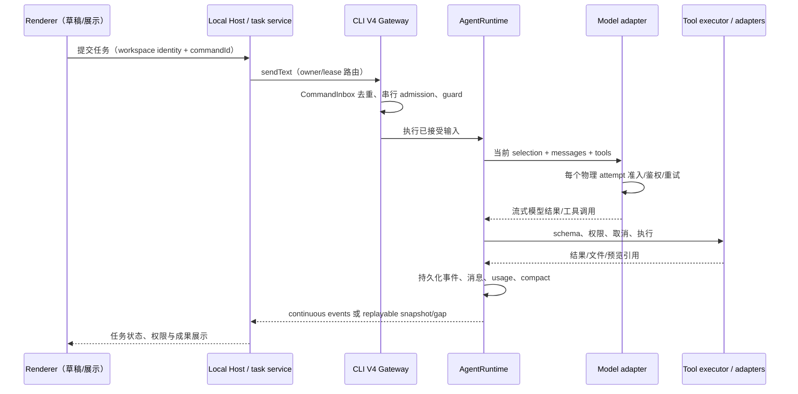
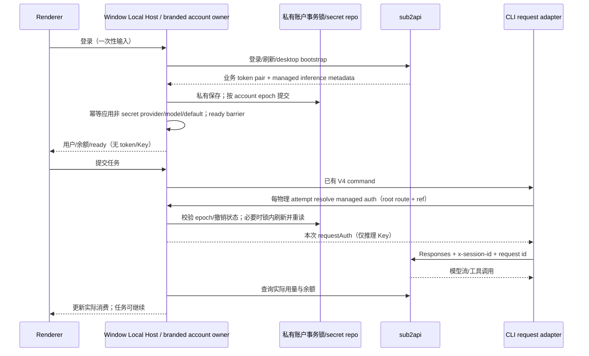

# Agent 执行、模型路由与受管理凭据接入

调查日期：2026-11-10—2026-11-11；源码基线：`a9fe401eede6e6e5e01be9048679c206fe6f02d9`。本文件只记录源码调查与建议，没有发送真实模型请求或修改执行器。证据标记：**S** 当前源码实现；**D** 文档/UI 声明；**N** 需要新增/修改；**U** 需要构建或运行验证。S 不等于发行物已验收。

2026-11-11后续设计见 [12：W3托管Agent推理](12-managed-agent-inference-design.md)：明确每用户独立Agent用途Key、managed source、目标CLI applied门禁及跨账户队列/辅助调用绑定。本文件保留源码证据，不代表W3已经接通。

## 结论

值得继承的是完整的本地 Agent harness：协议命令准入、模型注册表与请求 adapter、文件/命令工具、权限与取消、会话持久化与恢复、上下文压缩、子 Agent、Skills/MCP。品牌接入应扩展账户和请求鉴权边界，沿用现有 Responses adapter 与执行循环。

**不能把“用户登录后自动写一个普通 api-key Provider”直接当成安全的零配置方案。** 当前普通 API Key 是 Provider 配置的字符串字段，保存到 Personal JSON 并进入 Registry 序列化；现有 Host 请求级鉴权分支仅处理 `zhipu-account`。要使受管理推理 Key 不经过 Renderer，需要新增受管理 access/凭据引用及 Host resolver 契约，再复用现有逐请求反向 RPC；这是一条局部扩展，不能宣称仓库已有现成 generic credentialRef。

## 1. 执行层职责和主链路

| 层                                    | 当前职责与证据                                                                                                                                           | 品牌产品处理                                                               |
| ------------------------------------- | -------------------------------------------------------------------------------------------------------------------------------------------------------- | -------------------------------------------------------------------------- |
| `packages/ui`                         | 通过 service/hooks 取得任务与模型视图；不应拥有已接受的任务队列。进程与端约束见 `docs/agents/runtime-boundaries.md:7`、`:65`（D，已与下列实现交叉核对）  | 保留聊天/权限/成果组件，普通模式隐藏 Provider、MCP 等编辑器                |
| `packages/services`                   | `zcodeTaskServiceAdapter.ts:453` 把发送转成 V4 `sendText`；传递 workspaceIdentity、remoteSessionId、modelSelection、commandId                            | 账户业务及受管理推理 owner 放在 Host 的 service 装配中，不放 Main/Renderer |
| `packages/client` / shared protocol   | Host 与 Agent 的强类型 RPC；请求字段运行时 schema 例如 `packages/shared/src/zcode-protocol/index.ts:2845`                                                | 保留、对新增 access 显式扩展契约                                           |
| `apps/zcode-cli/packages/bootstrap`   | 装配存储、插件、MCP、权限、模型工厂与 runtime：`src/app/create-app.ts:387`、`:421`、`:630`、`:658`、`:931`                                               | 继承，不重写                                                               |
| `apps/zcode-cli/packages/core`        | 会话/turn、工具执行、权限、压缩、Memory、子 Agent 等领域执行逻辑；`src/runtime/methods/runtime-model.ts:24` 统一创建模型句柄                             | 继承，接入不应侵入 turn loop                                               |
| `apps/zcode-cli/packages/adapters`    | AI SDK 网络调用、进程/文件/存储等外部 I/O；`src/model/model-execution.ts:332` 按协议建 SDK                                                               | 继续通过 adapter 出网                                                      |
| `packages/provider` / `provider-node` | 前者实现配置/Registry/selection 的纯规则，后者拥有 JSON 原子写、锁、轮询、下载等 Node I/O；`provider-node/src/personal-provider-config-repository.ts:69` | 复用模型能力与选型规则，新增 managed access 的完整 schema                  |

**S：命令队列不是 UI 缓存。** `bootstrap/src/zcode-protocol-v4/command-inbox.ts:25` 定义 cold prepare 与持久化幂等查询；`:84` 定义 FIFO admission gate；`:110` 分离 in-flight/live/settled；`:120` 先校验信封并按 command key 串行查重。`v4-gateway.ts:704` 装配该 owner，`:742` 在 inbox 去重后拒绝未 ready 的新执行。收费门禁应在请求前失败关闭，不能新增另一份 accepted input queue。

**S：权限机制有实际执行边界。** `core/src/permission/service.ts:149` 有 yolo 快路，`:175` 有项目拒绝，`:694` 从 capability 解析风险与副作用；`core/src/tool/executor/permission-request.ts:48` 先登记再发布审批，`:52` 请求 broker，`:123` 等待登记/应答共同完成。普通模式应保留易懂的文件写入/系统操作确认；隐藏终端配置不等于关闭 Bash 工具，也不应为“零配置”统一开启 yolo。权限治理与操作系统隔离不是同义词，干净机器的隔离边界需 U 运行验收。

## 2. Provider 如何进入执行器

### 当前配置与默认选择

1. **S** `packages/provider-node/src/provider-config-runtime.ts` 组装 Built-in source 与 Personal repository；`packages/services/src/model-provider/providerConfigRuntime.ts:39` 只负责 App 路径与旧数据迁移，唯一文件 runtime 仍在 provider-node。
2. **S** `packages/services/src/model-provider/providerRuntime.ts:65` 组装进程内 Config、Registry、Settings Facade、ModelSelection Facade；`:120` 共享 start Promise。Host 中的 ready 视图不能视为 CLI 已收到新配置。
3. **S** Personal source 在 `personal-provider-config-repository.ts:69` 锁内重读后 transform，`:143` 先严格校验再原子私有写，`:174` 用版本轮询同步跨进程变更。进程内 Promise 或普通文件写锁不等于账户 refresh 网络事务锁。
4. **S** CLI `bootstrap/src/app/process-provider-registry-runtime.ts:45` 从 env 取得 Provider 文件路径，`:62` 启动自己的 NodeProviderRegistryRuntime；桌面模式不使用 standalone credential store（`:55`）。账户运行态另外通过 `zcodeAgentService.ts:1875` 串行读取、发 `providerUpdateAccountConfig`、校验 receipt；`:1918` 再显式刷新 Registry。
5. **S** `bootstrap/src/app/provider-registry-model-runtime.ts:43` 校验完整 selection 后精准查 provider/model，`:74` 将冻结的配置交给 adapter；`model-execution.ts:201` 绑定 snapshot，`:250` 为单次 requestAuth 创建实际模型，不在共享 Registry 中改 Key。
6. **S** API 类型映射明确：`model-execution.ts:401` 将 `openai-responses` 映射 `openai`，`:332` 调 `createOpenAI(...).responses`；Chat Completions 是另一分支 `:353`；Anthropic 是 `:343`。sub2api Responses 可复用此分支，Base URL 应经真实工具调用验收，不能仅验证 `/models`。

| 目的                | 已有具体入口                                                                                  | 接入限制                                                                                                                           |
| ------------------- | --------------------------------------------------------------------------------------------- | ---------------------------------------------------------------------------------------------------------------------------------- |
| 创建个人 Provider   | `packages/provider/src/config-service.ts:223` `createPersonalProvider`                        | ID 自动分配，非幂等 upsert；不能在每次登录创建一份                                                                                 |
| 更新已存在 Provider | 同文件 `:144` `savePersonalProviderOverlay`                                                   | 不存在则拒绝；只有 `standard-personal` 个人组可自行创建；固定官方账户 access 有特殊保护                                            |
| 增加模型与能力      | 同文件 `:322` `addPersonalModel`、`:449` `savePersonalModelDraft`                             | capability、contextWindow、optionSpecs、reasoningLevel 必须完整；`/models` 名单本身不足以推断这些事实                              |
| 原子更新配置        | `provider-node/src/personal-provider-config-repository.ts:69` `update(transform)`             | 是文件事实 owner；需保留其他记录。`config-service.ts:138` replacePersonalConfig 是迁移/cutover 整层替换，不宜用于每次 bootstrap    |
| 默认模型            | `provider-node/src/model-selection-config-repository.ts:22` `saveConfiguredDefault`           | 和 Personal 共享同一文件/锁，非另一份 setting；`provider/src/model-selection-config.ts:28` 默认失效会按可见 Registry 顺序 fallback |
| UI 可用模型         | `services/src/model-provider/providerFacadeServices.ts:95` ModelSelectionService 只有只读视图 | 不能伪造 ready，建议品牌 bootstrap 完成后明确发布唯一可选 managed provider                                                         |

**N：受管理 bootstrap 应有幂等 apply。** 用稳定的品牌 provider ID/安装身份维护受管理记录，锁内比较旧 revision、仅更新自己拥有的 provider/models/default；不要清空用户的 Personal 层。具体采用 Built-in branded 配置加运行态可用性，还是单独 managed overlay，应在实现 spec 中定案；现有 account overlay 只接受 Built-in 已有 provider（`provider/src/resolver.ts:184`），不能把任意新品牌 provider 丢进去。首版普通模式建议只发布平台允许的模型，失效时提示重试/联系支持，不能 fallback 到残留官方模型。

### 当前 Key 不是安全引用

| 事实                                                | 证据                                                                                        | 后果                                                                                   |
| --------------------------------------------------- | ------------------------------------------------------------------------------------------- | -------------------------------------------------------------------------------------- |
| **S** ApiKeyAccessConfig 只有 `apiKey` 值和管理 URL | `provider/src/config/provider-config.ts:36`；`provider-data-schema.ts:32`                   | 不存在 generic credentialRef；完整 api-key schema 强制非空 Key（`:39`）                |
| **S** Registry 序列化包含 apiKey                    | `provider/src/resolver.ts:39`                                                               | 无法据此保证 Key 不到前端/跨进程 payload；隐藏设置入口无效                             |
| **S** 普通 api-key 不经过 Host 每请求 auth          | `adapters/src/model/runner.ts:190`、`:214`                                                  | 加一个 Host resolver 但不改门禁不会生效                                                |
| **S** requestAuth 已支持请求级 Key 与 headers       | `contracts/src/model/invocation-context.ts:87`；`adapters/src/model/model-execution.ts:425` | 可复用物理请求绑定，不必改 loop；动态 auth header 清理也要扩展，当前仅认 zhipu-account |
| **S** 原反向 RPC 有账户专用字段                     | `shared/src/zcode-protocol/index.ts:2845`、`:2889`                                          | 需要新增 managed access/ref、账户/设备作用域、epoch/取消校验；不能冒充 ZAI/BigModel    |

**N：最小新增契约与改点（不要求重写引擎）。**

| 模块                                                                                                                 | 最小改造                                                                                                                                                                                                                                                                                                              |
| -------------------------------------------------------------------------------------------------------------------- | --------------------------------------------------------------------------------------------------------------------------------------------------------------------------------------------------------------------------------------------------------------------------------------------------------------------- |
| `packages/provider/src/config/provider-data-schema.ts`、`provider-config.ts`、`schema.ts`、`resolver.ts`             | 新 `managed` access 分支（名称待 spec），仅不透明 credential ref/账户 scope，不携带 Key；补 complete schema、union、overlay、serialization、executable 规则。`schema.ts:145` 的旧二选一 mapping 需显式扩展；`:26` 的 Account overlay schema 只容纳 zhipu-account 权益，不能直接塞 managed 数据。普通 API-key 兼容保留 |
| `packages/services` 的品牌 managedInference service 与私有 secret repo（新增）                                       | 登录凭据与推理凭据分别保存；仅 Host 掌握 secret，Renderer RPC 只返回账号/余额/ready 投影；按 provider/ref/accountEpoch/设备 resolve，登出和换号拒绝旧结果                                                                                                                                                             |
| `packages/shared/src/zcode-protocol/index.ts` 与 `contracts/src/model/invocation-context.ts`                         | 扩展既有 runtime auth 请求/应答为明确 managed 分支；绑定 ref+可信 scope，保持取消与错误分类；UI 不负责补 Key                                                                                                                                                                                                          |
| `bootstrap/src/app/provider-registry-model-runtime.ts:74`                                                            | 保留标准协议与模型能力，只扩展受管理 request dependency/鉴权来源识别；现有 requestDependencies 仅 off-peak/highspeed 特判，不能默认已支持                                                                                                                                                                             |
| `core/src/runtime/methods/model-runtime-headers.ts:8`、`bootstrap/src/zcode-protocol/provider-runtime-headers.ts:20` | 复用逐 attempt Host RPC/超时/取消；通用化 access 字段。路由由可信 workspace/root session 提供，Host 再校验 ref 与当前 account epoch                                                                                                                                                                                   |
| `adapters/src/model/runner.ts:155`、`model-execution.ts:401`、`:425`                                                 | managed 必须在每次物理请求取得动态 Key，缺失 fail closed；清掉静态认证头；重试不得复用旧账户；协议仍走 Responses adapter                                                                                                                                                                                              |
| `services/src/zcode-agent/zcodeAgentService.ts:1722`                                                                 | 在已有反向 RPC 分派增加 Host-only managed resolver；不能进入官方验证码/签名/套餐交互链，也不能走 Renderer generic credential service                                                                                                                                                                                  |

此处“Host-only”指凭据解析和账户生命周期对 Renderer 隐藏，**CLI 作为实际网络调用进程仍会短时持有推理 Key**。如果要求 CLI 永远看不到 Key，就需要 Host 本地转发网关，扩大网络和生命周期边界，不属于本轮默认最小方案。

**N：多窗口 owner 不能忽略。** 当前每窗口一个 Host（`docs/agents/runtime-boundaries.md:9`），Provider 文件可以跨进程同步，但这不解决 rotating refresh token 的竞争。品牌 account lifecycle 在 Host service，利用跨进程互斥覆盖“锁内重读 → refresh 网络消费 → 原子提交 token pair/epoch”，其他 Host 等待后重读；Main 只承担 OS 加解密/原生端口。不能每个 Host 独立使用一个内存 single-flight 就宣布全局安全。Key 轮换/登出同时使各 Host ready 状态失效，旧请求取消或以旧 epoch 拒绝，已结束的文件成果仍可打开。

## 3. 辅助模型调用审计

当前没有一个独立“全局 lite 默认模型”可一次写入后覆盖所有链路。默认模型只是新会话初始推荐，恢复和显式 override 是独立语义。应以统一 Registry allowlist 与逐请求 auth gate 管理，不到各 helper 手写 Base URL。

| 调用                            | S 当前选型/鉴权证据                                                                                                                                                                                                                                 | 接入验收                                                                                             |
| ------------------------------- | --------------------------------------------------------------------------------------------------------------------------------------------------------------------------------------------------------------------------------------------------- | ---------------------------------------------------------------------------------------------------- |
| 主 turn                         | `core/src/runtime/methods/runtime-model.ts:24`；`bootstrap/src/app/provider-registry-model-runtime.ts:43`                                                                                                                                           | Responses 工具调用、stream、取消和重试                                                               |
| 会话/目标标题                   | `bootstrap/src/app/runtime-config.ts:72` 空配置跟随当前会话；`core/src/runtime/methods/title-generation-sidecar.ts:29` 冻结当前/显式 selection；`:130` 创建模型；`:177` 带逐 attempt auth                                                           | 强制触发 title，网关日志归同一账户；没有旧显式 title selection                                       |
| 手动/自动/reactive compact      | `core/src/runtime/methods/compact-active.ts:195` 使用传入 turn model 或当前会话；`:432` auth；`compact-summary-model-request.ts:74` 同模型发请求                                                                                                    | 压缩足够长的任务；不能只测聊天短答                                                                   |
| Memory extraction               | `core/src/runtime/helpers/project-memory-extraction.ts:33` 继承产生工作的 turn model；`project-memory-agent.ts:40` 无显式时当前会话，`:64` auth                                                                                                     | 开关按产品决定；开启时校验后台调用同账户计费并在登出后停止                                           |
| Memory Dream                    | `project-memory-dream.ts:55` 明确“当前产品链路不自动触发”；`:66` 使用同 capture helper                                                                                                                                                              | 不列为已自动稳定交付；待单独启用与成本验收                                                           |
| 目标完成验证                    | `core/src/runtime/methods/target-completion-verification.ts:102` 冻结当前会话模型，`:329` auth，`:339` 保留原思考档位而非自动降档                                                                                                                   | 任务末尾 verifier 也会计费；换号/余额不足不能绕过 managed gate                                       |
| Git 提交信息/工作区生成         | `services/src/git/gitCommitMessageGenerator.ts:120` 读取当前模型，`:154` 发送 workspace text request；`zcodeAgentService.ts:5820` 转正式 RPC；`core/src/runtime/methods/workspace-generate-text.ts:58`、`:147` 按显式 selection 创建 workspace 模型 | 独立调用并非主 turn；测试账户归因/鉴权/取消；scope=workspace 的 session type 不能假装某一任务主 turn |
| 普通子 Agent                    | `bootstrap/src/app/runtime-config.ts:182` 合并 built-in overrides/profiles；`core/src/subagent/profile.ts:24` 支持显式 selection                                                                                                                    | 清理旧 provider override，全部候选经过 allowlist；权限/工具保留                                      |
| 脚本/动态 workflow 子 Agent     | `bootstrap/src/app/create-app.ts:755` 共用父 modelFactory；`workflow-actor-model.ts:157` actor selection > run selection > persisted pin > 继承                                                                                                     | 既有 pin 失效要清晰提示；不能暗换模型后继续历史 transcript                                           |
| WebSearch/WebFetch 的模型处理等 | `core/src/runtime/methods/runtime-model.ts:56` 把 admission/retry/session type 统一绑定到模型句柄，明确覆盖这些辅助用途                                                                                                                             | N 修改 managed 分支后使用 mock gateway 记录所有物理出网；不要只 grep 主请求                          |

**S：子 Agent 有两条身份轴。** `core/src/runtime/helpers/child-client-ports.ts:5` 子会话自己的账本身份与根会话路由身份分开；`:66` provider auth 反向请求重写到父，最终到根。核账不能把反向 RPC 的根 sessionId 与真实模型网络请求的子 sessionId 误认为天然相同。

**S：会话归因已经可用于 sub2api。** `adapters/src/model/runner-attribution.ts:20` 定义 `x-request-id`、`x-session-id`、`x-query-id`、trace 和 session type，`:36` 每请求生成；`:105` 去除 `sess_` / `subagent_agent_` 内部前缀。sub2api 已有 usage `SessionID` 字段（跨仓库证据见本目录接入文档），因此无需先创造一套完全不同的账单传输。**N/U** 记录桌面 task → 原始 CLI session → 网络归一化 session → 子会话/root 的映射，再用测试账户真实请求比对 usage 日志。标题、重试、压缩和子 Agent 均会产生消费，任务 UI 的 token 估算不能代替 sub2api actual cost。

## 4. 会话、恢复与本地/远端

| 能力                   | 当前证据与边界                                                                                                                                                                | 建议                                                                       |
| ---------------------- | ----------------------------------------------------------------------------------------------------------------------------------------------------------------------------- | -------------------------------------------------------------------------- |
| 持久会话/消息/模型选择 | `adapters/src/storage/session-store/paths.ts:4` 默认 SQLite；`bootstrap/src/app/create-app.ts:534` 恢复选择，`:573` resumeFromStore，`:583` runtime 恢复，`:591` 激活暂停目标 | 首版保留；不能把关闭 App 误承诺为所有系统操作可从断点自动重做              |
| 恢复缺失模型           | `bootstrap/src/app/runtime-config.ts:65` 恢复不套新默认；`workspace-model-runtime.ts:120` 不把历史选择暗换 Registry 首项                                                      | 品牌只允许自身模型时，为旧任务显示迁移确认；新用户独立数据目录可减少此问题 |
| workspace 身份         | `docs/agents/runtime-boundaries.md:45` 身份 key 与文件 cwd 分离；`zcodeTaskServiceAdapter.ts:458` 真实发送携带 identity、remoteSessionId                                      | UI 隐藏 SSH 不得顺手按路径合并 owner/任务                                  |
| 桌面实时 / 手机恢复    | `docs/agents/runtime-boundaries.md:60` continuous 与 replayable 共用 task owner、不同交付语义                                                                                 | 首版可关闭手机/远控入口，保留边界与协议；后续再开放                        |
| 远端 Memory            | `project-memory-extraction.ts:43`、`project-memory-dream.ts:62` 对 remote workspace 直接返回                                                                                  | 不能把本地 Memory 声明成远端完全等价                                       |

## 5. 保留、隐藏与暂缓

| 机制                                         | 建议                                           | 依赖及实际收益                                                                     |
| -------------------------------------------- | ---------------------------------------------- | ---------------------------------------------------------------------------------- |
| Agent loop、工具、自动 compact、取消、持久化 | 首版必须继承                                   | 网站/现有项目/办公多步任务的基础，重写会扩大不可控面                               |
| Skills/MCP/插件装配与工具搜索                | 底层保留，普通 UI 隐藏人工配置                 | 办公 runtime、浏览器、专业能力依赖它们；以后改成“可用能力/自动准备”                |
| Bash/执行环境                                | 保留，隐藏终端技术配置，保留审批和结果         | 开发构建与办公转换常需本地进程；仅隐藏终端面板不影响工具                           |
| 多供应商/API Key 管理                        | 机制保留，普通模式不开放                       | 高级模式复用；首版避免密钥、协议、档位配置负担                                     |
| 子 Agent/工作流内部调度                      | 保留；普通 UI 暂不开放模型 override/脚本编辑器 | 复用已有选择/取消/恢复/并发治理；对外只展示任务进度                                |
| Dream 与高级 Memory 调试                     | 首版暂缓入口                                   | 当前未自动触发；需单独验证后台成本、隐私与账户切换                                 |
| SSH/WSL/远控、Bots、定时入口                 | 见功能矩阵，首版可关闭                         | 不因入口关闭而删 owner/lease、identity、CommandInbox；它们还承担跨 Host/stale 防护 |
| 官方套餐鉴权/验证码链                        | 品牌 managed 分支绕开，先配置停用官方 Provider | 不是换域名即可复用的通用业务协议；厘清依赖后才考虑物理删除                         |

## 6. 最小回归与未知项

首切片应先补 CLI/协议回归（非 App 业务单测）：managed access 的 schema、secret 不进入序列化、缺失/换号/旧 epoch 失败关闭、逐物理 attempt 鉴权、取消清理、并发多 Host refresh；对 mock gateway 分别触发主 turn、标题、compact、Memory、子 Agent。随后以测试账户验证一次真实文件工具调用，并从 sub2api actual usage 对账。桌面交互先维护 E2E case，再改 UI；必须跑根 typecheck/lint 和受影响 CLI 的包入口。

U：本次未进行真实推理、两平台干净安装、权限/取消压力、App 重启恢复、多窗口账户轮换验证。代码中已有恢复和重试不等于 sub2api 的 SSE、工具 schema、reasoning/output token options、429/余额不足业务码已兼容。第一切片要验证这些失败路径；不要把网络断流后的自动重试承诺成任意外部副作用“恰好一次”。
