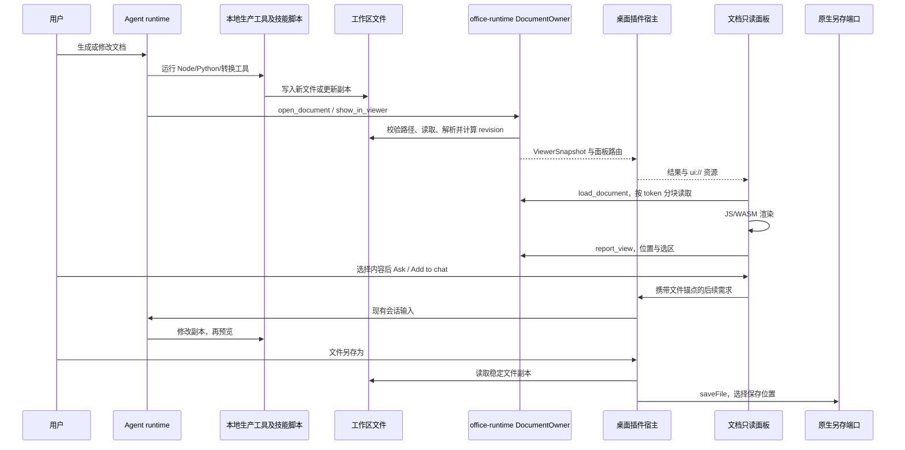

# 办公、成果预览与后续扩展

本章基于 `a9fe401eede6e6e5e01be9048679c206fe6f02d9` 的静态源码调查。**已实现**表示找到实际代码或构建入口，不代表已经通过 Windows/macOS 安装包验收；本轮未安装办公依赖、未调用模型、未构建或运行桌面应用。仓库内技能只是被审查的产品资产，本轮没有执行它们的安装指令。

## 1. 结论与保留边界

值得继承的是四类文档的生产技能、真实的本地解析/预览、文档定位与选区回传、插件 MCP Apps 宿主以及文件另存能力。**不能把“内置文档插件”解释成“干净电脑具备完整办公环境”**：查看器的 JavaScript/WASM 依赖有自包含打包设计，生成和转换脚本仍依赖 Python、npm 包、LibreOffice、字体等宿主环境。

首版同时保留 Word、Excel、PPT、PDF，先限定可验收格式与复杂度，采用自然语言修改已有文件、再次预览、导出副本的闭环。无需在首版制造 Word/Excel 式完整可视化编辑器，也无需让普通用户安装插件或输入命令。

| 证据状态      | 当前结论                                                                                                                          | 关键证据                                                                                                                                                                                           |
| ------------- | --------------------------------------------------------------------------------------------------------------------------------- | -------------------------------------------------------------------------------------------------------------------------------------------------------------------------------------------------- |
| 已实现        | `documents`、`pdf`、`presentations`、`spreadsheets` 是默认启用的内置插件，各带生产 skill、viewer skill、`visual-judge` 和查看面板 | `apps/zcode-cli/packages/bootstrap/src/app/official-plugin-definitions.ts:210`、`:221`、`:235`                                                                                                     |
| 已实现        | 四个查看面板共用 `office-runtime`，各插件按 `package.json.office.kinds` 构建自己的格式；面板不是在线 Office 服务                  | `apps/zcode-cli/packages/office-runtime/scripts/build.mjs:15`、`:74`、`:153`、`:223`                                                                                                               |
| 已实现        | 桌面 Node bundle 与独立 CLI SEA 均要求携带面板产物；少文件会被识别为残缺插件                                                      | `packages/desktop/scripts/prepare-agent-node-bundle.mjs:100`、`:113`；`apps/zcode-cli/packages/cli/scripts/sea-official-plugin-assets.mjs:79`                                                      |
| 已实现        | 查看器只读；修改通过 Agent 调用生产脚本重写新的文件完成                                                                           | `apps/zcode-cli/packages/office-runtime/CONTRACT.md:10`；`apps/zcode-cli/packages/office-runtime/ui/viewers/XlsxView.tsx:183`；`apps/zcode-cli/packages/documents-plugin/skills/docx/SKILL.md:176` |
| 文档/技能声明 | DOCX/PPTX 技能覆盖生成、修改和审阅，PDF 覆盖提取/合并/表单/转换等；尚未跑本 fork 的实际产物质量验收                               | 各插件 `skills/*/SKILL.md`；PDF 实际 CLI 命令在 `apps/zcode-cli/packages/pdf-plugin/skills/pdf/scripts/pdf.py:8`                                                                                   |
| 待新增        | 受宿主管理的办公依赖、稳定成果列表、统一导出入口、面向普通用户的依赖准备/失败提示                                                 | 本章 §4、§7；不得仅把安装脚本交给模型自行执行就宣称零配置                                                                                                                                          |
| 未确定        | 打包后的四面板能否在干净双平台正常启动、复杂文档的保真程度、离线启动、路径含中文/空格、首次依赖准备的权限与代理行为               | 需要真实发行包与干净环境验证                                                                                                                                                                       |

## 2. 生产、预览和导出是三条相关链路

`DocumentOwner` 是面板状态唯一所有者：解析缓存按文件路径/revision 复用，当前文档与选区按 session 分区；子 Agent 按 `root_session_id` 回到主会话面板。源码见 `apps/zcode-cli/packages/office-runtime/src/app/documents.ts:40`、`:89` 与 `src/adapters/server.ts:95`。`open_document`、`show_in_viewer`、`read_document`、`search_document`、`get_view` 等有实际 MCP 注册，契约见 `apps/zcode-cli/packages/office-runtime/src/CONTRACT.md:13`。UI 从资源读取文件块的代码位于 `apps/zcode-cli/packages/office-runtime/ui/main.tsx:178`，不通过厂商 Office 云端渲染。

当前还存在第二个**宿主文件预览入口**，与插件面板共存：`packages/ui/src/previewPaneContent.tsx:16` 引入 PDF/PPTX，`:25` 引入 Office；`previewPaneOfficeContent.tsx:7` 按需加载 DOCX/XLSX。不要为了统一界面直接删除其中一套：文件浏览、聊天中的文档定位、MCP 工具状态和预览入口的所有者不同，应先确定首版成果入口再复用现有端口。

| 类型 | 已实现的查看与读取                                                              | 生成/修改方式及限制                                                                                                                                                        |
| ---- | ------------------------------------------------------------------------------- | -------------------------------------------------------------------------------------------------------------------------------------------------------------------------- |
| DOCX | 插件 `DocxView` 使用 `docx-preview`；宿主文件预览也使用它，支持页/段落/表格定位 | 技能引导 docx-js 生成和 OOXML/Python 编辑；不能保证页码、域、修订和复杂排版完全等同 Word。宿主当前 `renderChanges:false`、`renderComments:false`，不要宣传为完整修订审阅器 |
| XLSX | `react-xlsx` + WASM 查看；server 用解析出的单元格/公式读取，面板有本地计算显示  | openpyxl/xlsxwriter 生产，`xlsx.py recalc` 使用 LibreOffice；面板计算结果不等于导出文件已经保存公式缓存，也不等于支持所有 Excel 函数/宏                                    |
| PPTX | 插件及宿主用 `@aiden0z/pptx-renderer` 浏览器 renderer，支持 slide/shape 定位    | 技能引导 pptxgenjs、python-pptx 或 OOXML 修改；复杂动画、嵌入对象、母版与字体的还原需样例验证                                                                              |
| PDF  | 插件用 pdf.js，宿主 PDF 预览用 react-pdf/pdf.js；可按页定位、选区、截图         | ReportLab、pypdf、pikepdf 等生产/处理，HTML 和学术路线另需浏览器/Tectonic；扫描 PDF/OCR 不在当前已核实的最小闭环承诺中                                                     |

关键位置：`apps/zcode-cli/packages/office-runtime/ui/viewers/registry.ts:18`、`DocxView.tsx:9`、`PptxView.tsx:2`；`packages/ui/src/previewPaneOfficeDocxContent.tsx:10`；`apps/zcode-cli/packages/spreadsheets-plugin/skills/xlsx-viewer/SKILL.md:30`；`apps/zcode-cli/packages/spreadsheets-plugin/skills/xlsx/xlsx.py:5`。

**导出已有实现，但范围需分清。** 文件级“另存为”经工作区 `IFileService` 读字节后调用 `IPlatformService.saveFile`，单文件上限 50 MiB，取消不视为失败；见 `packages/ui/src/file-menu/FileSaveAsMenuItem.tsx:36`、`fileCopy.ts:4`、`:33`。插件通用宿主也提供 MCP Apps `downloadFile`，但四个 office 面板当前没有专属下载按钮/转换工具调用，不能把通用能力当成已有办公导出产品流；见 `packages/ui/src/plugin-ui/adapters/pluginUiDownloads.ts:40`。office viewer 自身文件上限为 100 MiB，解包上限 512 MiB（`apps/zcode-cli/packages/office-runtime/src/contract.ts:18`），与另存限制不同，验收必须覆盖这一差异。

宿主 PPTX 文件预览已有“导出 PDF”：将 browser renderer 结果放入打印 DOM，调用平台 `printPageToPdf`，再 `saveFile`，见 `packages/ui/src/components/ui/pptx-preview-viewer.tsx:730`。这条路径不调用 LibreOffice。技能 `pptx/SKILL.md:688` 所写“所有 rendered preview 都依赖 LibreOffice”只适合作为其脚本生产流程要求，不能套用到已实现的宿主/插件 JS 查看器；也不能将 JS 打印结果宣称为 PowerPoint 原生排版保真转换。

## 3. 实际内置资产与官方市场的区别

内置插件是发行资产：bootstrap 从 filesystem 或 SEA 解出本地种子、建立本地 catalog/cache，缺失时按插件降级而不是把全部会话恢复炸掉。见 `apps/zcode-cli/packages/bootstrap/src/app/bundled-plugins.ts:91`、`:98`、`:110`、`:308`。`official` 是来源身份，不表示工具每次去云端运行。办公 stdio server 的 manifest 原写 `node`，在打包态由宿主改为 `process.execPath` 并带 `ELECTRON_RUN_AS_NODE=1`，因此**面板服务本身不要求用户另装 Node**；见 `apps/zcode-cli/packages/bootstrap/src/app/official-plugin-runtime.ts:70`、`:86`。

在线官方市场是另一条链路：marketplace adapter 支持 URL/GitHub/Git/npm/本地目录/settings 来源，官方 catalog 有 bundled/CDN 分区及合并逻辑；见 `apps/zcode-cli/packages/adapters/src/plugins/marketplace.ts:79` 和 `official-marketplace.ts:5`。内置 listing 图标来自 `https://cdn-zcode.z.ai/zcode/official-plugin/assets`，图标失败有默认显示降级，见 `official-plugin-definitions.ts:3`、`:63`。因此首版可保留并托管固定插件，隐藏第三方市场与安装配置入口；无需为了离线办公而删除插件框架。

| 办公相关对外依赖                       | 认证/触发                                                                      | 是否核心                               | 处理建议                                                                        |
| -------------------------------------- | ------------------------------------------------------------------------------ | -------------------------------------- | ------------------------------------------------------------------------------- |
| 内置办公 MCP server / 面板资源         | 本地 stdio 与 `ui://`，宿主注入 workspace/session scope                        | 是，成果查看交互依赖                   | 保留，验证自包含产物；不改成远端服务                                            |
| 官方插件 listing/CDN 图标              | 公开 HTTP 资源、浏览市场时展示                                                 | 否                                     | 自有品牌本地图标或自有静态源，保留失败降级                                      |
| Image Search MCP                       | `${ZCODE_BASE_URL}/api/v1/mcp/server/image_search`，`zcode_official/jwt_token` | 非基础办公必需                         | 首版关闭或自有服务适配；sub2api 登录态不能直接用于原协议                        |
| 字体安装源                             | `https://z-cdn.chatglm.cn/office-skill/fonts`，脚本下载，无业务 token          | 生成端部分字体需要，特定官方域名不必需 | 选择许可明确的少量字体，固定版本/hash/notice，产品管理安装；不依赖任意 CDN 脚本 |
| Python/npm/LibreOffice/Tectonic 下载源 | 技能 setup 或模型运行安装命令时联网                                            | 取决于任务                             | 由宿主管理的依赖配置替换自由安装流程；支持代理、下载恢复与明确错误              |

Image Search 证据为 `apps/zcode-cli/packages/image-search-plugin/.mcp.json:3`；它是搜图，**不是图片生成**。仓库内 PDF poster 提到“installed image generation skill”，只是一条可选技能指令（`apps/zcode-cli/packages/pdf-plugin/skills/pdf/briefs/poster.md:355`），本次未找到可与用户余额直接联动的内置生图实现。

站点发布是独立的官方业务插件，不是本地预览的前置：`apps/zcode-cli/packages/bootstrap/src/app/official-plugin-definitions.ts:431`、`:438` 将 `zcode-site` 注册为默认启用（显式用户配置可覆盖）。其面板从 `zcode-site-plugin/src/server/main.ts:26` 解析运行时 endpoint，默认 `https://zcode.z.ai`（`packages/shared/src/zcodeEndpoint.ts:3`），REST 路径见 `src/server/routes.ts:24`。manifest `zcode-site-plugin/.zcode-plugin/plugin.json:20` 要求 `zcode_official/jwt_token`；面板 `src/server/api.ts:20` 从工具 `_meta` 读取宿主身份头，缺少时不发请求。

发布脚本用本地会话 token 访问 UDS/Windows named pipe，不直接持有登录材料（`apps/zcode-cli/packages/zcode-site-plugin/scripts/zcode-site.mjs:9`、`:201`）；创建 site/deployment 后上传 gzip 包（`:245`、`:249`、`:251`），由 Agent endpoint 加官方身份头并转发（`apps/zcode-cli/packages/bootstrap/src/official-command-endpoint/endpoint.ts:140`、`:147`，路径白名单 `contract.ts:9`）。服务端如何保存/执行这些包，本仓无法核验；“控制面写 OSS”只是客户端注释。首版需同时停插件、命令、面板和转发授权，不能只隐藏发布按钮。

发现一个需运行确认的配置漂移：`packages/services/src/plugins/officialPluginCache.ts:10` 的默认集合仍列旧 `document-skills`，未列 CLI 中的四拆分 Office 与 Sites；其注释 `:7` 要求两侧同步。当前可确认 CLI 已注册默认插件，不能据此承诺 services 的 skills/commands/面板跨入口可见性一致。应先在固定文件 smoke 和首次安装中定位消费者与实际影响，再决定是否修复；本轮不改行为。

## 4. 双平台办公依赖：查看器已打包，生产环境尚未闭环

| 依赖/能力                                      | Windows/macOS 当前来源与证据                                                                                                                                                                        | 分类                                                   | 首版要求                                                                                                |
| ---------------------------------------------- | --------------------------------------------------------------------------------------------------------------------------------------------------------------------------------------------------- | ------------------------------------------------------ | ------------------------------------------------------------------------------------------------------- |
| 四类查看器 JS/MCP server                       | esbuild `bundle:true`；桌面 staging 和 SEA required assets；`office-runtime/scripts/build.mjs:153`、`:223`，桌面 staging `prepare-agent-node-bundle.mjs:100`                                        | 发行构建声明内置，安装包待验                           | 校验签名包中每个 `dist/server.mjs` 和完整面板资源；离线打开基准文件                                     |
| PDF cMaps、standard fonts、WASM、worker        | `office-runtime/scripts/build.mjs:44`                                                                                                                                                               | 发行构建声明内置                                       | 完整随包，不临时从 CDN 取 pdf.js 数据                                                                   |
| PDF viewer Noto Sans SC 字体 fallback          | 构建复制分片及 OFL notice；同文件 `:54`、`:249`                                                                                                                                                     | 发行构建声明内置，仅查看用途                           | 测试无系统中文字体时的 PDF；不要等同所有生成工具字体可用                                                |
| XLSX worker/WASM                               | `office-runtime/scripts/build.mjs:92`、`:108`                                                                                                                                                       | 发行构建声明内置                                       | 测试公式/图表/大文件失败提示                                                                            |
| 外部 Node/npm 与 `docx` / `pptxgenjs` 等生成包 | DOCX setup 列 `npm install -g docx`；PPTX skill 列全局安装命令；`docx/env_setup/setup.md:46`、`pptx/SKILL.md:672`                                                                                   | 依赖用户环境或任务中脚本安装；不是确定的首启自动安装   | 复用桌面 Node 运行时并提供受控模块解析，或者管理私有 Node 环境；须实际验证子进程和模块寻址              |
| Python 与 pip                                  | DOCX env check 检测 `python3`；Windows 脚本没有 Python 时打印 winget/下载建议；`docx/env_setup/env_check.sh:27`、`xlsx/env_setup/setup_windows.ps1:63`                                              | 用户已有环境，缺失时需安装；无已核实的桌面 Python 内置 | 提供私有可更新解释器，避免改全局 Python/PATH，不要求用户开终端                                          |
| Python office packages                         | xlsx 检测 openpyxl/xlsxwriter；PDF 检测 reportlab/pypdf/PyMuPDF/pikepdf/pdfplumber；`xlsx/env_setup/env_check.sh:27`、`pdf/env_setup/env_check.sh:31`                                               | 脚本按需 pip 安装，未固定完整生产依赖                  | 固定版本与平台 wheel，验证离线/网络失败及原生组件；审查许可证                                           |
| LibreOffice                                    | DOCX visual check、XLSX recalc、Office→PDF；脚本只报 missing/给安装建议，skill 要求模型需要时下载安装；`docx/env_setup/env_check.sh:36`、`xlsx/SKILL.md:24`、`xlsx/env_setup/setup_windows.ps1:139` | 按需安装指令；不在已核实桌面资源清单                   | 托管可用二进制或受控安装流程；明确体积、权限、版本、升级和取消；单实例转换队列/独立 user profile 需验收 |
| Poppler (`pdftoppm`)                           | PPTX skill 明列系统安装；`pptx/SKILL.md:683`                                                                                                                                                        | 用户环境/任务按需安装，未核实发行内置                  | 若保留脚本 PNG QA 则托管，或在 spec 中改用已打包 renderer 并验证质量                                    |
| Playwright/Chromium（HTML→PDF）                | PDF env check 中是 optional；`pdf/env_setup/env_check.sh:45`；PPTX skill `:678`                                                                                                                     | 可选任务依赖，不等于 Electron browser 自动能被脚本使用 | 如首版开放 HTML 转 PDF，明确复用宿主浏览器的受控接口或托管其专用浏览器；不重复盲装                      |
| Tectonic（LaTeX）                              | PDF env check optional；`pdf/env_setup/env_check.sh:49`                                                                                                                                             | 特定任务按需安装                                       | 学术 LaTeX 第一版可不承诺，保留扩展；基础 PDF 不受其阻塞                                                |
| 生成端 CJK/西文字体                            | Mac/Linux/Windows setup 不同；Windows 下载列表；`xlsx/env_setup/setup_windows.ps1:171`；`docx/env_setup/font_list.txt:1`                                                                            | 系统已有与脚本下载混合                                 | 先收敛少量跨平台开放字体并保留许可，逐一做 Word/PowerPoint 替换与导出验证                               |

当前 setup 直接面向 shell/PowerShell 和全局环境，有 `brew`、`winget`、`npm -g`、`pip`、设置 PATH 等指令。**脚本可供工程调查和迁移参考，但不能原样作为普通用户产品初始化方案**。例如 PPTX 技能要求将 `soffice` 注册 PATH（`pptx/SKILL.md:744`），PDF `env.fix` 会安装核心 Python 包（`pdf/scripts/pdf.py:472`）。本轮仅记录，未执行。

## 5. 许可证与品牌发行边界

根 `LICENSE:2` 为 Apache-2.0；四个生产 skill 的 `LICENSE.txt:1` 均为 Z.ai 2026 的 Apache-2.0，四个插件 `package.json` 同样声明 Apache-2.0；`office-runtime/LICENSE:1` 为 MIT。应保留版权、许可和适用 NOTICE，不能因为改品牌删除第三方声明。

发现元数据冲突：四个 `skills/docx|xlsx|pptx|pdf/SKILL.md:7` 写 `Proprietary`，同目录 LICENSE 文本却写 Apache-2.0。当前证据支持“仓库授权文本和元数据不一致”，不支持直接断言整个办公能力不可商用或已取得所有外部资源再分发权。发版前应向上游澄清并在资产清单记录授权依据。

构建脚本已有许可汇总机制，实际 bundled npm 依赖从 esbuild metafile 收集 license/notice，缺失 SPDX 与文本时构建失败；见 `apps/zcode-cli/packages/office-runtime/scripts/licenses.mjs:4`、`:29`。构建额外追加 Lucide、Noto Sans SC（OFL-1.1）与 pdf.js 数据文件许可（`apps/zcode-cli/packages/office-runtime/scripts/build.mjs:239`）。这值得继承，但其范围只覆盖该 viewer 构建，不覆盖生产脚本动态 pip/npm 下载的所有组件。

PDF core 脚本显式要求 `PyMuPDF`（`pdf/env_setup/env_check.sh:37`）。**发布前必须核定实际锁定版本的 AGPL/商业许可要求及集成方式**；本仓未提供该 pip 依赖的版本锁与对应许可文本，不能把根 Apache 许可扩展到它。LibreOffice、Poppler、Tectonic、字体等同样要按实际版本制作第三方清单与再分发方案；本章不代替具体产物的许可审查。字体名单主要为 Noto/Sarasa/Liberation/LXGW/WenQuanYi/DejaVu/Tinos/Carlito/Freefont/OpenSymbol，不能仅凭名单断言其全部可随任意产品重发，或反向断言名单含闭源字体。

## 6. 未来设计、生图与游戏扩展

| 方向               | 当前实际边界                                                                                                         | 最小扩展方式                                                                                                            | 是否要修改宿主                                                     |
| ------------------ | -------------------------------------------------------------------------------------------------------------------- | ----------------------------------------------------------------------------------------------------------------------- | ------------------------------------------------------------------ |
| 生图/改图          | 未找到已核实的内置生成实现；Image Search 是带官方 JWT 的远程搜索 MCP                                                 | 新建自有生图适配器/插件，独立 image credential/模型/费用与结果落盘，复用图片预览；接 sub2api 的生图工作台须另追源码合同 | 基础调用可插件化；统一余额错误、进度、编辑引用与成果列表需宿主衔接 |
| 界面设计与原型     | Agent 可生成 HTML/CSS，已有 Gen UI HTML fragment sandbox、tweak 状态与会话回传                                       | 复用 `visualize`/Gen UI，受控写入 HTML 后预览，设计调整走现有会话                                                       | 若只做交互原型可少改；完整设计画布、矢量编辑/素材库需新 UI/协议    |
| 网站/网页小游戏    | 可沿用文件工具、开发服务器、Browser Use/内嵌浏览器与 HTML 预览；仓库有 game planner 的工作流测试，不是发行级游戏引擎 | 第一版网站模板与预览闭环先验；后续 HTML/Canvas/WebGL 游戏采用同一开发环境                                               | 主要是模板、依赖与预览工作流；发布/托管另做产品选择                |
| Blender            | 本次在主要业务与插件源码未找到 Blender 专用执行/宿主集成；图标库的 Blender 名称不构成功能                            | 后续插件通过 Blender Python/MCP/CLI 调用，输出 `.blend`、图片/视频和元数据                                              | 托管大体积二进制、进度/取消、原生/GPU 环境与 3D 预览可能需宿主能力 |
| Unity/Unreal/Godot | 本次未找到稳定专用集成；网页 fetch 白名单或提示词不是引擎适配器                                                      | 独立插件和工具链，自建工程创建、构建、运行、错误读取合同                                                                | 安装/授权/GPU/进程管理与预览需要额外工作，不作为首版能力           |
| Computer Use       | **不可用占位**，不能靠隐藏配置变可用                                                                                 | 真要支持桌面自动化需替换实现并验证系统权限/跨平台                                                                       | 是，属于原生能力接入，不应借此许诺 Office GUI 自动化               |

Gen UI 有真实实现：`packages/services/src/gen-ui/adapters/service.ts:40` 要求 desktop sandbox；`:63` 设定无 connectDomains、仅允许静态资源域；`packages/ui/src/gen-ui/CONTRACT.md:3` 定义实例存活、状态和后续会话行为，下载与导航默认阻止（`:5`）。它适合交互解释/原型，不能当成任意联网网页宿主或替代专业设计工具。网页游戏测试证据：`apps/zcode-cli/packages/dynamic-workflow/tests/graphs/game-planner-reviewer.ts:1`。Computer Use 的实际占位代码：`packages/zcode-cua/index.js:1`，与 `NOTICE.md:24` 一致。

## 7. 首版办公可验收切片与任务

前置依赖是账户/模型首次真实工具调用切片、双平台受控 Node/Python 环境、许可确认及产物预览 smoke。办公不能整体延期，但可先限定 `.docx/.xlsx/.pptx/.pdf`、普通表格/图表/文本与中英文，复杂宏、OLE、加密、复杂修订、专业排版/扫描 OCR 作为明确后续边界。

| 类型  | 首版最小生成                                    | 首版最小修改                                                | 预览与导出验收                                                                                                                |
| ----- | ----------------------------------------------- | ----------------------------------------------------------- | ----------------------------------------------------------------------------------------------------------------------------- |
| Word  | 生成含中文标题、正文、页眉页脚与表格的 3 页报告 | 上传一份报告，替换指定段落/表格数据，原文件保留，输出新副本 | 页数、中文、表格无明显截断；打开插件面板、选区提修改、重新加载新 revision；另存 `.docx`，如承诺 PDF 则同一文件转换后再验      |
| Excel | 生成月度预算工作簿，2 张表、合计公式和基础图表  | 修改已有 `.xlsx` 的指定金额/公式，保留其余样式和工作表      | 对照 fixture 校验已知公式值，真实 recalc 后重新读取缓存；预览值与导出重开值一致，另存 `.xlsx`；不以面板显示即判定导出计算正确 |
| PPT   | 生成 10 页含标题、图表、中文与页码的汇报        | 修改指定 slide 的文本和数据，保留其余页，输出新副本         | 逐页截图验收文字边界/字体/图表；slide 选区回传后可继续修改；另存 `.pptx`；验收已选 PDF 导出路径且标明保真范围                 |
| PDF   | 生成带中文、表格与页码的 3 页报告               | 对已有文本 PDF 做合并/删页/替换指定表单字段之一，输出新文件 | 页数、顺序、可搜索文本/字段值与 fixture 一致；面板逐页检查，另存 `.pdf`；不把 PDF 当作可无损重排的 Word                       |

建议验证顺序：先用固定的四类文件在生产安装包内离线打开原生预览和插件面板（无全局 Node/Python/LibreOffice）；再用托管环境运行确定性脚本完成同样文件的生成、修改、导出重开；最后让模型完成自然语言闭环。这样分别定位 viewer 资产缺失、生产依赖缺失与模型生成质量问题。Excel 单独验证真实重算后的落盘缓存值，不能只看预览。

建议任务顺序：

1. **建立依赖与产物 spec。** 在现有办公插件 specs 上补首版受支持格式、操作、依赖来源、文件保护、取消与错误合同，维护双平台用例；不新增 App 业务单测。复用四插件 `package.json` 的 `build`、`smoke`、`test:e2e` 入口；当前 `office-runtime/scripts/e2e.mjs:22` 明说它模拟 host iframe，并不覆盖 Electron sandbox，必须补真实桌面验收。
2. **收敛私有办公环境。** 先固定 Node module 与 Python packages、可再分发字体；在平台/基础设施层提供探测、准备、失败状态，不让 renderer 或模型在全局路径随意安装。LibreOffice 与 PyMuPDF 的策略是发布门槛；当前没有证据表明只改 UI 就能消除它们。
3. **复用四个只读面板完成修改闭环。** 只在已有工具、MCP viewer、文件服务之间衔接；先通过上表 4 个 fixture，再测试中文空格路径、取消、原文件保护、文件正在修改、插件 server 失败与 50 MiB 导出限制。
4. **统一成果入口。** 显示文件名、预览、继续修改、另存，底层复用 `IFileService`、`IPlatformService.saveFile` 与现有 preview；普通模式隐藏插件安装/MCP/终端配置，保留权限解释和失败诊断入口。

主要风险是生成环境缺失、原生依赖下载失败、字体与 renderer 排版差异、公式计算语义、导出限制不一致、第三方授权，以及模型生成脚本产生坏文件。验收依据应为真实文件、工具退出状态、预览截图和导出后重开结果，不能用 skill 文本、聊天完成话术或社区演示代替。
