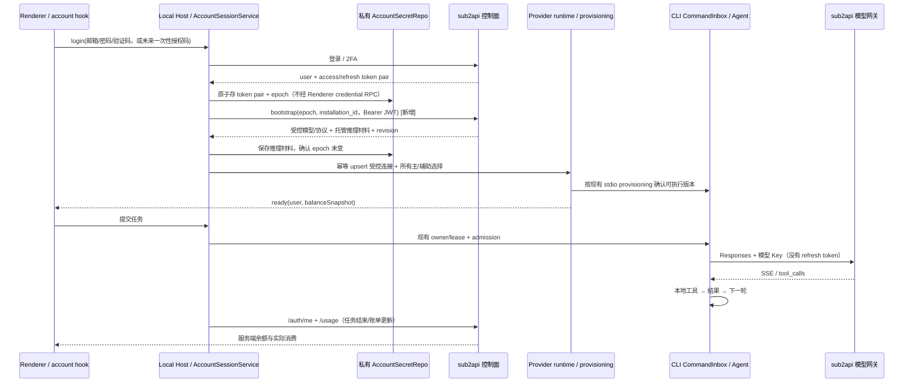
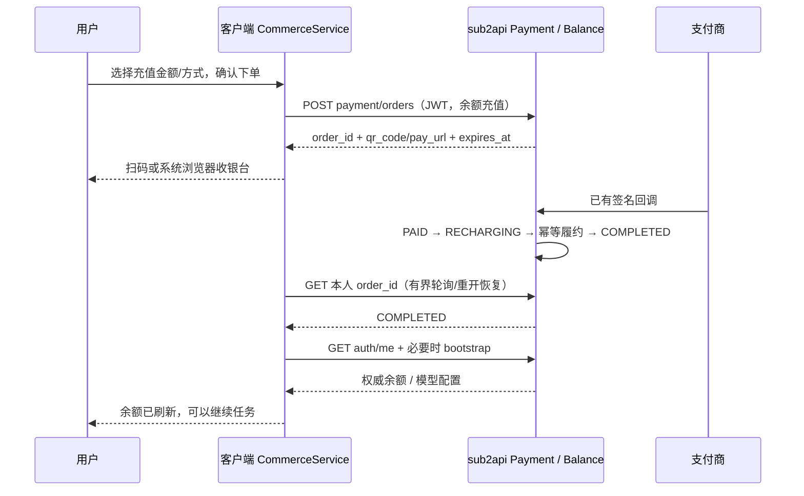

# sub2api 接入方案与接口缺口

后续进展：账号/钱包W1/W2实施见 [11](11-account-wallet-implementation.md)；按当前sub2api `d5555fb` 复核后的推理接入合同以 [12](12-managed-agent-inference-design.md) 为准，生产支付与登录缺口见 [13](13-account-wallet-production-gaps.md)。12细化/替代下方bootstrap草案：新增稳定purpose，不改既有生图Key；充值关闭不阻塞已有余额的Agent验证。下文旧基线保留作为初始调查记录。

日期：2026-11-10—2026-11-11。ZCode 基线见 [总览](README.md)。sub2api 只读基线：`main` / `c32e6296da8293e2a8a7d661c3c4da1dd3ebfaa1`，开始时工作区干净；本轮没有修改、调用真实账户、充值或支付。下文 `sub2api/` 证据路径相对于相邻仓库 `/Users/patrick/WorkBuddy/MiloRouter/sub2api`。旧调研仅作线索，以下按实际源码重新核验。

S=当前源码实现，不代表线上配置可用；N=建议新增/修改，尚未实现；U=需要运行验证。

## 1. 已有接口与准确边界

控制面 `/api/v1/*` 的公共响应为 `{code,message,reason?,metadata?,data?}`，成功 `code=0`（`sub2api/backend/internal/pkg/response/response.go:15`、`:34`）。模型网关使用协议原生响应，不能共用一套业务 envelope 解析器。

| 需求                            | 已有接口 / 认证                                                                    | 源码证据                                                                                           | 可复用范围 / 缺口                                                                                                                                                                                            |
| ------------------------------- | ---------------------------------------------------------------------------------- | -------------------------------------------------------------------------------------------------- | ------------------------------------------------------------------------------------------------------------------------------------------------------------------------------------------------------------ |
| 邮箱密码登录 S                  | `POST /api/v1/auth/login`                                                          | `backend/internal/server/routes/auth.go:38`；`handler/auth_handler.go:77`、`:124`、`:239`          | 请求包含验证码证明字段；正常响应有 access/refresh token、expires_in、user，或 `requires_2fa` 分支；生成 token pair 失败时还可兼容回退成仅 access token。客户端不得假定 refresh 总存在，也不得绕开验证码/TOTP |
| 二次验证 S                      | `POST /api/v1/auth/login/2fa`                                                      | `handler/auth_handler.go:264`、`:286`、`:293`                                                      | temp_token + 6 位 totp_code；客户端需处理两阶段登录                                                                                                                                                          |
| 刷新 S                          | `POST /api/v1/auth/refresh`，body `refresh_token`                                  | `handler/auth_handler.go:670`；`service/auth_service.go:1802`                                      | 轮转 token，旧值失效；服务端状态、密码版本、可选 IP/UA 绑定影响结果。必须跨窗口串行刷新；网络失败不得无限重用旧 token                                                                                        |
| 退出 S                          | `POST /api/v1/auth/logout`，可提交 refresh_token                                   | `handler/auth_handler.go:712`、`:724`                                                              | 撤销 refresh token；**不等于撤销 API Key 或已在执行的请求**；模型凭据生命周期另处理                                                                                                                          |
| 当前用户/余额 S                 | `GET /api/v1/auth/me`，Bearer JWT；另有 `/user/profile`                            | `server/routes/auth.go:257`；`handler/dto/types.go:12`                                             | DTO 有 balance、balance_credits、frozen_balance(\_credits)、allowed_groups；余额 display 口径还需结合计费配置，不把浮点数直接当人民币                                                                        |
| 普通用户 Key S                  | `GET/POST /api/v1/keys`，Bearer JWT；PUT/DELETE `/:id`                             | `server/routes/user.go:107`；`handler/api_key_handler.go:34`、`:172`、`:221`                       | 可做技术验证，具所有权检查；普通 Key 创建不是天然幂等，也不是桌面专用托管凭据，生产不让客户端自行挑分组                                                                                                      |
| 托管 Key 范例 S                 | `GET /api/v1/image-studio/key`，Bearer JWT                                         | `server/routes/user.go:28`；`handler/image_studio_handler.go:64`；`service/api_key_service.go:625` | 生图专用，按用户/用途幂等，管理员决定分组，仍扣用户余额；**不要直接挪用该 Key 给 Agent**                                                                                                                     |
| 可用分组/倍率 S                 | `GET /api/v1/groups/available`、`/rates`，Bearer JWT                               | `server/routes/user.go:116`                                                                        | 供后台策略核验；首版无需向用户暴露组概念，也不凭列表顺序选第一个                                                                                                                                             |
| 模型目录/推理 S                 | `GET /v1/models`；`POST /v1/responses`、`/chat/completions`、`/messages`，模型 Key | `server/routes/gateway.go:179`、`:192`、`:207`、`:214`、`:233`                                     | 分组、平台和模型白名单决定实际可用性。Responses 有 HTTP/SSE 与 GET WebSocket；首切片仅验证 HTTP/SSE，协议存在不代表任何组都支持                                                                              |
| 充值配置 S                      | `GET /api/v1/payment/config`、`/checkout-info`、`/limits`、`/plans`，JWT           | `server/routes/payment.go:40`                                                                      | 可直接复用可用渠道、金额范围与配置；首版是余额充值，原厂商订阅 UI 不适用                                                                                                                                     |
| 下单 S                          | `POST /api/v1/payment/orders`，JWT                                                 | `server/routes/payment.go:53`；`service/payment_service.go:90`                                     | 返回 order_id、result_type、pay_url/qr_code 或其他支付形态、expires_at 等；桌面只支持已验证的扫码/收银台渠道，不假定所有渠道都返回 URL                                                                       |
| 到账查询 S                      | `GET /api/v1/payment/orders/:id`；`POST /orders/verify`，JWT                       | `server/routes/payment.go:54`、`:56`；`service/payment_fulfillment.go:244`、`:475`、`:491`         | `PAID/RECHARGING` 与 `COMPLETED` 含义不同；先支付再履约入账，确认完成后刷新用户余额；前端跳转成功不能记作充值到账                                                                                            |
| 支付回调 S                      | `/api/v1/payment/webhook/*`                                                        | `server/routes/payment.go:79`                                                                      | 后端已有支付商回调与履约，客户端不处理签名/加余额。本轮不发起订单                                                                                                                                            |
| 消费明细 S                      | `GET /api/v1/usage`、`/usage/stats`，JWT                                           | `server/routes/user.go:129`；`handler/usage_handler.go:70`、`:233`                                 | 可按本人 Key、模型、日期等筛选；actual_cost、charge_credits、billing_currency、倍率与账单快照见 `handler/dto/types.go:632`                                                                                   |
| 会话核账基础 S / 完整任务账单 N | usage DTO 的 request_id、session_id                                                | `handler/dto/types.go:606`、`:673`；`service/session_id.go:35`                                     | 已能从显式会话头写 usage；当前用户 usage filter `handler/usage_handler.go:206` 未接受 session_id。子代理/辅助请求归属、按 task 聚合与预算仍需补齐；不能称为完全没有会话关联                                  |

当前未找到桌面 bootstrap、Agent 托管 Key、设备凭据领取/撤销的专用路由。搜索范围为当前 `backend/internal/server/routes`、`handler`、`service`；不是对所有未来/线上版本的断言。

## 2. 最小架构与状态所有者（N）

复用现有分层：UI hook → services 契约 → window Local Host 内服务 → 通用 Provider/Agent。新增品牌业务模块，不把账号与支付塞进 Electron Main，不让 Renderer 直接访问 Repo，也不把任务队列迁到 sub2api。

| 事实                                      | 唯一所有者                                                               | 客户端可持有的投影                                                                                       |
| ----------------------------------------- | ------------------------------------------------------------------------ | -------------------------------------------------------------------------------------------------------- |
| 用户、余额、实际消费、分组/模型授权、到账 | sub2api                                                                  | 账号页与侧栏余额快照，带更新时间；失败显示未知/旧值，不填 0                                              |
| 登录 token pair 与 account epoch          | 本地私有 AccountSecretRepo；Host 中 AccountSessionService 是唯一变更入口 | UI 只见 user / 状态，无 refresh token；跨窗口共享存储锁与变更通知                                        |
| 用户托管推理 Key 与撤销状态               | sub2api；客户端私有 credential repo 保管材料                             | N：给 Provider 新增受管理 access / credential reference，用户不填 Key；现有 api-key 配置没有这种引用能力 |
| 活跃执行所用 provider revision            | Host provider/provisioning gate → CLI runtime                            | UI 显示“可开始/正在准备/需登录/充值”；不把登录完成等同 runtime 已就绪                                    |
| accepted input、工具、恢复                | 现有 CLI CommandInbox / runtime；Host 路由 owner/lease                   | UI 草稿与 pending overlay；详见 [执行审计](02-agent-execution.md)                                        |
| 订单状态                                  | sub2api payment 服务                                                     | UI 保存待查订单 ID；绝不本地记账                                                                         |



现有可复用设施：`packages/services/src/credential/credentialService.ts:3` 使用 `withFileLock` 与私有原子写，`:82` 可注入 cipher；但它的 RPC 契约 `credential/credential.ts:11` 允许 Renderer 任意 load/save/delete。**不能把新账号 secret 只换个 key 名放入同一可读服务，然后宣称 token 从不进入 Renderer。** 新私有 repo 不暴露到通用 credential RPC，推理 Key 通过 Host 内认证 resolver 接入；`ICredentialService` 的现有兼容面另保留。

OS 保护：正式发行给私有 repo 注入 macOS/Windows 受保护的加解密适配器。可复用现有 cipher injection，Electron Main 只向可信 Host 提供窄 encrypt/decrypt 端口，核验调用来源；不经 Renderer 可调用的通用 `IPlatformService` 或公开 RPC 暴露解密。账号刷新、计费和任务状态仍归 services/Host。现有默认 AES-GCM 文件方案是已实现能力，OS safeStorage 是 N，不是现成钥匙串。

跨窗口刷新：沿用已有文件锁/原子写工具，新建 account scope 的 refresh 临界区；锁内重读版本，短期内已被其他 Host 刷新则复用新 token，否则仅一个请求消费 refresh token，再整体保存 pair。现有单次 save 文件锁不覆盖网络换证，因此不足以保证这一语义。退出也使用相同账户锁，递增 epoch，迟到响应不得恢复旧账号；通知其他 Host 停止后续模型轮次并清理派生配置。锁有合理超时/失败状态，不能无限等待；不把超时当成同步正确性的依据。

登录响应缺少 refresh token 时，应明确记录为不可自动刷新的会话，到期要求重新登录，不伪造长期登录态；首切片的正常路径必须验收服务端能稳定返回完整 token pair，并覆盖该兼容分支的提示/恢复。短 token 会话是否可发任务由后续 spec 冻结，不以隐藏该异常代替服务可用性。

## 3. Desktop bootstrap：建议增加，但本轮仅设计

建议 `POST /api/v1/desktop/bootstrap`，JWT 鉴权，`Cache-Control: no-store`。POST 反映“可能创建/修复受控凭据”的副作用；不用仿制 ZCode `/client/configs`。示意合同如下，字段命名和部署 origin 在实施 spec 中冻结：

```json
{
  "request": {
    "schema_version": 1,
    "installation_id": "opaque-installation-id",
    "platform": "win32-x64",
    "app_version": "brand-version"
  },
  "response_data": {
    "schema_version": 1,
    "revision": "opaque-policy-revision",
    "user": { "id": "opaque-user-id" },
    "inference": {
      "connection_id": "managed-default",
      "protocol": "openai-responses",
      "base_url": "https://gateway.example.com/v1",
      "model_id": "server-selected-model",
      "default_selection": { "reasoning_level": "server-validated-level" },
      "credential": { "id": "opaque-id", "secret": "runtime-only" },
      "capabilities": { "tools": true, "vision": false },
      "auxiliary_policy": "same-managed-connection"
    },
    "capabilities": { "recharge": true }
  }
}
```

这是合同草案，非现有响应，不含真实 Key。映射模型时还需要真实上下文窗口、输出限制和能力资料，由服务端模型策略提供并严格校验；示意中未展开全部字段。默认选择须显式指定经过该模型能力校验的 reasoningLevel/成本策略；不支持推理档位的模型应明确无此选项。当前缺省会补到最高公开档位（`packages/provider/src/model-selection-config.ts:58`），不能在普通用户无感时意外提高成本。不要凭客户端模型目录猜能力或价格。

为何值得加这一接口：服务端集中决定可用组、协议、模型、倍率策略、受控 Key 用途、客户端能力与最低支持版本，客户端不必自动点击“创建 Key”、猜分组或拼接多个厂商协议。现有 `/auth/me`、`/payment`、`/usage` 继续独立复用，不把支付/任务执行塞进 bootstrap，也不需要新建云端 Agent 服务。

托管 Key 最小选择：首切片采用**每用户一把、独立 Agent 用途**，安装 ID 仅作为诊断元数据，不宣称设备隔离。复用 `GetOrCreateImageStudioKey` 的算法思想，新增独立用途/方法、组配置和功能开关。当前数据库已有 `(user_id,name)` 的 system partial unique index（`sub2api/backend/migrations/250_system_api_key_unique.sql:26`；`repository/api_key_repo.go:1121`），可支持每用户/用途唯一；不要与生图用途共名。

领取必须校验用户状态、功能开关、组有效性、模型可用性、现有 Key 状态，组调整后同步并失效认证缓存；停用的 Key 不能静默变成有效；客户端不能提交任意 group_id 绕过授权。沿用余额计费模式而非误绑订阅组；生产环境是否已存在这样的组为 U。

设备独立凭据是后续 N：需要稳定的用途/设备记录、设备列表、轮转和撤销接口及数据库约束；不要仅拼接设备名后声称设备安全。每用户共享 Key 下，设备退出只清本地材料并停本地执行，不能撤销其他设备共同使用的 Key。若要求“退出后泄露的 Key 立即失效”，则设备级凭据和撤销是首版前置项，不能靠撤销登录 JWT 代替。

## 4. 最小模型路线

选择与现有 Codex 用户业务匹配的**一个经过运营配置确认的 Responses 模型/余额组**，不预设某个模型名一定已上线。复用 Responses 协议，新增受管理 access / secret reference 及 Host 请求鉴权分支，不使用 `zhipu-account`、Coding Plan 或官方网关 headers。现有 `api-key` 配置保存明文 apiKey（`packages/provider/src/config/provider-config.ts:36`），且普通 api-key 模型不会走 Host 请求鉴权端口（`apps/zcode-cli/packages/adapters/src/model/runner.ts:190`）；因此不能把“安全凭据引用”描述成已可零改动复用。新增分支只扩展配置/序列化/鉴权门禁，沿用模型工厂、反向 RPC 与执行循环，详见 [执行审计](02-agent-execution.md)。主模型、标题、压缩、目标验证、Git 信息、子代理与开启后的记忆都服从同一 managed connection 策略；辅助模型另选时也只能来自 bootstrap 的授权集合。

模型 Key、登录 access token、refresh token 三者分用途/受众/存储/失效原因，不互换；默认不把 token 放 URL、CLI argv、日志、普通 JSON 配置或安装包。单任务推理数据直达自有网关，本地文件、工具与预览继续在用户设备，不经 sub2api 执行。

HTTP+SSE 首验需要覆盖：多轮 `function_call` / `function_call_output`、字符串化工具参数、reasoning item 回放、并行调用、模型拒绝、长上下文压缩与终止事件；不能用一条文本聊天测试代替 Agent 联调。WebSocket、原生搜索、图像理解、原生压缩各作为单独能力，未验证就不上产品开关。

## 5. 充值与消费流程（N）



不在客户端写死充值渠道、汇率和赠金额。支付页面只获取必要订单材料，不向任意 webview 注入登录 JWT。`pay_url` 来源也要校验允许的支付域与外部打开策略；不要把任意返回 URL 当作可执行 deep link。到账后提示继续，保留已完成工具结果，不自动重放有外部副作用的完整任务。

消费页优先展示服务端已结算明细与余额时间戳，usage 使用 `charge_credits` 与相应币种/换算快照（`handler/dto/types.go:637`），客户端 tokens × 静态单价只能标“估算”。初期支持“本账户/Agent Key 消费”，不要把充值前后余额差当单任务消费，因为可能多设备、并发、冻结或其他平台消费。

会话关联已有但还不完整：让每次模型请求有稳定的账单会话头与唯一 request id，子代理/标题/压缩关联回父任务，同时维持上游所需各自 session/cache 语义。当前 usage List 没有 session_id 查询合同，严格任务总账需要新增过滤/聚合与迟到账单更新；预算硬上限还需服务端 admission/预留设计，不在第一切片承诺。

## 6. 错误与恢复规则（N）

| 触发                   | 普通用户看到/可做                              | 技术处理与验收                                                                                                                              |
| ---------------------- | ---------------------------------------------- | ------------------------------------------------------------------------------------------------------------------------------------------- |
| 密码/验证码/TOTP 错误  | 在登录页完成验证，不丢任务草稿                 | 不降级到共享 Key；成功后才生成账户 epoch                                                                                                    |
| 控制面 JWT 401         | 自动恢复一次，失败后“登录已过期，请重新登录”   | 单 flight refresh，原子轮转；只在确认为该账号/该凭据版本时清理，不能用旧响应踢出新登录                                                      |
| 模型 Key 401           | “连接需要重新验证”，保留任务/成果              | 重新 bootstrap 一次；与 JWT 失效分开，不能无限创建 Key/循环重试                                                                             |
| 余额不足               | 显示余额、充值入口、已完成成果；用户到账后继续 | 当前网关可返回 **403 `INSUFFICIENT_BALANCE`**（`middleware/api_key_auth.go:269`），不能只识别 HTTP 402；保留 accepted queue 与 runtime 事实 |
| 模型限流/并发/套餐限额 | “当前繁忙”，显示重试状态并可停止               | 按具体 code/Retry-After 有界退避；429 不等于余额不足，不切回官方供应商                                                                      |
| 无可用模型/组被停用    | “服务暂不可用”，可稍后重试/联系客服            | fail closed；不能猜新组、静默选择任意 provider                                                                                              |
| 网络中断/SSE 中断      | 保留输出与已生成文件，提供重试/继续            | 区分是否已产生工具副作用；不要重新提交完整任务假装续传；复用 runtime 恢复机制                                                               |
| refresh 网络超时       | “连接暂时异常”，可重新验证                     | 可能已经轮转，重复消费旧 refresh 不保证成功；先确认本地新版本/重新登录，不能以固定延时当同步方案                                            |
| 支付超时/已付未入账    | 显示订单状态、查询/帮助入口                    | 以服务端订单与余额为准，不再次自动下单；pending order 在重开后可恢复                                                                        |
| 退出/换账号            | 下次执行前要求登录，文件仍可本地预览导出       | 阻止新轮次/新 admission，取消本地运行可取消部分，清 token 与 provider 派生状态；已完成外部动作无法撤回                                      |

## 7. 缺口与上线前验证

| 优先级         | N / U 项                                                                  | 所属与依赖                              | 完成标准                                                     |
| -------------- | ------------------------------------------------------------------------- | --------------------------------------- | ------------------------------------------------------------ |
| P0             | 独立账户客户端、refresh、私有 secret repo、账户 epoch                     | ZCode services/Host + 平台加密端口      | 登录、重开、双窗口刷新、退出迟到响应、换账号不串凭据         |
| P0             | desktop bootstrap + Agent 托管 Key / 默认组与模型策略                     | sub2api，**后续获授权实施，本轮仅设计** | 重复/并发领取只一把；组/Key停用正确拒绝；消费绑定当前用户    |
| P0             | 主/辅助 Provider 映射与 runtime readiness                                 | ZCode provider/services/CLI 现有接口    | 用户无需输入配置，真实工具调用多轮成功；无官方模型外呼       |
| P0             | 验证码/2FA 桌面实现与线上策略                                             | 两仓库联调                              | 普通账户能完成登录，不要求关闭现有安全设置                   |
| P0             | 余额充值/订单恢复/实际用量 UI                                             | ZCode；复用现有 sub2api 接口            | 测试环境模拟回调/履约后余额刷新并能继续；本轮不真实支付      |
| P1             | 系统浏览器授权码 + PKCE / loopback 或品牌 deep link                       | sub2api 新授权流程 + Desktop 回调       | 单次 code、state、绑定客户端校验；refresh token 不出现在 URL |
| P1             | 任务 usage 过滤聚合、辅助归属、迟到账单                                   | sub2api usage + ZCode request context   | 父任务包含已归属子调用且不误计其他任务；保留用户所有权约束   |
| 视产品要求前移 | 设备专属 Key、吊销与轮转                                                  | sub2api 新生命周期与客户端管理          | 单设备退出/吊销不影响其他设备；离线退出的待吊销可重试        |
| U              | 真实部署 origin、余额组、模型 ID、计费单位、支付渠道、验证码/会话绑定配置 | 运营/现有部署，不从源码猜               | 联调前填入部署清单；无须为完成本轮源码分析阻塞               |

直接登录现有邮箱接口可作为首切片，不要求先建完整浏览器 OAuth 系统；若现网登录依赖桌面无法承载的验证码/身份流程，再把一次性授权码交换前移。MCP OAuth 的授权语义不同，不拿现有 MCP grant 充当桌面模型账号。
