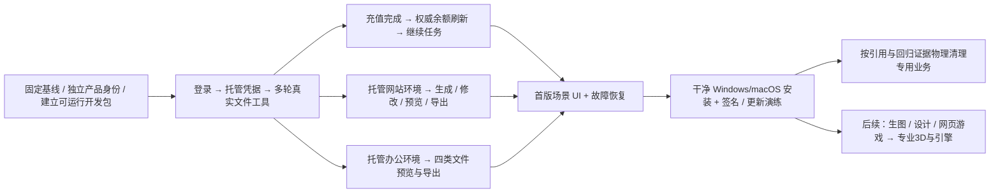

# 分阶段路线与第一条最小切片

本路线为初始调查计划；账号钱包W1/W2现已实施，真实范围与验证见 [11](11-account-wallet-implementation.md)，不代表推理接线已完成。F03/F04的下一步细化以 [12](12-managed-agent-inference-design.md) M0–M4为准：充值暂不开放，先用已有余额完成托管模型与工具闭环；支付生产化见 [13](13-account-wallet-production-gaps.md)。没有构建证据前不估精确工期。第一版同时交付开发与办公，下面的顺序表示工程依赖，不表示把办公排除在第一版之外。

## 1. 阶段与交付门槛

签名/运行依赖/许可的调查可以与账户切片并行，最后才合成发行；不应等账户完成后才发现办公依赖不能分发。以下任务 ID 用作后续 PR 与验收记录关联，不是已经完成的工程任务。

| ID / 可验证交付                     | 依赖                            | 具体任务与模块                                                                                                                                        | 完成标准                                                                                                                                                      | 主要风险                                                                                 |
| ----------------------------------- | ------------------------------- | ----------------------------------------------------------------------------------------------------------------------------------------------------- | ------------------------------------------------------------------------------------------------------------------------------------------------------------- | ---------------------------------------------------------------------------------------- |
| F00 固定可重现基线                  | 无                              | 遵循 `mise.toml`；冻结 pnpm lock；安装 workspace 依赖；记录构建资源来源；先产未签名内部验证包，以固定四类文件验证离线预览                             | pin 的 Node/pnpm 下 typecheck、lint、基础构建真实执行；记录两平台包及日志；原生预览和插件面板在无全局开发/办公工具时可用                                      | 当前无 node_modules；原生资源/镜像/第三方材料缺口；iframe host 测试不等于安装包验证      |
| F01 独立产品身份与官方生命周期策略  | F00，可并行设计                 | `desktop-product-identity.mjs`、资源/协议、品牌业务数据根贯通 Host/Agent、独立用户级指令路径策略、强更与更新 gate；默认 Provider 刷新与后台云能力策略 | 与 ZCode 并排安装不覆盖账号/会话/配置/快捷方式；生产包不受原官方强更/更新控制；最小启动/登录请求清单可解释                                                    | 单换 productName/appId 只隔离部分数据，默认业务根仍是 .zcode；不可篡改 HOME 解决路径问题 |
| F02 最小登录 spec 与私有账户 owner  | F00                             | 新品牌 account services/secret repo/typed contracts + UI hook；先维护 E2E 场景                                                                        | 登录/2FA、重开、双窗口刷新、退出/换账号、迟到响应均有明确状态和证据；refresh token 不经 Renderer generic credential RPC                                       | 轮转 token 并发消费、旧账号请求复活、OS 加密与文件损坏                                   |
| F03 bootstrap / Agent 托管 Key 合同 | 接入合同；后续 sub2api 修改授权 | [05](05-sub2api-integration.md) 的最小 POST 接口、独立 Agent 用途、一个余额组/默认 Responses 模型                                                     | 并发/重复领取幂等；停用 Key/组时拒绝；用户余额与当前身份一致；不占用生图 Key                                                                                  | 本轮后端只读，尚不能宣称接口已存在；线上组/模型未知                                      |
| F04 受管 access 与主/辅模型路由     | F02、F03                        | 扩展 provider schema/config/序列化 + Host request-auth + CLI 门禁；保持原执行循环                                                                     | **登录→无需设置→写文件→读回→多轮完成**；标题/压缩/子代理等已启用路径只走受管授权集合；账单归用户                                                              | 当前 plain api-key 明文/不走动态 auth，不能零改动实现安全凭据引用                        |
| F05 充值与到账恢复                  | F02，余额接口已有               | 新 CommerceService、余额/订单 UI；复用 sub2api payment；不使用厂商套餐 webview                                                                        | 测试环境/模拟渠道从 PAID/RECHARGING 到 COMPLETED，再刷新余额继续；中断重开能查原订单                                                                          | 支付成功不等于入账，自动重复下单、离线状态误报余额为0                                    |
| F06 用量与易读错误                  | F04、F05                        | 实际 usage/币种/credits；model error mapper；账户与模型认证错误分离                                                                                   | 账户/Agent Key 已结算消费可查；403余额不足、401、429、断网等按实际 code 展示；没有切回官方的静默兜底                                                          | task 总账仍需聚合，不能用余额差或本地估价替代实际消费                                    |
| F07 网站工具链与预览                | F04；可并行准备runtime          | 托管 Node/npm/必要 Git、缓存与环境探测；复用 browser/file/terminal/预览                                                                               | 干净 Windows/macOS 生成带校验表单的网站，启动预览，二次修改，导出可运行源码；用户不输命令                                                                     | Electron Node/MCP npm fallback 不等于 Shell 中的通用 Node                                |
| F08 办公工具链与许可                | F00，可与F02并行                | 生产端 Node/docx/pptxgenjs、Python/库/LibreOffice/生成字体等按实际路径固定版本来源、hash、许可；复用 office-runtime 和内置插件                        | UI 自动准备/修复/失败重试，不要求手动 pip/npm/终端配置；先以确定性脚本完成四类文件生成、修改、导出重开，离线/下载中断行为明确                                 | 生成/转换/预览依赖不同；PyMuPDF许可、技能元数据和字体来源需核验，见04                    |
| F09 四类办公成果闭环                | F04、F08                        | Word/Excel/PPT/PDF 各选代表样本，每种均生成并修改，保留内容/预览/导出入口；fixture 见04第7节                                                          | Word生成报告并修改模板；Excel生成含公式/图表工作簿并修改、真实重算；10页PPT生成并二次修改；PDF生成报告并修改已有文本PDF；所有成果可预览、导出并在目标软件打开 | 格式保真、公式/图表、中文字体、复杂Office不支持项；不许只验证扩展名                      |
| F10 开发/办公普通模式               | F04，随后接F05–F09              | 复用现有 coding/office 和成果面板；能力策略按 [07矩阵](07-feature-matrix.md) 收口                                                                     | 安装→登录→充值→描述→确认操作→预览→修改→导出全程无 Key/MCP/供应商术语前置                                                                                      | 多处快捷入口、旧导航与后台服务仍可触发非首版功能                                         |
| F11 首版双平台发行与升级            | F01、F05–F10                    | 补自有原生预签名/Windows签名/独立公证脚本；manifest、制品校验、迁移；严格第三方声明检查                                                               | 干净 Windows/macOS 安装启动/登录/任务/办公/网站；升级后账号和本地成果保持；失败可恢复                                                                         | 当前签名hook/公证流程尚缺脚本，不能只换证书；平台原生模块、系统字体/权限/长路径          |
| F12 有证据的裁剪                    | F11与引用审计                   | 清理仅属官方营销、套餐、分享等无用适配；同步导出/spec/技能/资产                                                                                       | knip/dep:refs + 架构门禁 + 受影响运行验收，能解释每项删掉什么和哪些消费者仍保留                                                                               | 动态注册、构建资产、共享provider/预览/调度依赖被误删                                     |
| F13 生图/设计/网页游戏              | 首版稳定                        | 自有计费生图工具、受控UI插件/Gen UI、HTML游戏模板与预览                                                                                               | 真正生成图片且按用户计费；HTML/CSS原型或明确约定的源文件格式可编辑导出；游戏修改规则后仍能运行                                                                | 素材搜索不是生图；Gen UI不提供现成专业设计文件导出；插件演示不是稳定宿主能力，详见04     |
| F14 Blender/专业游戏引擎            | F13之后独立选型                 | 插件提供工具；宿主补应用进程、SDK、资产、视口/导出集成与能力探测                                                                                      | 单个真实工程可生成/修改/预览/导出，目标应用版本与许可明确                                                                                                     | 外部大型依赖、GPU、原生应用权限与插件协议；不能由Prompt预设推导支持                      |

F03 需要未来进入 sub2api 修改范围，本轮尚未授权修改它，所以本轮交付合同与缺口。F00–F02 的设计和客户端准备可先开展，F04 的真实闭环依赖 F03 已可调用或一套受控联调接口。不能用 mock 文本成功替代真实模型工具验证。

## 2. 第一条切片：登录后自动配置并完成真实文件工具

**选择它的原因：** 一次验证用户身份、余额归属、模型协议、动态鉴权、Provider 默认选择、Host/CLI provisioning 和工具回合。它同时是网站和办公的前置条件，而且不需要先改 Agent loop、搬目录或删除功能。只做换图标/首页不能证明商业接入可用。

### 产品规则（实施前的 spec 草案，N）

- 普通用户唯一登录入口是品牌账户。登录成功不直接解锁发送；受管模型配置和 runtime readiness 成功后才可开始新任务。准备失败显示原因与重试，不跳到手工 Key 表单。
- 未登录仍可查看已有本地成果；不能继续产生需要付费的模型调用。余额/账户查询断网显示未知或带时间的缓存，不把缓存当实时授权事实。
- 一个受管连接、一个服务端确认的默认模型、一个余额计费组；显式配置已校验的默认推理档位/成本策略，避免缺省落到最高档位。没有全局“lite模型”可直接改，当前配置需要逐入口处理辅助选择，见02。
- 主模型与已启用辅助模型都受允许集合约束；插件/子代理/workflow 的显式 override 不能绕过。没有可用受管模型时明确停止，不回落原官方 Provider。
- 账户 token pair、模型 secret、配置引用分离。新 managed access 保持动态鉴权，Renderer 不得到 refresh token；安装包无共享平台 Key。
- 配置应用按 `(account-id, connection-id, revision)` 幂等。只更新品牌所属条目和默认引用，不覆盖整个 Personal 配置，不触碰与任务无关的用户配置。
- 退出/换账号先阻止新的 admission/模型轮次，再取消可取消的当前请求、清私有材料与派生配置；account epoch 防止迟到回写。既有本地会话与文件不删除。
- 状态沿用现有 runtime/Host 唯一所有者，UI 是投影；不新建第二个任务队列。Desktop continuous 与 mobile replayable 协议合同保持兼容，尽管首版手机入口关闭。

### 最小改动位置与边界

以下“新增”文件夹/文件是建议命名，需实施时按架构 policy 注册归属；不是仓库已经存在的功能。

| 层 / 现有位置                                                                                                                                                                                                                | 建议改动                                                                                      | 为什么必须经过这里                                                                                               |
| ---------------------------------------------------------------------------------------------------------------------------------------------------------------------------------------------------------------------------- | --------------------------------------------------------------------------------------------- | ---------------------------------------------------------------------------------------------------------------- |
| 新增 `packages/services/src/brand-account/`（示意名）                                                                                                                                                                        | AccountSessionService、私有 AccountSecretRepo、Sub2apiClient、bootstrap mapper；契约/实现分层 | 隔离 sub2api 业务，不污染 ZAI/BigModel DTO；统一刷新与账户代次                                                   |
| `packages/shared/src/channels.ts:97`、新增账户公共schema；`packages/services/src/node.ts:2600` 附近装配                                                                                                                      | 注册类型化账号/余额服务、公开投影与命令；新服务走公开入口注入                                 | UI不能直连Repo；Main不承载账户业务。原 OAuth 与新账号不得同时作为品牌登录事实                                    |
| `packages/services/src/credential/credentialService.ts:82`、Desktop可信Host平台端口                                                                                                                                          | 复用 cipher 注入/原子写工具，新私有repo的OS保护与跨Host刷新锁；加解密仅限 Main 与可信Host之间 | 现有 generic credential RPC 可读任意key，不适合承载品牌 refresh token；不能新增Renderer可调用的通用解密接口      |
| `packages/provider/src/config/provider-data-schema.ts`、`packages/provider/src/config/provider-config.ts:36`、`packages/provider/src/config/schema.ts:26`、`:145`、`resolver.ts:39`；`config-service.ts:144`、`:223`、`:322` | 新增 managed access/ref、受管源及映射，完整校验与序列化、按ID幂等应用；不借用 zhipu-account   | 当前普通 api-key 配置包含实际 Key，account overlay只认识原厂权益；这是新契约，不是现有能力改名                   |
| `packages/provider-node/src/model-selection-config-repository.ts:22`、现有Provider runtime装配                                                                                                                               | 写入受管 configured default；明确受管源优先级/版本/失效；保留其他条目                         | 无现成万能 upsert，不调用 replacePersonalConfig 全覆盖；ready必须来自目标Host完成应用                            |
| `packages/services/src/model-provider/` 与现有 ModelRequestAuth Host handler；详见02                                                                                                                                         | 受管 credential resolver，按引用/账户/epoch解析当前模型Key                                    | 仅本地Host读secret；refresh token不发到CLI；模型401与账户401分开                                                 |
| `apps/zcode-cli/packages/adapters/src/model/runner.ts:190`、`model-execution.ts:425`、`apps/zcode-cli/packages/contracts`；`apps/zcode-cli/packages/bootstrap/src/app/provider-registry-model-runtime.ts:74`                 | 扩展动态auth门禁与模型类型映射，复用 ModelRequestAuth / applyModelRequestAuth / 反向RPC       | 现有普通api-key会跳过Host鉴权；保持工具循环与SDK协议实现不重写                                                   |
| `packages/shared/src/zcode-protocol/index.ts` 及 CLI对应schema                                                                                                                                                               | 若现有请求鉴权/provisioning载荷扩展则同步类型与运行时校验                                     | 不允许一端“多加字段”另一端未校验；账户私有材料不进入通用任务snapshot                                             |
| `packages/ui/src/hooks/` 新账号hook、现有 `login/`、`root/useRootOAuthEffects.ts`、`SettingsPage.tsx`                                                                                                                        | 替换普通登录/余额入口与发送gate投影；隐藏手工Provider配置                                     | 复用组件与StoreProvider；不要在组件新建另一套service/token状态                                                   |
| `packages/desktop/src/main/index.ts:2614`、`forceUpdateGuard.ts`；`node.ts:1519`、`:2694`；默认插件/Provider配置                                                                                                             | 最小品牌能力策略：官方强更、动态默认Provider、商业轮询、官方MCP/远端市场按清单关闭            | 避免主任务接通后后台仍使用原服务，亦避免官方远端配置覆盖品牌默认                                                 |
| `packages/desktop/scripts/desktop-product-identity.mjs:8`、`packages/services/src/paths.ts:36`、`:60`、`:251`、`desktopRuntimeEnv.ts:65`                                                                                     | 独立内部验证身份/协议；品牌业务数据根贯通Host/Agent，明确用户指令独立路径                     | 改appId/name只隔离Electron userData，仍可能读写旧.zcode；验证不覆盖用户已有ZCode，不靠批量替换字符串完成品牌发行 |
| `packages/desktop/test/e2e/` 与 CLI对应测试入口                                                                                                                                                                              | 先维护“品牌登录→ready→真实工具/恢复/退出”用例与夹具，再实现                                   | App业务单测已退役；新增CLI鉴权分支用CLI包现行回归入口，工程改动用工程测试                                        |
| sub2api 新desktop handler/service + routes                                                                                                                                                                                   | 仅未来实施F03时修改；复用现有Key/余额计费与用户认证                                           | 本轮后端保持只读；不复制现有支付/网关，不模拟ZCode官方协议                                                       |

更详尽的模型映射/主辅调用位置见 [02](02-agent-execution.md)，接口合同和账户/刷新/支付时序见 [05](05-sub2api-integration.md)。首次代码实施必须先按 `architecture-governance` 做目标模块 context 与架构基线；若改会话/持久化管理，先读现有 session-management 技能。当前文档调查不需要为制造进度新增源码。

### 验收样本和必过场景

| Case                 | 前提与动作                                                           | 可观察通过条件                                                                                                                                         |
| -------------------- | -------------------------------------------------------------------- | ------------------------------------------------------------------------------------------------------------------------------------------------------ |
| A01 安装/登录        | 干净用户数据目录；登录自有测试账号                                   | 不出现API Key/Base URL配置；验证码/2FA需要时可完成；公开投影ready前发送不可提交                                                                        |
| A02 多轮真实工具     | 请求“在已授权文件夹创建 `hello.txt`，写入指定内容，再读回核对并报告” | 确有文件写入/读取工具记录、磁盘结果、模型至少一次工具结果后的续推理；不是模型口头声称完成                                                              |
| A03 默认与辅助路由   | 自动标题；触发受控压缩；显式子代理/选择override                      | 主/辅助只访问授权网关和模型；无旧厂商模型请求；服务端usage绑定此用户/Key。每个已启用入口单独记录证据                                                   |
| A04 保存与恢复       | 完成后退出重开，再要求修改文件                                       | 文件/会话保留；登录刷新与provider ready自动完成；修改接在原任务上                                                                                      |
| A05 账户并发         | 两窗口同时到期，刷新中退出/换账号                                    | 同一refresh只消费一次；旧响应不恢复旧账户；新账号Key/余额不串；两个窗口看到同一事实                                                                    |
| A06 低余额/网络/限流 | fixture返回403余额不足/401/429/SSE断开；真实联调仅限测试额度         | 提示与原因对应，同一command重投不重复admission；中断不自动重放完整任务/已完成工具，余额未知不变0；不偷偷切换官方供应商；不承诺任意外部动作exactly once |
| A07 secret边界       | 检查公开RPC、配置文件、argv、snapshot、脱敏日志与渲染状态            | refresh token/推理secret不在公开配置与UI projection；CLI只有每请求必要材料；仓库/安装包无平台共享Key                                                   |
| A08 官方后台去向     | 启动、登录、任务、打开设置/帮助、退出；使用production打包形态        | 原强更/商业/配置刷新等请求已按策略关闭；浏览器网站/依赖下载与自有网关请求另有可解释清单                                                                |
| A09 双平台           | 同一测试合同分别在Windows/macOS执行                                  | A01–A08真实通过；“macOS源码成功”不能代替Windows工具/原生模块证据                                                                                       |

A01–A09均为待执行，不将本轮文档中的流程图当通过记录。最小切片不包含真实支付、部署、公开发布、任意插件市场开放或专业3D引擎。

## 3. 后续成果验收合同

网站：新建带表单校验的小站→本地启动预览→用户追加“改配色并增加字段”→修改生效→导出源码；再在一个已有项目做局部修改。记录依赖自动准备过程、人工帮助次数和失败点。

办公：四种格式分别完成生成和修改。Excel生成并修改含公式/图表样本、真实重算并核查落盘缓存值；PPT生成10页并二次修改；Word生成报告并修改带样式模板、保持表格/分页；PDF生成报告，再对已有文本PDF做合并/删页/表单字段修改中的约定操作。所有文件预览、导出、在目标软件重开。分别记录原生UI预览、脚本转换和目标Office应用打开结果，不能以一种路径代表全部；格式支持上限在产品里明确。

平台：至少独立验收Windows x64与macOS的实际发行架构，macOS Intel/Apple Silicon与Windows arm64的声明、包体和原生资源按发行矩阵逐项决定，不从构建参数推断已支持。无系统Node/Python/Git、无管理员权限、中文/空格路径、断网/代理、下载中断、首次安装/覆盖升级/并排安装均列用例。

## 4. 本轮执行与尚未执行

- 已完成：源码地图、四线并行调查、sub2api只读接口复核、维护文档、基线与必要检查尝试。
- `node scripts/check-workspace-freshness.mjs`：失败，`git fetch origin --prune` 连接GitHub超时。随后 `--no-fetch` 成功，基于**本地已缓存** `origin/main` 为 ahead 0 / behind 0；不证明最新远端一致。
- `pnpm typecheck`：失败，`tsc: command not found`；`pnpm lint`：失败，`oxlint: command not found`。当前未安装 `node_modules`，因此未取得代码门禁通过证据。不是把已有源码错误判定为类型/Lint失败，也不能标通过。
- 本机Node为24.19.0，仓库pin为24.14.0。没有安装项目依赖、运行Desktop/CLI、编译安装包、真实模型调用、支付、签名、部署或发布；这些保持U。
- 本轮仅修改 `docs/fork/`，不改运行时代码、产品开关、现有用户数据或sub2api。静态文档引用/链接与diff检查结果在总览维护。

## 5. 下一轮联调前集中补齐的信息

这些不阻塞本轮分析：自有品牌名/包身份；用于联调的API origin、默认Responses模型与**余额计费**组；当前验证码/2FA/会话绑定策略；测试账号/额度的取得方式；首版支付渠道与币种展示口径；Windows/macOS签名及制品托管条件。若要求单设备注销立即吊销模型凭据，需把05中的设备Key生命周期前移。不要把任何真实凭据写进spec或提交。
