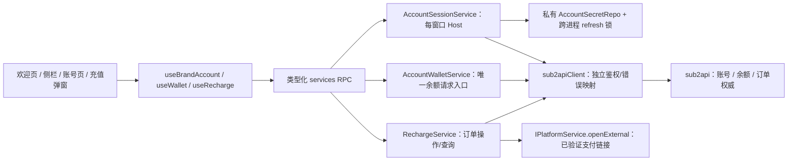
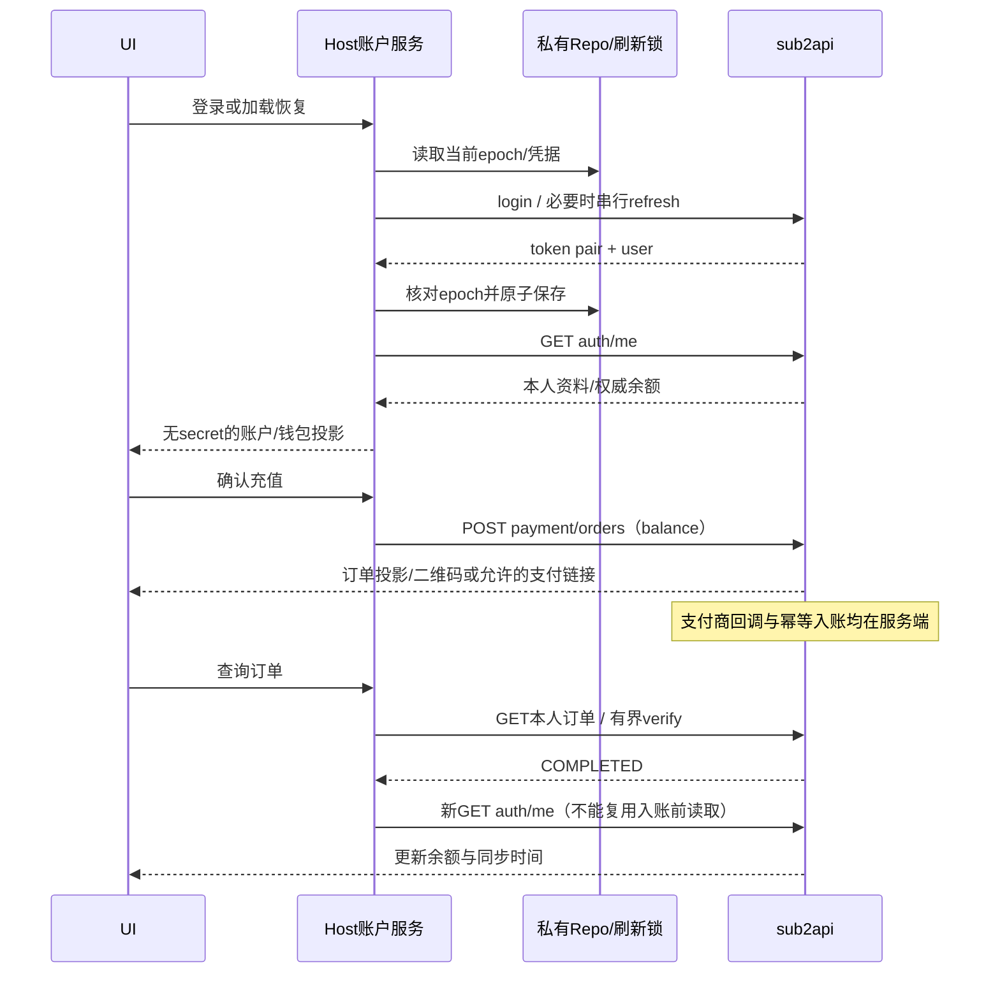
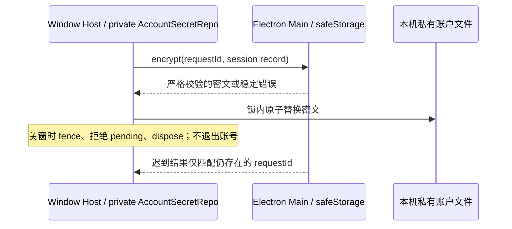

# 自有账号、余额与充值：第一阶段设计

状态：设计草案，2026-11-11；源码基线 `a9fe401eede6e6e5e01be9048679c206fe6f02d9`。用户已明确“余额归 sub2api、客户端每次加载同步、余额旁可手动同步、在 ZCode 发起充值”。其余推荐规则在本文明确标为方案，不代表已实现。本次只读复核 sub2api 为 `main@d5555fb24e207250958965bfd227009870c8d5f0`（不同于初始审计05的旧基线）。当前没有接入真实账号、创建订单或修改 sub2api。

相关材料：[接入总方案](05-sub2api-integration.md)、[影响与验收](10-account-wallet-impact-and-cases.md)、[可点击原型](prototypes/account-wallet.html)。原型只使用示例数据，不联网、不登录、不支付，不能用于验证后端联调。

进展与后续：W1/W2实际实现见 [11](11-account-wallet-implementation.md)，W3方案见 [12](12-managed-agent-inference-design.md)，已完成接口在正式开放前需补的后端能力见 [13](13-account-wallet-production-gaps.md)。12是下一片设计，尚未替换本规格当前固定推理门禁。

## 1. 本阶段交付边界

先完成一个独立闭环：**自有账号登录 → 看见本人资料与权威余额 → 在客户端选金额、发起支付 → 等待服务端到账 → 同步余额**。

账号不是 Z.ai/BigModel 账号，余额不是 Coding Plan 用量条。新增独立账户/钱包服务，复用现有窗口、服务 RPC、设置布局、弹窗和按钮；不改 Agent 引擎，不删除多供应商、Bots、插件或远程代码。品牌模式替换官方账号入口和相应请求生产者，原实现保留。默认每个品牌数据目录只有一个当前登录账号，所有窗口共用；不做窗口 A/B 分别登录不同用户。

本阶段不依赖 `desktop/bootstrap`。登录、资料、余额、充值均有现成接口；自动领取推理 Key 与模型配置作为下一切片，见第 9 节。不得以“已登录/有余额”宣称 Agent 已具推理凭据。账号密码修改、邀请奖励、订阅商城、完整退款申请、设备管理不在首切片；仍可显示服务端返回的退款等历史订单状态。

## 2. 用户看到的界面

### 2.1 欢迎与登录

保留现有欢迎页外壳与 Windows 窗口控制。默认标题“登录，开始使用”，表单为邮箱、密码、登录；有二次验证时在同一流程继续填写动态验证码，不让普通用户选择供应商或填写 API Key。

登录方式依据 sub2api 的公开配置展示；注册/忘记密码首版通过系统浏览器进入自有账户网站，返回客户端后登录。需要 Turnstile 等网页验证时不能绕过安全策略；先验证可信嵌入方案与部署域允许列表，无法承载则将浏览器一次性授权交换前移（是后端缺口，不把网页登录 JWT 拼到 URL）。无后端浏览器授权合同时不能假装网站登录会自动登录桌面。

登录成功取得资料后立即同步余额；余额尚未返回时显示“同步中…”，不填 `0.00`。网络失败保留重试入口。首次没有快照时显示 `—`；有旧快照时标为“上次余额 · 待同步”。

### 2.2 侧栏底部：长期可见

```text
┌──────────────────────────┐
│ [头像] 用户名             │  点击资料 → 账号与余额
│ 可用余额  ¥128.60   ⟳     │  ⟳ 仅同步余额，不打开充值
│ [充值]       刚刚更新      │
└──────────────────────────┘
```

金额与币种为示意，实际随服务端配置。主内容区不增加每条消息的余额提示。余额刷新按钮独立于头像/菜单触发器，避免嵌套按钮与误点。

推荐：普通状态箭头静止，hover/键盘焦点提示“同步余额”；请求中才旋转并禁用重复点击，accessible name 为“正在同步余额”，状态区 `aria-live=polite`。成功更新数字和时间，金额不变也显示新的同步时间。失败停止旋转，显示“同步失败，点击重试”，旧值旁持续保留“待同步”，不能只用几秒后消失的 toast。首次恢复登录前不向旁观者闪现上一账号金额。

### 2.3 设置新增“账号与余额”

复用现有设置资源布局，新增独立 section，避免塞入“模型供应商”。

| 区域     | 首版内容                                      | 行为                                                                   |
| -------- | --------------------------------------------- | ---------------------------------------------------------------------- |
| 账号资料 | 头像首字母、用户名（有则显示）、邮箱、用户 ID | 只读，来自本人 `/auth/me`；不假定后端有头像 URL                        |
| 余额卡   | 可用余额、旁边 ⟳、同步时间、充值按钮          | 与侧栏订阅同一钱包快照与 loading/error                                 |
| 冻结说明 | 服务端冻结余额大于零才展示                    | 独立行说明“冻结金额暂不可用”；可用余额不得重复减去冻结额               |
| 记录     | 充值记录，显示时间、实付、到账额度、状态      | 列表来自本人订单；付款币种与账户展示币种分别标注；不把实付等同余额增量 |
| 账户操作 | 退出登录                                      | 所有窗口退出；本地文件、历史成果继续保留，不自动清除                   |

消费明细可在下一步接已有 `/usage`；不要将现有本地 token 统计、余额差或估算成本改名为“实际扣款”。本阶段也不承诺每个任务严格汇总全部辅助请求。

### 2.4 客户端内充值

侧栏、账号页和未来余额不足提示共用一个 `RechargeDialog`，只改变入口来源，不分别维护金额/订单逻辑。

1. 打开即重新同步余额，读取充值配置、方式、限额。按钮显示可用渠道的服务端名称；没有可用渠道显示“暂时无法充值”及帮助。预设金额是可配置推荐项，必须通过当前渠道范围检查；可支持自定义金额。
2. 选择金额/方式后显示“实付金额、预计到账、手续费/赠送（若有）”。未下单前明确是预计值；客户端不写死汇率、折扣、赠送规则。不在后台默认下单。
3. 用户点击“确认充值”才创建 `order_type=balance` 订单，禁用连点。订单返回后以服务端的实际金额、币种、到期时间替换预计值；与确认信息有实质差异时先提示并再次确认是否打开支付。
4. 返回 `qr_code` 时在客户端展示二维码；返回已验证 HTTPS `pay_url` 时提供“打开支付页面”，通过 `IPlatformService.openExternal` 打开系统浏览器。客户端保留等待页面。首版支持哪些渠道取决于实际部署和桌面返回形态；不能把 Stripe `client_secret`、微信 OAuth/JSAPI 或 Airwallex intent 当成普通 URL。
5. 等待页显示订单号、金额、有效期、状态、“我已支付，查询结果”。此按钮只触发查询，不能把订单置为已支付。系统浏览器返回/关闭不等于成功。
6. `PAID/RECHARGING` 显示“支付已确认，正在入账”；只有服务端 `COMPLETED` 才显示“充值已到账”，再请求 `/auth/me`。余额读取失败时分开显示“充值已到账，余额待同步”，提供 ⟳；不把到账失败与同步失败混为一谈。

弹窗关闭只关闭界面，不默认取消订单；账号页保留待处理订单入口，重开重新查询本人订单。可提供显式“取消订单”，调用现有接口并以返回状态为准，支付与取消竞态必须再查状态。客户端重启后能从 `/orders/my` 恢复，不能只依赖 Renderer 内存或二维码缓存。

## 3. 余额同步合同

**权威性：** sub2api 唯一记账；客户端快照是展示缓存。不能先加充值金额、减 token 估算、根据余额前后差推导消费，或把断网当零余额。余额可同时被网站、其他设备、其他工具改变。

“每次加载同步”定义为发生下列语义事件就发起新的服务器读取；不是每次 React render：

| 事件                                 | 必须行为                       | 合并边界                                                       |
| ------------------------------------ | ------------------------------ | -------------------------------------------------------------- |
| 登录成功、App 冷启动恢复、新窗口加载 | 确认当前账号后读取资料/余额    | 同窗口同一账号正在进行的读可共享；缓存不能跳过读取             |
| 进入账号页、打开充值弹窗             | 每次进入都同步                 | 同一时刻两个入口可共用进行中请求                               |
| 点击任一 ⟳                           | 主动服务器读取，绕过客户端缓存 | 已旋转时合并，不重复创建 HTTP 请求                             |
| 窗口重新获得焦点、断网后恢复         | 对当前账号发起同步             | 将同一恢复事件合并，不能产生持续 focus 请求环                  |
| 订单 `COMPLETED`                     | 触发完成事件之后的新余额读     | 不能复用完成之前已发出的余额请求；必要时排队再读一次           |
| 后续 Agent 一轮结束/收到余额不足     | 触发余额刷新                   | 高频结束事件可批合一次；等待用量落账时不宣称任务精确消费已结算 |

2026-11-13 落地补充：执行结束来源为 CLI 原 turn finally，反馈原冻结 billingBinding；Host 私有账户服务按当前身份与授权核对后 200ms 批合。余额与最近 Agent 用量都必须在事件后重新读取：若已有旧请求，先使旧结果失效，再排队一次尾随新读；新事件发生在尾随读取中时仍需再排队。换号/退出丢弃未执行的旧事件，失败保留旧金额/用量并标陈旧。余额读取失败不能阻止独立 usage 读取。不得从 token、工具步骤或每次模型调用创建轮询循环。

没有必要一直轮询余额。订单等待可以轮询，余额在上述事件中同步即可。快照记录 `accountId + accountEpoch + requestGeneration + fetchedAt + billingSettingsVersion`；显示“更新于 HH:mm”，仅表示客户端读取时间，不冒充服务端账本提交时间。

状态为 `unknown → syncing → fresh`，失败转 `stale`（有旧值）或 `unavailable`（无旧值）。401 属于登录恢复，不是普通余额失败。轮转刷新成功后重试一次安全 GET；确认 refresh 过期/撤销才转“登录已过期”。断网/超时不清空有效登录材料、不无限重试。

同 Host：单一 `AccountWalletService` 是请求入口，组件只订阅投影。每次读取携带 generation/epoch，旧账号、旧请求的响应不能覆盖新状态；强制刷新事件发生于在途读之后时，排队一次后续读。切换任务/工作区不会切换账户钱包。

跨 Host：每窗口独立服务实例，不能把内存 Promise 当应用单例。共用私有账户存储和跨进程 refresh 临界区；余额失效通知携带账号/epoch，其他窗口重新读取，不能广播携带密钥的会话。首版不声称多窗口余额具有服务端 revision 的严格线性一致性；各窗口展示自身读取时间，恢复焦点会再同步。具体跨窗提交顺序见影响与验收文档。

## 4. 金额与接口映射

以下是当前源码接口；不是新增 API。部署 URL 与公开客户端配置属于发行配置，普通用户不填写 Base URL。

| 能力              | 已有接口                                                                  | 本阶段使用方式/证据                                                                                                           |
| ----------------- | ------------------------------------------------------------------------- | ----------------------------------------------------------------------------------------------------------------------------- |
| 安全/计费公开配置 | `GET /api/v1/settings/public`                                             | 启动读取安全与币种策略，`../sub2api/backend/internal/handler/setting_handler.go:38`；计费字段见 `handler/dto/settings.go:433` |
| 登录/2FA          | `POST /api/v1/auth/login`、`/auth/login/2fa`                              | 现有邮箱登录与两阶段验证；`../sub2api/backend/internal/handler/auth_handler.go:239`、`:301`                                   |
| 刷新/退出         | `POST /api/v1/auth/refresh`、`/auth/logout`                               | refresh token 轮转；`../sub2api/backend/internal/handler/auth_handler.go:685`、`:724`                                         |
| 本人/余额         | `GET /api/v1/auth/me`                                                     | 单次读提供资料和余额，`../sub2api/backend/internal/handler/dto/types.go:12`；不单开本地余额库                                 |
| 充值开关/可见方式 | `GET /api/v1/payment/config`、`/payment/checkout-info`                    | 充值开关、方式名称、可用额、费率与活动；`../sub2api/backend/internal/server/routes/payment.go:40`                             |
| 创建充值订单      | `POST /api/v1/payment/orders`                                             | JWT，本人余额充值；`../sub2api/backend/internal/service/payment_service.go:90`；具体返回形态不能仅看前端类型                  |
| 查询/主动查支付   | `GET /api/v1/payment/orders/:id`、`POST /api/v1/payment/orders/verify`    | verify 使用 `out_trade_no`，不能拿数字 id 替代；`../sub2api/frontend/src/api/payment.ts:55`                                   |
| 本人历史/取消     | `GET /api/v1/payment/orders/my`、`POST /api/v1/payment/orders/:id/cancel` | 重启恢复与显式取消；`../sub2api/frontend/src/api/payment.ts:43`、`:61`                                                        |
| 实际消费（后续）  | `GET /api/v1/usage`、`/usage/stats`                                       | 按真实计费记录展示，独立于本地 usage 面板                                                                                     |

重要合同约束：

- HTTP外层为 `{code,message,data}`，错误含 HTTP status 与 reason/metadata。`/auth/login` 的 HTTP 200 也可能是 `requires_2fa` challenge；`/auth/refresh` 不返回 user，必须再读 me。当前登录存在 access-only 兼容分支；缺 refresh 时不宣称长期保持登录，到期要求重登（`../sub2api/backend/internal/handler/auth_handler.go:77`、`:118`）。稳定使用 Host UA，不把 pair 在系统浏览器/WebView/Node间复用，避免现网IP/UA会话绑定策略误撤销。
- `/payment/config` 的实际开关是 **`enabled`**，不是前端类型中的 `payment_enabled`；`checkout-info` 没有完整config开关。`limits.methods` 的实际字段是币种、展示名、费率、daily_limit/single_min/single_max，**没有**前端类型宣称的 daily_remaining/available。不要据前端声明伪造可用状态或个人剩余额度，调用失败/限流以服务端为准（`../sub2api/backend/internal/service/payment_config_service.go:53`、`:133`）。
- 第一切片统一采用服务端 `balance` 的 USD 等价可用余额投影，与当前 sub2api 网页跨 legacy/shadow/credits 的行为一致，再按公共配置换算展示（`../sub2api/frontend/src/components/layout/AppHeader.vue:290`、`utils/billingCurrency.ts:84`）。不能直接加人民币符号，也不按 engine 做两套 UI。`balance_credits` 是整数账本字段，源码 `../sub2api/backend/internal/service/billing_currency.go:22` 固定 `1 USD = 100,000,000 credits`；不能把它与充值倍率/支付币种混为一谈。
- `balance` 已是可用余额，`frozen_balance` 独立展示；总额（若以后需要）为两者相加，不重复相减，参见 `../sub2api/frontend/src/components/layout/AppHeader.vue:290`。
- 账本整数/金额运算用十进制安全方式；超过 JavaScript 安全整数且 JSON 已损失精度时，不能靠转 BigInt 补救。联调检查安全范围，必要时后端补十进制字符串字段；未核定字段或币种时显示“余额待确认”，不猜人民币。
- 支付币种 `currency` 与账户展示币种可能不同；`pay_amount`、`amount`、`bonus_amount` 意义不同。以实际 Go handler DTO 为准：`../sub2api/backend/internal/handler/payment_handler.go:630` 的用户订单响应当前**没有**前端类型声明中的 `credited_credits` 等快照字段，客户端不得依赖这些不存在的字段。
- 余额订单请求 `amount` 是所选渠道币种的支付基数；服务端用 `balance_recharge_multiplier` 计算 USD 等价到账基数，再应用赠送/折扣。订单响应 `amount` 是 USD 等价到账总额，已包含 `bonus_amount`，`pay_amount` 是渠道币种实付且含手续费（`../sub2api/backend/internal/service/payment_recharge_bonus.go:262`、`../sub2api/backend/internal/payment/fee.go:11`）。展示汇率 `billing_usd_to_cny` 不能拿来替代充值倍率，也不能把赠送再加一遍。
- 充值完成后仍以 `/auth/me` 同步结果展示；订单到账展示可沿用已验证的 USD 等价 `amount` 及其单位。历史订单若缺结算展示汇率快照，不按今天汇率伪造当时人民币到账值。
- 创建订单响应定义在 `../sub2api/backend/internal/service/payment_service.go:90`；`oauth_required` 可能在真正创建订单之前返回，不能假设总有有效 order ID。`return_url` 只允许同站点或浏览器origin的 HTTP(S) `/payment/result`，不能填品牌scheme或随意localhost回调，传入query也会被清理（`payment_resume_service.go:235`）。首片不依赖深链完成，用恢复焦点/订单查询更新。

## 5. 服务结构、状态与安全边界



| 事实                               | 唯一权威                             | 本地允许保存/展示                                                  |
| ---------------------------------- | ------------------------------------ | ------------------------------------------------------------------ |
| 账号、可用余额、冻结余额、订单状态 | sub2api                              | 带账号范围与读取时间的投影；失败明确陈旧                           |
| 登录材料                           | 私有 repo；Host 账户服务是唯一写入口 | Renderer 不接收 access/refresh token，不存 localStorage、不传 CLI  |
| 登录挑战/邮箱密码草稿              | 登录 UI 暂存；Host 发送              | 不落盘，不写 RPC 参数日志；challenge 限时失效                      |
| 登录 epoch、凭据版本               | 共享私有账户存储                     | 换号/退出递增；所有迟到响应按版本丢弃                              |
| 待付订单索引                       | sub2api 本人列表                     | 可本地存按账号隔离的 order ID；不保存二维码/支付 secret 为长期材料 |
| 充值金额选择/弹窗步进              | Renderer 局部状态                    | 不当成余额/订单已支付事实                                          |

已有 `ICredentialService` 提供 Renderer 可调用的 load/save/delete，不能把登录 token 换个 key 名塞进去就声称私有；证据 `packages/services/src/credential/credential.ts:11`。新的私有 repo 不进入该 RPC。正式分发前落地 OS 保护（macOS/Windows）、窄可信 Host 加解密端口；Electron Main 只做原生桥，不保存账户/余额业务状态。凭据存储失败不能对 UI 返回“保持登录成功”。

refresh 锁覆盖“重读版本 → 网络换证 → 原子保存 token pair”，而不只覆盖文件写入。所有窗口同一账号 refresh 只消费一次旧 token。最小单锁方案中，退出也拿同一锁、递增 epoch、清材料并通知窗口，迟到响应不能复活账号；HTTP deadline 与锁等待上限必须协调，退出在有界等待期间显示“正在退出”。不能沿用默认 8 秒文件锁等待、再发更长网络请求，并在锁超时后绕锁换证。若需要退出立即落盘，后续实现用短 store CAS 锁加长 refresh 锁，先写 epoch tombstone，返回后 CAS 失败即丢弃；两方案不可混写。刷新超时可能已在服务器轮转，保留诊断状态、允许重新登录，不无界重放旧 refresh。

跨窗广播仅是失效提示：接收方重读私有 repo，再按自己的序列读取余额，不信任广播中的账号/金额。服务注册只暴露白名单 facade，不把带私有方法的 class 整个挂 RPC；TS interface 本身不是运行时方法访问白名单。现有 RPC 不自动打印方法参数，但错误 message/stack/detail 可能被透传；新客户端在窄边界统一转换为安全错误码/状态/requestId，禁止原始响应、token、密码、cause/details 进入错误与日志。



所有 authenticated HTTP 请求经 sub2apiClient，统一 origin、schema、超时、脱敏和错误映射；账户/余额读取禁用客户端 HTTP 缓存，不缓存敏感响应到网页存储。不复用 ZCode JWT/Project Token，也不把 sub2api JWT 注入旧 CodingPlan webview。refresh 属于登录材料；未来推理 Key 单独存管。

## 6. 异常与恢复

| 情况                     | 用户看到                             | 技术规则                                                                                                         |
| ------------------------ | ------------------------------------ | ---------------------------------------------------------------------------------------------------------------- |
| 断网/读取超时            | 上次余额 + 待同步，或 `—`；可重试    | 不置零、不自动退出、不伪造新更新时间                                                                             |
| 确认登录过期             | “登录已过期，请重新登录”             | 单次自动刷新失败且已确认不可恢复才退出；保护账号 epoch                                                           |
| 余额为零/不足            | 正常显示服务器金额，突出充值         | 客户端零余额不是网关最终授权规则，不能据未知/旧值永久拦截                                                        |
| 支付方式暂不可用         | 说明+其他当前可用方式/帮助           | 无可用方式不默认切官方商城                                                                                       |
| 创建订单超时             | “订单结果待确认，查询我的订单”       | 不自动重复 POST，已有接口无客户端幂等合同；先列本人订单并确认，再允许新建                                        |
| 下单后不能展示该支付形态 | 说明暂不支持本渠道，保留订单查询     | 无 `pay_url` 时不拼 URL；优先提供经验证渠道，不让用户安装 CLI                                                    |
| 已付但未到账             | “支付已确认，正在入账”               | 查询已有订单，不能引导再次付同金额解决                                                                           |
| 订单过期/失败/取消       | 展示服务端状态及查询/帮助            | FAILED可能是已付款但履约失败，不能统一说未付款；迟到回调仍需查服务端最新状态。未付订单才允许用户明确重新选择支付 |
| 到账后余额同步失败       | “已到账，余额待同步” + ⟳             | 不 `cachedBalance += amount`                                                                                     |
| 退出/换账号              | 所有窗口清账户投影，新登录展示新账号 | 不清本地成果；不得把旧订单/余额响应带到新账号                                                                    |
| 支付时退出               | 订单仍在服务端，本地停止查           | 重登录本人后从本人订单恢复，不跨账号显示                                                                         |

推荐轮询策略为可配置的 `3s → 5s → 10s` 有界退避，遵守 Retry-After、限流及服务器到期时间；前台订单等待才短轮询。关闭弹窗后停止快轮询，恢复焦点/打开账号再查；过期或暂时查不到不等于永远不可能到账。点击“我已支付”调用受限 verify，不能与后台并行刷支付商。所有具体间隔是工程参数，不是用超时推断入账正确性。

## 7. 最小改动模块

以下新文件名为设计候选，需 implementation 时 architecture context 核定；现有文件是真实引用。先采用品牌模式装配，不批量改名整个仓库。

| 层                            | 改动                                                                                | 为什么                                                                                                                                                                                |
| ----------------------------- | ----------------------------------------------------------------------------------- | ------------------------------------------------------------------------------------------------------------------------------------------------------------------------------------- |
| services contracts / Host装配 | 新 `brand-account/`、`wallet/`、`recharge/` 契约与实现；私有 repo + `sub2apiClient` | 隔离自有业务协议、唯一写入口、token 不进 UI；在 `packages/desktop/src/host/index.ts:4201` 本机专属注册段装配安全 facade，或 `node.ts` 按 authority 门控；不得无条件注册到所有远程服务 |
| desktop Host / Main窄端口     | 绑定共享账号存储、跨窗口通知/锁、OS 加密能力                                        | Host 是 window scoped；不能每窗独立消费同一 refresh。参考 `desktopWindowLifecycle.ts:145` 与 `host/index.ts:3880`                                                                     |
| shared schema / RPC           | 无 secret 的 user/wallet/order DTO、严格输入与状态校验                              | 不把后端原始 token/支付商 secret 放通用 Renderer event；方法参数/结果脱敏                                                                                                             |
| UI hooks/store                | `useBrandAccount`、`useWallet`、`useRecharge` 与同一账户投影                        | UI 不直连 Repo/后端；侧栏和设置共享读取                                                                                                                                               |
| WelcomeScreen / Root          | 接入品牌登录、替换 provider-family 登录守卫                                         | `packages/ui/src/WelcomeScreen.tsx:36`、`:336` 与 `packages/ui/src/root/useProviderAvailabilityLoginEntryGuard.ts:57`；只换按钮会被旧 guard 拉回                                      |
| SidebarFooter / Settings      | 品牌资料、余额+⟳、充值入口、新账户 section                                          | `WorkspaceSidebarFooter.tsx:133`、`:433`；被项目侧栏与设置共用。保留其他页不裁功能                                                                                                    |
| Root装配 / 旧支付挂载         | 品牌模式不挂官方套餐拉取 Provider；接新 RechargeDialog                              | `Root.tsx:176` 与 `settings/CodingPlanUpgradeDialogProvider.tsx:35`；隐藏按钮仍会产生官方后台请求                                                                                     |

不将 `WorkspaceSidebarFooterUsageSummary`、`StartPlanBalanceCard` 的套餐/令牌桶 DTO 转成钱包；旧 webview 有官方 origin 校验、凭据注入和专用完成 IPC，不能只换成 sub2api 网址。

账号 UI 始终读取本机 baseServices，不随 workspace/source service 切换；不把新的账号服务加入远程 Host RPC 合同或手机 allowlist。Host 销毁先 fence/abort，再释放监听器与传输；关窗口不等于退出。品牌门禁应分别表示 `accountAuthenticated` 与后续 `inferenceReady`；W1允许登录后访问本地界面，但未接W3时不走官方Provider偷偷执行。

## 8. 实施顺序与完成标准

| 切片              | 具体结果                                                                           | 依赖/验收                                                                                   |
| ----------------- | ---------------------------------------------------------------------------------- | ------------------------------------------------------------------------------------------- |
| W1：账号+只读钱包 | 自有登录、2FA、恢复、本人资料；侧栏/设置同源余额与⟳                                | 先维护文档与场景，后 services/装配/UI；通过 AW01–AW10；不等待充值联调或模型 bootstrap       |
| W2：充值闭环      | 金额/渠道→一次下单→二维码/允许链接→查订单→COMPLETED→同步余额；历史恢复             | W1、测试环境渠道与履约模拟；AW11–AW17，禁止真实付款验收                                     |
| W3：自动模型接入  | 登录后领 Agent 独立凭据，所有主/辅助模型走 sub2api；多轮工具任务成功且后端实际扣款 | 按05/06新增 bootstrap 与受管认证路径；账户登录态和 runtime ready 独立，缺该环节不会伪装可用 |
| W4：账单细化      | 本人实际消费列表、父子任务归属等                                                   | 复用usage；任务严格聚合缺口单独补合同，避免扩大W1/W2                                        |

W1/W2 可以不修改 sub2api。以下情况才需要后端小增量：浏览器授权交换（现网验证无法桌面承载）、可靠下单幂等 key、权威充值预报价、历史到账币种快照、超安全整数的字符串字段；设备/Agent bootstrap 属于 W3。当前源码“已有接口”不等于线上部署已经启用，联调前核验。

## 9. 待联调输入与验证记录

| 输入/待确认                        | 建议与影响                                                       |
| ---------------------------------- | ---------------------------------------------------------------- |
| 真实服务 origin / 可信支付域       | 使用自有 HTTPS，发行配置固定；联调必须填，设计不以示例地址代替   |
| 当前登录方式/验证码/2FA/会话绑定   | 保持服务端安全策略；如需浏览器交换则调整W1路径                   |
| engine、币种、汇率、充值渠道与限额 | 由线上公共配置验证；原型人民币只是示例，不承诺人民币余额等于实付 |
| 产品最终品牌与注册/帮助链接        | 先不批量替换全仓商标；本阶段按“品牌模式”边界开发                 |

2026-11-11：固定基线新鲜检查 `--no-fetch` 通过，仅针对缓存 origin/main；三线源码复核完成。本文与原型不修改运行时代码，不代表真实账户/支付链路已验收。类型/Lint与原型浏览器验证的实际结果记录在配套影响文档末尾。

## 10. 桌面安全存储桥合同（实施冻结）

发行默认控制面为 `https://milorouter.com`。只有未打包的开发进程可显式设置 `MILOROUTER_ACCOUNT_BASE_URL` 为 loopback origin（`http`/`https`，`localhost`、`127.0.0.1` 或 `[::1]`，不带路径、凭据、查询或 hash）；Main 忽略其他值及生产包的环境覆盖，并经 `init-local` 下发地址，普通用户不填写地址。品牌账号 RPC 仅在桌面本机 base attachment opt-in；Source、手机与通用 Credential RPC 不获得私有 token 或解密能力。

Main 只执行 Electron `safeStorage` 加解密，不拥有登录刷新、钱包或订单状态。可信 window Host 经现有 utility-process 私有消息通道请求 `{type: brand-account-cipher-request, requestId: UUID, operation: encrypt|decrypt, value}`；请求与结果均使用严格 schema、有界字符串。Main 只回复原 child，成功为 `{type: brand-account-cipher-result, requestId, result: {ok: true, value}}`，失败只返回稳定的 `secure_storage_unavailable` / `secure_storage_failed` 代码，不带原始异常或明文。操作系统加密不可用时拒绝保存或恢复；没有明文、共享密钥或环境变量 fallback。Renderer 不注册任何对应 IPC、服务方法或平台能力。

Host 持有请求关联表及有界 deadline，销毁先 fence，再拒绝 pending、释放账号订阅；迟到结果无法恢复已销毁服务。每窗口账号服务共用同一个本机私有文件与 refresh 锁，但不是全应用内存单例；关窗口只 dispose，不 logout。密码和 token 不进入 RPC 错误的 message/cause/details 或日志。

私有会话文件由 Main 按当前 Electron `userData/brand-account/session.json` 下发，不复用公开 Credential RPC 的文件。此规则由 [28号修复合同](28-installed-login-and-startup-fixes.md) 更新：最初共用 `getAppConfigDir()/brand-account/session.json` 会混入其他运行身份的不可读密文，旧文件保留但不再读取。开发验收同时隔离 `ZCODE_DATA_BASE_DIR` 与 Electron user/session data，不能读取真实用户会话。



## 11. W1/W2实现状态

2026-11-11：本轮已实施原生账号/钱包/充值与订单适配，详见 [11实施记录](11-account-wallet-implementation.md) 与10的实施矩阵；上文早期调查记录保留历史时点。具体代码集中为 `packages/services/src/brand-account/` 和 `packages/ui/src/brand-account/` 两个受管模块，Main/Host私有加密桥、本机服务装配及旧官方账号生产者的可逆品牌门控。三种服务职责合并为一个窄facade，私有repo/HTTP/密钥不暴露给UI。

订单预单不复制费用/优惠算法，改为输入支付渠道基础金额，下单结果显示服务器权威支付/充值额度；特殊支付形态明确未适配。W1/W2版本通过UI及Host阻止推理，W3凭据/bootstrap待下一片。完整分页、消费明细和跨平台安装包验收未在本轮完成，不以原型或本机fixture替代。

## 12. 账户与用量界面收口

2026-11-13，按25号方案实施。侧栏正常状态为身份、余额两行；余额刷新和充值保持独立动作，成功更新时间移入提示，失败保留短提示，不常驻模型就绪状态。设置页合并身份与钱包概览，下方提供账户消费记录、充值记录页签；页签只控制展示，继续复用现有服务端消费快照、本人订单列表及充值弹窗，不产生第二份账本或支付路径。原本地使用统计保留并以名称区分。

布局浏览器验收使用真实组件及合成账户，覆盖390px/桌面、中英文、Zai浅深主题、键盘切换页签、刷新与充值动作、失败余额保留、换号后旧订单隔离。设置未登录时使用23规定的嵌入登录外壳。此次不扩展完整订单分页，也不以fixture替代真实支付及原生包验收。

钱包的“重新登录”与推理恢复使用同一账号设置入口：成功退出后写入 account 设置意图并打开设置页。允许浏览本地内容时也必须一次点击到达登录入口，不能依赖 Root 自动返回全页登录；退出失败仍显示原账号的安全错误，不假定已经退出。
