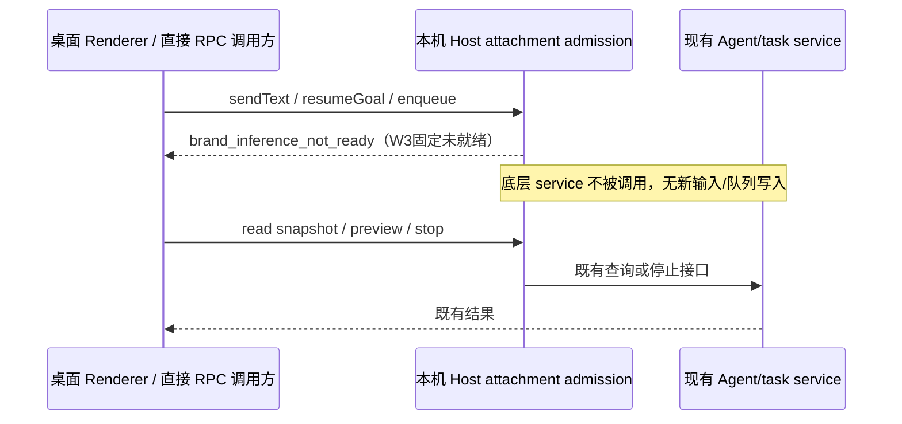

# 桌面账号与钱包实施记录

后续W3更新：本文件保留W1/W2阶段的固定推理门禁及当时验证记录；现行受管推理规则改由[14实施合同](14-managed-agent-inference-spec.md)和[16实施交接](16-managed-agent-implementation.md)维护。已连接仅开放纳管的本机执行；未连接、旧账户队列及未纳管后台入口仍拒绝。W1/W2的账号/余额/支付事实不被该变更替换。

2026-11-11。实施基线：ZCode `main@a9fe401eede6e6e5e01be9048679c206fe6f02d9`，sub2api只读 `main@d5555fb24e207250958965bfd227009870c8d5f0`；开始时已有未跟踪 `docs/fork/`，未重置工作区。行为合同见 [09](09-account-wallet-spec.md)，接受的场景见 [10](10-account-wallet-impact-and-cases.md)。本记录随实现更新；未运行的场景不得标为通过。

## 本次冻结范围

- 桌面本机 base attachment 显式装配 `brandAccount`，独立于官方 OAuth、套餐、远程 workspace 和 Agent 凭据。
- 控制面默认 `https://milorouter.com`；仅开发版允许 `MILOROUTER_ACCOUNT_BASE_URL` 指向 loopback 假服务。不向用户暴露 Base URL 设置。
- 登录、两阶段验证、刷新、本人资料、余额、充值配置、渠道、本人订单及验证/取消均复用 sub2api 现有 API；sub2api 不改动。
- 用户余额只取 `/auth/me.balance`。不复制记账、优惠和充值换算算法：下单前提示输入所选渠道币种的基础金额，具体实付和到账以创建订单结果为准，再由用户明确打开支付页面或扫码。
- 订单账户充值额度和其中赠送均明确显示服务端 USD 等价数，支付金额显示订单自身币种；历史订单不按当前公开汇率冒充当时的人民币到账快照。实时钱包余额仍按当前公开配置展示币种。
- 初始支付展示支持 HTTPS 支付链接及二维码。Stripe/Airwallex SDK、微信 OAuth/JSAPI 返回明确暂不支持，保留服务端订单记录。原站支付页面需要同浏览器的恢复快照，不能只拼 URL 或注入账号 JWT 来复用。
- 操作系统加密不可用则登录存储失败；不降级为明文。关窗口不退出，退出不删本地任务/成果。
- W3 推理凭据及实际扣款接线另行实现；W1/W2 登录成功不代表 Agent 已自动获得推理权限。
- 装配 `brandAccountService` 的 W1/W2 版本禁止新发、续发和排队提交 Agent 任务；UI 禁用发送并解释模型接入尚未完成，Host admission 同时拒绝绕过界面的运行命令。不能使用本机残留官方 provider 静默执行。历史查询、本地文件与成果预览保持可用；未来 W3 必须显式更新此合同才能开放。

## 当前站点只读核验

公开设置返回 `site_name=MiloRouter`、`billing_display_currency=USD`、`billing_engine=credits`、`payment_enabled=false`，登录验证码开关均为 false。此为核验时状态，客户端每次加载仍读取服务端设置。没有执行生产账号登录、订单创建或支付。

## 验收入口与证据计划

新增候选用例位于 `packages/desktop/test/e2e/brand-account/manual-review/pending/`，使用已有独立 node:test + Playwright Electron 入口惯例，与 WDIO/provider replay 分开；不加入 CI 或人工审核通过目录。运行命令：

```sh
pnpm --filter @zcode/desktop exec tsx --test test/e2e/brand-account/manual-review/pending/brand-account-wallet.test.ts
```

前置为当前源码 desktop tsup 构建与 renderer dev server（默认 localhost:5174）。测试在独立 data/home/Electron 目录启动真正桌面窗口，使用本机可控 HTTP sub2api fixture，不连接生产账号或支付商。断网、延迟、401、订单履约由 fixture 控制，不能通过改 UI store 伪造通过。

| 用例组        | setup → action → assertion                                                    | 初始状态                 |
| ------------- | ----------------------------------------------------------------------------- | ------------------------ |
| AW01/02/04/05 | 本机 API → 原生登录/加载/手动同步 → 真实请求与权威余额、同步时间、冻结额      | 待运行                   |
| AW03/06/07    | 轮转刷新/恢复/请求失败 → 重新加载/点击刷新 → 一次轮转、持久登录、旧值待同步   | 待运行                   |
| AW11–15       | 读取渠道 → 一次创建订单/查询状态 → PENDING/PAID 不加余额，COMPLETED 后新读 me | 待运行                   |
| AW16/17       | 关闭弹窗/重启 → 查询本人历史订单 → 恢复状态、充值关闭尊重后端                 | 待运行                   |
| AW09/10/18/19 | 退出/换号/迟到响应/双 Host → 新 epoch 生效 → 不泄露旧账号与 token             | 待运行；需要独立时序证据 |

正式覆盖以实际测试断言及产物为准，上表不代表所有 AW 场景已完整覆盖。待用户人工审阅后再决定 promotion，不自动声称产品验收完成。

## 实现与验证结果

本机 macOS arm64、Node 24.14.0、桌面开发构建。2026-11-11 完成以下验证；未发布安装包。

| 检查                                         | 结果与证据                                                                                                                                                                                                                                               |
| -------------------------------------------- | -------------------------------------------------------------------------------------------------------------------------------------------------------------------------------------------------------------------------------------------------------- |
| 原生 Electron 界面验收                       | 通过。`brand-account-wallet.test.ts` 跑真实 Main → Host → RPC → UI 和本机 HTTP fixture；一条连续流程含12组断言。证据 `packages/desktop/.e2e-artifacts/brand-account-1794376962458/result.json` 及01–04截图。                                             |
| 账户 runtime / 并发                          | 9/9 通过，两个独立子 Host、真实 HTTP/加密文件、自动文件失效、2FA、轮转/超时/429、换号迟到响应、COMPLETED 后新读。`packages/desktop/.e2e-artifacts/brand-account-runtime-2026-11-11/runtime.tap`。测试 cipher 是 fixture 注入，原生 OS 加密由上一行覆盖。 |
| Host 推理 admission                          | 5/5 场景、85次请求断言通过，见同目录 `admission.tap`。                                                                                                                                                                                                   |
| `pnpm typecheck`                             | 通过，退出0；包含新增 pending E2E。                                                                                                                                                                                                                      |
| `pnpm --filter @zcode/desktop typecheck:e2e` | 通过，退出0。                                                                                                                                                                                                                                            |
| 改动源码格式检查 / diff                      | `oxfmt --check`匹配49文件通过；`git diff --check`通过。                                                                                                                                                                                                  |
| `pnpm lint`                                  | 退出0，84条既有警告、0 errors；不是零警告。                                                                                                                                                                                                              |
| 架构检查                                     | `pnpm architecture:check --changed` 通过，0 violations、0 baseline、0 new。仅新模块受管，不把此门禁当全仓所有边界证明。                                                                                                                                  |
| 隐私证据                                     | 原生会话文件含 OS 密文、不含 token/password 哨兵；Renderer local/session storage、URL及桌面日志没有测试秘密哨兵。原生 fixture 网络计数确认仅一次登录/一次创建订单/一次轮转。                                                                             |

原生验收实际覆盖：邮箱密码登录、冻结额不重复相减、手动刷新/读取失败保留旧值、401轮转、二维码、PENDING→PAID→RECHARGING→COMPLETED 后读取与实付不相等的权威余额、关窗重启恢复、本人历史订单、服务端禁用充值、账号资料/退出。重启时公开配置改为 CNY，钱包 4.56 USD 显示30.78 CNY，历史订单充值额度仍显示 USD，冻结展示16.88 CNY。

保留早期失败产物用于排查，不将它们列为通过。早期失败包括干净窗口启动等待时间不足、现有三步职业引导、确认按钮可访问名带快捷键、测试把Vite源码加载误判成业务外呼，以及开发热更新期间重挂Root关闭弹窗；修正前置/定位器并冻结编辑后上述原生流程通过。未为此修改既有引导或延长产品同步时序。

## 当前边界与下一步

- 下一片具体方案见 [12：托管Agent推理](12-managed-agent-inference-design.md)；W1/W2生产化增量见 [13](13-account-wallet-production-gaps.md)。可以先用现有余额验证自动授权/真实工具，不依赖充值开放；两份均为设计，尚未修改本文件所述固定推理门禁或sub2api。
- 正式站当前只读配置为充值关闭。接口已接入，仍需管理员开启相应测试/正式渠道后做授权验收；没有在生产创建订单、支付或调用用户余额。
- 客户端原生支持二维码/HTTPS链接。SDK、OAuth/JSAPI形态、嵌入网页安全挑战尚未适配；出现时明确提示，不注入浏览器凭据、不自动重试建单。
- 历史订单当前展示最近20笔；API已支持分页。完整分页UI、实际消费列表、取消订单按钮留后续；现有订单状态和充值均来自后端。
- Windows 原生安全存储、字体/布局、签名安装包、干净机启动未验证。macOS为开发版运行，不代表签名发行和跨平台验收通过。
- 多窗口 runtime 证明共享会话轮转与自动退出；没有声称已验证真实双原生窗口的所有交互、远程 workspace 往返或所有AW01–AW20组合。
- W3仍待实现：Agent专用凭据/bootstrap与所有主/辅助模型接入sub2api。当前显式禁发推理，保留本地查看与预览。账户/订单之外的上游更新、插件、帮助/遥测并未在本片全部替换。

## W3 未就绪时的本机 RPC admission 合同

W1/W2 的账号登录不授予推理就绪状态。本轮不伪造 bootstrap；当 attachment 为 `desktop-continuous` + `local` 且本机集合注册 `brandAccount` 时，Host 在发布服务频道处统一拒绝产生新推理的 RPC，固定返回 `code=brand_inference_not_ready`、`kind=feature_disabled` 与不含凭据的说明。拒绝发生在代理调用底层 service 之前，不建立新任务、输入或队列项。远端 workspace、source-settings 和手机 attachment 继续使用各自既有合同；不能通过登录状态或已有官方 Provider 推断 W3 已就绪。

门禁覆盖 V4 新会话/发送/编辑重发/重试/目标续跑/队列提升/自动 drain/工作流运行，兼容 task 的 `sendPrompt`、队列提交与提升、Bot 输入/会话投递、压缩和 goal，以及 Agent 的直接推理/辅助文本生成/模型连通测试、插件 sampling、定时任务新建/更新/启用/手动执行和闲时任务新建/续跑/换票。V4 命令使用已审阅的非执行 allowlist，新增命令默认拒绝。停止、取消、暂停、关闭自动 drain、删队列、goal 查看/暂停/清除、停用定时任务、反馈及会话重命名等不触发推理的命令仍可用。

已有会话的读取、订阅、恢复到内存、任务列表、文件/办公预览、导出、账号/余额/订单查询保持可用；`resumeTask`/`resumeSession` 仅恢复历史状态，不代表继续执行，后续输入仍过同一 admission。此门禁属于本机桌面 RPC 边界，不宣称暂停迁移前已运行的任务或 Host 内部自动化调度；后续 W3 接线时应以真实受管推理能力替换本轮固定拒绝，并另行审阅后台执行入口。

验收新增 AW20：直接调用已发布本机 service channel 的 V4 `sendText`、`resumeGoal`、`sendQueuedNow` 及兼容 `sendPrompt`/`enqueueTaskCommand`，均返回固定错误且底层调用计数为零；同 channel 查询和 stop 可达底层。切换为 remote/mobile 或移除品牌服务后，不误施加本机门禁。UI 提示与禁用 composer 作为第二层说明，不能替代 Host admission。

AW20 工程边界验收已持久化为 `packages/desktop/test/e2e/brand-account/manual-review/pending/brand-account-admission.test.ts`；运行 `pnpm --filter @zcode/desktop exec tsx --test --test-reporter=tap test/e2e/brand-account/manual-review/pending/brand-account-admission.test.ts` 通过5种 attachment/品牌组合、85个请求断言，覆盖实际服务发布函数与底层零调用条件。TAP 位于 `packages/desktop/.e2e-artifacts/brand-account-runtime-2026-11-11/admission.tap`。这仅验证 Host RPC 工程边界，不代表原生加密、模型网关或真实任务已验收。Host 定向类型检查和两份改动文件的 Lint 通过；全量门禁由主任务统一记录。



## 本机预览

当前已重启新版开发窗口，默认访问正式控制面，不带fixture override。使用独立 `.zcode-runtime/fork-preview/` 数据，不重置原有用户数据。运行日志显示品牌服务装配成功；随后用户在窗口中手动完成登录（仅确认`brandAccount.login OK`与`refreshBalance OK`，未读取密码、token或真实余额）。代理没有提交生产登录表单、订单或支付。首次使用仍显示仓库原有职业/UI模式/助手偏好引导，完成后进入侧栏和账户页。
