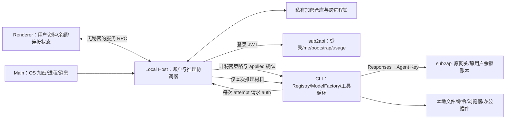
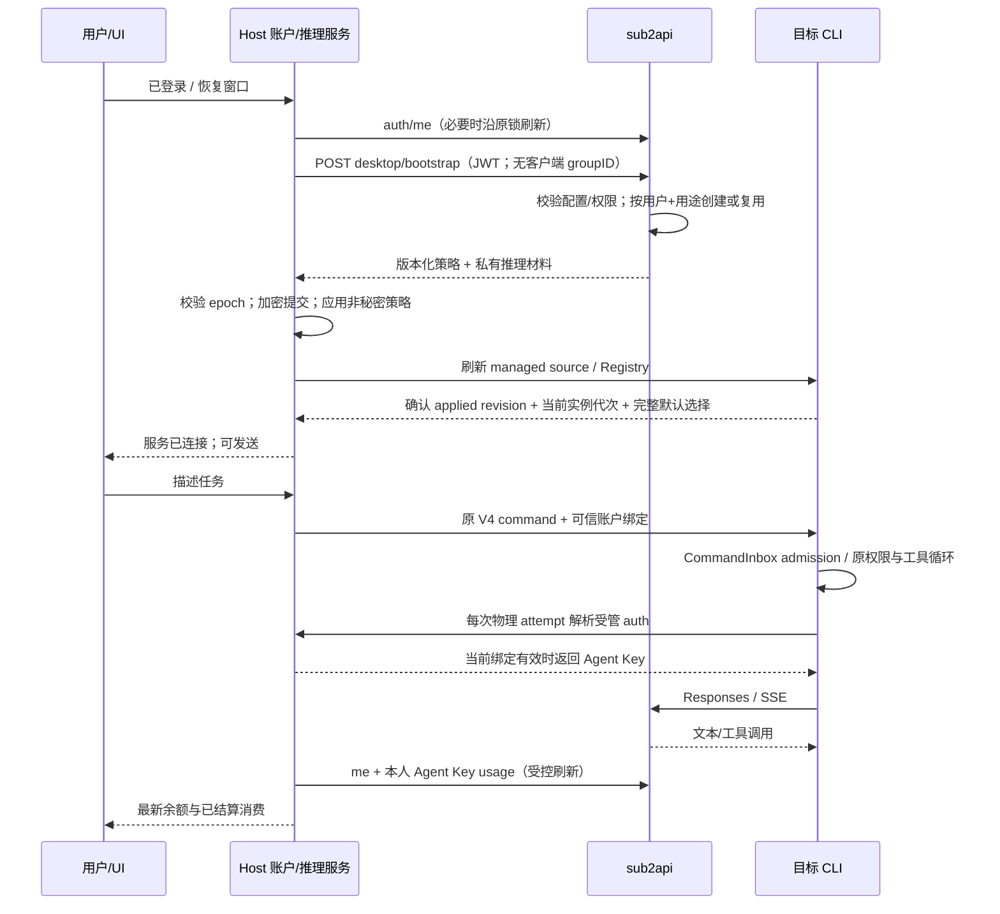

# W3：托管 Agent 凭据、模型接入与实际消费方案

2026-11-11。状态：**本文件保留实施前的设计与检查记录；现行合同以[14](14-managed-agent-inference-spec.md)、运行证据以[15](15-managed-agent-inference-cases.md)及[16实施交接](16-managed-agent-implementation.md)为准。** 用户已确认独立Agent Key、与工作台可共用聚合分组；两个仓库已在`codex/desktop-managed-agent`实施，未部署生产。ZCode起点为`a9fe401eede6e6e5e01be9048679c206fe6f02d9`，保留W1/W2工作区；sub2api起点为`d5555fb24e207250958965bfd227009870c8d5f0`。账号钱包见[11](11-account-wallet-implementation.md)，支付生产化增量见[13](13-account-wallet-production-gaps.md)。

证据口径：**S** 当前源码已实现；**N** 本方案建议新增；**U** 需要构建/运行或线上配置核验。路径从 ZCode 根计算，`../sub2api/` 指相邻后端仓库。源码能力不等于线上部署或发行物已通过验收。本方案细化并优先替代 [05](05-sub2api-integration.md) 的 bootstrap 草案和 [06](06-roadmap-and-first-slice.md) 的 F03/F04；其他功能不在本片裁剪。

后端证据的 `service/`、`handler/`、`repository/`、`server/`、`pkg/` 短写均相对于 `../sub2api/backend/internal/`；`migrations/` 相对于 `../sub2api/backend/`。CLI证据的 `core/`、`adapters/`、`bootstrap/`、`contracts/` 短写均相对于 `apps/zcode-cli/packages/`。

## 1. 推荐决策

1. **可以先用已有余额推进，充值继续由后端保持关闭。** 登录、余额、订单接口不重写；打开推理能力不要求打开充值。
2. **每用户一把独立 Agent 托管 Key，首次启用时创建，以后领取同一把。** 不复用、修改或扩大现有生图 Key 的权限；不让客户端从 `/keys` 选择“第一把 Key”。
3. **推荐小范围二开 sub2api。** 增加 Agent 配置、稳定用途标识和一个桌面 bootstrap 接口，复用原有网关与用户余额记账。首次切片不新增钱包、支付系统或云端 Agent 执行器。
4. **首片使用一个已验证的 Responses 模型。** 主任务和辅助任务先共用这个模型，通过既有调用规则设置完整参数；多档产品套餐、自动廉价模型切换后置。
5. **首片不做每设备 Key。** 退出本机清理登录态/推理材料并停止本机执行，不撤销其他设备共享的用户 Agent Key。单设备远程撤销需要后续设备凭据模型，不能用 installation ID 冒充。
6. **保持 W3 未就绪门禁，直到目标 CLI 确认配置已应用。** 隐藏 Provider 设置不足以防止旧配置或辅助请求绕回官方服务。

上述为推荐实现合同；用户尚未确认的设备管理、模型具体 ID 和运营分组留在第 12 节。本文不把建议场景标为已验收，也不提前修改全局会话规格或特性图的既有语义。

## 2. 现有默认 Key 是什么

Key 本身通常不“装着模型”。实际权限由 **Key → 分组 → 平台/上游账号/模型白名单** 决定，分组还影响计费方式和倍率。`key_type=system` 只表示系统托管，不表示天然只能生图。

如果站上所见的是“生图工作台专用”，它对应以下现有逻辑；本轮没有读取真实账户 Key，不能据此断言线上那条记录的身份。

| S：当前源码                                               | 证据                                                                                                            | 对 Agent 的含义                                                            |
| --------------------------------------------------------- | --------------------------------------------------------------------------------------------------------------- | -------------------------------------------------------------------------- |
| 登录用户可领取生图托管 Key                                | `../sub2api/backend/internal/server/routes/user.go:28`；`handler/image_studio_handler.go:67`                    | 登录 JWT 与模型 Key 已是分开的协议，可借鉴无感领取模式                     |
| 懒创建并复用本人“生图工作台专用”Key，绑定管理员的生图分组 | `service/api_key_service.go:621`、`:632`、`:654`；`handler/image_studio_handler.go:162`                         | 不是每次登录都创建；不能直接拿此接口做 Agent，否则分组会再次被生图逻辑同步 |
| Key 类型只有 user/system；模型白名单在 group              | `service/api_key.go:30`；`server/middleware/group_model_allowlist.go:31`；`service/group_model_allowlist.go:84` | 需要 Agent 独立用途和模型组，不能只将一个开关从图片改成文本                |
| 同用户未删除的 system Key 按 name 唯一                    | `migrations/250_system_api_key_unique.sql:26`；`repository/api_key_repo.go:1121`                                | 允许同用户同时有生图和 Agent 两把 Key；没有“一人只能有一把系统 Key”的限制  |
| system Key 的 name/status/额度等仍可由普通更新入口修改    | `service/api_key_service.go:918`、`:944`、`:969`                                                                | name 不适合作为新 Agent 用途的永久身份，UI 隐藏不能替代服务端保护          |
| 原网关按 Key.UserID 扣本人余额并写 usage                  | `service/gateway_usage_billing.go:323`、`:364`；`repository/usage_billing_repo.go:185`                          | 两把 Key 共用同一账户余额，仍能分别统计生图与 Agent 消费                   |

建议用户界面只显示“Agent 服务已连接”。用户账户里即使存在托管凭据记录，也无需复制、配置、轮换或理解它。系统托管不意味着无法被本机恶意进程读取；桌面 CLI 作为出网进程会短时持有必要的推理 Key。

## 3. 两个仓库各改什么

| 范围               | S：可继续复用                                                             | N：本片新增                                                           | U：联调确认                               |
| ------------------ | ------------------------------------------------------------------------- | --------------------------------------------------------------------- | ----------------------------------------- |
| sub2api 账号/余额  | 登录、2FA、refresh、me、logout；已有 credits 账本                         | 无需为了 W3 改写这些接口                                              | 线上刷新绑定、网关错误与当前部署版本      |
| sub2api Agent 凭据 | Key 生成、用户归属、认证缓存、分组授权、原网关                            | 独立用途字段、幂等领取、保护规则、bootstrap、Agent 配置               | Agent 余额组、可调度上游、模型/能力及参数 |
| sub2api 充值/订单  | 既有建单、履约、订单状态与历史                                            | 见13，正式开放充值前补能力声明/幂等/支付恢复                          | 支付商沙箱；本轮不开放                    |
| sub2api 消费       | `/api/v1/usage`、`/usage/stats` 的本人 Key 过滤                           | 无需新账本；credits字符串投影，跨轮换用途聚合和精确任务汇总另分范围   | 日志落库延迟、历史引擎和快照金额一致性    |
| ZCode 账户         | W1/W2 私有存储、跨 Host 刷新锁、epoch、防迟到、余额同步                   | 向同进程的推理协调器提供受控内部接口                                  | 双平台正式包安全存储                      |
| ZCode 模型         | Provider Registry、ModelFactory、Responses adapter、请求级 auth、工具循环 | managed access/source、Host 私有 resolver、策略与 CLI ready、账户绑定 | 真实 SSE、tool schema、取消/重试与扣费    |
| ZCode UI           | 账户、钱包、⟳、本地文件与成果预览                                         | 服务连接状态、可理解的故障提示、本人 Agent 实际消费                   | 原生 Windows/macOS 连续使用               |

**后台配置与代码开发分开：** 创建一个标准余额计费 Agent 分组、关联文本推理上游、配置白名单/倍率/默认模型是运营配置；新增 bootstrap、用途字段、策略 DTO 和桌面 managed 访问是代码开发。仅配置分组不能让客户端自动安全接入；仅写代码也不能使一个没有推理上游的生图组完成 Agent 任务。

## 4. 所有者、凭据边界与事件顺序

| 状态/事实                    | 唯一权威                            | 本地镜像/提交边界                                                 |
| ---------------------------- | ----------------------------------- | ----------------------------------------------------------------- |
| 用户、可用余额、冻结额、账单 | sub2api                             | Host 读 API；UI 只展示结果和同步时间，不加减余额                  |
| 登录/刷新凭据                | sub2api 签发，Host 品牌账户服务管理 | 延用 W1 私有加密仓库/跨进程锁；不交 Renderer 或 CLI               |
| Agent Key、用途、分组、禁用  | sub2api                             | Host 私有持有；不进入 Personal Provider JSON、公开 RPC 或任务快照 |
| 非秘密模型策略与版本         | sub2api Desktop 配置                | Host 校验并幂等应用；CLI Registry 是实际模型创建时的校验者        |
| 账户代次与本机已登录身份     | Host 账户服务及共享加密记录         | 换号/退出先失效 epoch，再提交新状态；旧异步结果不可恢复旧账户     |
| 被接受输入、队列、活动执行   | CLI CommandInbox/runtime            | Host 路由并注入可信账户绑定；不建第二份 accepted queue            |
| UI 草稿、按钮 loading        | UI 局部状态                         | 不承载凭据或推理授权；保留用户未发送文字                          |

同一设备多 Host 复用账户存储协调；bootstrap 应 single-flight，跨设备的唯一性由数据库保证。不在每个 token/chunk 上访问 bootstrap。推理 Key 有效期若后端未设置，应明确为无固定到期日，不能虚构短期租约。

## 5. sub2api 最小增量合同（N）

### 5.1 用途身份与服务端保护

建议新增可空 `api_keys.purpose VARCHAR(32)` 和唯一索引 `(user_id,purpose) WHERE key_type='system' AND deleted_at IS NULL AND purpose IS NOT NULL`。Agent 固定 `purpose=desktop_agent`；name 只作展示。

- 保留原按 name 的索引和全部生图行，历史行 `purpose=NULL`；本片不批量回填、不迁移生图凭据，也不覆盖用户自建 Key。
- 新建与复用以用途身份为准，数据库冲突后回读同一条；并发组变更也需锁内/条件更新并重读，避免返回旧分组。品牌改名/语言变化不生成新 Key。
- 原name唯一索引仍在，展示名须避免与其他system用途冲突；若冲突后按purpose读不到目标行，应明确失败/按受控规则分配展示名，不能按name误领生图或其他用途Key。
- 普通 `/keys` 修改/删除入口不得变更该用途、分组、Key 内容或绕过托管停用策略。不要机械沿用原 system Update 的宽松字段处理。
- 普通列表/详情对该用途只返回脱敏信息或隐藏原始 Key；当前 `handler/api_key_handler.go:143`、`:177` 和 `handler/dto/types.go:61` 会输出原始 Key，需要用途级保护，保留旧 Key 行为兼容。
- 未删除但 disabled/expired/quota_exhausted 的托管 Key 返回明确不可用原因；不能自动激活或再建一把绕过限制。托管行退出通用删除流程；管理员停用保留记录，明确的重置/轮换流程才可替换，避免软删除后登录又创建而“撤销失效”。
- 分组同步、停用、重置提交后使用既有认证缓存失效和跨实例广播：`service/api_key_auth_cache_invalidate.go:6`、`api_key_auth_cache_impl.go:254`。生图当前同步组的 `api_key_service.go:640` 没有同样失效，**只借鉴其模式，不复制遗漏**；是否单独修复生图列后端维护任务。
- `Quota=0` 仅表示不另设这把 Key 的总额上限，仍受用户余额、组权限、平台额度和限流约束；不能向用户展示成“无限额度”。首片明确绑定标准余额组，拒绝误配订阅组。

建议改点：新增 migration；`service/api_key.go`/`api_key_service.go`；`repository/api_key_repo.go` 的用途查询/创建和映射；Key 用户及管理员通用入口的托管保护；新增独立 Desktop handler/service/routes/settings。代码中的手写 SQL/类型与 ORM schema 应核对一致，按当前仓库迁移惯例实施，避免无关生成代码变动。

### 5.2 `POST /api/v1/desktop/bootstrap`

新增于 JWT 认证路由，`Cache-Control: no-store`。POST 表示可能创建/同步托管凭据。首片一个接口即可，不仿制 ZCode 的官方 `/client/configs`，不让 UI 直接调用它。

| 请求字段                             | 规则                                                        |
| ------------------------------------ | ----------------------------------------------------------- |
| `client_version`、`protocol_version` | 判断本客户端能否理解当前配置；拒绝不支持的合同版本          |
| `platform`                           | win32/darwin；不决定额外账单权限                            |
| `installation_id`（可选）            | 仅诊断/未来迁移，不能代替设备鉴权，不表示每设备 Key         |
| 禁止客户端选择的字段                 | userID、groupID、purpose、倍率、Key、任意网关地址或启用状态 |

响应仍使用 sub2api 原有成功 envelope；下列为**新增字段语义草案**，非当前可调用 API：

| 响应部分                            | 内容及接收者                                                                                                                                                      |
| ----------------------------------- | ----------------------------------------------------------------------------------------------------------------------------------------------------------------- |
| `schema_version`、`config_revision` | 严格 DTO 版本与内容版本；版本相同幂等应用；旧响应不得覆盖新状态                                                                                                   |
| `service_status`、`reason_code`     | ready / disabled / not_configured / forbidden / credential_disabled 等；与账户是否登录分开                                                                        |
| `provider`                          | 稳定品牌 Provider ID、`openai-responses`、受信 HTTPS API base；如 base 是 `/v1`，验收实际落到 `/v1/responses`，不得双拼路径                                       |
| `models[]`                          | 模型 ID、输入模态/工具/流式能力、上下文/输出上限、受支持选项与映射，足以构造当前完整 Registry model；来源为管理员审核的模型策略，不能只照 `/v1/models` 名单猜能力 |
| `selection_policy`                  | 完整新任务默认选择；标题策略；compact/verifier/子 Agent 继承规则。每项只能指向授权集合；原模型不支持 reasoning 时不伪造值                                         |
| `credential`（私有）                | Key ID、purpose、实际 Key、真实存在时的到期信息；**只到 Host**。UI DTO 与持久化模型配置剥离整个秘密字段                                                           |
| `features`                          | Agent 是否可启用、支持的客户端合同；充值是否可用仍读原 payment/config，不在这里复制订单或余额事实                                                                 |

非ready结果不返回推理秘密；HTTP鉴权失败与配置可读但服务不可用分开。origin白名单应编译/配置为产品受信范围，不能仅信响应内容扩大允许目的地址。DTO不包含远端脚本或未受限可执行表达式。

服务顺序：读取当前认证用户 → 校验用户/功能开关 → 校验 Agent 组存在、active、用户允许使用且为余额计费 → 校验模型策略与分组白名单/上游可配置能力 → 原子领取/复用 → 必要变更及认证缓存失效 → 返回当前版本。错配不下发一个“看似 ready”的 Key。

静态配置验证无法证明上游此刻有容量或真实支持工具调用。bootstrap 不能偷偷发付费探测请求；ready 表示客户端已配置可尝试运行，首次真实任务仍可能收到限流/网络/模型错误。

最低后台配置包括：Desktop 开关、Agent 余额组、网关 API base、一个已验证 Responses 模型与完整参数策略、配置版本。初期可以用现有 settings 管理并补最小管理入口；不先建设完整模型运营平台。

## 6. ZCode 最小接线（N）

| 模块                                                                                                            | 具体修改与理由                                                                                                                                                       | S：当前证据                                                                                                 |
| --------------------------------------------------------------------------------------------------------------- | -------------------------------------------------------------------------------------------------------------------------------------------------------------------- | ----------------------------------------------------------------------------------------------------------- |
| `packages/services/src/brand-account/` + 新推理协调模块                                                         | 复用登录/refresh；新增内部受控授权端口。推理材料作为独立用途记录加密保存，由同一账户/epoch 锁协调原子提交；公开 snapshot 只新增连接状态。禁用/换号立即使推理状态无效 | `secretRepo.ts:134`；`service.ts:76`、`:153`、`:451`                                                        |
| `packages/provider/src/config/{provider-config,provider-data-schema,schema}.ts`、`resolver.ts`                  | 新 access 分支，建议 `managed` + manager/ref，严格 schema/序列化中无 Key；普通 api-key 与官方 account 分支兼容保留                                                   | 静态 Key 字段 `provider-config.ts:36`；序列化 `resolver.ts:39`                                              |
| `packages/provider-node/`、`services/src/model-provider/`                                                       | 独立、非秘密的 managed source/overlay，按稳定 ID 和版本幂等应用，独立于 Personal 设置；普通品牌模式实际执行只允许该授权集合                                          | 现有 Personal 原子写 `personal-provider-config-repository.ts:69`；当前 account overlay 仅支持官方账户，详02 |
| `packages/shared/src/zcode-protocol/index.ts`、CLI contracts                                                    | 扩展明确的 managed auth 请求与校验，绑定 provider/ref、账户和目标运行实例；CLI 只能调用私有反向端口，Renderer 没有读取 Key 方法                                      | 现有 RPC schema `:2845`；`contracts/src/model/invocation-context.ts:87`                                     |
| `services/src/zcode-agent/zcodeAgentService.ts`                                                                 | 既有反向请求分派新增 Host 私有 resolver；检查可信 workspace/root route、账户绑定、版本/epoch和取消信号；不走原官方验证码/套餐链                                      | `:1722`                                                                                                     |
| CLI `bootstrap/src/app/provider-registry-model-runtime.ts`、`core/src/runtime/methods/model-runtime-headers.ts` | 模型创建和每个物理 attempt 都要求受管授权；缓存收到配置与 Registry 已应用是两件事，新增可验证 applied 状态                                                           | `provider-registry-model-runtime.ts:43`；现有逐请求端口见02                                                 |
| CLI `adapters/src/model/{runner,model-execution}.ts`                                                            | `managed` 不能走普通静态 api-key 的跳过分支；动态 Key 绑定本次请求、清掉静态认证头，复用 Responses/SSE/工具循环                                                      | `runner.ts:190`、`:214`；`model-execution.ts:425`                                                           |
| Host admission + UI Composer/SessionPane                                                                        | 将现有固定 `brand_inference_not_ready` 门禁改为可信 ready/账户绑定检查；ready 前不提交，不能先放开 UI 再异步填模型                                                   | `packages/desktop/src/host/windowHostAttachmentRpcPolicy.ts:111`；现有W1/W2门禁见11                         |
| `packages/shared/src/zcode-protocol-v4/input-intent.ts` + CLI admission/runtime                                 | 冻结非秘密计费账户绑定，贯穿 queue/guide/子代理/辅助调用；避免换号后旧任务扣新账户                                                                                   | 既有 intent `:66`，固定选择 `:79`；`contracts/src/interfaces/session.port.ts:405`                           |

首片建议用单独 managed source，而非将秘密写入 Personal 或改造官方 `zhipu-account`。这需要正式实现前的 architecture context/check；当前只画清边界，不假定仓库已有第三类 source。禁止将 `replacePersonalConfig` 当作 bootstrap 全量覆盖器。

### 就绪状态与版本

`signed_out → provisioning → applying → ready`；失败分别为 `needs_login / unavailable / configuration_error / credential_blocked`。余额、支付配置、网络状态是独立事实，不能混成一个 loggedIn 布尔值。

ready 必须同时满足：当前 accountRef/epoch有效、秘密材料有效、策略严格校验通过、目标 CLI 的实例代次与 applied revision匹配、完整选择可执行。Host配置已落盘或 `receivedRevision` 回执不代表 CLI Registry 应用完成（特性图 `capability.model-selection` 已有此警示）。更换 CLI/Host、账户、策略失效时重新过门禁，不用固定超时模拟同步成功。

策略刷新触发：登录恢复、目标 CLI 新实例、窗口重新加载、服务端明确策略失效、用户“重新连接”。余额⟳继续只同步余额；不把刷新余额变成每次重新创建 Key。新增可执行命令与每次请求校验当前策略；配置更新不原地替换已冻结 Active Model。旧模型被撤权则暂停并提示，下一次新运行再用新策略。

## 7. 换号、队列与辅助请求

### 7.1 账户绑定和退出

建议 Host 注入可信 `billingBinding={origin, accountRef, accountEpoch, policyRevision}`，CLI admission 将其与已有完整 `ConversationInputIntent` 一起冻结；accountRef为账户作用域标识，不是 Key，也不是新的鉴权凭证。它必须由 Host 从已认证身份确定，不能接受 Renderer 自报。

- 每个 run 捕获绑定；每次模型 attempt 对照当前 Host。子 Agent、title sidecar、compact、goal verifier 和延迟 memory 都继承原工作绑定，不能在运行结束后重新读“当前账号”来收费。
- 退出先阻断本机新授权/新 admission，并通过现有 runtime stop/cancel 路径停止正在执行的托管工作，清本机登录与推理材料；已完成文件不删除。在途远端请求与已经执行的工具副作用不能承诺瞬间撤销或回滚。
- 已 accepted 队列仍归 CLI；退出/换号后禁止自动出队收费。账户 A 的未完成输入不自动改扣 B。默认保留历史只读，提示使用原账户继续；不静默重写 intent/modelSelection，也不清空用户队列。
- 同账户重新登录 epoch 变化后，必须显式恢复，产生针对原账户的本次执行授权；原 admission 事实保留。旧数据无绑定时禁止后台自启动；用户明确开始新的托管 turn/迁移授权后才可推理。首片可先提供“新建任务继续”，跨账户接管旧队列后置。
- 新增落盘字段应由 CLI 原持久化 owner写入、nullable兼容；若涉及表结构，沿原加法 migration与 fixture 校验，不让 Host 写 CLI SQLite。沿用 workspaceIdentity 与 owner/lease，不按相同磁盘路径合并任务。
- 本机退出不撤服务器每用户共享 Key；“停用全部设备 Agent Key”是独立管理动作。现有 `/auth/logout` 仅撤当前 refresh（`../sub2api/backend/internal/handler/auth_handler.go:724`），不等于撤 API Key 或全部已发 access token。

### 7.2 辅助调用策略

| 调用                                    | 首片策略与不可破坏的语义                                                                                             | S：入口，均为CLI相对路径                                                                 |
| --------------------------------------- | -------------------------------------------------------------------------------------------------------------------- | ---------------------------------------------------------------------------------------- |
| 主任务                                  | 完整默认 managed selection；Responses 真实工具调用                                                                   | `core/src/runtime/methods/runtime-model.ts:24`                                           |
| 标题/目标标题                           | 授权的同一模型；可使用经模型验证的低成本参数，仍属于原工作账户；无网关时使用现有文本降级能力或明确缺省标题，不换厂商 | `core/src/runtime/methods/title-generation-sidecar.ts:29`、`:177`                        |
| 手动/自动/reactive compact              | 延用提交或触发 Active Model；不引入强制廉价模型而破坏已冻结选择                                                      | `core/src/runtime/methods/compact-active.ts:195`、`:432`                                 |
| goal verifier                           | 延用原模型和原推理选择；账户/余额失败不能误判任务通过                                                                | `core/src/runtime/methods/target-completion-verification.ts:102`、`:329`                 |
| 子 Agent/workflow                       | 隐式继承父；显式 pin 必须在授权集合，失效明确报错；根路由与子会话归因不能混淆                                        | `core/src/subagent/profile.ts:24`；`workflow-actor-model.ts:157`，完整路径见02           |
| Git 信息/工作区文本、Search/Fetch后处理 | 创建工作时绑定当前账户；无任务归属的请求显示“其他 Agent 消费”                                                        | `core/src/runtime/methods/workspace-generate-text.ts:104`、`:213`；调用来源见02          |
| Memory extraction/dream                 | 开启时同一授权；未启用的后台功能继续关闭，不为接入顺手启用                                                           | `core/src/runtime/helpers/project-memory-extraction.ts:33`；`project-memory-dream.ts:55` |
| 插件模型采样/其他独立模型入口           | 必须逐个验证进入受管模型工厂/逐请求鉴权；未纳管的采样入口不对普通模式开放                                            | 按02和实际插件消费路径补录运行证据，不能以主任务通过代替                                 |

Registry 候选过滤与最终 ModelFactory/请求 gate 都要执行策略。仅改默认模型、隐藏设置或清一个 title override 都不足以覆盖 Personal 残留、项目配置、workflow pins和重试。所有允许的模型 API base 受 Host 固定 origin策略限制，bootstrap 返回任意域名不得直接放行。

## 8. 余额、实际消费与失败恢复

沿用“加载即同步、⟳手动同步、失败保留旧值并标待同步”。W3 增加任务结束/恢复后的受控同步，合并并发请求，不按流式 token 高频读钱包。余额缓存只用于展示和提示，是否允许扣费最终由网关判断；不能因旧的零余额永远阻止重新查询，也不能因旧的正余额承诺任务可完成。

| 情形             | 用户体验                                                                 | 技术处理建议                                                                                                                                        |
| ---------------- | ------------------------------------------------------------------------ | --------------------------------------------------------------------------------------------------------------------------------------------------- |
| 充值关闭但有余额 | 正常使用 Agent；充值入口显示尚未开放                                     | 原 payment/config开关继续权威；不绕过它创建订单                                                                                                     |
| 余额不足         | 保留进度/文件/草稿，暂停收费调用；同步余额；充值关闭时说明暂不可在线充值 | 网关当前可回 `403 INSUFFICIENT_BALANCE`（`server/middleware/api_key_auth.go:272`）；其他计费失败可能为 `billing_error`，不能把所有403都显示余额不足 |
| 登录过期         | 尝试现有一次串行刷新；失败则重新登录，同账户明确继续                     | W1锁与epoch保留；不将登录JWT发到模型端点                                                                                                            |
| Key失效/停用     | 显示连接失效或服务停用；保留成果                                         | 区分 `INVALID_API_KEY`/`API_KEY_DISABLED`/过期；可做一次受控重新领取核验，disabled不偷偷建新Key                                                     |
| 限流/容量不足    | 显示稍后重试与取消；使用已有受限重试预算                                 | 识别HTTP/SSE错误及Retry-After；`handler/gateway_handler.go:2496`；不重建Key、不自动升价换模型                                                       |
| 断网/流式中断    | 保留任务与工具结果；给出重试/继续入口                                    | 不重放已经执行的工具副作用；沿既有commandId/query与runtime恢复，不宣称任何副作用恰好一次                                                            |
| 模型/配置不匹配  | 显示服务配置需要修复，可看已有文件                                       | 失效policy、刷新一次后仍不兼容则阻止；不fallback到官方Provider                                                                                      |

首片增加 Host 的本人当前 Agent Key 分页用量接口，复用 `/api/v1/usage?api_key_id=...`；Key ID来自当前bootstrap，后端已有所有权检查（`handler/usage_handler.go:70`）。页面显示“Agent近期消费（当前连接）”，说明范围从此凭据启用至查询时间；包含该用户其他设备使用同一Agent Key的记录，**不能称为本设备、本任务或跨轮换的全部Agent消费**。轮换后首片不假装旧记录被包含；要展示完整历史，应由后端按本人+purpose关联所有历史Key（含已撤销/软删除），绝不能用当前KeyID代替。

单笔credits引擎记录使用 `charge_credits` 与对应的 `credits_per_usd`、`billing_currency`、历史汇率/版本快照；`actual_cost`为USD等价值。字段已有 `handler/dto/types.go:634`。当前int64字段以JSON number返回，普通 `JSON.parse` 可能损失精度；推荐对现有用量DTO加兼容的十进制字符串字段（如 `charge_credits_string/credits_per_usd_string`），Host/Renderer以字符串传递、精确换算。替代方案是Host从原始响应无损解析，不能先parse成Number再转BigInt补救。UI不直接对int64做浮点金额计算。

现有stats只提供 `total_actual_cost` 等USD浮点报告值（`pkg/usagestats/usage_log_types.go:293`），没有按历史快照求和的credits总额。首片可读并明确展示服务器USD等价报告，不能称其为精确credits总账；精确汇总应由后端完成、返回字符串及清晰币种范围。legacy引擎可能实际收费但 `charge_credits=0`（`service/gateway_usage_billing.go:300`），此类记录按 `actual_cost` USD显示并注明原始计费口径，不能当作免费。不按余额差、不用客户端tokens乘单价生成“实际扣费”；日志尚未可读时显示等待结算，不展示为零。

精确任务账单后做：已有 `usage_logs.session_id`、headers解析和DTO（`service/session_id.go:35`；`dto/types.go:675`），但本人筛选结构没有session/task/run维度（`pkg/usagestats/usage_log_types.go:271`）。先校对现有 `runner-attribution.ts` 的主/子会话ID归一化，保留既有语义；补opaque root-task/run关联和本人过滤/聚合时，覆盖标题/压缩/子任务/重试。不要直接把子session头全部改成父ID而抹掉现有归因。

## 9. 功能影响简表

本次为 `planning`：影响层包括 option-source、draft-default、validation、commit-effect、persistence、recovery，presentation仅展示投影。采用现有功能边界规划技能，因无可用codegraph查询工具，以已声明种子+定向rg/调用链核对代替；**没有执行codegraph或声称完整静态调用图证明**。深度为语义一跳、关键调用链约两层，执行器细节不展开重构。

| 等级           | 入口/场景                   | 展示/草稿与默认来源              | 校验与提交                         | 权威/隔离边界                                           |
| -------------- | --------------------------- | -------------------------------- | ---------------------------------- | ------------------------------------------------------- |
| must-inspect   | 登录/账户/服务状态          | UI账号投影；backend policy默认   | brand account→推理协调器→bootstrap | Host账户/私有库；不与官方OAuth状态共用                  |
| must-inspect   | 新任务Composer              | UI草稿；目标Host给完整默认       | Host就绪检查→V4→CommandInbox       | CLI接受事实；每workspace隔离，Base Host不可替代远端授权 |
| must-inspect   | 历史SessionPane/queue/guide | 历史selection与原intent          | 原模型验证+原账户绑定；明确resume  | CLI存储/runtime；不被新默认或新账号覆盖                 |
| must-inspect   | Provider设置/模型候选       | 品牌只读策略；高级Personal仍保留 | Registry+factory+attempt限制       | managed source独立；隐藏入口不承担权限                  |
| should-inspect | 标题/compact/goal/子Agent   | 继承或显式pin；各自状态独立      | 共用受管model factory/auth         | 原run绑定；子session与根路由分离                        |
| should-inspect | 余额⟳/实际消费              | Host权威读取结果                 | me/usage读请求，不改本地余额       | sub2api账本；非token估算                                |
| conditional    | Git文本/Memory/插件采样     | 调用创建时捕获选择与账户         | 同一gate；未纳管入口不启用         | 不伪装成当前主turn费用                                  |
| invariant-only | Web/手机/SSH/WSL/Bots/定时  | 既有模式合同                     | 不因本机Key自动获得模型权限        | 本片仅desktop本地；不扩散私有服务                       |
| evidence-only  | W1/W2 pending E2E/fixture   | 既有测试与产物                   | 只证明账号/钱包与固定拒绝门禁      | 不当作W3或Windows/生产扣费通过                          |

共用的是模型工厂、底层Registry与请求级授权；不同的是新任务默认、历史选择、手动压缩选择、子任务pin和workspace文本工作，不能为了统一账单合并这些状态写者。持久化sink分别是品牌秘密库、非秘密配置source、CLI会话库和后端账本；不存在一份通用store统管它们。

图谱drift候选：现有 `capability.model-capabilities/model-selection` 只覆盖官方account/Personal语义；W1品牌账户与W3受管access没有完整专属节点。本轮在此提出新增 `capability.brand-managed-inference`、account/inference owner、bootstrap、managed source、Composer readiness、per-attempt auth及可信binding边；W3语义确认后再更新 `.agents/skills/feature-boundary-planner/references/zcode-feature-graph.yaml` 并执行完整性/种子检查，不能把设计伪装成现有实现。

## 10. 最小交付顺序与验收

| 步骤                   | 产出/改动范围                                                               | 依赖                              | 验收证据                                                                   | 主要风险                                    |
| ---------------------- | --------------------------------------------------------------------------- | --------------------------------- | -------------------------------------------------------------------------- | ------------------------------------------- |
| M0 冻结合同/配置       | 确定后台Agent余额组、模型/参数、bootstrapDTO、账户绑定；补正式spec和case    | 本方案review；不用支付开关        | 角色/字段/错误表；配置验证；无真实Key入文档                                | 上游模型只列出而不支持tools                 |
| M1 后端bootstrap       | purpose迁移/保护、Desktop settings/service/handler、认证缓存失效            | M0，独立后端开发分支              | 两个并发请求同一Key；跨用户隔离；生图Key/id/group不变；禁用不可绕过        | 并发创建、组授权、缓存/管理员删除语义       |
| M2 桌面托管接线        | managed schema/source、私有auth resolver、applied ready、可信binding        | M1合同；先本机fixture             | 真Main→Host→CLI，秘密哨兵不在Renderer/JSON/argv；登录成功但未applied仍拒绝 | 漏掉静态Key跳过分支、迟到结果、残留Provider |
| M3 一次真实工具闭环    | 登录后描述“创建指定文本文件并读回”，工具至少两步；原权限/取消保留           | M1/M2部署到授权测试环境；现有余额 | 文件读写+完整协议/模型请求；sub2api本人Agent Key usage和余额对账           | SSE/schema不兼容；失败后重复工具副作用      |
| M4 辅助/恢复及实际消费 | 标题、compact、子Agent、goal/其他已启用入口；会话恢复、换号队列；实际用量UI | M3；mock故障注入                  | 每入口网关记录；无官方模型外呼；A队列不扣B；断网/401/429/余额不足          | 侧车延迟使用新账号；billing日志延迟         |
| M5 网站与办公任务      | 网站生成预览；Excel修改、PPT生成预览导出；以后Word/PDF                      | M4 + 原04工具依赖验收             | 文件重开与内容/版式验证；双平台正式包运行                                  | 自带Agent不代表Python/字体/LO/Git齐备       |
| P 充值开放（独立）     | 13中的建单幂等、渠道能力/恢复、必要登录挑战                                 | 支付渠道可开放时；不阻塞M1–M4     | 支付商沙箱回调、COMPLETED后权威余额、可继续任务                            | 支付URL/SDK差异、重复建单                   |

**最值得先做：M0–M3，证明“现有账号登录 → 自动领取独立Agent凭据 → 一个受管Responses模型 → 真工具写文件并读回 → 同一余额实际扣款”。** 不先做复杂模型选项、不先改办公执行器，也不等充值开放。

## 11. 候选验收与剪枝（尚未执行）

高风险维度为：账户有效/换号/refresh、策略有效/applied/CLI换代、输入新发/已accepted/恢复、请求主/侧车/子Agent、网络/余额/Key状态、证据UI/协议/文件/后端。以下为提议场景（`proposed/planned`），review并冻结spec后再转accepted；不是新增测试或已通过记录。

| ID   | setup → action                                                           | 必须断言与非UI证据                                                                                            | 目标状态 |
| ---- | ------------------------------------------------------------------------ | ------------------------------------------------------------------------------------------------------------- | -------- |
| MI01 | 有生图Key，无AgentKey；同用户并发bootstrap两次                           | 只有一条desktop用途行；两次相同ID；生图Key/id/group均未改；响应no-store                                       | planned  |
| MI02 | 不同用户或用户无Agent组权限；请求bootstrap                               | JWT决定归属；无权不建Key/不泄露他人配置秘密；原网关组权限仍生效                                               | planned  |
| MI03 | 托管Key disabled/expired；重复登录/领取                                  | 明确不可用；不新建、不恢复active；禁用缓存传播在多实例验收                                                    | planned  |
| MI04 | 登录成功；延迟CLI应用/应用错误/换CLI代次                                 | UI与Host均拒绝执行；applied当前版本后才允许；不靠sleep放行                                                    | planned  |
| MI05 | 已有余额且payment关闭；新任务工具写文件并读回                            | 不要求用户填Key；真实文件正确；使用Agent Key/同一UserID；原权限有效                                           | planned  |
| MI06 | title/compact/goal/子Agent及其他已启用辅助入口                           | 每个入口分别触发并记录所有模型外呼；只访问授权origin/model；无官方兜底                                        | planned  |
| MI07 | A运行/有accepted队列；换B；旧bootstrap/sidecar迟到                       | 旧epoch结果丢弃；B不为A工作扣费；CLI保留原queue/binding；无Host第二queue                                      | planned  |
| MI08 | 同账号重登/重启；历史选择不可用或缺绑定                                  | 原历史和文件可读；无自动收费；显式新运行授权或新任务继续；原intent不重写                                      | planned  |
| MI09 | 两Host同时刷新、bootstrap与退出竞争                                      | refresh只消费一次；不会恢复已退出账户；秘密与ready均不串号                                                    | planned  |
| MI10 | Key401/余额不足/429/断网/中途流错误                                      | 分类提示、保留成果、有限重试、不重建Key/换厂商；已执行工具不重复提交                                          | planned  |
| MI11 | 检查Renderer、公共RPC、Personal/managed配置、argv、快照、日志            | 登录/refresh只在Host私有域；推理Key只在加密库和请求所需内存；仓库与包无共享Key                                | planned  |
| MI12 | 多轮/并发消费、usage延迟、Key轮换、legacy正费用及超过JS安全整数的credits | 当前连接范围清楚；旧Key不冒充已计入；int64不丢精度；legacy不误当免费；不以余额差冒充任务费用；待结算不显示为0 | planned  |
| MI13 | 两设备同一用户；退出一台；管理端停用                                     | 本机停止新收费但另台不因普通退出失效；明确管理停用才跨设备拒绝；在途边界单独记录                              | planned  |
| MI14 | 替换managed endpoint/Personal残留/项目显式pin到官方模型                  | 最终factory/auth拒绝非授权请求；仅隐藏设置不能作为断言                                                        | planned  |

剪枝：不对所有办公格式×每种认证错误做全排列（共享认证gate，MI10代表）；手机/远端本片不获本机凭据（MI11及拒绝路径，已有模式不合并）；首片不验证每设备撤销（没有该语义，MI13只验证共享Key）；充值成功路径交13且当前关闭。精确任务总账、多模型产品策略、跨账户接管队列标记后续/undefined，不能用测试倒推产品决策。

实施交接：先更新09的W3正式spec、会话case catalog及coverage matrix的链接/场景状态，再用 `e2e-case-lifecycle` 维护pending E2E；CLI/schema/adapter按各包真实入口做回归，不新增App业务单测。受控HTTP/SSE fixture负责时序、401/429/断流和secret哨兵，真实工具写独立临时目录；后端需数据库并发/缓存证据。先fixture后授权真实小任务；验收产物脱敏，不记录真实Key、文件隐私或余额。正式门禁包括 `pnpm typecheck`、`pnpm lint`、架构检查及目标CLI/E2E入口；本轮文档设计不计为这些代码验证的重新通过。

## 12. 实施前所需信息与当前未知

| 项目                   | 推荐/所需输入                                                                              | 对推进的影响                                                  |
| ---------------------- | ------------------------------------------------------------------------------------------ | ------------------------------------------------------------- |
| 推理分组与上游         | 后台确定一个标准余额组，具有可用Responses文本模型；可以复用合适的现有推理组，不复用生图Key | 代码合同/fixture可以先做；真实M3前必须配置，不需要用户给Key   |
| 首个模型与参数         | 从站上已接入且支持工具的模型中选一个；明确context/output/reasoning策略，不凭名称猜         | 不阻塞方案；真实调用前需确认运营配置                          |
| 每用户或每设备         | 推荐先每用户独立Agent用途；以后若需设备管理再升级                                          | 要求单设备远程撤销时必须前移设备schema/轮换，本方案不声称具备 |
| 正式发布范围           | macOS/Windows均需正式包实际验收，当前只有W1/W2的macOS开发证据                              | 不应以本机fixture宣称双平台发行就绪                           |
| 网关错误/SSE与计费延迟 | 当前源码有多种error envelope与异步日志；需受控和真实链路验证                               | 尤其影响暂停/重试、余额不足识别及消费展示                     |

本轮只维护方案文档，未修改sub2api、运行代码或现有用户数据；未建Key、发起消费、支付、部署或发布。W3仍未接通，当前固定推理门禁保持原状态。

## 13. 本轮检查记录

- `check-workspace-freshness.mjs --no-fetch` 通过，仅相对缓存origin/main，未据此宣称远端最新。
- 当前保留W1/W2改动的工作区执行 `pnpm typecheck` 通过；`pnpm lint` 退出0，84条既有warning、0 errors。这不证明尚未实现的W3行为。
- 两份新方案格式检查、`git diff --check` 通过；本次所改8份文档的46个本地链接及新方案27处完整源码路径/行号检查通过；短写引用另按源码追踪核对。
- sub2api HEAD仍为上述基线，`git status --short` 为空。未新增/运行W3测试，未实际验证生产推理、支付和Windows原生包。
