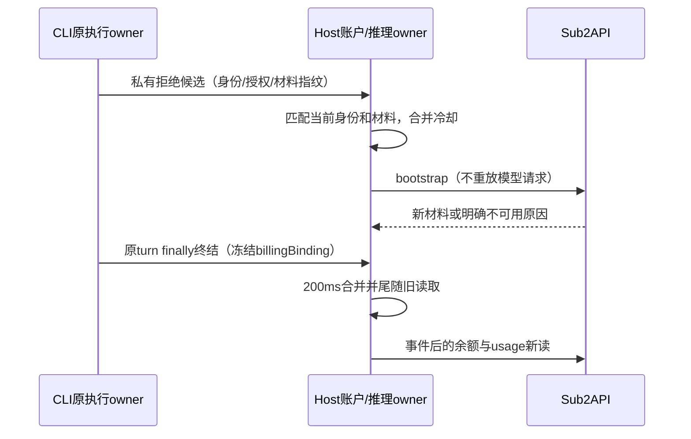
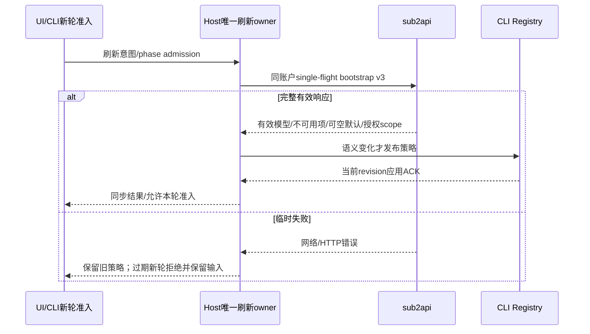
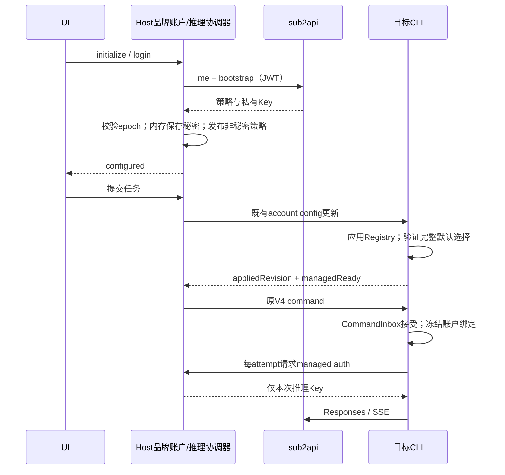

# W3 实施合同：托管推理与本地工具闭环

## 2026-11-13：明确恢复原因与执行后同步

- bootstrap 的已知不可用原因保留为固定安全错误：服务停用/未配置、账号无权、分组不可用/无权、凭据停用/过期/配额耗尽、配置无效；未知原因维持通用不可用。停用不能被重新登录恢复，重置凭据不续期、不补配额。
- 复用 `ProviderRuntimeHeadersPort` 增加私有 `reportManagedOutcome` 事件端口。CLI 到本机 Host 的严格 `interaction/managedInferenceOutcome` 通知不进入 Renderer、持久会话事件、手机重放或日志。鉴权/余额拒绝只携带既有 managedAccess、实际使用 Key 的 SHA-256 指纹及枚举种类，不携带 Key、错误正文或认证头。
- HTTP 错误码只产生候选，不能证明错误由本机网关产生。Host 校验当前本地 client/workspace、账号 epoch、完整授权 scope、credentialRef 和当前材料指纹后，合并一次强制 bootstrap；仅 bootstrap 裁定凭据是否更新或明确不可用，失败不清登录、不据上游 401 判停用、不自动重放模型请求。同一材料候选做有界冷却，旧身份/旧材料迟到反馈丢弃。
- 执行终结复用 core turn 的既有 finally，携带执行开始前冻结的 billingBinding；成功、失败和取消都只触发权威余额及用量同步，不改变已接受任务。Host 200ms 合并密集终结/余额不足事件，已有余额及 usage 在途请求均须尾随事件后新读；不在 token、工具或每个模型步骤刷新。新读仍受账号/授权隔离；不伪造已结算或客户端扣费。
- 私有登录仓库读取成功即可独立启动推理连接，公共设置加载失败不阻塞合法会话的 bootstrap。原账户/设置错误及重试仍保留。



## 2026-11-12 追加：在线目录刷新与可用性合同

本节为本轮实施规则，替代下文「所有配置变化取消任务」及运行期单模型失效拒绝整份目录的历史行为。详细时序见 [18 刷新设计](18-agent-model-refresh-design.md)。不部署、不真实支付或付费推理。

- Host 是刷新、成功时间和退避的唯一 owner。`refreshAgentConfig({force?})` 只提交刷新意图；手动强制、菜单/前台/联网与准入超过60秒刷新，前台长任务每5分钟检查。single-flight 合并同账户请求。余额刷新仍独立。
- 公共推理快照追加 `refreshStatus`、`lastSuccessfulAt`、`refreshError`；后台同步不清除已有合法配置，网络/5xx/限流/无效响应保留旧策略并显示同步失败。新一轮执行在过期刷新失败时拒绝准入并保留输入，已运行工作不受控制面临时故障额外中断。确证用户/组/凭据失效仍阻断。
- 退出的本机意图屏障必须在锁/加密/持久化失败时释放；失败不宣称已退出，展示安全错误，可重试或重新同步，不能遗留永久session_changed。账户与支付接口类型分开维护但保留原同一RPC facade、鉴权和到账同步owner。
- 钱包读取与模型配置初始化独立启动；余额暂时不可读不应阻止同账户合法推理配置同步。实际消费权限仍由网关余额规则决定，客户端不臆测余额或先行扣费。
- `configuration_changed` 表示bootstrap领取期间管理员保存了新配置，不是确证失效；同flight最多完整补取一次，重复竞态按临时同步失败保留旧配置，不能因一次正常保存清空运行任务。
- bootstrap protocol 3：ready `models` 允许空数组；`unavailable_models` 列出单模型失效原因；`selection_policy` 为 `{default:{model_id,reasoning_level,max_output_tokens}|null,auxiliary:"inherit-main"}`。默认模型失效时无默认，不静默挑选另一模型。1/2 原合同保留。管理保存仍全量严格，运行期按模型隔离目录/白名单/思考策略变化；查询失败返回HTTP错误，不伪造空目录。
- bootstrap protocol 4（2026-11-14）：完整保留 protocol 3 的授权 scope、空目录和逐模型不可用合同。模型 `context_window` 直接采用官方总上下文或官方独立输入上限，不提前扣减最大输出。新增可选 `output_limit_kind`；缺省、空串或 `fixed` 表示已公布的正数输出上限，允许等于上下文；`unlimited` 与 `not_published` 必须以 `max_output_tokens:0` 表示无独立上限或官方未公布，不能把 API 默认值或上下文减一冒充官方上限。`default_max_output_tokens` 始终为不超过上下文的正数运营请求预算，客户端只把它投影为现有 optionSpecs 预算，并继续沿用运行时剩余上下文限制。1/2/3 的严格校验不放宽，思考 none 和工具能力不变。
- Host 每次优先请求 protocol 4；仅 HTTP 400 且服务端明确报告“不支持该 bootstrap 协议版本”时，同一已校验账户内有界回退一次 protocol 3。认证失败、权限失败、网络/限流/服务故障及非法响应不触发协议回退；回退仍走原认证会话校验、刷新与 epoch fence，不缓存别的账户凭据或创建第二个请求所有者。

```text
Host 原账户 bootstrap singleflight → protocol 4
  ├─ 成功 → 严格版本校验 → 原 scope/epoch fence → 发布非秘密模型策略
  ├─ 明确不支持版本 → 同一账户 protocol 3 一次 → 原版本校验与 fence
  └─ 其他失败 → 原错误/恢复路径，不降级
```
- `credential.authorization_scope` 为组、网关、Key身份的稳定服务端hash；现有 `billingBinding.policyRevision` 承载该scope而非目录版本（旧schema仍用旧配置版本）。目录revision用于应用ACK，账号/origin/epoch、凭据/路由scope仍隔离。逐attempt另传执行模型配置指纹，Host对当前成员和指纹验证，名称/新增/默认变化不使无关模型失效。
- 新增/改名/默认变更发布新Registry，不关闭resident session、不杀工具或已有SSE。删除/参数不兼容在下一模型请求拒绝；输入、成果和显式选型保留。Host授权IO完成后复核最新策略、身份及代次，不以旧对象引用误拒兼容更新。
- CLI新轮和自动queue提升复用runtime-headers反向请求，`phase:"admission"` 等待Host freshness并确认该CLI最新Registry ACK；普通attempt不做freshness网络依赖，携带`modelConfigRevision`防止冻结模型绕过新能力/预算。保留原CommandInbox、owner/lease、队列和重放语义，不新增accepted queue。
- 准入握手不返回Key，只核对请求前后的origin/accountRef/epoch；首次新输入在最新Registry ACK后冻结授权scope。同账户切组恰逢刷新可以当次继续，不能要求用户重发；已接受的queue/retry仍保留原完整binding并拒绝跨scope提升。换账号或epoch变化始终拒绝，不能把旧输入自动转给新账户。
- 品牌UI复用Registry模型菜单，显示后台展示名及独立同步按钮，隐藏供应商/套餐设置；不因目录刷新重写已有会话/草稿。管理页只突出分组、模型、默认和能力，完整有效保存即发布；旧enabled和disable接口保留兼容，不新增停服或Key模型ACL。



## 2026-11-12 追加：分组多模型合同

用户要求后台按计费分组拉取可用模型，逐个添加/删除并指定默认，逐模型确认能力及预算。本节替代下文历史“首片单模型”限制，完整管理合同见[后端规范](../../../sub2api/docs/DESKTOP_AGENT.md)。本轮不部署或改生产配置。

新桌面 bootstrap 请求 protocol 2，严格接收 schema 2 的 1–32 个唯一模型及属于集合的默认 selection；每条完整校验能力、推理顺序、预算，任何非法成员拒绝整份策略。旧后端 schema 1 可解析为单项兼容，但不在协议失败时静默重试降级；旧发行桌面 protocol 1 由新后端仅下发默认模型。

受信 `ManagedProviderPolicy.ready` 改为 `models:[{modelId,modelConfig}]` 和唯一 `defaultSelection`，无额外单模型配置副本。默认必须属于集合且推理合法；Registry 原有多模型与 Picker 复用，不改执行引擎。模型配置固定客户端映射，输出预算按各自默认预算独立 clamp。每模型 `default_reasoning` 映射到共享 reasoning option 的可选 `defaultLevel`，要求属于 values；选择/目录/子 Agent 在未指定档位时优先采用该值，无此字段的既有供应商保持原默认规则，不重排档位冒充默认。Host 私有授权检查 provider、模型集合成员、凭据引用及原 billingBinding，保留账号/epoch/revision/IO代次屏障；删除或变更模型推进配置 revision、沿既有失效取消机制生效。CLI 只有确认所有模型实际应用且默认有效才返回 managedReady，不以 Host 收到为准。

验收覆盖两模型不同能力/推理/预算的真实 Registry+RPC应用；两者逐attempt可授权，未配置/删除成员被拒绝；重复ID、默认不在集合、任意非法成员拒绝；原账号切换/刷新竞争回归继续通过。后台关闭按钮改为原子保留已保存配置关闭准入，仍非撤销已发Key；已连接桌面需重连应用策略。

2026-11-11，实施分支：两个仓库均为 `codex/desktop-managed-agent`。ZCode起点 `a9fe401e`，保留W1/W2工作区；sub2api起点 `d5555fb`，创建分支前干净。用户授权本地开发与验证，**不部署、不改生产配置、不支付、不发起生产消费**。后端上线交给用户另行安排。

本规格将 [12设计](12-managed-agent-inference-design.md) 的下一片转为实施合同；验收见 [15](15-managed-agent-inference-cases.md)。账号钱包原实现见 [11](11-account-wallet-implementation.md)。先实现已有余额下的受管推理，不依赖充值开放；13中的支付生产化增量不混入本片。

## 2026-11-12 管理入口与本人Key可读规则

用户最终决定：sub2api系统设置新增独立Agent栏（`/admin/settings#agent`），集中所有已有Agent独立配置；工作台继续只管理工作台。仍复用`desktop_agent_config_v1`及既有管理员GET/PUT，不放入通用系统设置全量保存。详细规则和验收以相邻后端`docs/DESKTOP_AGENT.md`为准。

本人网站Key列表/详情允许查看、复制、使用和导入Agent Key，与工作台Key一致；保留不可编辑/删除及跨用户读取保护。此规则替代早期后端DTO隐藏Key方案，不改变桌面自身Renderer/配置/日志禁止暴露秘密的边界，也不把登录JWT交给CLI。

## 1. 已确定范围和待确认边界

- 复用sub2api原JWT/刷新、用户、余额、网关与计费；复用ZCode原Responses adapter、工具、权限、CommandInbox和会话恢复。
- 后端配置默认关闭；管理员必须明确设置可用模型/能力、参数与余额分组。聚合分组可以包含图片与文本，不要求另建组。
- 用户已确认：**每用户一把独立Agent托管Key（`purpose=desktop_agent`），与工作台Key各自领取，可共用同一聚合分组，消费按Key区分。** 现有工作台行/Key/分组不迁移，未来展示名变更不影响新Agent的稳定用途身份；不从用户普通Key列表挑第一把。
- 后端不返回任意CEL/脚本。客户端以固定映射构造模型配置，普通用户不选供应商、不填Key/Base URL。
- 登录材料继续OS加密持久化；首片推理Key只保存在Host内存，恢复后重新幂等领取。无离线推理要求，因此不增加第二秘密文件或跨文件事务。它与登录材料分用途/生命周期管理；不进入Renderer、普通JSON配置、CLI参数或任务快照。
- Desktop本机接入。手机、远端workspace、Bots、定时和插件独立采样不因本机账号自动获得推理授权。底层机制保留，未纳管入口继续阻止。
- 首片Host在configured后仍拒绝workspace文本生成/连通性探测、插件独立采样、Bots投递、定时和闲时执行；取消/停用/只读查询保持可用。未知V4执行命令默认拒绝，不因连接成功自动放行未来入口。

## 2. 后端API合同

新增 `POST /api/v1/desktop/bootstrap`，JWT本人认证，使用sub2api现有 `{code,message,data}` envelope，响应 `Cache-Control: no-store`。请求严格接受：

```ts
{ client_version: string; protocol_version: 1 | 2; platform: 'win32' | 'darwin'; installation_id?: string }
```

客户端不能指定userID/groupID/Key/purpose/倍率。数据合同：

```ts
{
  schema_version: 1 | 2;
  config_revision: string;
  service_status: 'ready' | 'disabled' | 'not_configured' | 'forbidden' | 'credential_blocked';
  reason_code: string;
  // 以下字段只在ready时出现；非ready不得带推理材料。
  provider?: { id: 'milorouter-managed'; api_type: 'openai-responses'; base_url: string };
  models?: Array<{
    id: string; display_name: string;
    context_window: number; max_output_tokens: number; default_max_output_tokens: number;
    reasoning_levels: Array<'none'|'minimal'|'low'|'medium'|'high'|'xhigh'|'max'>;
    default_reasoning: string; supports_reasoning: boolean; supports_streaming: boolean;
    requires_mfjs_tool_schema: boolean;
    input: { text: boolean; image: boolean; video: boolean; audio: boolean; pdf: boolean };
    output: { text: boolean };
    supports_tool_call: boolean; supports_json_schema_output: boolean;
    supports_native_web_search: boolean; supports_mid_conversation_system: boolean;
  }>;
  selection_policy?: {
    model_id: string; reasoning_level: string; max_output_tokens: number; auxiliary: 'inherit-main';
  };
  credential?: { id: string; key: string; scope: string; expires_at: string | null };
}
```

schema 1 严格唯一默认模型；schema 2 为 1–32 个唯一模型，默认选择必须属于集合。所有成员的上下文/输出是安全正整数；输出上限小于上下文，默认输出不大于模型上限；reasoning候选按none→minimal→low→medium→high→xhigh→max升序且不重复，默认reasoning属于候选，模型必须支持文本、工具、stream。不支持reasoning时只允许`none`，客户端映射空对象；支持时非none映射Responses reasoning参数，none沿ZCode既有语义省略effort，不宣称强制关闭模型思考。输出预算通过固定映射限制在各模型服务端配置的默认预算以内，不能只显示配置而继续使用不受限预算。

API base必须与固定账户origin同源、使用`/v1`，无凭据、query、fragment。只有未打包开发版的loopback控制面可以接受对应loopback网关；打包版仍使用产品固定HTTPS站点。禁止HTTP重定向和把bootstrap返回地址当成新增任意信任域。

后端顺序：认证用户→配置开关→模型/组/本人权限与余额计费方式验证→按最终用途规则幂等领取→必要时认证缓存失效→返回。余额不足不改成其他用户Key，不自动充值。bootstrap不发付费探测；ready只代表配置可尝试运行，不保证上游此刻有容量。

## 3. Host、Registry和CLI合同

### 单一所有者

| 事实                     | 权威/写者                                             | 其他层边界                                                    |
| ------------------------ | ----------------------------------------------------- | ------------------------------------------------------------- |
| 用户余额/账单/组权限/Key | sub2api                                               | Host读、UI展示，不维护余额副本记账                            |
| 登录pair/本机账户epoch   | brand-account服务与共享加密仓库                       | Main只提供cipher；不新增公开token读取方法                     |
| bootstrap推理材料        | brand-account内部推理协调器，Host内存                 | 仅私有resolver可读，公开facade只返回安全状态                  |
| 非秘密managed策略        | 后端配置→Host校验→既有AccountProviderConfigSource快照 | 不写Personal，策略存在时Registry只采用受管集合，blocked时为空 |
| 实际已应用模型集合       | 各目标CLI Registry                                    | 不能以Host配置成功或receivedRevision代替applied               |
| 已接受输入/队列/运行     | CLI CommandInbox/runtime                              | Host只路由，UI只有草稿/optimistic overlay                     |

### 共享非秘密类型（shared/model-selection）

`ManagedBillingBinding={origin,accountRef,accountEpoch,policyRevision}`。accountRef是来自认证用户的稳定作用域，不使用会轮转的token hash。`ManagedProviderPolicy`为：

- `{state:'blocked',revision}`；
- `{state:'ready',revision,billingBinding,providerId,credentialRef,baseUrl,modelId,modelConfig,defaultSelection}`。

后台执行归属（2026-11-13）：runtime task registry 保存任务生命周期原 `billingBinding`，
在首次 register 时从显式创建 scope 或创建轮克隆（普通 API 也显式保存无绑定）；后续 update/rollback 保留它。
Workflow service 在 submit/amend 新 run 的首个 await 前按匹配创建 trace 冻结原 scope；同 run 的
模型工具、GUI、自动 resume 均沿用它，终态重臂只刷新分支代和结算面，不能转换扣费身份。
scope 同时传给延迟 actor 与早于 tracker 登记的进度通知；显式普通 API 的无绑定 scope 与
没有可信 scope 有区别，均不得借用其他活动轮。冷恢复没有原内存 scope 时不伪造绑定。
后台完成不能从当前账号、当前 foreground 或最新目录补绑定；缺任务/缺绑定时保持缺失，交既有
managed runner guard 拒绝，不能自动重投到新账号。

```text
输入 admission 冻结 binding → foreground owner → task registry.register 克隆原绑定
  → 异步任务完成/子代理回报 → 通知命令克隆 task 原绑定
  → 同优先级 + 同 off-peak + 同绑定合批（活动轮吸收也要求同绑定）
  → 新 foreground + modelExecution.requestDependencies → runner/Host 逐 attempt 校验
  → turn_settled 仅反馈该轮原绑定
```

通知 admission 的幂等/分支代、Stop 和 shutdown 规则沿用既有命令队列；绑定是非秘密的内存执行
作用域，不增加可恢复后台工作或客户端队列。重启仍按既有规则 discard 未恢复的后台通知。
desktop continuous 与 mobile replayable 使用同一 CLI owner，不由 Renderer 接管绑定或补签。
换号/epoch/授权修订后，旧任务通知独立运行并安全拒绝，不能与新账户任务合批或进入其活动轮；
拒绝轮的结算反馈仍只携带旧绑定，由 Host 再次 fencing。

`modelConfig`为现有完整共享数据合同；`defaultSelection`完整且明确指定reasoning，不借用最高公开档位fallback。

既有 `AccountProviderConfigSnapshot` 增加可选 `managedPolicy`，Host与CLI共用同一路径和revision。CLI `provider/updateAccountConfig` 响应增加 `appliedRevision/managedReady`：实际Registry采用该snapshot且默认选择验证通过才为true。managed缺省继续原产品语义；显式blocked不回落官方/环境Key/Personal。

反向 `provider/runtimeHeaders` 请求增加 `managedAccess={credentialRef,billingBinding}`。成功响应沿用 `requestAuth={apiKey,apiKeyId?,accountScope?}`。Host按当前账号、epoch、策略、模型、ref及可信workspace/root路由校验；每次物理attempt重新解析，异步返回前再次核对epoch和取消身份。账户登录JWT/refresh不发给CLI。

本机登录对刷新开始/结束由账户服务推进既有IO代次；同账户、同epoch刷新也构成授权时序边界。私有协调器在执行准入、用量作用域和推理材料读取的最后一次异步身份读取前捕获该代次，并在最终同步返回前核对。即使旧`readIdentity`已返回，若其Promise continuation恢复前刷新进入pending，旧授权也必须拒绝，不交回Key或ready准入；不能只比较未变化的policy对象。bootstrap自身允许一次401刷新，故最后身份核对的代次捕获点在bootstrap返回之后。回归用真实账户服务与解密/加密latch制造该microtask顺序，不用sleep推测竞争窗口。

`accountScope` 沿用共享响应合同的64位小写十六进制格式：Host对 `[origin,accountRef]` 的JSON编码取SHA-256，不回传明文账户标识。它在同账户重新登录、凭据轮换及策略更新后保持稳定，不同来源或账户的作用域不同；epoch/revision的过期防护仍由 `billingBinding` 独立承担，不放宽原官方账号响应校验。回归须解析真实Host resolver返回值，并经真实CLI反向RPC响应schema验收，不能仅用mock返回值跳过校验。

### 公开投影与执行门禁

`BrandAccountSnapshot.inference={status:'signedOut'|'connecting'|'configured'|'unavailable',error:null|安全错误}`；“重新连接”复用既有 `initialize()`，重新读控制面并在未configured时领取策略，保持单一初始化路径。UI只显示“连接中/已连接/服务暂不可用/重新连接”，不解释Key、MCP或协议。

`configured`只表示Host拿到有效策略与材料，不是全部workspace的CLI全局ready。用户提交在进入CLI admission前先经目标进程现有配置同步，只有该CLI本代applied确认成功才能执行；失败保留未接受草稿，不创建第二队列。未configured时UI和Host继续禁止推理。



## 4. 生命周期与恢复

- 当前账户读取、刷新与退出保留W1跨进程锁和epoch fence；正常token刷新不改变归属。任何await之后的旧bootstrap不能恢复旧账号或Key。
- 登录/2FA/退出意图设置本机授权屏障，先清Key再等待共享锁；屏障期间initialize、旧余额或watch回调均不得重新bootstrap。成功登录后才解除；退出成功写入epoch墓碑后解除，退出存储失败继续阻断直到新的明确认证动作，不能重读旧登录文件恢复授权。
- 账号变化立即清内存Key并发布blocked。CLI策略失效阻止后续attempt和队列自动执行；沿现有取消域停止活动执行。不保证撤回网关已经接受的请求或回滚工具副作用。
- CLI从受信策略注入 `billingBinding`，Renderer自报不可信；输入/queue/guide、活动模型、子代理、title/compact/verifier/memory捕获原工作绑定。A退出或换B后，A的accepted队列不能自动扣B。
- 原input intent不可重写；历史没有binding时不自动后台收费。首片可以新建任务继续；同账号显式恢复需新执行授权且保留原事实，未闭合路径继续拒绝，不靠超时自动恢复。
- workspaceIdentity用于隔离，workspacePath用于文件/cwd；保持owner/lease与desktop-continuous/web-remote-replayable合同。外部relay/Main不拥有任务或账户状态。
- 推理Key过期/禁用时明确失效，重新领取不能绕过后端停用；普通退出不自动撤销服务器共享凭据。最终跨产品Key共用规则以用户答复回写。
- 标题/压缩/子代理等全部启用的模型调用必须进入managed factory/auth；固定官方模型、Personal pins、环境fallback被拒绝。未纳管入口保留关闭。

## 5. 验收与发布边界

accepted范围为MI04/05/07/09/10/11/14和主辅请求路由；MI01–03按最终Key决策细化，完整case与证据计划见15。首个真实执行层验收使用独立本地HTTP控制面/SSE网关fixture，真Main→Host→CLI，写文件再读回，记录所有模型请求及秘密哨兵。

后端验证包括默认关闭、不合法配置/请求、JWT用户隔离、模型组授权、幂等领取/停用/认证缓存；不连接生产数据库。CLI按各包真实测试入口补schema、factory/attempt与绑定回归；App业务单测不新增，交互先维护pending E2E。必要门禁为typecheck、lint、架构检查、目标CLI/后端测试与桌面构建。

消费先接本人当前凭据的后端已结算记录（若共用工作台Key，必须标明包含所有工作台消费，不能称Agent专属/本设备/本任务）。credits不得经有损Number转换；历史legacy有actual_cost但credits=0时不能当免费。精确任务总账后置。

独立Key决定后的首片展示：账户页显示**当前Agent连接的最近20条已结算记录**，读取原`GET /usage?api_key_id=…&page=1&page_size=20`，只使用私有bootstrap给出的本人Key ID。包括该Key在所有设备和辅助请求的记录，不冒充单任务账单；轮换旧Key历史未汇总。bootstrap成功、账户初始化及余额⟳会触发读取，不重新建Key；失败标stale并保留同账户上次结果，换号/连接用途变化立即清空。公开snapshot增加usage投影，复用initialize/refreshBalance，不增加第二公开刷新命令。

金额使用后端`charge_credits_string/credits_per_usd_string`，BigInt除法生成USD等价十进制，不将原int64经Number解析后转换。通用有理数最多保留12位小数，有余数标近似，正数低于精度标小于最小单位；当前固定1e8换算可精确表示。旧记录缺有效credits换算但actual_cost>0时展示旧计费USD金额，不能以charge_credits=0显示免费；缺可靠金额则显示待确认。UI不暴露Key/credits概念，不展示估算总账或将空列表解释成零消费。

本地fixture通过不代表生产endpoint已存在；本次后端代码不部署。生产接入与真实小额任务验证需用户指定Agent上线后再做。macOS开发证据不能代替Windows正式包验证。
