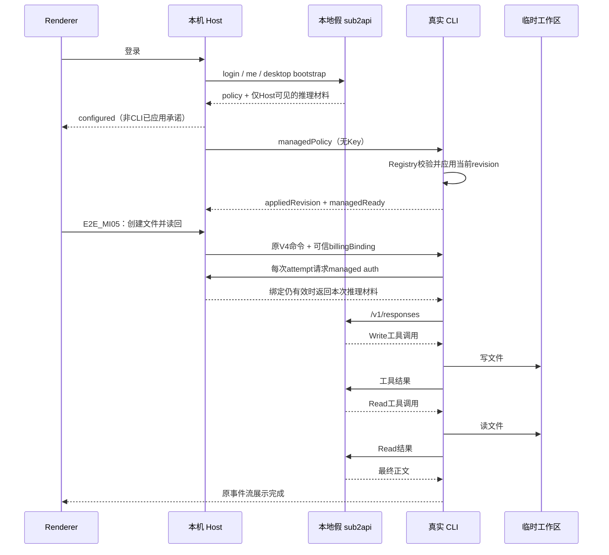

# W3：托管推理验收场景与证据

## 2026-11-14 官方限制与 bootstrap protocol 4

MV04 复用现有本地 HTTP、加密账户 Host、私有授权 resolver 和真实 Registry 投影：验证官方上下文不扣输出、缺省/空/fixed 输出可等于上下文、unknown/unlimited 输出为零但请求预算保持正数、scope/空目录/逐模型不可用仍按 v3 隔离；1/2/3 不接受零输出、新字段或输出等于上下文，v4 也不接受额外的 bounded 别名。精确旧服务版本拒绝仅回退一次到 v3，换号后旧授权不可用；401 认证重放仍请求 v4，普通 400/403/429/503 不降级。所有场景均未请求模型接口。

Node v24.19.0/macOS 本地验收：`brand-managed-runtime.test.ts` 34/34；连同 `brand-managed-delivery.test.ts`、`brand-account-admission.test.ts`、`brand-account-runtime.test.ts` 共 65/65。执行入口为仓库根 `pnpm --filter @zcode/desktop exec tsx --test` 加上述 `test/e2e/brand-account/manual-review/pending/` 文件路径。`pnpm typecheck`、`pnpm lint`（84 个既有警告、0 错误）和 `pnpm architecture:check --changed` 通过，修改的 6 个 TS 文件定向 lint 为 0 警告/0 错误。freshness 脚本的远端 fetch 因 GitHub 超时未完成；没有构建安装包、发布、提交或真实付费验证，不把本地 HTTP 证据当成安装包或生产验收。

## 2026-11-13 恢复与执行后同步

- RC01：逐项验证已知 bootstrap 不可用原因及未知原因的安全映射；不暴露任意服务端正文。
- RC02：同账号 Key 轮换后，匹配原作用域/材料的拒绝候选合并一次 bootstrap；新材料可用于下一调用，不自动重放请求。上游同名错误且 bootstrap 仍 ready 时不清登录、不标停用。
- RC03：旧账号/旧 epoch/旧 scope/旧 credentialRef/旧材料指纹以及远程或旧 client 的反馈均丢弃；退出期间不接受迟到恢复。
- RC04：真实 core 源码 turn 成功/失败/取消都从 finally 发原 billingBinding 的终结反馈，child 端口按既有根 session 路由；通知不进入持久历史/Renderer。
- RC05：终结/余额不足事件在旧余额及 usage 请求中发生时，两者均尾随一次事件后新读；密集事件合并，失败仍独立尝试另一个读取，换号不发布旧结果。
- RC06：公共设置失败但已有合法登录会话时，推理 bootstrap 仍能就绪，设置错误仍可重试。

## 本轮在线刷新实施验收

2026-11-12本轮结果与精确范围见 [20实施交接](20-agent-model-refresh-implementation.md)：Host/账户/准入52项，CLI bootstrap86项、请求鉴权19项、provider-regression29项，后端三包及前端148项通过。最终protocol3原生Write→Read、标题、消费展示与秘密扫描1/1通过；模型刷新UI另见 [19](19-agent-model-refresh-ui-acceptance.md)。以下历史11月11日的证据不替代本轮结果，未覆盖项目仍保留未验证标记。

MR01 同账户并发刷新只发一次bootstrap，同语义响应不发布策略事件；MR02 新增/改名/默认变更不停止已运行SSE或工具，已选草稿/会话不变；MR03 删除模型仅拒其下一attempt，剩余模型旧已接受工作仍可授权；MR04 模型参数变化使冻结旧实例拒绝，新实例按新能力/预算执行；MR05 网络/5xx/429/非法响应保留同账户旧策略和同步错误，过期新轮不执行且输入/queue保留；MR06 换号/退出/迟到响应及确证凭据失效继续隔离；MR07 分组目录一项失效时v3返回其余有效模型，默认失效时default=null，不自动选择；MR08 手动模型刷新、前台/联网和新轮/自动队列的60秒freshness，经Host单一owner及该CLI ACK后生效，余额按钮不触发模型刷新。验收复用本地HTTP加密Host夹具、真实stdio CLI与合成SSE，另做品牌UI浏览器/桌面检查；不写App业务单测、不晋升未验证场景为CI。

## 2026-11-12 多模型追加验收

执行前先冻结 MM01：本地 bootstrap protocol2 两模型，默认为第二项，Host正确发布全部模型且两项分别授权，未配置项拒绝；Registry输出独立上下文/推理/输出预算。MM02：重复ID、默认不存在、非默认项能力/预算非法以及schema1多项均拒绝整份策略；schema1单项可兼容。MM03：重连删除一项后旧revision与已删除项不得取得凭据，剩余成员在新绑定下可用。MM04：真实CLI account-config RPC收到多模型并确认全量应用，删除更新后registry不含旧项；缺模型/无效默认不能返回managedReady。MM05：非全局默认模型 `[low,high]`、默认 `low` 经 schema、overlay、序列化、Registry、GUI 及工具目录仍为 `low`；无新元数据的旧模型维持最高档、辅助最低档保持不变，非法默认拒绝。沿既有本地HTTP/加密Host与真实Registry/RPC runner，不晋升CI、不发真实消费。

多模型本轮证据与命令汇总见 [16：实施与交接](16-managed-agent-implementation.md#2026-11-12-多模型修正与验证)。下文 11 月 11 日的原生 Write/Read 是此前单模型版本证据，本轮未用它证明多模型原生安装包或生产扣费通过。

2026-11-11。本文承接 [12：设计](12-managed-agent-inference-design.md)，将 W3 场景转为可执行验收合同。W1/W2 的已运行结果仍以 [11](11-account-wallet-implementation.md) 为准；不能把账号、钱包或固定拒绝门禁通过视为推理通过。当前状态为 **Host/publication/delivery 35项通过；macOS开发构建在本地假网关完成真实Write/Read及消费UI；最后一处刷新代次修复已分层验证，最终desktop构建原生复跑通过**。最终字段和状态定义以 [14实施合同](14-managed-agent-inference-spec.md) 为准。

桌面验收仅连接 loopback 假 sub2api；最终用例显式隔离App、Electron、CLI会话库与存储目录。前期CLI隔离遗漏见第6节。不创建生产 Key、不调用付费模型、不发起支付、部署或发布。真实模型、生产账单、Windows 原生包与双设备验收仍需独立证据。

## 1. 范围与影响

| 项目         | 本片合同                                                                                        |
| ------------ | ----------------------------------------------------------------------------------------------- |
| 能力         | 登录后由 Host 取得托管推理材料，配置一个 Responses 模型，沿原 CLI 工具循环执行                  |
| 变更层       | option-source、draft-default、validation、commit-effect、persistence、recovery；UI 展示连接投影 |
| 规划模式     | implementation-handoff；沿用 MI01–MI14 编号，不另造平行语义                                     |
| 主验收环境   | macOS 原生 Electron 开发构建，真实 Main → window Host → CLI；本地 HTTP/SSE 端点                 |
| 主要证据     | 桌面操作、真实工具文件、完整模型请求计数与分类、非秘密 RPC 投影、脱敏日志和持久化扫描           |
| 独立后端验证 | bootstrap 并发、用途/归属保护、缓存失效、分组与计费配置；由 sub2api 工程测试负责                |
| 不在本片     | 生产支付、每设备撤销、精确任务总账、多模型套餐、跨账户接管队列、办公格式全排列                  |

### 入口、所有者与提交落点

| 场景/入口                  | 展示或草稿所有者                      | 默认/授权来源                               | guard 与提交                              | 权威及持久化                                    | 模式边界                                 |
| -------------------------- | ------------------------------------- | ------------------------------------------- | ----------------------------------------- | ----------------------------------------------- | ---------------------------------------- |
| 登录/账户页/重新连接       | UI 表单与账户投影                     | sub2api 账户；Host 私有推理材料             | 登录/refresh → bootstrap；账户代次校验    | 账户服务；登录对加密落盘，推理 Key 仅 Host 内存 | 不复用官方 OAuth，不在 Renderer 取得 Key |
| 新任务 Composer            | UI 未提交草稿                         | 当前 managed policy 的完整 defaultSelection | Host gate → 原 V4 command → CLI admission | CLI CommandInbox 与原会话库                     | 本机桌面；远端不能借用本机 Key           |
| 历史任务/队列/继续         | CLI 既有 intent、selection 和 binding | 原 run 的可信账户绑定                       | 当前账户/代次/策略、CLI applied 验证      | CLI 是 accepted queue 唯一所有者                | 不把 A 的输入自动改扣 B                  |
| 标题/compact/goal/子 Agent | 各工作原有状态                        | 同一授权模型集合；继承原工作 binding        | 共用 factory 与逐 attempt auth            | 原 runtime/子会话；Host 只解析本次授权          | 不以主任务成功替代每入口验证             |
| 余额/消费                  | UI 只显示 Host 读取结果               | sub2api me/usage                            | 合并刷新；不由 token 或余额差推算实际费用 | 后端账本                                        | 当前连接 Key 范围，非本设备/精确本任务   |
| 非品牌/远端/Web 附着       | 原有模式所有者                        | 原模式配置                                  | 既有 publication policy                   | 原 Host/runtime                                 | 本片不得发布读取托管秘密的公共服务       |

共享的是 Registry、ModelFactory、Responses adapter 和工具循环。新任务默认、历史选择、子 Agent pin 与辅助工作各有冻结时点；不合并这些状态写者。源码种子为 `packages/desktop/src/host/windowHostAttachmentRpcPolicy.ts`、`packages/services/src/brand-account/`、`packages/services/src/zcode-agent/zcodeAgentService.ts`、`packages/provider/` 和 CLI `bootstrap/src/app/provider-registry-model-runtime.ts`。

本片沿用 [12 第9节](12-managed-agent-inference-design.md#9-功能影响简表) 的两层关键链路核对。当前无 codegraph 查询工具，未执行 codegraph，不宣称静态调用图完整。现有图谱对品牌 managed access 的缺口仍是 graph-drift-candidate；父级实施维护其图谱/全局会话文档，本验收文件不并发修改这些共享文件。

## 2. 冻结边界与事件顺序

2026-11-11 实施冻结：公开 `inference.status` 为 `signedOut | connecting | configured | unavailable`，重新连接复用既有 `initialize()`；不新增公开秘密或连接写入方法。**configured 表示 Host 已有可用策略，不等于每个目标 CLI 已 applied。** Host publication gate 与 CLI 执行端仍必须校验目标实例的 appliedRevision/managedReady；不能以按钮开放证明 CLI 就绪。

| 状态/事实                     | 唯一所有者                                 | 测试观察点                                                       |
| ----------------------------- | ------------------------------------------ | ---------------------------------------------------------------- |
| 登录对与账户 epoch            | Host 账户服务和既有跨进程存储协调          | 加密文件、两个 Host 的公开 snapshot、迟到请求 latch              |
| Agent 推理 Key                | Host 私有内存                              | loopback 网关收到的认证分类；不得将值写入产物                    |
| managed policy、revision      | 后端签发，Host 校验；CLI Registry 实际应用 | 非秘密快照与 updateAccountConfig 的 appliedRevision/managedReady |
| billingBinding                | Host 从认证身份注入；CLI 接受后冻结        | origin/accountRef/accountEpoch/policyRevision，无 Key            |
| accepted 输入、活动执行、队列 | CLI CommandInbox/runtime                   | 原 admission/queue 事实和模型请求，不建立 Host 第二队列          |
| 工具副作用                    | 原工具执行器与实际文件系统                 | 目标文件内容、Read 返回值、写入次数                              |
| 余额/实际消费                 | sub2api                                    | me/usage fixture 和后端独立验证；UI 只是展示                     |



不变量：目标 CLI 换代必须重新验证 applied；同 revision 重复应用幂等；换号/退出先失效授权，再处理迟到结果。退出只能停止后续本机授权与执行，不能声称已到网关的请求或已经完成的文件操作瞬间回滚。

MI09增加退出意图与跨Host存储锁竞争：真实 `secretRepo.withLock` 占住共享文件锁时，退出意图必须先封锁本机授权；并发initialize或退出前发起的余额读取完成，不得在墓碑提交前重新bootstrap或恢复configured。测试以锁latch和旧me响应latch推进，锁未释放时调用私有 `assertConfigured()` 等当前coordinator flight收口后校验，再检查blocked、旧resolver拒绝和bootstrap计数不增，最后释放锁完成退出。该私有方法服务实际admission前的材料/expiry检查，不增加RPC或测试专用状态；不以固定sleep建立屏障。退出持久化失败时同样保持本机阻断，不能重新使用仍在磁盘的旧登录对。

### 首片未纳管入口的硬门禁

即使Host为configured，下列入口仍不接受新推理，返回 `brand_inference_entry_unavailable / feature_disabled`。这是首片支持范围，不能把“已连接”理解为全部历史入口已纳管；不删除底层实现。停止、取消、关闭及只读查询仍可委托。正常send/queue/compact/goal由当前绑定及目标CLI applied规则支持；未知V4命令默认拒绝，不因对象里存在type就放行。

| 服务             | 首片硬拒绝                                                                                                                              | 保留动作                                      |
| ---------------- | --------------------------------------------------------------------------------------------------------------------------------------- | --------------------------------------------- |
| ZCodeAgent       | generateWorkspaceText、testModelConnectivity、sampleMcpApp；automation创建/更新/立即运行/重启/启用；非cancel的controlOffPeakExecutionV4 | automation关闭、offpeak取消、普通查询/停止    |
| PluginUiSampling | sample                                                                                                                                  | 非推理只读方法                                |
| OffPeakTask      | createTask、continueTask                                                                                                                | 查询/取消                                     |
| ZCodeTask        | submitBotGroupInput、deliverSessionMessage                                                                                              | 既有查询/停止；支持的普通V4命令仍走完整gate   |
| V4               | startSavedWorkflow、resumeWorkflowRun、amendWorkflowRunSettings；不在本片显式可执行/非执行集合的未知type                                | 明确非收费命令；正常推理命令仍须ready/binding |

该范围纳入MI06/MI14的RPC验收：未纳管入口必须在Host publication层被拒绝，delegate调用计数保持0；不能只把UI入口隐藏。远端与Web既有attachment合同仍独立，不将本机品牌服务发布过去。

### MI12近期实际消费合同

首片读取本人当前Agent Key的最近20条后端已结算记录，包含此用户所有设备与主/辅助请求。界面不得称为本设备、本任务或跨轮换完整Agent总账。Key ID来自当前Host bootstrap；Renderer不能选择其他用户Key，也不直接请求usage。Key轮换后只显示当前连接，旧Key聚合后置。

| 场景                 | 验收规则                                                                                                      |
| -------------------- | ------------------------------------------------------------------------------------------------------------- |
| credits引擎          | 保留`charge_credits_string`与`credits_per_usd_string`精确十进制；大于JS安全整数仍正确，不先转Number再转BigInt |
| legacy引擎           | `charge_credits=0`但`actual_cost>0`仍显示后端USD等价实际消费，不能显示免费                                    |
| 尚未结算/空列表      | 明确当前未有可读记录，不用客户端token乘单价或余额差估算真实扣费                                               |
| 同步失败             | 保留已读记录并标stale/同步失败；不能把失败替换为0消费                                                         |
| 换号/退出/旧请求迟到 | 先清当前账户投影；A迟到usage不能覆盖B或恢复A记录                                                              |
| 刷新                 | 受控读取当前本人Key最近20条；余额仍以me为准，与usage分别展示时间和失败状态                                    |

fake数据需同时包含超过安全整数的credits、legacy正费用、延迟/失败与A/B不同记录。断言UI实际显示服务器记录及stale/账户隔离，不以钱包金额差验证费用。真实后端usage查询与用途归属由后端工程证据补充，本机fake UI通过不证明生产扣费。

## 3. 维度与剪枝

| 维度     | 代表等价类                                                               | 采用原因                                     |
| -------- | ------------------------------------------------------------------------ | -------------------------------------------- |
| 账户     | 未登录、A有效、refresh、A退出、换B、同A重登                              | 决定谁可获得本次授权及迟到结果是否仍有效     |
| 配置     | 缺失/错误、Host configured、CLI未applied、当前applied、旧实例/旧revision | 防止只改UI默认而越过实际模型状态             |
| 输入     | 新任务、续发、已accepted队列、只读历史                                   | 验证新默认不覆盖既有intent，队列不换账单账户 |
| 模型调用 | main、title、compact、goal verifier、child、其他已启用入口               | 每入口独立识别，防止辅助请求绕回官方服务     |
| 故障     | 401、余额不足、429、断网、流中断、停用凭据                               | 分类恢复与有限重试，不重新建Key或换供应商    |
| 证据     | UI、HTTP/SSE、CLI/RPC、磁盘文件、日志/argv、后端数据                     | UI单层不能证明真实工具与秘密隔离             |

| 决定 | 剪枝/后置组合                           | guard 或理由                                            | 代表覆盖                              |
| ---- | --------------------------------------- | ------------------------------------------------------- | ------------------------------------- |
| P01  | Word/Excel/PPT/PDF × 每种认证故障全排列 | 共享认证/factory gate；办公工具与发行依赖另验           | MI10；办公里程碑另列                  |
| P02  | 手机/SSH/WSL 获取本机托管Key            | 本片只发布本机桌面能力；不扩大attachment秘密面          | MI11与现有publication隔离回归         |
| P03  | 每设备远程撤销                          | 首片未定义设备凭据，不以installation ID冒充设备鉴权     | MI13仅保留共享Key语义，双设备实测后置 |
| P04  | 真实充值成功后继续推理                  | payment仍可关闭；已有余额可以执行，不为推理绕开支付开关 | MI05；支付开放交13                    |
| P05  | 精确本任务账单/跨轮换用途聚合           | 当前用量只承诺当前连接Key范围，后端尚无完整任务聚合合同 | MI12验证清楚范围与待结算              |
| P06  | 跨账户接管旧队列                        | 未定义用户确认与迁移授权；不得自动改绑                  | MI07/08验证拒绝自动扣新账户           |
| P07  | macOS开发测试推定Windows/签名安装包通过 | 工具、密钥库与发行依赖不同，不能等价                    | Windows/正式包保持未验证              |

最终产品决定为每用户一把独立`desktop_agent`用途Key，与工作台Key共用同一运营group；不复用生图Key，也不因品牌名改变而重新建Key。测试不把显示名或Key列表顺序当凭据身份；fixture只模拟返回的不透明credentialRef。该决定不改变 Host/Renderer 秘密边界、账户隔离和全请求授权断言；真实用途/并发/其他Key不变仍需后端工程证据。

## 4. Accepted 场景与证据矩阵

`accepted` 表示纳入本轮/后续实现合同，`planned` 表示没有通过运行的证据；两者不可混用。MI01–03 的数据库和跨实例缓存事实由后端工程测试证明，桌面假后端不能证明。MI13 跨设备行为后置；其他已启用辅助入口必须逐个获得证据，未启用入口不为验收顺手开启。

| ID   | Setup                                                       | Action                                    | 必须断言                                                                                                | 证据/状态                                                                 |
| ---- | ----------------------------------------------------------- | ----------------------------------------- | ------------------------------------------------------------------------------------------------------- | ------------------------------------------------------------------------- |
| MI01 | 同用户现有生图凭据，Agent凭据状态按后端合同                 | 并发bootstrap两次                         | 幂等领取同一身份；不误领/改写其他用途；no-store；不在响应/日志泄露他人秘密                              | 后端通过：32并发/用途唯一索引/legacy不变；生产未验                        |
| MI02 | A/B两用户与无分组权限用户                                   | bootstrap及越权字段请求                   | JWT决定归属；客户端不能选择user/group/purpose/base；无权不建Key                                         | 后端通过：JWT归属/严格DTO/无权不插入；生产未验                            |
| MI03 | 托管凭据停用/过期、配置错误                                 | 重复登录/领取、管理员变更后请求           | 不自动激活/新建绕过；缓存失效；配置错误不返回ready秘密                                                  | 后端通过：状态保护/真实Redis失效；Host拒绝通过                            |
| MI04 | 已登录，Host configured；目标CLI未applied/换代/错误revision | 尝试各收费command，再完成实际应用         | Host与CLI最终gate拒绝未就绪；查询/停止等非收费command仍可用；当前applied才允许                          | partial：publication＋stdio ACK拒绝/允许；原生ready通过；换代全排列未验   |
| MI05 | payment关闭，有余额；隔离临时工作区                         | 原生UI发送E2E_MI05写文件并读回            | 用户未填Key；真实Write和Read；至少三轮Responses；模型/路径/认证全正确；原权限路径有效                   | 通过：macOS开发构建＋假网关，真实Write/Read/权限UI；最终构建通过          |
| MI06 | 当前managed模型，标题/compact/child等入口分别有setup        | 独立触发每个已启用入口                    | 每个入口存在对应真实模型请求；origin/model授权；binding继承；没有官方fallback                           | partial：main＋title真实请求；未纳管RPC硬拒绝；compact/goal/child未触发   |
| MI07 | A运行、有accepted队列；挂起A bootstrap/auth/辅助请求        | 换B后释放A迟到结果                        | 旧epoch不能覆盖B；B Key不用于A工作；队列事实保留且不自动出队；无Host第二队列                            | partial：迟到bootstrap/账户epoch＋退出文件保留；真实活动run/队列待验      |
| MI08 | 同A重登/重启；历史缺binding或selection被撤权                | 打开历史、等待、明确新建任务继续          | 历史/文件可读；无后台自动收费；原intent不重写；新的授权只作用新工作                                     | partial：同A重登旧epoch拒绝；冷启动历史/队列未验                          |
| MI09 | 同一存储两个Host、旋转refresh、bootstrap在途                | 并发刷新/退出/重连                        | refresh仅消费一次；退出墓碑不被旧结果恢复；秘密/连接状态不串号                                          | partial：双Host实例/锁/401刷新＋3入口IO代次通过；独立进程竞争未验         |
| MI10 | 各自完成至少一次工具后注入故障                              | 401/余额不足/429/断流，然后取消或明确重试 | 错误分类可理解；保留成果；有限重试；不重建Key/换厂商；已完成工具不自动重放                              | partial：bootstrap401/凭据过期通过；余额不足/429/断流工具恢复未验         |
| MI11 | 含登录、refresh、推理三类独立哨兵                           | 登录、执行、退出，扫描公开面与持久化      | Renderer/storage/RPC/config/argv/快照/日志无秘密；登录JWT不发模型端；推理Key不发账户端；无硬编码共享Key | partial：原生认证分类＋961文件/公开面扫描通过；非全进程网络审计           |
| MI12 | 用量延迟、legacy正费用、大int64、轮换                       | 刷新本人当前连接用量                      | 待结算不显示0；当前范围清晰；credits精度保持；不以余额差冒充任务费；旧Key不伪装被包含                   | 通过首片当前Key范围：HTTP＋UI精度/stale/empty＋后端DTO；生产扣费未验      |
| MI13 | 两设备同用户共享凭据                                        | 一台退出、另一台调用，再管理停用          | 普通本机退出不撤全部设备Key；管理停用才跨设备拒绝；记录在途边界                                         | accepted/future：后端用户用途幂等已验；双设备未运行                       |
| MI14 | 残留Personal/项目pin、替换managed endpoint                  | 最终factory/auth尝试执行非授权选择        | 拒绝非授权origin/model/access；不以隐藏设置或仅主请求成功代替                                           | partial：Host非法endpoint/model/binding＋CLI定向回归；完整历史pin场景未验 |

## 5. 本机测试入口与fixture合同

现有品牌账号测试使用显式 `node:test + tsx + Playwright Electron`，**不属于 WDIO replay preset**。沿用 `packages/desktop/test/e2e/brand-account/manual-review/pending/`，保持pending，不自动转正或加入CI/Docker。受控假上游是协议测试条件，不是生产模型或生产扣费通过。

```sh
# 原生W1/W2，需desktop tsup产物与localhost:5174 renderer
pnpm --filter @zcode/desktop exec tsx --test test/e2e/brand-account/manual-review/pending/brand-account-wallet.test.ts

# 现有账号跨Host/HTTP控制面，无Electron
pnpm --filter @zcode/desktop exec tsx --test test/e2e/brand-account/manual-review/pending/brand-account-runtime.test.ts

# Host publication/admission边界
pnpm --filter @zcode/desktop exec tsx --test test/e2e/brand-account/manual-review/pending/brand-account-admission.test.ts
```

新 W3 原生用例为 `brand-managed-inference.test.ts`，用相同 `tsx --test` 入口显式运行；Host控制面用例为 `brand-managed-runtime.test.ts`，共享本域 `managed-inference-fixture.ts`。文件存在不代表运行通过。沿用 `ZCODE_ACCOUNT_E2E_EXECUTABLE`、`ZCODE_ACCOUNT_E2E_RENDERER_URL` 与隔离 data/electron/session 目录；CLI必须运行当前构建，不能只Mock CLI结果。CLI的`ZCODE_SESSION_DB_PATH`与`ZCODE_STORAGE_DIR`不自动跟随App `ZCODE_DATA_BASE_DIR`，测试必须分别显式指向隔离data下；职业引导非本case范围，按真实onboarding-record owner合同预置匿名dismissed资格，不能假定一定展示三步。测试运行期间冻结相关源码/Vite HMR，防止Root重挂载关闭弹窗而污染交互证据；不增加固定sleep掩盖同步。

fixture请求分类：主轮与真实工具续轮为 `main`；标题等确有业务触发的辅助请求为 `common` 并逐个计数；刻意构造的错误/非法策略为 `synthetic` 并记录原因；UI资源/非模型网络为 `ignore`，不能忽略未知模型请求。Responses分别校验流式主轮与非流式辅助调用，使用稳定 `E2E_MI*` marker。

网关使用真实随机端口listener，不先探测并释放端口。受控时序使用 started/finish latch 或流chunk屏障；不以等待若干毫秒证明未授权。错误注入只命中本例路径和marker，不能改变所有模型请求。真实工具写入本例临时工作区，禁止写用户已有项目。

每个模型请求记录非秘密 `requestId / path / model / stream / workClass / authClass / bodyMarker / bindingRef`；认证只记录 `agent-A/agent-B/invalid` 等分类和断言结果，原始 Authorization/Key绝不写入产物。完整输入可含合成任务与工具结果，但也要在写artifact前扫描三类secret哨兵。HTTP fake端点的no-store/字段测试不能替代生产TLS和受信origin验证。

### 产物最低要求

| 产物               | 内容与限制                                                                                     |
| ------------------ | ---------------------------------------------------------------------------------------------- |
| result.json        | 真实passed/failed/partial IDs、平台/Node/commit/命令、实际文件路径与哈希；未运行断言单列       |
| gateway-trace.json | 所有已观察模型请求、工作分类、认证分类、意外请求失败；无原始秘密                               |
| 截图               | 登录完成、工具完成、换号/错误状态；全部使用合成用户与合成金额                                  |
| 文件               | Write结果与Read回传一致；不得以预先写入期望文件替代工具执行                                    |
| 公开面/存储扫描    | Renderer DOM/storage/URL、公开RPC、Personal/managed配置、CLI snapshots、argv、应用日志逐项结果 |
| 进程/构建信息      | Main/Host/CLI真实入口及实例代次；注明开发包，不能据此宣称已签名发行包                          |

`page.on('request')`只观察Renderer，不能证明Host/CLI没有其他模型外呼。本片以假网关全请求分类、执行器策略gate定向回归和进程证据组合论证；如果尚未获得全进程网络阻断/审计，必须明确该限制，不能写“所有进程绝无任何对外请求”。

## 6. 回填与执行记录

2026-11-11，macOS arm64、Node `v24.14.0`，显式运行 `brand-managed-runtime.test.ts`、`brand-account-admission.test.ts` 与 `brand-managed-delivery.test.ts`，**35 passed / 0 failed**。产物：`packages/desktop/.e2e-artifacts/brand-managed-runtime-2026-11-11/runtime-admission-delivery.tap` 与 `run.json`（早期21项transcript另保留）。这是下面范围的partial证据，不将完整MI行改成covered：

| 范围    | 实际通过                                                                                                                                                                                                              | 尚未证明                                                           |
| ------- | --------------------------------------------------------------------------------------------------------------------------------------------------------------------------------------------------------------------- | ------------------------------------------------------------------ |
| MI04/06 | 9个publication组合：未登录/connecting/unavailable/过期拒绝；authenticated+configured委托；非品牌/远端/source-settings/Web保持边界；另逐项验证configured仍硬拒绝未纳管入口，关闭/取消/查询可用                         | 真实换代全排列（stdio ACK为synthetic；ready已有原生正向证据）      |
| MI07/09 | initialize singleflight；退出立即blocked；A→B/同A重登拒绝旧绑定；coordinator等待迟到bootstrap仍拒绝；双Host实例共享墓碑；退出等待存储锁时旧me与initialize不恢复授权；首次bootstrap401仅refresh一次、bootstrap重试一次 | 独立Host进程bootstrap竞争、真实活动run取消及accepted queue自动出队 |
| MI11/14 | 公开事件/策略与加密登录文件无secret哨兵；resolver拒绝非授权provider/model；bootstrap拒绝外域、query秘密及错误/v1路径；拒绝输出占满context、不支持stream及逆序reasoning的矛盾模型；不隐式发起模型请求                  | 全进程网络审计、compact/goal/child逐入口；其余已有下述原生扫描     |
| MI03/10 | credential_blocked或已过期材料不配置；配置后用Date虚拟时钟跨过真实expiresAt，下一private admission拒绝并发布unavailable，旧resolver拒绝；均不调用/keys或Responses                                                     | 后端真实停用/数据库/缓存；余额不足/429/断流工具恢复                |

锁竞争回归另留红绿证明：只在artifact定向bundle移除`identity`和`prepareInference`的本机auth-action guard，同一case稳定失败于`Missing expected rejection`；共享产品源码未改。产物在上述目录 `red-barrier/red.tap`、`manifest.json`，正式源码最终35项为绿。首个artifact运行因缺少tsx loader报模块加载错误，不算行为红；记录已由带`--import tsx`的业务断言失败替代。

原生首跑 `brand-managed-inference-1794384976534`：登录/本人余额、真实项目创建、目标CLI启动/admission成功，但模型网关请求0条，工具尚未执行。UI显示Zod `invalid_format`，Host日志确认收到`provider/runtimeHeaders`后turn失败；源码证据为反向响应`requestAuth.accountScope`要求64位hex，而managed resolver返回`origin:accountRef`。这是已确认合同不兼容，不能标MI05通过。修复采用稳定账户作用域hash并补真实schema回归，不放宽官方协议；后续原生重跑已完成真实工具，见下。该产物的开发Renderer还观察到`react-grab.com/api/version`请求，不能声称所有进程无任何外呼；这不是模型请求或实际计费证明。

刷新最终授权窗口补三条真实服务回归：`resolve`、`assertConfigured`、`readUsageScope`各自将授权解密与同epoch refresh读卡在两个latch，先释放授权读、再使refresh进入pending并停在墓碑加密。此时policy仍ready、后端refresh尚未发送，三入口均必须拒绝`session_changed`。测试复用AES-GCM加密，未用明文存储替代正式登录文件；原有bootstrap401成功刷新仍通过。定向红绿证据由CLI分工保存在`packages/desktop/.e2e-artifacts/authorization-generation-review/{red,green}.json`，旧实现三入口均错误resolved，新实现均拒绝。

原生最终通过`brand-managed-inference-1794391206652`（macOS arm64；此前完整通过基线为`1794390535863`；测试runner Node `v24.14.0`，实际Electron子运行时另由会话env记录，不混写版本），显式运行`ZCODE_ACCOUNT_E2E_RENDERER_URL=http://127.0.0.1:5174 pnpm --filter @zcode/desktop exec tsx --test test/e2e/brand-account/manual-review/pending/brand-managed-inference.test.ts`，**exit0 / 1 passed**，13.5秒。实际断言：

- 不填Key登录并读取余额；payment关闭；真实创建并信任隔离项目。
- Write权限在真实UI出现，点击allowOnce后创建文件，再执行Read；最后main请求包含实际Read结果。3条stream main＋1条nonstream title均走`/v1/responses`、同一托管model、Agent认证；网关violations为0。
- 文件内容严格为`E2E_MI05_REAL_TOOL_WRITE_AND_READ`及换行，SHA256为`d5070ef8be9d9252d383da8e93c0824f123fa208ad17244c67330ff813c31123`。
- 近期当前Key消费实际显示精确`9007199.254740993`与legacy正费用；刷新失败保留旧记录并标stale；empty显示待结算说明且金额元素数为0；不是将空列表显示为免费。
- 执行后退出回登录，文件保留；Renderer DOM/storage/URL、进程参数、Main输出与data目录961个文件（含显式隔离CLI数据库、配置、日志、快照）无三类秘密哨兵。CLI设置process.title，故以真实进程树的`zcode-cli`身份＋Host精确`zcode.cjs app-server` spawn记录共同证明入口，不能要求ps仍展示已被覆盖的argv。

对应产物为该目录`result.json`、`gateway-trace.json`、`00-write-permission.png`、`01-real-tool-completed.png`、`02-usage-fresh.png`、`03-usage-stale.png`、`04-usage-empty.png`。最终desktop tsup已包含刷新代次fence和订单纯投影整理，之后原生复跑通过。`1794390923552`同构建已过功能断言，但React Scan开发observer的紫色组件标签覆盖截图，未用作视觉通过证据；最后一轮仅调用既有`window.reactScan({enabled:false,showToolbar:false})`关闭开发observer，未隐藏产品节点、未改产品行为或后期涂改图片，工具完成与消费截图已实际目视确认清晰。该脚本仅Vite serve装配，正式build不注入。`result.json`记录基线commit `a9fe401eede6e6e5e01be9048679c206fe6f02d9`、实际CLI bundle SHA256 `dfc64681925dafdb5981834f87f9dd7dd4f52d1b06ebcfc725ab6b5feed8dc9c`及执行命令；commit相同不代表无本地改动，不能把基线commit当成完整工作区内容。Renderer仍观察到开发工具`https://www.react-grab.com/api/version`，没有执行全进程抓包；只可声明已观察的主/标题请求路由正确，不能声明所有进程无任何外呼。

前期验收准备失误也保留：`1794389403881`硬编码3次Skip，但源码允许已有CLI使用证据时不展示引导；改为按owner合同预置dismissed。`1794389710884`的假Responses function_call完成项缺`status: completed`，当前SDK校验未发出tool-call，UI留下失败输入；不是Write handler失败，修fixture后真实权限/文件已通过。前几轮仅隔离App data，遗漏CLI独立会话库：确认合成session `sess_f5df8e41-6ad9-4b63-88b5-106ce933ba5e`及本例绝对workspace写入默认`~/.zcode/cli/db/db.sqlite`；只按此明确ID只读排查，未读取或SQL清理其他会话，也未声称那些轮已完成全隔离。自`1794390191303`起显式设置CLI DB/storage，最终成功轮已扫描该私有目录。早期默认DB合成fixture清理尚未执行。

后端独立证据：`../sub2api/output/research/desktop-w3-backend-2026-11-11.md`与`../sub2api/docs/DESKTOP_AGENT.md`。真实PostgreSQL18.1/Redis8.4可丢弃测试容器、32并发ensure、migration256前后legacy行不变、用途唯一索引、禁用/过期/额度状态不复活、group授权与撤销、真实APIKeyService→bootstrap、Redis L2删除＋pubsub＋后续重新鉴权、DTO脱敏与int64字符串均由该独立测试证明。`unit`/`integration`、Wire生成、vet与Go build通过；这不是桌面HTTP fake的数据库证明，也不代表生产推理/真实账单/支付通过。后端默认仍disabled，启用前所有服务实例必须升级。

最终E2E `tsc -p tsconfig.e2e.json --noEmit`退出0。真实反向RPC/schema回归`pnpm --dir apps/zcode-cli/packages/bootstrap exec vitest run tests/provider-runtime-headers-cancel.test.ts`最终6/6通过，产物在`packages/desktop/.e2e-artifacts/authorization-generation-review/scope-rpc-run.json`和stdout/stderr日志；覆盖真实server/port响应与64hex账户作用域，不只手动parse。全仓typecheck/lint/架构、desktop构建由父级统一执行并记录：最终退出均0，lint为84 warnings/0 errors，架构0违规。独立CLI聚合typecheck仍因该workspace找不到turbo未完成，不能据root typecheck或bootstrap单包typecheck声称全CLI类型检查通过。完整`typecheck:e2e`脚本结果由父级另记。没有生产Key、付费推理或生产数据库访问。后端已提供独立`desktop_agent`真实provider/并发证据，MI01–03对应工程合同可据其结果回填；不得扩大为生产登录、模型扣费或支付通过。

| 项目                                    | 责任/当前状态                                                |
| --------------------------------------- | ------------------------------------------------------------ |
| 14实施spec、bootstrap/ready/binding合同 | 父级维护；接口冻结后据此实现                                 |
| 会话catalog/matrix、特性图链接          | 父级统一回填，避免并发编辑                                   |
| CLI/schema/adapter回归                  | CLI分工按各包实际入口运行并提供结果                          |
| sub2api工程/数据库证据                  | 后端分工提供；本文件不假装桌面fixture证明数据库              |
| 本文件与brand-account pending E2E       | 本分工负责；35项分层与macOS原生工具/消费已运行；正式包仍待验 |
| 人工review/正式fixture promotion        | 尚未发生，不自动转正                                         |

最终代码验证需运行 `pnpm --filter @zcode/desktop typecheck:e2e`、`pnpm typecheck`、`pnpm lint` 与适用架构检查；工作区全量门禁由父级合并后统一执行，避免并发TypeScript emit覆盖正在运行的Host产物。已有warning与新失败分开报告。只有运行产物逐项证明的MI行才改为covered；流程经过某状态或新断言未执行均不计覆盖。

## 2026-11-13 请求恢复与结算同步验收

Node `v24.14.0`、macOS arm64，本机假控制面/合成 stdio 子进程，无生产账号、真实付费模型请求或支付。
本次为 Host/CLI 回归证据，不替代原生桌面完整链路验收：

| 显式入口（仓库根执行，Node 24 PATH）                                                                                                                                                                                   | 结果                 | 产物（`packages/desktop/.e2e-artifacts/client-refinement/`） |
| ---------------------------------------------------------------------------------------------------------------------------------------------------------------------------------------------------------------------- | -------------------- | ------------------------------------------------------------ |
| `pnpm --filter @zcode/desktop exec tsx --test test/e2e/brand-account/manual-review/pending/brand-managed-runtime.test.ts`                                                                                              | 29 passed / 0 failed | `runtime-recovery-settlement.tap`                            |
| `pnpm --filter @zcode/desktop exec tsx --test test/e2e/brand-account/manual-review/pending/brand-managed-delivery.test.ts`                                                                                             | 11 passed / 0 failed | `private-outcome-delivery.tap`                               |
| `pnpm --dir apps/zcode-cli exec vitest run packages/adapters/tests/project-token-request-auth.test.ts packages/core/tests/child-client-ports.test.ts packages/bootstrap/tests/provider-runtime-headers-cancel.test.ts` | 41 passed / 0 failed | `cli-outcome-regression.log`                                 |

运行时用例直接读取当前 services 源码；CLI adapter/core/bootstrap 测试直接 import 各自 `src`，
core turn 通过 `createTestAgentRuntime → ../src/runtime.js` 进入原运行时，跨包 contracts/provider
沿包的公开入口解析。覆盖固定安全停用原因、未知与原型字段拒绝、候选合并及轮换指纹保护、
控制面确认停用后重置 Key 仍不可用；公开 settings 故障不阻挡既存登录的独立推理初始化；
真实 HTTP 余额/用量事件前读取与尾随读取中再次结算，以及旧账号尾随不阻挡新登录。

私有通知验收覆盖本机 stdio 可接收、未知秘密字段/远端 identity/remoteSessionId 被丢弃；
bootstrap 端口验证不额外发 RPC，child 逐层路由根会话且保留原 binding。原 turn 成功、失败、
取消均在 finally 发送一次冻结归属，模型运行中不提前结算。真实 SDK generate/stream 的 HTTP
401/403 错误只发对应候选，未知码/不匹配状态不发，单次 transport 不自动重放付费请求。
旧 CLI 进程反馈的路由检查由既有 active-client fence 实现，本次不把代码检查计作独立原生覆盖。
