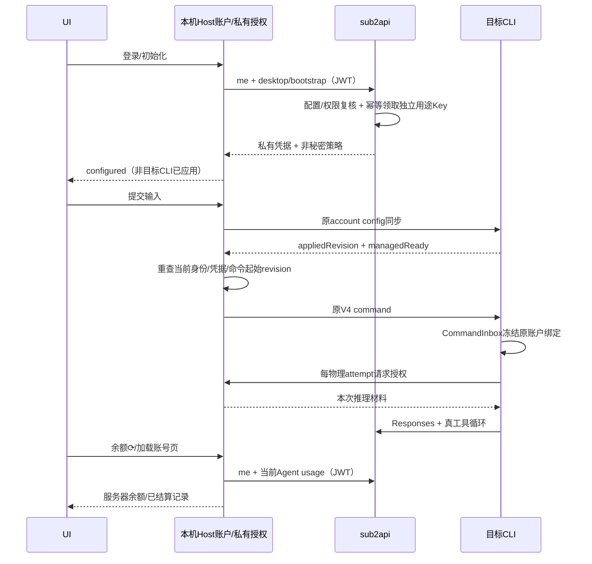

# W3 受管推理实施与后端交接

## 2026-11-12 多模型修正与验证

用户生产截图暴露了旧管理页的单模型限制和手输 ID，以及 `{enabled:false}` 覆盖配置的关闭入口。本轮在现有 `codex/desktop-managed-agent` 本地修改：sub2api 从干净 `3844d81b2` 起；ZCode 保留此前全部未提交改动。不提交、推送、部署或修改生产配置，不创建支付或付费模型请求。

- **管理页**：系统设置 → Agent 先选计费分组，读取该组本地持久配置的公开模型 ID；可搜索但不能创建任意 ID，逐个添加/移除，显式指定一个默认模型。每模型独立能力、上下文、输出预算与推理档位。切组不静默丢弃草稿，失效成员需修正；失败/空目录明确提示并允许刷新。
- **停用**：“关闭 Agent 连接”改用无 body 独立 POST，仅将最新已保存开关原子改 false，保留模型和其他配置、不提交草稿；CAS 防并发覆盖。仍不撤销已发 Key，已连接客户端需重新连接应用新策略。
- **桌面链路**：protocol 2 / schema 2 将完整 1–32 模型传给既有 Registry；逐成员验证和授权、全部实际应用后才确认就绪。每模型预算独立 clamp；`default_reasoning` 经可选 `defaultLevel` 传到主模型选择、GUI、工具/子 Agent 目录，不把非默认模型误提升到最高档。旧供应商无元数据时保留原行为，辅助最低档保持不变。
- **兼容**：旧持久单模型只读归一；旧管理 PUT 拒绝，防覆盖新集合。旧 protocol 1 桌面只收到默认一项，更新 Desktop/CLI 才能选完整列表；没有新增数据库迁移，不改变余额/计费或工作台 Key。

后台目录与接口、完整配置发布顺序见 [sub2api 维护文档](../../../sub2api/docs/DESKTOP_AGENT.md)。实现集中在后端 `desktop_agent{,_models}.go`、setting CAS、管理 handler/routes；前端 `AgentSettings.vue`、`AgentModelSettingsCard.vue`、既有 API/helper；桌面 shared policy、Host bootstrap/授权、provider resolver 和 CLI applied ACK，不重写执行器。

| 验证层           | 本轮结果和证据                                                                                                                                                                                                            |
| ---------------- | ------------------------------------------------------------------------------------------------------------------------------------------------------------------------------------------------------------------------- |
| sub2api 后端     | service/handler/routes 的 DesktopAgent 定向回归、目录追加边界回归通过；真实 PostgreSQL/Redis 的 CAS 并发保留验证通过；server 编译通过                                                                                     |
| sub2api 管理界面 | 10 文件 220 项通过，含 API/helper、组件、设置入口、Key 既有回归及 i18n；完整 vue-tsc、ESLint、Vite build 通过。ESLint 1 项既有 warning，构建有既有 chunk/Browserslist 提示，SettingsView 测试有 stub 警告，均非零告警宣称 |
| 真实浏览器       | 合成管理 API 下 59/59，含两模型增删、独立字段、默认删除、目录迟到/失败/空、TOTP 与保留配置停用；375px 中英文亮暗截图已目视，浏览器 error/warning/意外请求均 0                                                             |
| ZCode Host/RPC   | 本地 HTTP、加密存储、publication/admission/delivery 共 37/37，含 MM01–03 和旧身份/刷新竞争；没有付费模型请求                                                                                                              |
| CLI 配置链       | 6 文件 42/42，含 MM04–05 真实 Registry/RPC 与每模型默认档位保真；直接 bootstrap tsc 通过                                                                                                                                  |
| ZCode 根门禁     | 最终 `pnpm typecheck`、`pnpm lint` 通过，Lint 为 84 项既有 warning / 0 error；架构与最终差异检查见下述收尾记录                                                                                                            |

日志归档于相邻 sub2api 的 `output/research/agent-multimodel-*-2026-11-12.log`；浏览器 [说明与重放](../../../sub2api/output/playwright/agent-multimodel-2026-11-12/README.md)、[完整结果](../../../sub2api/output/playwright/agent-multimodel-2026-11-12/results.json)、[中文桌面截图](../../../sub2api/output/playwright/agent-multimodel-2026-11-12/desktop-zh-light.png)。此 output 为本地证据，持久合同为本页及 14/15。

收尾时架构门禁发现 `model-catalog-port.ts` 虽是既有上游文件，但按仓库规则，已准入上游新增路径在本地修改后必须纳管。已登记最窄 `cli-model-catalog-adapter`（精确适配器文件与其契约目录），复用既有 `ModelCatalogPort`、公开 Registry 类型，保留原创建入口；未移动执行源码或修改 baseline、上游快照与例外规则。最终架构检查 0 违规 / 0 baseline；登记后直接 bootstrap tsc 与 22 项受影响回归通过，最终两库 diff-check 通过。详细过程保留于 `agent-multimodel-cli-default-level-2026-11-12.log`。必要 Go 检查完成后清理可再生编译缓存，可用磁盘约 9.7GiB，不删除源码或用户数据。

从 ZCode 的 `packages/desktop` 用 Node 24.14.0 执行：

```sh
node --import tsx --test --test-concurrency=1 \
  test/e2e/brand-account/manual-review/pending/brand-managed-runtime.test.ts \
  test/e2e/brand-account/manual-review/pending/brand-managed-delivery.test.ts \
  test/e2e/brand-account/manual-review/pending/brand-account-admission.test.ts
```

CLI 从根执行 `pnpm --dir apps/zcode-cli exec vitest run`，目标为 `packages/bootstrap/tests/` 下 `account-config-delivery.test.ts`、`model-catalog-port.test.ts`、`provider-registry-selection.test.ts`、`model-config.test.ts`、`model-config-mutation.test.ts`、`process-provider-registry-runtime.test.ts`。根 `pnpm typecheck` 不代替 CLI 子工作区，另执行 `node node_modules/typescript/bin/tsc -p apps/zcode-cli/packages/bootstrap/tsconfig.json --noEmit`。

本轮未重建原生 Desktop 安装包，未验证 Windows 或生产模型实际工具调用、扣费；下文此前单模型原生通过不作为本轮多模型原生证据。发布顺序为新 sub2api 后端及配套前端 → 配组与模型 → 构建新 Desktop/CLI → 重连与真实工具/余额对账。现有本地改动保留，交付不包含上线。

## 以下为此前 W3 单模型和独立设置实施记录

2026-11-11。ZCode与sub2api均在`codex/desktop-managed-agent`。ZCode从`a9fe401e`起保留W1/W2全部本地改动；sub2api从干净的`d5555fb`起。未提交/推送、未部署、未修改生产配置或数据库、未发起生产推理/充值。本文记录源码和本地受控验收，正式规则见[14](14-managed-agent-inference-spec.md)，场景及逐项证据见[15](15-managed-agent-inference-cases.md)。

## 2026-11-12 后续配置调整

用户已由另一Agent部署前一版本（此文11月11日本地验证记录保留历史范围，本任务未执行该部署）。11月12日本地已新增sub2api **系统设置 → Agent** 独立栏（`/admin/settings#agent`），集中连接开关、计费分组、网关、模型、输出预算、能力及推理档位，复用已有受保护配置API独立保存，不读写工作台设置。本人网站Key读取不再按Agent用途特殊隐藏，可查看、复制、使用及CCSwitch导入；Key继续托管、不可编辑删除，桌面秘密边界不变。当前后续改动未部署、提交或推送。配置与本轮验证见[后端规范](../../../sub2api/docs/DESKTOP_AGENT.md)。

本轮sub2api前端202项定向回归、完整类型检查/国际化/生产构建、ESLint（0 errors、1项既有warning）通过；后端DTO、写保护、真实PostgreSQL/Redis的32并发领取回归通过；本地真实浏览器39项配置页面验收通过，含二次验证、Enter保存隔离、完整字段和375px中英文明暗布局。未调用生产模型或操作支付。ZCode文档同步后再次执行`pnpm typecheck`、`pnpm lint`均通过（84项既有warning、0 errors），两仓库diffcheck通过；不将这些管理页验证当作生产余额/推理对账。

## 已实施的边界

用户确认**每用户一把独立Agent托管Key**，与原工作台Key各自存在，可共用聚合分组与用户余额；`purpose=desktop_agent`是稳定管理身份，展示名不参与幂等领取。现有生图工作台Key记录不迁移。用途不构成额外网关模型/协议限制，同组的真实权限由原网关决定。普通桌面用户无需复制Key或配置供应商、Base URL；本人仍可在网站主动查看和使用其Key。

| 范围          | 当前实现与入口                                                                                                                                                                                                                       |
| ------------- | ------------------------------------------------------------------------------------------------------------------------------------------------------------------------------------------------------------------------------------ |
| sub2api       | 新Desktop设置/严格校验、JWT bootstrap和管理员配置接口；独立用途唯一领取/停用保护、精确credits字符串。后端规范与配置详见[DESKTOP_AGENT](../../../sub2api/docs/DESKTOP_AGENT.md)                                                       |
| Host账户      | `packages/services/src/brand-account/{service,managedInference,inferenceBootstrap}.ts`；复用原登录/刷新/OS加密仓库，Key仅Host内存；公开RPC只有连接状态与安全投影                                                                     |
| 模型来源      | `packages/services/src/node.ts`、`packages/provider/src/{sources,resolver,registry-service}.ts`；受管策略显式存在时仅采用受管集合，blocked为空，不回落Personal/官方/环境Key                                                          |
| CLI应用与执行 | `apps/zcode-cli/packages/bootstrap/src/zcode-protocol/{account-provider-config,v4-bridge}.ts`；实际Registry应用回执；原CommandInbox冻结billingBinding，保留旧intent/queue                                                            |
| 每次请求      | `packages/services/src/zcode-agent/zcodeAgentService.ts`、CLI `adapters/src/model/{runner,model-execution}.ts`；每attempt私有授权，所有者/epoch/revision/模型/ref校验，拒绝HTTP重定向。accountScope沿既有64hex合同，使用稳定身份摘要 |
| 生命周期      | Host认证意图先阻断推理再等共享锁；CLI策略失效复用原session shutdown取消前台/工具/子代理/sidecar，保留持久输入与成果。只读历史和stop不受就绪门禁限制                                                                                  |
| UI            | `BrandInferenceStatus`、Composer/SessionPane、`BrandUsageHistory`；连接状态/重连、可执行门禁、近期实际消费，继续使用原余额⟳与订单接口                                                                                                |
| 实际消费      | `usageReader.ts`与`usageProjection.ts`读原本人`/usage`，仅当前Agent凭据最近20条，含所有设备/辅助；不做余额差、单任务估算或跨旧Key聚合。credits保持字符串与BigInt，legacy正费用不显示成免费                                           |

登录JWT/refresh从不交给CLI。推理Key只在Host与一次请求所需CLI内存；非秘密managed配置和持久intent可包含账户绑定，但不含Key。shared schema、导出与真实RPC回归一起演进，不以mock忽略真实校验。

## 状态与提交顺序



正常登录刷新不改变账户绑定。刷新中的新授权可短暂拒绝；未知刷新结果要求重登，不宣称完全无感恢复。A提交预处理期间切到B时，旧命令不能借B策略被接受；A旧/缺绑定队列不能自动为B收费。Host不能撤回网关已接受的请求，也不回滚已发生的工具副作用。

## 首片刻意保留的限制

- 本机Windows/macOS合同。当前本地验收平台为macOS arm64；Linux不伪装darwin；Windows正式发行包、OS加密/工具依赖仍需实际验收。
- Bots、定时/闲时、workspace独立文本、插件独立采样、saved workflow恢复等未携原绑定入口继续关闭；停止/取消/只读保留，源码不删除。
- 后端Desktop开关默认关闭。开关只控制bootstrap，不撤销已发Key；停用Key和认证缓存失效才是网关撤权。客户端本轮没有后台策略推送或周期轮询，已连接策略的远端变更需要重新连接/重启；不可宣称开关立即全设备生效。
- 充值未开放；仍复用现有账号/订单/余额。支付生产化缺口见13，未用本轮代码发真实订单。
- 首片一个显式审核的Responses模型，不猜生产模型ID、能力、reasoning或分组。ready不发付费探测，也不保证上游实时容量。
- 本地合成网关验证只能证明协议/执行/隔离，不证明生产模型质量、实际扣费或支付。

## 验证记录

结果与逐项范围统一收录于15。工具版本固定为Node 24.14.0、pnpm 10.33.2。失败尝试保留根因与修复记录，不将仅生成测试文件算为通过。

| 检查          | 本地结果与限制                                                                                                                         |
| ------------- | -------------------------------------------------------------------------------------------------------------------------------------- |
| 基线检查      | `check-workspace-freshness.mjs`通过；相对origin/main ahead 0/behind 0；新分支未推送，不检查跟踪分支                                    |
| 根类型检查    | `pnpm typecheck`通过，包含Desktop main/Host/E2E；不等于另一个CLI子工作区的聚合命令通过                                                 |
| E2E类型检查   | `pnpm --filter @zcode/desktop typecheck:e2e`完整脚本通过（含report build和noEmit）                                                     |
| 根Lint        | `pnpm lint`通过：84 warnings、0 errors，未把既有warning描述为零warning                                                                 |
| 架构          | `pnpm architecture:check --changed`通过：0违规、0baseline                                                                              |
| W1/W2账户回归 | 真实本地HTTP/加密/跨Host工程场景9/9通过，含刷新超时及支付不自动重放                                                                    |
| W3分层回归    | Host真实HTTP/存储、命令admission和实际stdio delivery共35/35通过；含同epoch刷新三个入口的最终返回屏障                                   |
| CLI           | 当前源码真实RPC/schema 6/6通过；desktop-agent构建及实施时定向回归通过。完整CLI typecheck聚合入口缺turbo，相关包直接检查结果见15        |
| 后端          | 真实临时PostgreSQL/Redis集成、32并发领取与迁移逐行对账、Redis失效、五包定向unit/vet、Wire、CGO关闭构建通过；命令见后端文档             |
| 原生Desktop   | 最终tsup后1/1通过；真实Main→Host→CLI完成写入权限确认、Write/Read三轮、title、消费展示、退出与隔离CLI数据库秘密扫描；产物及退出结果见15 |
| 文档/差异     | 改动涉及的92个支持文件格式检查通过；docs/fork 17份Markdown的78条本地链接无缺失；两仓库`git diff --check`通过                           |

原生首轮揭示了真实反向RPC的accountScope格式不符，修复为已有64hex合同后通过。随后发现的onboarding、编辑器草稿恢复、Responses合成完成事件缺status及process.title覆盖argv均为验收准备问题，按真实owner/协议修正夹具，未改工具引擎。另以真实服务双latch确认同账号刷新microtask窄窗口，按14补最终IO代次核对，不能仅靠policy对象未变就交回旧材料。各尝试和修复后证据保留于15。

开发Renderer观察到react-grab版本查询；网络证据只覆盖Renderer监听和合成网关，不声称全进程抓包或零第三方外呼。正式发行前仍按03清单进行生产构建流量验收。

特性图已追加6个品牌语义节点与12个代码种子、7条关系；节点/文件/符号检查通过。整图存在4条原有悬空关系，与HEAD完全相同，本轮新增为0；未修改无关图谱。当前无codegraph工具，因此只执行文本种子与图完整性核对，不宣称完成codegraph索引检查。

## 交给负责上线的Agent

1. 审核两个分支的实际diff与本地改动范围；按后端DESKTOP_AGENT规范审迁移、备份/回滚和数据库唯一性。此任务未执行生产操作。
2. 在授权测试环境先跑迁移与默认关闭bootstrap，确认现有工作台Key/用户Key不变；在新版本 **系统设置 → Agent** 选择现有工作台使用的聚合余额分组，使两把Key共用该组，再由运营确认同站`/v1`和一个支持工具的模型及完整能力/预算。页面通过受保护的管理员API配置，不会隐式复制工作台设置或发起探测调用。
3. 使用测试账户做登录→领取→工具写读→`usage`结算与余额对账；401/429/余额不足/断网和管理停用单独确认。不传账号密码或平台Key到PR/日志。
4. 真实验证通过后再由用户安排生产开关；Desktop enabled不能当Key撤销开关。生产部署/发布需另行授权，当前未执行。
