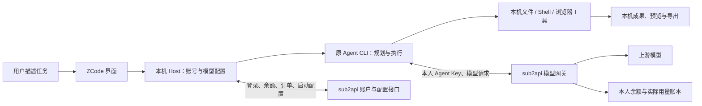

# ZCode 与 sub2api 协作设计复核

后续决策见 [18：Agent 配置边界与模型刷新](18-agent-model-refresh-design.md)：本页关于“真正暂停服务”的建议不再推进；保留托管 Key 的原分组权限，优先补模型目录同步、兼容更新和明确错误。本页保留当时的源码复核与讨论记录，不代表新的停服需求。

2026-11-12。性质为源码调查与设计评审（impact-only），不是新行为 spec 或实施授权。本轮只新增这份报告，不修改产品代码、现有 spec、生产配置或支付。用户已说明后台完成部署；本文未访问生产账户或核验线上二进制。

基线：ZCode `codex/desktop-managed-agent@a9fe401e` 加此前保留的本地改动；sub2api 同分支、干净 `ed06646f8897d3d0bc14d3626e9e9b9b3c5c77ba`。Node 按 `mise.toml` 固定 24.14.0。freshness 的远端 fetch 因 GitHub 连接超时失败；`--no-fetch` 对缓存 origin/main 通过，不代表远端已核验。本文没有重新执行构建或运行时故障注入，上一轮测试只作为历史证据。

## 结论

复用 ZCode 本地执行器、由 sub2api 统一账号/余额/订单/模型网关，是符合目标的方向。每用户独立 Agent Key、与工作台共用分组但独立用途、用现有 Registry 接受托管模型，也值得保留。

目前管理页把“是否下发桌面配置”称为“允许连接/关闭连接”，容易让运营者理解为即时停用 Agent；两个控件最终又写同一个开关。更重要的是，后台配置变化尚未自动到达已就绪桌面，且配置变化传播后的任务中止粒度过宽。这是产品规则和生命周期没有收口，不能只靠改名解决。

此前交接文档把“重新连接应用变更”说得过于宽泛，需以本次证据纠正：正常 configured Host 的 `initialize()` 和余额刷新都不会重新 bootstrap；当前通常需要新 Host（例如重启客户端）或退出重登。前轮所谓 reconnect 回归实际重建 Host，不能证明现有连接在线刷新。

## 原 ZCode 与当前改造分别负责什么

- **Electron Main** 管窗口、进程、系统加密和消息转发；不记账，也不替用户规划任务。
- **本机 Host** 管品牌登录态、读取配置和私有推理凭据、调度原 CLI。这里的 Host 是本机进程，不是需要部署到服务器的 Agent 后端。[组装入口](../../packages/desktop/src/host/index.ts:3954)
- **原 CLI/Registry/Runtime** 继续管模型选择、Agent loop、工具、权限、子 Agent、队列和恢复。任务代码与办公成果主要由本机工具处理；模型请求经网关传给上游。
- **sub2api** 管用户身份、余额、充值履约、订单、账号池/分组/路由、网关限流和实际扣费。没有把 ZCode 执行引擎搬到服务器；模型请求仍可能包含用户任务内容，不能把“本机执行”说成数据永不离开机器。

原 ZCode 的模型配置由 Built-in、Personal、Account 等来源形成统一 Registry，不只是“官方登录 → 唯一模型”。品牌模式把 sub2api 下发的托管集合接到既有 Account source 接口，再复用 Registry：

| 层             | 原设计                                | 当前品牌模式                                        | 判断                                              |
| -------------- | ------------------------------------- | --------------------------------------------------- | ------------------------------------------------- |
| 模型来源       | Built-in + Personal + Account 解析    | managedPolicy 存在时只解析受管集合，未就绪为空      | 合理，避免普通用户另配供应商或错误回落官方 Key    |
| 模型参数       | Registry 中的能力、上下文、选项映射   | 管理员确认能力，Host 转为既有配置，逐模型默认和预算 | 合理；名单不能证明实际能力，能力声明仍须验证      |
| 默认与会话选择 | 默认、任务选择、子 Agent 选择各有归属 | 后台提供默认；原选择器/会话执行继续使用 Registry    | 应保留，不把改全局默认理解为强制改所有历史任务    |
| 秘密           | 凭据解析与非秘密配置分离              | JWT 只供账户 API，Key 留在 Host/必要 CLI 请求内存   | 合理，不向 Renderer、普通配置、任务快照发原始秘密 |
| 工具和任务     | 原 CLI 执行与持久化                   | 原样复用，加逐次请求的账号绑定校验                  | 合理，防止 A 的已接受任务在换号后误扣 B           |
| 技术配置入口   | 普通用户可配供应商等                  | 品牌模式隐藏供应商设置                              | 符合目标，底层不必删除                            |

证据：[Registry 两条解析分支](../../packages/provider/src/registry-service.ts:225)、[managed-only resolver](../../packages/provider/src/resolver.ts:31)、[Account source 注入](../../packages/services/src/node.ts:1597)、[设置入口隐藏](../../packages/ui/src/settings/settingsPageConfig.ts:238)。

辅助调用仍遵循原执行器规则：标题允许历史显式选择，否则继承会话模型；压缩优先复用本轮显式模型，否则继承会话模型，记忆继承产生工作的模型。它们最终经过 Registry 校验，不能越过品牌集合回落官方模型；历史私配模型不在集合时可能报不可用，不应承诺已自动归一为后台默认。[标题选择](../../apps/zcode-cli/packages/core/src/runtime/methods/title-generation-sidecar.ts:33)、[压缩选择](../../apps/zcode-cli/packages/core/src/runtime/methods/compact-active.ts:196)、[模型创建校验](../../apps/zcode-cli/packages/bootstrap/src/app/provider-registry-model-runtime.ts:43)。bootstrap 声明的 `auxiliary=inherit-main` 与原显式标题选择的优先级仍需明确产品合同；它不会因此越过 Registry，但并非已强制覆盖所有辅助选择。

执行候选隔离也不等于所有官方业务请求已经切断：原官方 Account source 仍被实例化并保留设置失效、OAuth logout 等惰性刷新入口；官方 MCP 凭据源也仍存在。当前不能声称它们构造即联网，也不能声称品牌模式已隔离全部官方请求。[原 source 监听](../../packages/services/src/node.ts:1648)、[OAuth 刷新/官方 MCP 源](../../packages/services/src/node.ts:1691)。后续应按功能边界关闭/替换，与本轮模型网关接入分别验收。

## 完整工作流程与唯一事实来源

1. 管理员在 sub2api 选择计费分组，从该组的可路由模型目录挑选 Agent 提供的模型，确认各自能力/预算并指定默认。配置只保存在 `desktop_agent_config_v1`。
2. 用户在桌面登录 sub2api，本机保存 OS 加密的登录材料，用 JWT 读取本人资料、余额、订单；正常过期沿既有 refresh 接口恢复。
3. 本机启动接入调用 `POST /desktop/bootstrap`。服务端检查 enabled、用户、分组权限、模型配置；幂等创建或复用该用户 `purpose=desktop_agent` 的 Key，并返回模型集合、默认和凭据。不是每次启动都新增一把 Key。
4. Host 将非秘密模型策略送入原 Registry/CLI，CLI 确认全量应用。每次实际模型请求再由私有端口校验本机当前账号和授权绑定，取得请求所需 Key；主任务、标题等辅助调用走受管机制，不把登录 JWT 当模型 Key。
5. 网关按 Key 归属、分组、路由及账本执行实际计费。用户总余额由 sub2api 维护，工作台与 Agent 共用本人钱包，两把 Key 区分渠道消费。
6. 桌面加载/回到前台/恢复网络/手动点击余额 ⟳ 时读取 `/auth/me` 与近期 Agent usage。充值订单确认 `COMPLETED` 后重新取余额，不由客户端自行加钱。
7. 退出先阻断本机后续推理授权并清本机登录/内存凭据，保留历史成果；已打开的流和本地工具由异步 CLI 失效交付取消，logout 不等待全部停止。不会撤销同一用户其他设备共享的 Key。

证据：[bootstrap](../../../sub2api/backend/internal/service/desktop_agent.go:525)、[独立用途领取](../../../sub2api/backend/internal/service/api_key_desktop_agent.go:15)、[每用户用途唯一索引](../../../sub2api/backend/migrations/256_desktop_agent_key_purpose.sql:3)、[CLI 实际应用回执](../../apps/zcode-cli/packages/bootstrap/src/zcode-protocol/account-provider-config.ts:52)、[本人余额读取](../../packages/services/src/brand-account/service.ts:373)、[订单完成刷新](../../packages/services/src/brand-account/service.ts:625)、[退出屏障](../../packages/services/src/brand-account/service.ts:560)。

## 两个“连接”控件的实际含义

| 控件                          | 当前动作                                                               | 不会做什么                                         | 为什么曾这样设计                                           |
| ----------------------------- | ---------------------------------------------------------------------- | -------------------------------------------------- | ---------------------------------------------------------- |
| 允许桌面 Agent 连接（复选框） | 修改表单草稿的 enabled，点击保存后与模型等字段一起提交                 | 单独勾选不生效；不是启动本机 CLI 或建立长连接      | 默认关闭，运营配置完整后才向客户端下发                     |
| 关闭 Agent 连接（独立按钮）   | 无请求体 POST，只将服务器最新已保存 enabled 原子改 false，保留其余配置 | 不保存草稿、不停用已发 Key、不立即停止已连接客户端 | 模型草稿无效时也应能停下配置下发；避免完整表单校验阻碍操作 |

两者是**同一个全站 Agent 配置开关的两种提交方式**，不是“允许某台设备”和“断开另一条连接”，与手机远控也无关。[复选框](../../../sub2api/frontend/src/components/admin/settings/AgentSettings.vue:21)、[完整保存与独立关闭](../../../sub2api/frontend/src/components/admin/settings/AgentSettings.vue:256)、[CAS 停用](../../../sub2api/backend/internal/service/desktop_agent.go:651)。

独立停用 API 和保留配置的原子更新值得保留；把两种技术写法同时作为主界面按钮却没有明确服务状态区，属于设计表达问题。当前更准确的名称应是“启用桌面自动配置/停止下发配置”。如果要显示“暂停 Agent 服务”，必须补服务器对新模型请求的准入规则，而不是只改文案。

## 已确认的设计缺口

| 事项                                 | 当前源码证据                                                                                                                                                                                                                                                                                                           | 实际影响                                                                                                            | 判断与建议                                                                                                                               |
| ------------------------------------ | ---------------------------------------------------------------------------------------------------------------------------------------------------------------------------------------------------------------------------------------------------------------------------------------------------------------------- | ------------------------------------------------------------------------------------------------------------------- | ---------------------------------------------------------------------------------------------------------------------------------------- |
| 底层多模型与桌面入口未闭环           | [品牌模式隐藏整个模型控制簇](../../packages/ui/src/v4/ConversationComposer.tsx:2533)；[后台默认注入](../../packages/services/src/node.ts:1666)                                                                                                                                                                         | 新版 Registry 能接受全部模型，但普通用户在该输入入口仍不能选择；后台多模型不等于已有可用选择 UI，也没有自动路由策略 | 隐藏供应商/Key合理，应该另给简化品牌模型选择：只展示后台审核项、默认已选，复杂参数继续隐藏；此前“更新桌面即能选完整列表”的交接说法不完整 |
| 已就绪 Host 不自动重取后台配置       | [prepareInference 跳过 configured](../../packages/services/src/brand-account/service.ts:134)；[每次授权只检本机策略](../../packages/services/src/brand-account/managedInference.ts:126)；[刷新余额不 bootstrap](../../packages/services/src/brand-account/service.ts:763)                                              | 后台关闭、删模型、改预算、改默认可长期不到达客户端，没有明确最大陈旧时间                                            | 必须补在线配置同步/新任务前 freshness，以及始终可用的手动刷新模型配置；不能只要求用户退出重登                                            |
| “重连”入口与说明不匹配               | [按钮只在 unavailable 出现](../../packages/ui/src/brand-account/BrandInferenceStatus.tsx:18)；[initialize 仍走 prepareInference](../../packages/services/src/brand-account/service.ts:587)；[测试实际重建 Host](../../packages/desktop/test/e2e/brand-account/manual-review/pending/brand-managed-runtime.test.ts:735) | configured 用户没有刷新配置入口；Renderer 重挂、余额刷新不等于重建 Host                                             | 旧文档承诺需纠正；新规则先写 spec，再实现，区分账户刷新、配置刷新、传输重连                                                              |
| 停用不约束已发 Key                   | [bootstrap 唯一开关判断](../../../sub2api/backend/internal/service/desktop_agent.go:538)；[Purpose 只管身份](../../../sub2api/backend/internal/service/api_key.go:47)；[网关通用鉴权](../../../sub2api/backend/internal/server/routes/gateway.go:185)                                                                  | 已连客户端/本人复制的 Key 仍按原通用网关规则调用；不是紧急停费开关                                                  | 若产品需要暂停模型服务，网关应按 Agent 用途检查服务可用性并明确缓存时限；客户端轮询不能代替服务端准入                                    |
| 所有策略差异均中止全部 resident 任务 | [整份 JSON 比较及 shutdown](../../apps/zcode-cli/packages/bootstrap/src/zcode-protocol/account-provider-config.ts:30)；[binding 包含整个 config revision](../../packages/services/src/brand-account/inferenceBootstrap.ts:150)                                                                                         | 即只改展示名、默认、添加模型，一旦传播也可能中止仍可合法执行的任务/目标；目前被缺同步部分遮蔽                       | 在上线自动同步前区分撤权变化与兼容变化；仅删 abort 不够，需同时定义授权代际与既有 binding 的兼容                                         |
| UI 就绪不是完整执行就绪              | [Host 先 configured 再 publish](../../packages/services/src/brand-account/managedInference.ts:77)；[CLI ACK 屏障](../../packages/services/src/zcode-agent/zcodeAgentService.ts:1960)                                                                                                                                   | CLI 应用失败时仍可能显示已连接，任务被安全拒绝但用户不知如何恢复                                                    | 保留安全屏障；产品投影应表达正在准备/可执行/暂不可用，恢复操作常驻                                                                       |
| 登录与恢复过度依赖一次 me 成功       | [凭据已保存发布](../../packages/services/src/brand-account/service.ts:453)；[先 await balance 后 prepare](../../packages/services/src/brand-account/service.ts:509)                                                                                                                                                    | me 失败时可能已登录而推理仍未启动；仅刷新余额不补启动，缺连接恢复按钮                                               | 这是源码时序风险，需本地故障注入验证后修复；账户展示读取与推理准备应有独立可重试状态                                                     |
| 余额不是任务完成即更新               | [焦点/网络/可见性触发](../../packages/ui/src/brand-account/BrandAccountProvider.tsx:65)；[刷新实现](../../packages/services/src/brand-account/service.ts:763)                                                                                                                                                          | 持续停留窗口完成任务后，显示可能仍是上次查询值                                                                      | 已满足原先加载同步和手动同步要求；建议任务完成后触发一次账本读取，不推算金额或高频逐 token 刷新                                          |

以上控制条件与调用路径为直接源码结论；登录后的网络异常组合需真实故障注入确认表现。没有把新旧运行时构建、线上日志或历史测试通过当成这次问题已经运行验证。

### 计费分组、Agent 模型目录和 Key 是三层不同规则

- **计费分组** 决定账号池/路由/计费和网关允许范围；可以按用户决定与工作台共用聚合分组。
- **Agent 模型列表** 当前决定合作桌面向用户提供哪些模型及能力/预算，Host 按此集合授权；它尚不是网关额外的模型 ACL。
- **本人 Agent Key** 是每用户一把、跨设备复用的用途 Key；网站可看可复制是用户明确决定，应该保留。本人读取不等于匿名公开，也不代表需要把 Key 加回 Renderer。

因此本人拿这把 Key 在其他工具调用该组允许但未在 Agent 列表展示的模型，是当前权限设计的结果。是否把 Agent 模型列表升级为网关硬限制属于额外产品决策，不应偷偷改变共用聚合分组的权限。服务暂停是否对所有 `desktop_agent` Key 的新请求生效则应独立明确。

共享 Key 也意味着：改后台计费分组后，某设备下次 bootstrap 会迁移该用户 Key 的组，其他仍持旧策略的设备使用相同 Key，实际路由/价格已经随共享 Key 改变。[有效 Key 改组](../../../sub2api/backend/internal/repository/api_key_managed.go:148)、[提交后认证缓存失效](../../../sub2api/backend/internal/service/api_key_desktop_agent.go:46)。这需要同步策略覆盖多窗口/多设备，不能宣传成每设备独立配置。首版不必因此引入一整套设备管理平台。

普通模式的余额不足和扣费仍由现有网关保障：[余额不足 403](../../../sub2api/backend/internal/server/middleware/api_key_auth.go:271)、[本人账本扣费](../../../sub2api/backend/internal/service/gateway_usage_billing.go:372)。已准入请求的在途结算不会因关配置下发立即停止或回滚；生产是否使用现有 simple mode 例外本轮未核验。

## 建议的收口方案（未实施）

1. **保留已有分层和独立 Key。** 不换引擎，不另建余额账本，不合并工作台和 Agent Key，不让普通用户配置供应商、Key 或 CLI。
2. **管理页分“服务状态”和“模型策略”。** 只保留一个清晰可见、独立提交的服务开关；模型策略编辑不会因表单无效阻碍暂停，也不应无意覆盖暂停。底层独立停用接口保留，底部重复按钮可并入状态区。现阶段只承诺配置下发时就用准确文案。
3. **先定义政策更新如何影响现有任务，再补自动同步。** 展示名、默认、增加模型等兼容变化不应暂停所有任务；删去当前模型、停用服务、账号变更等撤权需在明确边界生效。沿原 Host→Registry→CLI，不增加第二任务队列。配置提供 revision/有效期，启动、回前台、新任务前及手动刷新按统一规则更新；避免每次 token/工具都重新领取 Key。
4. **真正的暂停放到服务器新请求准入。** 若开关称为服务暂停，服务端对 Agent 用途的新模型请求执行该规则并有明确缓存/传播时限。客户端收到变更后停止后续执行、保留成果，已在途请求/本地工具的取消能力需另写准确规则；不能承诺已发生消费或文件操作被回滚。
5. **收口状态和恢复。** 普通用户看到已登录、准备中、可以开始、暂不可用等明确状态，以及一个可重复执行的恢复动作。无需理解 bootstrap、Host、凭据或 CLI ACK；登录/余额读取失败不应让推理准备永久卡住。
6. **补任务完成后的余额/实际消费同步。** 用 sub2api 已结算数据并保留手动 ⟳，不根据 token 数、上次余额差或其他设备消费做本任务估算。
7. **补简化品牌模型选择。** 只列后台审核的展示名，默认项预选，不要求用户操作供应商/Key/协议。先复用原 Registry 与会话选择提交路径，勿为了隐藏技术设置一起隐藏可用的产品选项；本轮没有实现按任务智能自动路由。

模型展示名还需贯穿现有投影：Host 接收 `display_name` 但模型策略没有保留该字段，[inferenceBootstrap](../../packages/services/src/brand-account/inferenceBootstrap.ts:166)；CLI 当前标签仍取模型 ID，[provider-registry-selection](../../apps/zcode-cli/packages/bootstrap/src/app/provider-registry-selection.ts:184)。仅解除原控件的隐藏条件不够，不能宣称会自动显示后台设置的友好名称。

策略中止也涉及持久任务状态：[session-residency](../../apps/zcode-cli/packages/bootstrap/src/zcode-protocol/session-residency.ts:151) 会将 active target 改为 paused；后台 [revision](../../../sub2api/backend/internal/service/desktop_agent.go:536) 由整个配置 JSON 的 hash 生成，展示名变化也会改变它。兼容变更的收口必须同时考虑配置版本、授权版本和当前任务，不靠删一条 abort 规避。

实施依赖顺序：先在现有 14/15 等 spec 确定暂停/兼容更新/失败恢复合同 → 本地可重复的双 Host 与在途任务场景 → 最小代码改动 → 根 typecheck/lint、受影响 CLI/E2E 与浏览器验收 → 用户另行部署。应验证“后台改默认不中止旧任务、新任务用新默认”“暂停后新模型请求被拒绝”“多设备改组一致”“普通读取/网关断网恢复无需重登”，不以抽象解耦作为验收。refresh 轮换请求结果不确定是独立状态，现要求重新登录，不能承诺任意网络故障都无需重登恢复。

## 影响简报与边界

| 字段      | 内容                                                                                                                                         |
| --------- | -------------------------------------------------------------------------------------------------------------------------------------------- |
| 意图/能力 | 解释并评审品牌账号托管推理、配置下发、服务停用与钱包协调                                                                                     |
| 层级      | presentation、option-source、draft-default、validation、commit-effect、persistence、recovery                                                 |
| 模式      | impact-only；不修改运行行为与现有产品 spec                                                                                                   |
| 主要种子  | service.prepareInference/initialize、managedInference.resolve、Registry source、updateAccountProviderConfig、desktop Bootstrap/DisableConfig |
| 排除      | 真实生产调用/支付、部署、功能删除、引擎重写、设备平台建设                                                                                    |

### UI Surface Matrix

| 场景/入口       | 共享实现与展示/草稿 owner                       | 默认与校验                              | 提交及权威/落点                          | 模式边界与隔离                                     |
| --------------- | ----------------------------------------------- | --------------------------------------- | ---------------------------------------- | -------------------------------------------------- |
| 后台 Agent 设置 | AgentSettings 唯一未提交草稿                    | 组目录、完整能力、默认为成员            | PUT → DesktopAgentService → 单条 setting | 管理员/step-up；不写工作台或用户余额               |
| 后台独立关闭    | 同组件操作，无模型草稿提交                      | 不受草稿模型校验阻碍                    | POST disable → settings CAS              | 当前只停止下发；不触碰 Key                         |
| 桌面登录/账户页 | BrandAccountProvider/Section 展示 Host snapshot | sub2api 用户与 me                       | 原登录/refresh/订单 API；Host 加密私库   | 本机根 Host；远端 workspace 不拥有登录材料         |
| 余额 ⟳          | BrandBalanceDisplay 局部同步状态                | 服务器 me/usage，无估算                 | refreshBalance → 原账本读取              | 不刷新模型配置，不维护本地账本                     |
| 推理状态/恢复   | BrandInferenceStatus 展示 Host inference        | 目前 configured 未含 CLI ACK            | initialize；真正执行前检查 applied       | unavailable 才显示恢复；不能等同所有执行入口已纳管 |
| 新任务/历史继续 | Composer 草稿；CLI accepted queue/session owner | managed 默认/既有选择与 billing binding | 原 V4 admission/CLI/逐 attempt auth      | 旧账户任务不能默扣新账户，停止/只读保留            |

### 共享与分歧

模型配置和新任务/子 Agent 共享 Registry，默认解析与已有会话选择的写入时点不同；后台 enabled 是服务端事实，前端复选框只是草稿；余额与模型配置都来自 sub2api，但读取路径和刷新时机不同。不能因同名“同步/连接”把这些状态合并。任务队列仍只由 CLI 接受和持久化，Host 不另存一份已接受队列。

### 分级关系、所有者和不变量

| 分级           | 关系、owner 与落点                                      | 必须保留/验证                                              |
| -------------- | ------------------------------------------------------- | ---------------------------------------------------------- |
| must-inspect   | 后台 setting → bootstrap → Host 私有策略 → CLI Registry | 新旧配置时限、幂等领取、完整应用回执、兼容更新与撤权区别   |
| must-inspect   | CLI 物理请求 → Host 私有凭据解析 → 网关本人钱包         | JWT/Key 分离、换号不串账、未配置模型不回落官方供应商       |
| should-inspect | 用户选择/默认 → 新任务/现有任务/子 Agent                | 全局默认不等于改写现有会话；每模型推理默认保真             |
| should-inspect | 任务完成/订单 COMPLETED → me/usage → UI                 | 后端权威金额、迟到结果隔离、不乐观记账                     |
| conditional    | 同用户第二 Host/设备 → 同一 purpose Key/组              | 一处改组的跨设备后果；暂停传播时限                         |
| invariant-only | 原工具/权限/成果/只读历史、工作台 Key                   | 不删引擎/技能、不丢成果、不连带停工作台                    |
| evidence-only  | 历史37 Host/42 CLI/59浏览器验收与本轮源码               | 前轮重建 Host 不能证明现有 Host 在线更新；本轮无新运行证据 |

### 图查询证据与漂移

本会话没有可调用的 codegraph 工具。已读取功能语义图 `capability.brand-managed-inference` 及一跳 UI/Host/request 边，并用精确 `rg` 和源码逐层追踪到权威落点；没有声称做过 codegraph 或穷尽所有动态请求。

| 种子                        | 直接路径（文本核对，约2层）                                | 解释                                        |
| --------------------------- | ---------------------------------------------------------- | ------------------------------------------- |
| AgentSettings.save/disable  | admin API → DesktopAgentService → setting                  | 两控件同一 enabled，不是两条连接            |
| prepareInference/initialize | Brand UI → account service → inference.connect             | configured 跳过网络配置更新                 |
| managedInference.resolve    | CLI runtime headers → Host resolver → 本机 identity/policy | 逐 attempt 本机校验不等于服务器策略在线复核 |
| updateAccountProviderConfig | policy JSON compare → session shutdown/Registry apply      | 兼容更新和撤权当前没有分类                  |
| refreshBalance              | UI事件 → me/usage                                          | 没有模型配置刷新或任务完成订阅              |

建议图谱增量（仅提出，不修改）：补 `surface.admin-agent-config`、`surface.admin-agent-disable`、`state.sub2api-agent-config` 和 `boundary.agent-key-gateway-admission`，标明配置下发与网关准入是不同语义；补“configured Host 当前不会主动更新配置”和“任意策略变化会取消 resident runtime”的证据边。既有 `surface.brand-managed-connection` 的“reconnect uses initialize”只描述调用，不足以证明刷新已连接模型策略，是本次 drift-candidate。

### 未知与后续决策

- 当前生产部署实际模式、分组模型能力及定价、客户端实际构建是否包含最新 protocol 2，未读取线上核验。
- 登录后 me 失败/CLI ACK 失败的真实 UI 恢复表现、双设备改组和在途任务更新，仍需故障注入与原生运行证据。
- 服务暂停建议约束所有 Agent 用途 Key 的新模型请求；是否连本人复制到其他工具的调用也暂停，以及 Agent 模型目录是否升级为网关 ACL，应在实施 spec 明确，不能用文案替代决定。当前解释与报告不依赖这些答案，不需要阻塞调查。
- 本轮没有修改 feature graph、spec、产品代码，未申请部署或恢复已移除模块；以上建议不是已完成的新功能。
