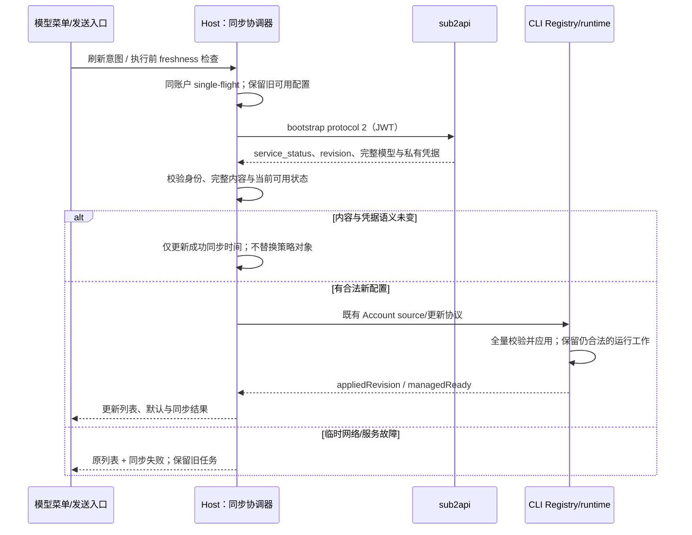

# Agent 配置边界与客户端模型刷新方案

2026-11-12。状态：**本地实施和验证完成**，结果与发布交接见 [20](20-agent-model-refresh-implementation.md)，UI逐项范围见 [19](19-agent-model-refresh-ui-acceptance.md)。用户已授权按本方案落地并要求单模型配置变化隔离故障。实施增量以 [14 合同](14-managed-agent-inference-spec.md) 的「在线目录刷新与可用性合同」为准：protocol3、按模型隔离、可空默认及稳定授权scope替代下文首片沿用protocol2/整份不可用的限制。历史调研保留，不等同当前验证结果。不部署、不调用付费模型或支付。

基线：ZCode `codex/desktop-managed-agent@a9fe401e` 加已有本地改动，sub2api 同名分支、干净 `ed06646f8`。freshness 检查通过；远端跟踪分支不存在，检查基于缓存 `origin/main`。当前执行环境 Node 24.19.0，`mise.toml` 要求 24.14.0；`mise` 不在 PATH。本页源码结论不等于生产运行验证。

本文更新 [17 复核](17-integration-design-review.md) 的建议：**不推进全局“暂停 Agent 服务”或 Agent Key 额外网关模型白名单；优先完成客户端模型目录同步和明确的不可用提示。** 14/15 保留已实施合同及历史证据，后续实现本方案时再同步行为与回归用例。

## 1. 已确定的产品边界

| 问题                                    | 结论                                                                                                 | 来源/状态                                      |
| --------------------------------------- | ---------------------------------------------------------------------------------------------------- | ---------------------------------------------- |
| 是否需要全局暂停 Agent 服务             | 首版没有明确需求，不新增网关停服机制。旧开关原意是未配置完成时不下发配置，不能称为停服务或断开客户端 | 用户质疑后收窄方案；不是已删除旧开关           |
| Agent 托管 Key 能否本人查看、复制和使用 | 可以；仍由系统创建和管理，用户不能改组或删除，消费由本人余额承担                                     | 用户已确认；当前源码已实现                     |
| Key 是否只能调用 Agent 后台勾选的模型   | 不增加这层限制；原分组、Key 状态、余额、限流继续约束真实网关调用                                     | 当前实现及本轮边界；客户端目录不升级为网关 ACL |
| 客户端能否调用未配置模型                | 不能；执行前校验，不静默换默认，不回落原官方模型。模型目录刷新成功后，以新集合判定                   | 用户已明确；当前有本地校验，缺后台在线同步     |
| 分组和 Agent 模型是什么关系             | 分组提供可路由候选及计费规则；管理员选出的模型、能力、默认值组成桌面产品目录                         | 当前源码及既定产品要求                         |
| 余额与模型刷新是否是一件事              | 不是。余额旁 ⟳ 继续只同步服务器余额与实际用量；模型菜单有自己的 ⟳                                    | 建议沿用已有钱包语义                           |

不阻止本人把 Key 用在其他工具，没有技术问题。不过“Agent Key 消费”表示这把 Key 的用量，不等于能证明来自桌面客户端；不应将它标成“本设备/本任务消费”。

管理页建议只突出**计费分组、Agent 可选模型、默认模型及能力、保存配置**。重复的“允许连接/关闭连接”不再作为产品主操作；旧 `enabled` 和 disable API 先保留兼容，后续界面与存量配置迁移一起收口，不在文档轮偷偷移除。无需用户为日常改模型操作一遍“停用、修改、重新开放”。

## 2. 当前源码事实与影响简报

层级：`presentation / option-source / draft-default / validation / persistence / recovery`。模式：`planning`，范围限品牌 Desktop 本机的模型配置；不调整执行引擎、余额账本、工作台设置、手机或远端工作区。

### UI Surface Matrix 与状态所有者

| 场景/入口                    | 本地展示或草稿 owner               | 权威/提交落点                               | 默认、校验及影响                                          | 隔离边界                     |
| ---------------------------- | ---------------------------------- | ------------------------------------------- | --------------------------------------------------------- | ---------------------------- |
| sub2api Agent 设置           | `AgentSettings.vue` 的未提交 draft | `DesktopAgentService` → 单条 setting        | 从组目录选模型，默认属于集合，能力及预算完整校验          | 不写工作台配置/用户余额      |
| 账户初始化                   | Host `brand-account`               | JWT → `/desktop/bootstrap`；Host 私有材料   | 当前 configured 会跳过重新 bootstrap                      | JWT 与模型 Key 分离          |
| 模型菜单与草稿               | UI selection view / composer draft | 既有 ModelSelection facade → Host Registry  | Registry 变化已能驱动 UI 刷新；菜单目前不能主动拉 sub2api | 草稿默认与已有会话选择不同   |
| 已有任务模型选择             | CLI session/runtime                | 原 `switchModelConfig` 等命令               | 保留显式选择；不由后台改默认重写历史                      | 不改 input intent、任务归属  |
| 队列提升、子 Agent、辅助调用 | CLI CommandInbox/runtime           | 原 admission / ModelFactory / Host 私有授权 | 与主请求使用同一受管集合；不能只更新主菜单                | 不新增 Host 队列、不越权回落 |
| 余额 ⟳                       | 账户 UI 展示 Host snapshot         | `refreshBalance` → `/auth/me`、usage        | 当前不会刷新模型配置，应保留这个职责                      | 不乐观增减余额               |

共享的是 Registry 和请求前校验；新草稿默认、现有会话显式选择、已接受队列、子 Agent 选择各有提交边界，不能因为共享菜单而合并其写者。

| 分级           | 已确认关系/问题                                                       | 源码证据                                                                                                                                                                    |
| -------------- | --------------------------------------------------------------------- | --------------------------------------------------------------------------------------------------------------------------------------------------------------------------- |
| must-inspect   | enabled 只阻止 bootstrap 下发，不禁用已有 Key；disable 仅改该布尔值   | [bootstrap](../../../sub2api/backend/internal/service/desktop_agent.go:538)、[disable](../../../sub2api/backend/internal/service/desktop_agent.go:651)                      |
| must-inspect   | Key purpose 是用途身份；网关限制来自 Key、余额与分组规则              | [用途](../../../sub2api/backend/internal/service/api_key.go:47)、[网关准入](../../../sub2api/backend/internal/server/routes/gateway.go:185)                                 |
| must-inspect   | configured Host 不会重新 bootstrap，余额刷新也不会刷新模型            | [prepareInference](../../packages/services/src/brand-account/service.ts:134)、[余额](../../packages/services/src/brand-account/service.ts:763)                              |
| must-inspect   | 当前任意 managed policy 差异都会取消全部 resident runtime             | [CLI 更新](../../apps/zcode-cli/packages/bootstrap/src/zcode-protocol/account-provider-config.ts:30)                                                                        |
| must-inspect   | config revision 现在同时进入账单绑定，兼容更新也会使旧工作不匹配      | [绑定构造](../../packages/services/src/brand-account/inferenceBootstrap.ts:150)、[相等性](../../packages/shared/src/model-selection.ts:31)                                  |
| must-inspect   | 现有 connect 在同步失败时清材料并 blocked，不能直接当后台刷新方法复用 | [connect](../../packages/services/src/brand-account/managedInference.ts:57)                                                                                                 |
| should-inspect | 不在集合的模型当前已有 CLI/Host 校验，但公开错误较笼统                | [Factory](../../apps/zcode-cli/packages/bootstrap/src/app/provider-registry-model-runtime.ts:43)、[Host](../../packages/services/src/brand-account/managedInference.ts:142) |
| should-inspect | 列表每次读取当前 Registry；它是本地当前事实，不代表已向后台同步       | [CLI list](../../apps/zcode-cli/packages/bootstrap/src/app/session-facade.ts:364)、[UI 订阅](../../packages/ui/src/hooks/useModelSelectionView.ts:211)                      |
| conditional    | 每用户一把 Key 跨设备复用，某设备 bootstrap 可迁移共享 Key 的分组     | [改组](../../../sub2api/backend/internal/repository/api_key_managed.go:148)                                                                                                 |
| invariant-only | 工具权限、成果、取消、任务身份、原非品牌模式不因目录刷新改变          | 原 CLI/runtime；14/15 中已有边界                                                                                                                                            |

### 分组变化不完全等同于模型 ID 变化

切组还可能改变上游账号池、路由、价格倍率及可用性，即使公开模型 ID 一样。模型能力、上下文、推理档位和默认输出预算也可独立变化。但这些都不要求新增全局暂停机制；只需在正确的执行边界检查当前选择是否仍能执行。

当前 Key 改组是**该用户下次 bootstrap 时懒迁移**，不是保存全站配置后立刻改所有用户的 Key。多设备共用同一把 Key，实际路由和计费始终由服务器当前分组决定，客户端快照不能冻结旧价格。菜单刷新方案不承诺把分组切换变为全用户原子迁移。

另有一个必须如实保留的边界：[validateGroup](../../../sub2api/backend/internal/service/desktop_agent.go:455) 会因已发布清单里任意一项掉出组目录而使**整个 bootstrap 不可用**，并不返回剩余有效子集。刷新首片沿用完整合法配置合同；管理员须同步修正 Agent 清单。若以后要让其余模型继续开放，需单独修改后端有效目录/默认缺失语义，不能由桌面猜测或默默删项。

## 3. 建议的刷新机制

首片继续调用现有 `POST /api/v1/desktop/bootstrap` protocol 2，使用 JWT，完整校验后幂等领取/复用原 Key。刷新不是新建 Key，也不是模型付费探测。暂不新增 WebSocket、推送服务、设备平台或第二模型列表 API。

### 触发与缓存

以下 60 秒/5 分钟是建议初值，集中在 Host 配置，后续可根据实际请求量调整；不是后台实时撤权保证，也不是 Key 有效期。

| 触发                                           | 行为                                                                                     |
| ---------------------------------------------- | ---------------------------------------------------------------------------------------- |
| 启动或恢复登录、明确切换账号                   | 强制完整同步；首次拿到合法配置且目标 CLI 确认应用后才能执行                              |
| 手动点击模型菜单 ⟳ / 账户页“刷新模型”          | 强制同步，入口始终可见，显示转圈与结果                                                   |
| 展开模型菜单                                   | 距上次成功同步超过 60 秒则后台同步；先展示原列表，避免菜单空闪                           |
| 回到前台、恢复网络                             | 超过 60 秒则后台同步，短时间重复事件合并                                                 |
| 新需求、继续任务、恢复执行、队列待开始一轮工作 | 超过 60 秒则在正式执行准入前等待同步；60 秒内复用最近完整快照                            |
| 长任务持续运行且应用在前台                     | 最多每 5 分钟后台同步一次，覆盖用户不打开菜单/不再发送消息的情况；后台或休眠不维持定时器 |

每窗口的品牌账户 Host 是同步调度和成功时间的唯一所有者，时间绑定 `[origin,accountRef,accountEpoch]`，换号清空；不按 workspace/CLI 各开计时器。Renderer 只提交刷新意图、展示状态。当前公开 RPC 可增加 `refreshAgentConfig()`，内部仍只有一个同步入口；不要把它塞入余额刷新或让 UI 直接访问后台/私有凭据。多 Host 各自刷新，不为传播模型目录修改登录文件或推进账号 epoch。

同一 Host 的初始化、定时、前台事件和手动刷新共用 single-flight。配置、账号与请求代次共同约束响应提交；登录 A 的迟到结果不能覆盖 B。手动刷新碰到已在途的同账户同步时复用该次结果；若请求期间有明确的后续失效事件，合并为一次尾随检查，不堆积请求。失败不推进成功时间；自动触发按失败退避并尊重 Retry-After，避免网络故障时焦点事件形成请求风暴，用户手动重试可发起一次受控检查。

### 一份配置如何发布

现有 UI 已订阅 Registry，无需再维护一份 UI 模型数组。Host 收到不等于执行端已应用；执行准入仍需目标 CLI 的 ACK。UI 状态建议增加独立 `refreshStatus / lastSuccessfulAt / refreshError`，保留可用策略时不能把 `configured` 临时改为 `connecting/unavailable`。

`config_revision` 是整份保存配置的 hash，**包含保存的 `group_id`，但不包含该组当前账号池、状态、模型策略、倍率或 Key 的实际状态**；同 revision 的 bootstrap 仍可能返回不同可用状态，不能只比较版本就忽略 `service_status`。只有完整响应校验通过且语义相同，才只更新检查时间、不重建 policy 对象、不广播 CLI 更新。这样也避免当前 `resolve()` 在异步授权后因对象引用变化误报 `session_changed`。

## 4. 更新对用户和任务的影响

| 后台变化                            | 客户端行为（建议）                                                                                                                   |
| ----------------------------------- | ------------------------------------------------------------------------------------------------------------------------------------ |
| 新增模型、改展示名                  | 更新列表；不停止现有任务、工具或队列                                                                                                 |
| 改默认模型/默认档位                 | 仅参与新草稿初始化，或原有无选择草稿的既有默认解析；不新增“每次同步覆盖草稿”写入路径，不改已有会话或已选草稿，已接受输入仍保留原选择 |
| 移除当前选中的模型                  | 保留名称并标“该模型当前未为 Agent 开放”；阻止新发送或下一次模型调用；用户显式选另一个模型后再继续                                    |
| 正在运行的模型被移除                | 不为刷新杀掉正在执行的本地命令或撤回已打开的 SSE；下一次模型请求前明确拒绝，保留已完成成果与输入，不自动换模型重跑                   |
| 同一模型的能力/推理档位/预算变化    | 下次构造模型使用新配置；旧模型实例不能越过新参数约束。无法兼容的在途模型在下一次请求前提示重新选择/继续；不凭 ID 相同就认定兼容      |
| 切换计费分组或网关材料变化          | 重取完整配置，按新组验证可用模型与请求材料；服务器仍按 Key 当前组路由计费，不承诺旧价格。不全局关闭工具或无关任务                    |
| 一项模型导致后台整份配置不可用      | 明确“管理员模型配置暂不可用”，不伪造有效子集；阻止新的推理请求，不把它当成网络失败无限沿用旧配置                                     |
| 账号退出/换号，Key 确证被禁用或过期 | 继续原账号隔离与失效规则；不能套用“临时刷新失败保留配置”的处理                                                                       |

成功刷新后，列表外模型需要在 **UI、CLI 选择/Factory、Host 每次模型授权** 三处形成一致结果；友好错误用稳定错误码映射，不透传服务端正文。子 Agent、标题、压缩、记忆等后续请求也检查新集合；未纳管入口继续关闭。

临时网络/5xx/限流失败保留同账户上一份合法配置、显示“模型列表同步失败，可重试”。已开始工作不因控制面临时故障被额外中断；推理网关断网仍沿原请求错误处理。新一轮执行若快照已超过 60 秒且同步失败，保留草稿或待执行队列项并提示重试，不先接受执行再丢输入。首次没有任何合法配置时，不能用缓存占位或默认官方模型放行。

成功同步以前可能仍使用旧集合，在线同步也不是瞬时全设备强制撤权。如果要让复制的 Key 或离线/旧版客户端立即无法调用某模型，应使用分组真实权限等服务端机制，那是另一层产品需求，本方案不新增。

## 5. 实现前必须处理的技术边界

1. **目录修订与账号绑定分开。** `config_revision` 用于同步/ACK；模型新增、名称和默认变化不应使原用户全部已接受工作作废。保留原输入的账号、选择、创建版本事实，兼容性按同账号/epoch、凭据身份、当前模型与参数判定；不能全局删除 revision/账户校验。CLI queue、canonical replay、adapter、Host resolver 要使用一致规则。
2. **同步失败与确证失效分开。** 当前 `connect()` 失败会清材料，不能直接拿来做后台刷新。新配置完整通过后才一次替换；临时失败不发布 blocked。更换账号和认证失败的屏障仍即时生效。
3. **不是只删除全量取消代码。** 兼容变化不取消 runtime；删除/不兼容变化的下一模型请求必须查最新允许集合和参数，旧 Model 实例也不能只凭旧 revision 放行。CLI 已打开流、本地工具和下一请求是三个不同边界。
4. **准入检查不能只放 UI。** 自动队列提升发生于 CLI，不一定再经过 Renderer；开始一轮工作的 freshness 需经 Host 权威入口/私有协议覆盖，失败不消费或改写已接受项。不能在所有 attempt 上用“超过 60 秒就失败”替代它，否则会误伤正在运行的任务。
5. **复用原 Registry 和选择提交。** [当前品牌 Composer 隐藏了模型控制簇](../../packages/ui/src/v4/ConversationComposer.tsx:2533)，恢复简化模型选择而继续隐藏供应商/Key/高级配置；`display_name` 需贯穿模型投影，不能只解开 hidden 就声称已显示后台名称。

具体模块顺序：`brand-account/{contract,service,managedInference,inferenceBootstrap}` → shared policy/授权兼容规则 → `zcodeAgentService` 和 CLI account config/admission/queue/request auth → 原 ModelSelection facade/hook → 品牌模型菜单与同步状态。跨包实现前使用架构治理受控上下文；先维护 14/15 的合同与 pending E2E，再修改代码。

## 6. 决策、候选与验收计划

### 澄清日志、范围与维度

本轮用户已经明确“Key 不必因 Agent 开关停止使用”“未配置模型客户端应报错”“需要设计列表刷新”，无需再次确认相同边界。时间阈值、旧开关界面收口和失败时新执行策略为本页建议，未声称已上线。

主域：模型/provider/runtime、账号配置同步、任务准入；持久队列/多 Host 为高风险交叉项。维度限于首次/已有合法快照、同账号/换号、fresh/stale、同步成功/临时失败/确证不可用、兼容变化/移除模型、空闲/在途流/本地工具/待执行队列。手机/远端保持未开放，工作台与钱包只验证隔离，不做全状态笛卡尔积。

| 候选                                           | 状态          | 处理/理由                                                    |
| ---------------------------------------------- | ------------- | ------------------------------------------------------------ |
| C01 本人复制 Key 后调用同组其他模型            | accepted      | 继续按原分组规则；消费只能归属该 Key，不能冒充桌面来源证明   |
| C02 刷新后继续调用列表外模型                   | accepted      | 明确拒绝，不静默回落；当前有门禁，需新配置传播及友好错误验收 |
| C03 仅新增/改默认也中止全部任务                | bug-candidate | 当前实现与刷新目标冲突，补同步前须一并修复                   |
| C04 暂停开关限制所有 Agent Key 网关请求        | pruned        | 不属于用户首版需求，不新增服务端 kill switch                 |
| C05 每 token、工具调用或每个网络重试 bootstrap | pruned        | 使用 Host 缓存/准入同步；每 attempt 仍做本机最新模型授权     |
| C06 分组一项失效就由客户端猜剩余子集/默认      | pruned        | 当前接口只返回整份不可用，无法安全推导；后续须另改后端合同   |
| C07 跨设备原子迁移全部 Key 分组、冻结旧价格    | pruned        | 共享 Key 和现有懒迁移不具备此保证，不能靠菜单刷新实现        |
| C08 临时刷新失败清 Key 并停止旧任务            | bug-candidate | 首次连接失败与已有配置后台刷新失败应采用不同生命周期         |

### 已确定边界的用例与建议刷新验收

以下为 planned、未执行，不是覆盖通过证据。MR01–MR08 是本方案稳定编号；不新增或恢复 App 业务单测。

| ID   | 前置与动作                                                                                                                          | 必须断言                                                                                                      | 证据层                                 |
| ---- | ----------------------------------------------------------------------------------------------------------------------------------- | ------------------------------------------------------------------------------------------------------------- | -------------------------------------- |
| MR01 | 已有余额、登录、两模型列表；重复手动/前台刷新                                                                                       | 两模型均来自 bootstrap；并发合并；Key 数量不增；同响应不重复广播、不中断授权；余额 ⟳ 不调用 bootstrap         | Host/HTTP 记录 + CLI/浏览器            |
| MR02 | 正在执行 A，同时后台新增 B/改默认为 B/改名称                                                                                        | A 的流、工具和后续合法请求继续；新无显式选择草稿用 B；已有 A 选择/队列不改                                    | 真实 CLI + 合成 SSE + 文件 + UI        |
| MR03 | A 正在本地工具或有待执行输入，刷新移除 A                                                                                            | 当前工具结果保留；下一 A 模型请求/队列执行被明确拒绝；不请求 B、不改写输入；用户显式选 B 后再按原恢复规则继续 | 授权记录 + CLI 队列/持久化 + UI        |
| MR04 | 有旧合法快照，bootstrap 网络失败或 5xx                                                                                              | 原目录标 stale、旧任务不被取消；超过 freshness 的新工作保留输入并可重试；成功后恢复；首次无配置不能执行       | HTTP 故障闸门 + Host + UI              |
| MR05 | 同 revision 返回 `service_status=credential_blocked`，或 `service_status=not_configured, reason_code=model_forbidden`；另测非法响应 | 确证不可用不能被 revision 相等忽略；不伪造有效子集；非法响应不覆盖已验证完整快照                              | 后端定向回归 + Host                    |
| MR06 | A 同步在途时退出/换 B；双 Host 共享登录文件                                                                                         | A 的迟到响应不恢复凭据/列表；A 队列不扣 B；同账户兼容更新不误伤                                               | 真实共享存储锁/闸门 + CLI              |
| MR07 | 同模型参数收紧、移除原推理档位；切分组                                                                                              | 下一请求不越过最新参数/组规则；旧 Model 不因 ID 相同就获授权；后端实际组为准，不断言价格冻结                  | 两 Host + 网关记录 + Registry/模型参数 |
| MR08 | compact/title/子 Agent 使用被移除模型；隐藏的其他入口                                                                               | 辅助请求同样拒绝/提示，不回落官方；未纳管入口保持关闭；工作台 Key/余额同步职责不变                            | 各入口单独建立触发条件与请求记录       |

测试顺序：先在 14/15 增补已接受行为与 pending E2E 范围，再运行本地真实 Host/CLI + 合成控制面/网关；用 latch/事件控制迟到响应、流与工具边界，不靠固定 sleep。MR08 每个实际入口独立有 setup/action/assertion，不能以主请求替代。UI 需中文/英文、浅深色和桌面窄布局；Windows/macOS 正式包验证独立记录。根 typecheck/lint、受影响 CLI 与必要构建随后执行；本轮文档检查不能代替这些未来证据。

### 影响图、未知与交接

本会话没有 codegraph 工具；已沿图中品牌能力种子用文本核对约 2 层：`BrandInferenceStatus → initialize → prepareInference`、`managedInference → bootstrap/resolve`、`account-provider-config → Registry/runtime`、`ModelSelection hook → facade → Registry`。声明的是源码路径核对，不声称索引调用图或穷尽动态入口。

图谱只增补本页检索入口及已确认的“目录不是网关 ACL”边界；刷新 API、UI surface、owner 字段与兼容规则在实现前确认后再纳入图。当前 drift-candidate：`surface.brand-managed-connection` 的 initialize 路径不构成 configured 状态在线刷新，不能把旧节点当作 MR01 的现有覆盖。

交接：14/15 是实现前的合同/用例回填位置；通用会话 catalog/coverage 仍链接专项，不在仅设计阶段新增通过行；没有 E2E 代码或生产更改。尚待运行验证的重点为旧 Model/队列对兼容 revision 的处理、多 Host 改组与 CLI ACK 故障。这里没有会阻塞本轮设计的账号、密码或生产操作需求。

本轮检查：根 `pnpm typecheck` 成功；`pnpm lint` 退出 0，84 个警告、0 个错误（当前工作区的源码告警，本轮未改运行代码）。上述检查使用现有 Node 24.19.0，未在 pin 的 24.14.0 复跑。图 YAML 可解析，421 个 node ID 唯一，品牌节点的文档及文本种子存在，本次不增加边或失效引用；全图原有 4 条悬空边涉及 `persistence.desktop-user-data-root` 和 `capability.mcp-oauth-authorization`，未处理无关图节点，不能称全图完整性检查通过。未运行产品构建或上述 MR 场景。
