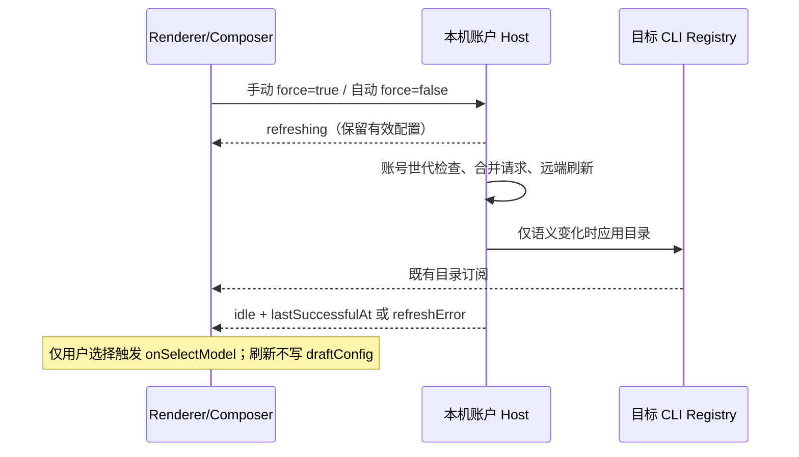

# Agent 模型刷新：UI 规则与验收

状态：模型刷新规则已实现；2026-11-12 完成 macOS 原生 Electron 的隔离验收。2026-11-13 追加模型/推理强度闭环规格与验收目标，实施结果单独记录；不能将旧验收视为新增交互已通过。

关联：[18 模型刷新方案](18-agent-model-refresh-design.md)。本文件只约束 Renderer；Host 的新鲜度、single-flight、账号世代和 CLI admission 由 18 定义。

## 边界与状态所有者

| 场景/入口                        | 复用实现                                       | 展示/草稿所有者                                | 事实与写入路径                                                                | 隔离要求                                                             |
| -------------------------------- | ---------------------------------------------- | ---------------------------------------------- | ----------------------------------------------------------------------------- | -------------------------------------------------------------------- |
| 新建/已有任务模型菜单            | `ModelConfigSelect`、Registry 模型分组 builder | Composer 已有 `draftConfig`，UI 不新增选型缓存 | 选择 → 原 `onSelectModel` → Composer owner；候选来自已有 `modelSelectionView` | 品牌模式显示模型、强度与刷新；不挂载官方套餐、供应商及高级设置 hooks |
| 菜单内刷新模型 ⟳                 | 通用菜单 footer action                         | 按钮忙碌/时间/失败来自 Host inference snapshot | `refreshAgentConfig({ force: true })`                                         | 与余额 ⟳ 分开，不清空当前菜单及显式选型                              |
| 账户页模型状态                   | `BrandInferenceStatus`                         | Host inference snapshot                        | 同一刷新服务命令                                                              | 不把刷新中显示成断开，不展示上游原始错误或凭据                       |
| focus/online/visible/前台 5 分钟 | 根 `BrandAccountProvider` 单处监听             | Renderer 不计算新鲜度                          | `refreshAgentConfig({ force: false })`                                        | Host 去重；后台不周期请求；退出后移除监听和计时器                    |

模型显示名优先使用 Registry 模型条目的顶层 `displayName`，没有时显示原模型 ID。显示名不参与执行 `modelConfig`、请求、选中值和标识编码。失效模型保留原 ID 和“不可用”提示，不把它伪装成新默认模型；用户仍可选择其他当前模型。

失效时 Registry 的 `effectiveSelection` 为空，属于提交门禁，不能用它代替草稿的原始选择意图。品牌控件只在该有效选择缺失时读取现有 `composerDraft.modelSelection` 来展示不可用 ID；不回写草稿、不改变共享 Composer/提交投影，也不恢复一个可执行选择。

菜单刷新按钮在刷新中显示旋转图标并禁用自身，候选及当前选择继续可见。背景刷新失败显示“模型同步失败，保留上次列表，请重试”，不把目录清空或把有效 Agent 状态改成未连接。账户页显示同一成功同步时间；失败不会更新该时间。无法取得初始目录时显示空态与刷新入口，不引导普通用户配置供应商或 API Key。

## 已确认与裁剪的组合

- 品牌/普通模式分开挂载控件，普通模式原供应商选择和高级设置保持已有行为。
- 已有显式模型与新草稿的默认初始化分开：本改动不做初始化、继承和回落；使用现有 owner 规则。
- 同账号配置刷新与退出/换号分开：快照、事件与刷新均经过根 context 的 service/epoch 约束，不从旧 Promise 结果恢复选型或余额。
- 不新增推理时请求、自动改模型、Renderer 配置缓存和页面独立轮询；不改变 desktop-continuous 或 web-remote-replayable 的会话恢复。

## 模型与推理强度闭环（2026-11-13）

品牌模型菜单复用 `ModelConfigSelect.composerOptions` 和共享纯展示菜单，但隐藏供应商导航，不挂载官方套餐 hooks。档位候选和默认值来自目标 Host 当前模型 Registry；选中值仍来自同一 Composer draft，经既有 `onSelectThought` 写回。菜单只写下一次提交的草稿，已接受队列、子任务和在途请求保持既有冻结规则。

- 触发器显示当前模型及实际强度。不同模型采用目标模型默认；重复选择同模型保留合法显式档位。旧档位失效或缺失时不静默填默认，必须提示并由用户显式选择合法档位。
- 菜单标明目标模型默认档位；`minimal`、`xhigh`、`max` 保留独立值。合法历史选择不因后台默认更新改变；当前档位移除后保持历史意图和发送门禁，菜单提供修复入口。
- 品牌 `none` 表示不传 `effort`、交给上游决定，文案为“上游默认”，不得沿用通用“关闭”。单一档位显示固定状态、不显示滑杆与循环快捷键；失效的单档选择须提供明确应用该档位的动作，不能永远卡在禁用状态。
- 多档模型复用滑杆与原有 `cycleThoughtLevel` 绑定，只循环当前模型合法候选；无有效模型、禁用状态、单档模型不接收循环动作。失效值显示待重选，不把滑杆的物理首格当作已选事实。
- 后台实际能力、预算、请求映射或候选集合改变时，旧句柄下一 attempt 仍可能被指纹校验拒绝；本UI改动不更改该协议，也不自动重放请求。仅改默认档位不参与执行指纹。

| ID    | 场景                                     | 必须观察到                                                                            |
| ----- | ---------------------------------------- | ------------------------------------------------------------------------------------- |
| RUI01 | A/B 的允许档位及默认不同，选模后滑杆调档 | 候选来自对应模型；默认标识正确；触发器、草稿与提交冻结值一致，无供应商入口            |
| RUI02 | A 显式高档后重复选 A、切 B、改后台默认   | 同模型保留高档；切 B 用 B 默认；刷新默认不改合法历史值                                |
| RUI03 | 当前档位被移除、旧值缺失、模型被移除     | 原意图保留且不可提交；模型存在时可明确选择合法档位恢复；不靠刷新或同模型重选偷偷补档  |
| RUI04 | 多档、单档与仅 none 模型                 | 键盘循环只在多档合法候选间；单档固定展示；none 文案不出现关闭/Off；失效单档能显式修复 |
| RUI05 | 390/720/1200、中英文、Zai Light/Dark     | 模型长名可截断，强度可读；菜单不溢出；Escape恢复输入焦点；无pageerror                 |

浏览器组件验收只证明现有菜单、回调和草稿/提交投影；完整 Host/CLI 最终 Responses 请求、busy 队列、恢复与子任务仍使用现有 CLI/原生场景验证，不能以合成浏览器替身冒充真实推理。

## 验收场景

| ID    | 前置                                            | 操作                                                | 必须观察到                                                                                         | 证据                    |
| ----- | ----------------------------------------------- | --------------------------------------------------- | -------------------------------------------------------------------------------------------------- | ----------------------- |
| MUI01 | 品牌登录，目录包含两个不同 ID/显示名模型        | 打开新任务菜单并选择第二项                          | 只有模型列表与模型 ⟳，无供应商/API Key/套餐入口；显示名正确；提交值仍为模型 ID；草稿文字不变       | UI + Composer 投影/协议 |
| MUI02 | 已有会话显式选择 A，草稿有文字                  | 自动或手动刷新，服务端仍包含 A 但默认改成 B         | 仍选择 A，草稿不变；同步时间更新；没有选择命令、任务中止或新默认覆盖                               | UI + Host/CLI 事件      |
| MUI03 | 已选 A，服务器新目录移除 A                      | 刷新，再展开选择 B                                  | A 在触发器保留原 ID 并标不可用，B 可选；刷新本身不发 onSelectModel；用户选 B 后才变更              | UI + 协议               |
| MUI04 | 可用旧目录、当前有效任务                        | 刷新时断网/超时，随后恢复并手动刷新                 | 旧候选/选型保持，失败提示可见，最后成功时间不前进；随后成功移除失败提示，按钮不永久旋转            | UI + 网络/Host 快照     |
| MUI05 | 账户页与菜单均可访问                            | 点击模型 ⟳，再点击余额 ⟳                            | 模型只触发 force=true 模型服务命令；余额仍沿原接口同步，不代替模型刷新                             | 服务请求记录            |
| MUI06 | 已登录、前台窗口                                | 连续 focus/online/visible/菜单打开；前台经过 5 分钟 | 自动意图 force=false；不在 Renderer 推断新鲜度；实际去重/限频由 Host；后台周期 tick 不发送         | UI + Host 请求计数      |
| MUI07 | A 账号刷新未完成                                | 退出/切换 B，A 结果迟到                             | 不显示 A 的刷新错误、成功时间或模型；监听/计时器销毁，无跨账号选择写入                             | Host 世代 + UI          |
| MUI08 | 普通模式、本地/远端 workspace、深浅主题与窄窗口 | 打开原模型菜单；再用品牌模式打开                    | 普通模式无品牌请求；品牌控件可读可点且无供应商数据 hooks；键盘关闭恢复输入焦点；无新增会话恢复语义 | 桌面 E2E/人工           |

本轮不新增 App 业务单测；上述场景交给 `packages/desktop/test/e2e/brand-account/` 的隔离 E2E 和人工验收。运行 `pnpm typecheck`、`pnpm lint` 和架构门禁验证工程与边界。需要模拟配置服务响应和可控时钟，不能用真实账号、支付或生产配置修改作为 fixture。

## 2026-11-12 原生执行记录

- 用例：`packages/desktop/test/e2e/brand-account/manual-review/pending/brand-model-refresh-ui.test.ts`，仍属于 pending 候选，未声明为 CI 已准入。
- 运行环境：macOS arm64、真实 Electron Main/Host/Renderer/CLI，使用本轮 CLI bundle 和生产 Renderer 构建；sub2api 替身仅监听 loopback，账号、余额和模型均为合成 fixture。
- 命令：`pnpm --filter @zcode/desktop exec tsx --test test/e2e/brand-account/manual-review/pending/brand-model-refresh-ui.test.ts`。
- 最后一轮结果：1/1 通过，8.8 秒。证据目录：`packages/desktop/.e2e-artifacts/brand-model-refresh-ui-1794470553822/`；该目录按仓库惯例忽略，不是稳定发布物。`result.json` 保存请求清单、逐项断言、平台和 CLI SHA-256，PNG 保存真实界面。最终轮失效截图及此前通过轮 `brand-model-refresh-ui-1794470080823/` 的失效/失败/窄屏截图已目视检查。最终 CLI SHA-256 为 `69930cc79003b0ff03ab0f18aec8b06fe823380e2d3833a0e4bf4727d984ee0b`。
- 作用域：没有提交推理任务，推理请求为 0，没有真实充值/支付；Renderer 捕获到的 HTTP 请求为 0，`pageerror` 为 0。账户与目录请求由 Host 完成。
- 收尾时清理已结束合成运行的 `data/`、`session/`、`electron/` 可再生目录，释放测试浏览器/CLI 缓存空间；保留 `result.json`、截图、`last-state.txt`、workspace 和提取的 Host 日志。报告中的内部数据路径是运行时证据，清理后不承诺仍能打开；重新运行用例可重建隔离环境。

| 场景  | 已执行并通过                                                             | 仍未覆盖                                           |
| ----- | ------------------------------------------------------------------------ | -------------------------------------------------- |
| MUI01 | 两个不同显示名候选、选择编码保留 ID、无供应商/API Key/套餐入口、草稿不变 | 其他语言与大量候选                                 |
| MUI02 | 新任务显式选择 A 后，远端默认改为 B，刷新仍选 A                          | 已经运行的正式会话、正在生成时刷新                 |
| MUI03 | 移除 A 后保留原 ID 与不可用标记，仅列 B；发送禁用，显式选 B 后恢复发送   | 正式会话与远端 workspace                           |
| MUI04 | bootstrap 503 后保留候选/选择/草稿/最后成功时间；手动恢复清除错误        | 真实断网与超时、首次目录失败                       |
| MUI05 | 账户模型刷新发 bootstrap，余额刷新不发 bootstrap；两处状态时间可见       | 多窗口同点与并发强制刷新（Host 场景另验）          |
| MUI06 | 目录新鲜时连续 focus/online/visible/打开菜单不增加 bootstrap             | 真实 5 分钟前台 tick、陈旧自动刷新、后台长时间行为 |
| MUI07 | A 刷新被 gate 阻塞时退出，结果迟到后登录 B，不恢复 A 登录/余额           | 不同账号不同模型目录的界面比对                     |
| MUI08 | 实际深色主题，标准窗口与 720×700 账户页；菜单保持打开后可按 Escape 关闭  | 浅色、Windows、普通模式对照、SSH/WSL/手机          |

首次原生运行发现一个展示缺陷：移除已选模型后，有效提交投影为空，品牌触发器误显示“选择模型”，尽管原始草稿选择仍然存在。已按本文件的 owner 规则修正为仅投影原始选择的不可用状态；没有改变有效提交或持久化语义。随后两轮原生运行通过，其中最后一轮额外确认发送门禁。

最终 CLI 增量构建后的一次回归在首次模型选择后的草稿断言失败，输入为空换行，完整失败证据保留在 `brand-model-refresh-ui-1794470460996/`。旧 harness 仅等输入框可见，既未等待 `isContentEditable`，也未在模型操作前确认输入成功，因此不能据此断言“切模清空草稿”的产品根因。harness 现增加真实可编辑前置和输入后即时断言；最终轮在此检查及全部模型操作后检查均通过。没有为此修改产品代码或吞掉异常。

## 2026-11-13 推理强度组件实施与验证

- 品牌控件已连接共享模型/强度菜单与既有 `onSelectThought`；共享菜单供应商导航默认保持原行为，品牌显式关闭。品牌 `none` 使用“上游默认”，单档只显示状态，失效单档提供显式应用动作。
- 同模型保留规则仅限目标目录中 `access.type=brand-managed` 的模型；普通 API 模式主动重选仍采用原默认规则。保留原意图读取 Composer owner，不能从已经剥离非法档位的有效投影反写历史。
- 新浏览器候选：`packages/ui/test/browser/manual-review/pending/brand-model-reasoning.test.mjs`，使用真实 `BrandComposerModelControls`、`useDraftConfigControl`、目录订阅和 `createComposerSubmissionConfig`，只替换外部 Host 目录。Node24.19.0 运行17/17通过，覆盖模型不同候选及默认、同模型保留、普通模式默认规则、默认更新、非法/缺失/单档修复、移除模型、none、键盘、提交冻结、Escape焦点及390/720/1200双语深浅主题；无pageerror。截图位于 `packages/desktop/.e2e-artifacts/brand-model-reasoning/`，已检查390px浅色中文效果。该候选仍未声明CI准入。
- 新原生候选：`packages/desktop/test/e2e/brand-account/manual-review/pending/brand-model-reasoning-ui.test.ts`。当前源码重建CLI和Desktop、补齐钱包恢复导航后再次显式运行通过，macOS **1/1**（9.7秒）；产物为 `packages/desktop/.e2e-artifacts/brand-model-reasoning-ui-1794546249062/result.json` 与 `completed.png`。菜单选择high并批准真实Write权限，Write→Read完成，3条stream main Responses均携带high，最后包含Read结果，标题调用仍用low；errors/violations为空，截图已目视检查。本轮原生未在审批期间改变后续草稿，不声称覆盖该时序；accepted冻结由上述17项浏览器候选验证。运行入口为 `pnpm --filter @zcode/desktop exec tsx --test test/e2e/brand-account/manual-review/pending/brand-model-reasoning-ui.test.ts`，可通过 `ZCODE_ACCOUNT_E2E_RENDERER_URL` 指向开发Renderer；不连接生产付费模型。整体交接见 [26](26-client-refinement-implementation.md)。

独立复核补充：共享单档修复必须遵守普通供应商连接切换的 `providerMenu.pending` 屏障。菜单项禁用且handler再次校验，连接尚未完成时强制点击也不写配置；切换完成后才可明确应用单档。新增共享组件browser场景及品牌失效修复回归2/2通过（2026-11-13），未改变品牌单档行为。
