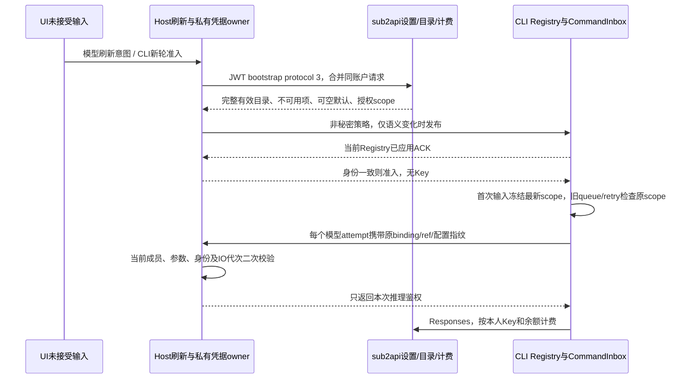

# Agent 模型在线刷新：实施与交接

2026-11-12。本轮按用户授权完成本地改造和验证，不部署、不更改生产配置、不发起真实支付或付费模型请求。两个仓库保持 `codex/desktop-managed-agent`：ZCode 基于 `a9fe401e` 及进入本轮前已有的账号钱包/托管推理工作区；sub2api 基于 `ed06646f8`，进入本轮时干净。本轮没有重置、提交或推送已有工作区。

产品规则以 [14 当前合同](14-managed-agent-inference-spec.md) 为准；[18](18-agent-model-refresh-design.md) 保留设计调查，[19](19-agent-model-refresh-ui-acceptance.md) 记录 UI 场景和原生证据。旧文档中的 protocol 2、整份目录失效和关闭连接界面描述是历史行为，不能用来覆盖本轮合同。

## 用户实际得到的行为

| 变化/故障                             | 新行为                                       | 工作保留与限制                                                                      |
| ------------------------------------- | -------------------------------------------- | ----------------------------------------------------------------------------------- |
| 新增、改名、修改默认模型              | 更新候选与新任务推荐值                       | 不重写显式选择，不取消正在执行的 SSE 或工具                                         |
| 移除一个模型                          | 该模型标不可用，其余有效模型保留             | 旧选择、输入和成果保留；下一请求拒绝，不偷偷换模型                                  |
| 修改能力、允许思考档位或输出预算      | 新实例采用新配置，旧冻结实例下次请求检查指纹 | 已打开的流继续；只改推荐思考默认值不使旧显式档位失效                                |
| 默认模型失效                          | `default:null`，要求用户选择一个有效模型     | 不猜首个模型，不回落官方或环境 Key                                                  |
| 分组内一项被下架/白名单或思考策略变化 | protocol 3 按项输出有效目录及不可用原因      | 默认下架不拖垮其余模型；全下架显示空目录                                            |
| 分组、Key 或网关变化                  | 新输入在同步与 CLI ACK 后使用最新授权        | 不主动截断已有流/工具；旧已接受输入、队列、retry 不能跨授权 scope 自动迁移          |
| 换账号、origin、epoch 或确证凭据失效  | 保留原强隔离和取消规则                       | 旧账号迟到结果不能恢复授权；不能把旧工作改扣新账号                                  |
| 控制面网络/503/429/非法响应           | 保留旧合法目录、最后成功时间和失败提示       | 普通 attempt 不被后台失败额外中断；超过60秒的新一轮须同步成功，未接受输入和队列保留 |
| 配置保存与领取 Key 恰好竞争           | 同 flight 最多补取一次                       | 连续竞争按临时同步失败处理，不清空已验证策略，不无限重试                            |
| 余额接口临时失败                      | 模型初始化独立继续                           | 客户端不记账、不猜余额；实际推理仍由网关余额规则决定                                |

模型菜单与账户页提供独立“刷新模型”；余额旁 ⟳ 继续只同步服务器余额和实际消费。启动/登录、手动、展开菜单、回到前台、恢复网络和执行准入共用 Host 唯一刷新 owner；自动触发遵守60秒 freshness、single-flight 和失败退避/Retry-After。应用在前台时每5分钟提交检查意图，Renderer 不维护第二份目录或计时事实。

sub2api 的 Agent 页保留分组下拉、逐项添加/删除模型、默认与能力设置，收起重复的连接开关和关闭按钮；完整有效保存即发布。旧 `enabled` 和 disable API 兼容保留。不新增停服机制，不给 Agent Key 增加一层按桌面目录拦截的网关 ACL，本人网页读取/复制 Key 的规则不变。

## 状态所有者与请求顺序



本机继续使用 desktop-continuous；没有修改手机的 web-remote-replayable、owner/lease、workspace identity 或快照恢复语义。远端/手机没有因此获得本机品牌凭据。CLI 仍是已接受输入和队列的唯一所有者，Host 不新建任务队列。

## 具体改动位置

| 模块            | 位置与职责                                                                                                                                                                                                                                                                                                                                                                                                                                                            |
| --------------- | --------------------------------------------------------------------------------------------------------------------------------------------------------------------------------------------------------------------------------------------------------------------------------------------------------------------------------------------------------------------------------------------------------------------------------------------------------------------- |
| sub2api         | [`DesktopAgentService`](../../../sub2api/backend/internal/service/desktop_agent.go)：v3逐模型校验、nullable默认、稳定 `authorization_scope`；DB/目录暂时读取失败返回HTTP错误，不伪造空成功。管理页 [`AgentSettings.vue`](../../../sub2api/frontend/src/components/admin/settings/AgentSettings.vue) 收口；完整合同和后端验证见 [DESKTOP_AGENT.md](../../../sub2api/docs/DESKTOP_AGENT.md)。共8个文件，无新增数据库迁移。                                              |
| Host账户域      | [`managedInference.ts`](../../packages/services/src/brand-account/managedInference.ts) 单一刷新、成功时间、退避、scope及指纹校验；[`inferenceBootstrap.ts`](../../packages/services/src/brand-account/inferenceBootstrap.ts) 严格解析1/2/3；[`service.ts`](../../packages/services/src/brand-account/service.ts) 公开安全快照、钱包独立启动、退出失败释放本机屏障。支付类型拆至同域 `paymentContract.ts`，验证/投影抽至同域 `projections.ts`，仍同RPC facade与owner。 |
| Host→CLI        | [`zcodeAgentService.ts`](../../packages/services/src/zcode-agent/zcodeAgentService.ts) 复用 runtimeHeaders 的 admission/attempt、等待目标 CLI ACK；无Key身份握手与完整attempt授权分离。                                                                                                                                                                                                                                                                               |
| shared/provider | [`model-selection.ts`](../../packages/shared/src/model-selection.ts) 明确空目录/默认与执行指纹；Provider/Registry保留显示名、无默认不回落，默认推荐值不计入执行指纹。                                                                                                                                                                                                                                                                                                 |
| CLI             | `bootstrap/src/zcode-protocol/account-provider-config.ts` 只对身份/blocked取消；`zcode-protocol/v4-bridge.ts`、`v4-gateway.ts` 与原CommandInbox做准入和绑定；`provider-runtime-headers.ts`、adapters/core逐attempt传指纹；原SSE、工具与会话引擎不重写。                                                                                                                                                                                                               |
| UI              | [`BrandComposerModelControls.tsx`](../../packages/ui/src/brand-account/BrandComposerModelControls.tsx)、`BrandModelSyncStatus.tsx`、账户状态和根Provider，复用现有模型菜单/Registry/草稿owner。仅展示时回读原始草稿失效选择，不放宽提交门禁、不挂载官方套餐与供应商hooks。                                                                                                                                                                                            |

## 本地验证

环境为 macOS arm64；本机 Node 与 `mise.toml` pin 存在差异，不能据此声明固定版本或干净双平台发行验收通过。freshness 的远端 fetch 超时；`node scripts/check-workspace-freshness.mjs --no-fetch` 通过，缓存 `origin/main` ahead0/behind0，无跟踪分支。

| 范围           | 执行与结果                                                                                                                                                                                                                                                                                                                                                      |
| -------------- | --------------------------------------------------------------------------------------------------------------------------------------------------------------------------------------------------------------------------------------------------------------------------------------------------------------------------------------------------------------- |
| Host/账户/准入 | 从 `packages/desktop` 执行 `node --import tsx --test` 加 `test/e2e/brand-account/manual-review/pending/` 下 `brand-managed-runtime.test.ts`、`brand-managed-delivery.test.ts`、`brand-account-runtime.test.ts`、`brand-account-admission.test.ts`：52/52通过。覆盖single-flight、临时失败、空目录、旧实例、换号、刷新IO代次、退出落盘失败、钱包故障与保存竞争。 |
| CLI            | bootstrap五文件86/86，请求鉴权19/19、provider-regression29/29；CLI整体typecheck34包通过，最后准入增量bootstrap typecheck再次通过；官方整CLI lint wrapper 0 errors/72 warnings、architecture 0。含真实SDK/HTTP SSE：首流保持，旧显式档位可继续；切scope/ref/网关后旧实例下一attempt拒绝且无多发HTTP。此层是进程内协议server，不能冒充stdio。                     |
| sub2api        | 定向Go行为3包通过、server编译通过；前端7文件148项、vue-tsc通过，完整ESLint 0 errors/1既有warning；未重跑Vite或真实浏览器。精确命令见后端合同第47行起。                                                                                                                                                                                                          |
| ZCode工程门禁  | 根 `pnpm typecheck`、`pnpm lint`、`pnpm architecture:check --changed` 通过；Lint保留84 warnings、0 errors；architecture 0 violations。两仓库 `git diff --check` 通过。                                                                                                                                                                                          |
| 原生UI         | 真实Electron Main/Host/CLI与生产Renderer，合成loopback控制面，覆盖模型菜单/草稿/移除/503/独立刷新及迟到换号；执行证据和未覆盖组合见 [19](19-agent-model-refresh-ui-acceptance.md)。                                                                                                                                                                             |
| 原生工具       | 最终构建的protocol3真实stdio Write→Read→正文、标题辅助调用、消费展示、退出与秘密扫描：1/1通过，约11秒，详见下方。                                                                                                                                                                                                                                               |

App业务单测未新增；沿用pending的隔离HTTP/原生E2E及CLI/后端回归，不将候选场景自动晋升CI。原生模型响应是确定性fixture，真实文件工具执行，既不证明生产模型质量，也不证明真实余额扣费。

原生工具命令（从 `packages/desktop` 执行）：

```sh
ZCODE_ACCOUNT_E2E_RENDERER_URL=file:///Users/patrick/WorkBuddy/MiloRouter/ZCode/packages/desktop/out/renderer/index.html \
  node --import tsx --test test/e2e/brand-account/manual-review/pending/brand-managed-inference.test.ts
```

证据目录 `packages/desktop/.e2e-artifacts/brand-managed-inference-1794470506499/`；`result.json`、`gateway-trace.json`、权限/完成/消费截图与 `workspace/E2E_MI05-output.txt` 保留。真实Main→Host→CLI stdio运行，三次流式主请求依次触发真实Write、Read及最终正文；另观察到一次标题辅助请求，全部为同用户Agent鉴权。Renderer请求和fixture违规均为空；DOM/storage/URL、进程参数、Main输出及合成数据/配置/日志/快照的秘密哨兵扫描通过。实际消费UI读取的是精确合成usage，不是真实扣费。

- 最终CLI bundle SHA-256：`69930cc79003b0ff03ab0f18aec8b06fe823380e2d3833a0e4bf4727d984ee0b`。
- 真实工具输出SHA-256：`d5070ef8be9d9252d383da8e93c0824f123fa208ad17244c67330ff813c31123`。
- 首次旧轮验收在正文完成后过早检查异步标题sidecar导致失败；最后修正为等待fixture实际观察到该请求，再检查结果，有15秒上界。没有降低标题必须走托管鉴权的要求，未通过轮保留独立证据。

## 发布交接与剩余边界

1. 另一个发布Agent先审查并发布sub2api本轮8文件。protocol1/2维持原响应和整体严格验证；protocol3新增有效子集、可空默认、不可用项及授权scope。无需数据库迁移，不批量改用户Key或余额。
2. 后端支持3后，再运行本地最新版ZCode连接联调，最后才发行新版桌面。新桌面请求3连接旧后端会被拒绝，不能靠重试降级掩盖。旧桌面不具备本轮在线刷新/故障隔离保证。
3. 发布不代替配置：在独立Agent设置确认分组、可路由模型、默认、能力和预算后完整保存；不需要停用再启用。测试账号真实推理与服务端usage核对由后续明确联调完成。
4. Windows原生安装包、干净机依赖、真实网络断连、5分钟长运行、多个设备同时懒迁移Key分组、生产限流/余额错误和实际账单尚未完整验证。管理页本轮通过组件/类型/静态检查，没有本轮真实浏览器证据。

多设备仍共用每用户一把Agent Key，bootstrap时懒同步分组；客户端不能冻结服务器价格或把“Agent Key消费”说成“本设备/本任务消费”。旧已接受工作跨scope要由用户明确重发/重选，不能为了可用性绕过账户和扣费边界。控制面临时不可用期间旧合法目录可展示、在途工作可继续，但过期新轮仍等待有效刷新；这是一条明确的产品限制。

## 本地磁盘处理

开始前清理35个旧的合成brand-account/brand-managed-inference E2E运行目录中的可再生 `session`/`data`，以及 `.zcode-runtime/fork-preview/electron`，逻辑约2.76GiB；后端验证完成后清理可再生Go编译缓存约1.9GiB。收尾再清理已结束合成运行下37个 `session`/`data`/`electron` 子目录，逻辑545MiB；先复制Host日志和CLI debug到对应 `preserved-logs/`，保留result、截图、last-state、网关trace和workspace成果。清理清单位于 `.e2e-artifacts/brand-refresh-cleanup-2026-11-12.json`。

保留源码、用户真实 `.zcode`、当前依赖和其他Agent的部署产物。初始可用约9.8GiB；构建和验收重新占用部分空间后，最终 `df -h /System/Volumes/Data` 显示约13GiB可用。逻辑清理量不等同APFS实际释放。result中的扫描路径记录的是当时事实，已清理合成目录不保证继续存在；不删除其报告/截图来掩盖失败。
