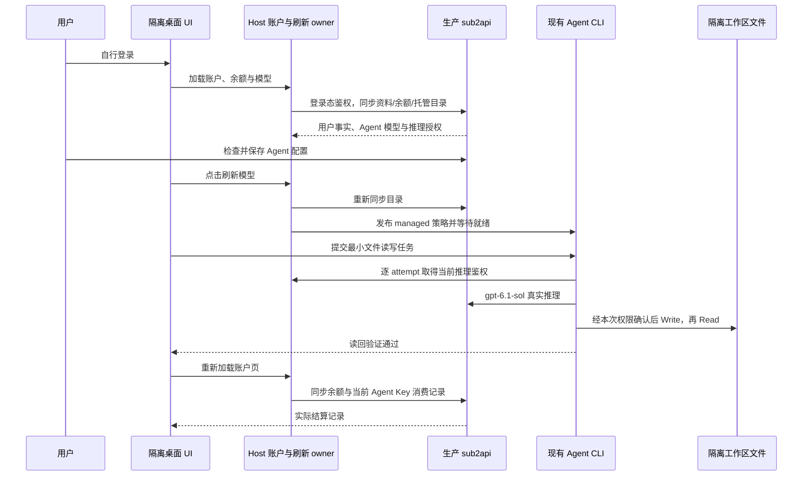

# Agent 模型刷新：生产后端联调验收

2026-11-12，macOS arm64。本次连接用户已部署的 sub2api，使用隔离的 ZCode 开发窗口和用户自行登录的账号，验证模型同步、真实推理、文件工具与服务端消费展示。**登录 → 自动取得托管模型 → 真实 Write/Read → 展示服务端消费记录已通过；不代表全部生产场景或双平台发行通过。**

本轮只进行验证并维护本文档，没有修改产品代码或生产配置，未手工修改余额或价格，没有充值、下单、支付、部署或发布。线上 Agent 配置由用户自行检查并保存；真实模型请求正常使用用户现有余额并由后端计费。历史本地 fixture 验证见 [20 实施交接](20-agent-model-refresh-implementation.md)，当前行为合同见 [14](14-managed-agent-inference-spec.md)，不能混用两类证据。

## 验收身份与隔离

| 项目             | 本次实际状态与限制                                                                                                                           |
| ---------------- | -------------------------------------------------------------------------------------------------------------------------------------------- |
| ZCode            | `codex/desktop-managed-agent`，HEAD `a9fe401e`，版本 `3.17.2`，包含现有未提交改造；HEAD 本身不包含全部被验实现                               |
| CLI 实际产物     | SHA-256 `69930cc79003b0ff03ab0f18aec8b06fe823380e2d3833a0e4bf4727d984ee0b`，与 20 中最终本地验收产物相同                                     |
| sub2api 本地参考 | `codex/desktop-managed-agent`，`5cb039f75`，工作区干净；用户告知已部署。网页可见版本 `v0.2.21-ds.9`，未通过页面证明生产镜像的精确 Git commit |
| 运行方式         | `pnpm dev:desktop`，真实 Electron Main → window-scoped Host → CLI stdio；Renderer 为本地开发服务，连接真实生产控制面和模型网关               |
| 环境             | macOS arm64、Node `24.19.0`；仓库 pin 为 `24.14.0`，本次不是固定工具链正式包验收                                                             |
| 数据隔离         | 桌面数据、会话及工作区位于 `/tmp/zcode-live-verification/`；没有读取用户原有 `~/.zcode`，也没有读取或复制登录材料、JWT、模型 Key             |
| 验证边界         | 登录信息和生产配置由用户操作；模型同步与任务通过产品 UI 完成。未手工向 CLI 写入模型 Key，未扩大持续工具权限                                  |

## 实际通过的链路

| 场景               | 观察结果与证据边界                                                                                                                                                                                                                                                                                    |
| ------------------ | ----------------------------------------------------------------------------------------------------------------------------------------------------------------------------------------------------------------------------------------------------------------------------------------------------- |
| 登录及资料         | 用户自行登录成功，桌面展示本人资料与服务器余额。没有从 UI 成功登录推导 JWT 到期续签也已通过                                                                                                                                                                                                           |
| 自动及手动余额同步 | 进入账户页有新的同步时间；实际点击余额旁 ⟳ 成功。客户端读取服务器事实，没有本地扣减或计算余额                                                                                                                                                                                                         |
| 初始配置问题       | 线上管理页最初显示“当前配置尚未发布”，桌面显示模型暂不可用；源码与只读状态对应历史 `enabled=false`。用户自行检查并“保存并应用 Agent 配置”后恢复，部署代码本身不会替代管理员发布配置                                                                                                                   |
| 模型目录同步       | 保存后点击桌面“刷新模型”，从暂不可用变为“模型已就绪”；默认与候选模型均为 `gpt-6.1-sol`，视觉能力标记可见；展开模型菜单可观察到新的同步时间。Host 日志确认 managed 策略已交付且 CLI provider/model ready                                                                                               |
| 真实主任务         | CLI 日志确认 `milorouter-managed / gpt-6.1-sol` 的工具首次输出、正文输出与主任务完成；UI 显示 Write → Read → 最终“读回验证通过。”                                                                                                                                                                     |
| 文件工具与权限     | 只在隔离工作区创建一个验收文件；写入权限仅允许本次，没有选择永久放行。文件存在、内容与字节数经磁盘读取核对                                                                                                                                                                                            |
| 消费展示与交叉核对 | 桌面同步后出现 4 条该模型的真实已结算记录。网站使用记录按 `Desktop Agent (managed)` 筛选，恰好得到对应 4 条，时间吻合，费用按网站显示精度与桌面一致。网页费用保留 6 位小数；桌面依据服务端精确 credits 字符串以 BigInt 换算展示金额，没有以余额差推算单任务费用，也没有据此重新核验后端价格或账本算法 |
| 充值入口与记录     | 本次检查期间充值仍未开放；记录接口可读取，显示暂无记录。没有真实订单或到账证据，不能标记支付验收通过                                                                                                                                                                                                  |

四条账单属于**该用户 Agent Key 在所选范围内的消费**，不能标成“本设备全部消费”“本次任务独立总费”，也不能逐条断言哪条是标题请求。其他 Key 的账单不在本轮核对范围；没有因时间或 token 数相近而推断重复计费。

本次任务在 19:14—19:16（Asia/Shanghai）执行。UI 的“已工作 1 分 47 秒”包含等待权限操作，不能当作纯模型推理时延或性能基准。

## 文件、日志与本地证据

最小任务要求只创建 `milorouter-agent-smoke.txt`，实际 Write 后再 Read，禁止联网、安装依赖或修改其他文件。文件为 25 bytes、无换行，内容严格等于 `MILOROUTER_AGENT_SMOKE_OK`；SHA-256 为 `df8b146eb370cf031ea04eaa6c948ccc2c3166024cfc61e27245aac35b9d7f4a`。

证据保留在本机临时目录，不提交账户截图、完整日志或真实账单金额：

| 本机路径                                                                                | 内容                                                                         |
| --------------------------------------------------------------------------------------- | ---------------------------------------------------------------------------- |
| `/tmp/zcode-live-verification/home/.zcode/workspace/default/milorouter-agent-smoke.txt` | 实际文件工具产物                                                             |
| `/tmp/zcode-live-verification/evidence/smoke-complete.jpg`                              | 完成页、Write/Read 与最终正文                                                |
| `/tmp/zcode-live-verification/evidence/managed-usage-desktop.jpg`                       | 桌面最近消费记录                                                             |
| `/tmp/zcode-live-verification/evidence/managed-usage-web.jpg`                           | 网站筛选 Agent Key 后的 4 条记录                                             |
| `/tmp/zcode-live-verification/home/.zcode/v2/logs/2026-11-12.log`                       | 隔离 Host/CLI 日志；786 行工具输出成功，811 行正文输出成功，815 行主任务完成 |

以上绝对路径是本次机器上的验收产物，临时目录未来清理后不保证存在。截图含本人账户信息，分享时须另行脱敏；日志只做白名单字段核对，没有将请求 headers、body 或账户存储复制进报告。

## 辅助请求与未验范围

标题在 UI 自动变为“MiloRouter 连接验收与文件读写验证”。该会话日志可见的 5 次运行时授权请求均指定 managed provider，最后一次与标题生成时序相符，但缺少可独立关联的 `consumer/querySource/status`，因此标题仅记为“源码链路确认，运行结果尚缺独立归因证据”。不能据此把所有辅助请求标成生产验证通过。

源码依据：[`title-generation-sidecar.ts:46`](../../apps/zcode-cli/packages/core/src/runtime/methods/title-generation-sidecar.ts#L46) 在没有显式标题模型时继承普通会话选择及计费绑定；[`同文件:186`](../../apps/zcode-cli/packages/core/src/runtime/methods/title-generation-sidecar.ts#L186) 每次真实 attempt 前刷新授权；[`zcodeAgentService.ts:1729`](../../packages/services/src/zcode-agent/zcodeAgentService.ts#L1729) 品牌模式统一进入 managed 授权分支。压缩、记忆、子 Agent、goal 等本轮未触发。

以下继续保留为未验，不用本地 fixture 或源码检查代替生产证据：

- 真实充值、支付与到账后余额更新；待充值开放后单独验收。
- 登录 JWT 自然到期刷新、退出后重登、多账号及多设备同时使用。
- 生产新增/删除模型、切换分组和网关、预算/能力变化时的在途任务与队列；本轮没有为测试而修改生产配置或实施故障注入。
- 生产断网、429/503、模型失效、空目录、余额不足及 5 分钟以上的长运行。本地覆盖情况见 19/20，不能升级为生产通过。
- Windows 原生正式包、macOS 正式包、干净机器的工具与办公依赖、签名、更新和再分发。
- 网站生成与预览、Excel 修改、PPT 生成/预览/导出等具体场景。

隔离日志仍有既有官方 MCP `image_search/sites` 鉴权不可用和任务索引警告；本次仅用文件工具的任务完成不受阻。它们需作为后续官方依赖和任务恢复专项调查，不能由本次成功推出全部工具均已脱离官方服务，也不能仅凭 warning 判断数据丢失。

## 本轮检查及后续顺序

本轮 workspace freshness 检查通过；根 `pnpm typecheck` 通过，`pnpm lint` 通过（84 warnings、0 errors）。这些检查针对当前含已有改造的工作区，不代表只凭上述 HEAD 可以复现，也不代表 Windows 打包通过。本文档收尾另检查格式、引用路径和空白。

账号与模型的核心闭环已具备下一步场景验收条件。建议先在隔离工作区完成“小型网站 → 本地预览 → 修改”，再验证“Excel 修改/PPT 生成 → 预览 → 导出”；同时补齐正式包和办公依赖清单。生产目录变更及故障恢复继续按 18/19 的稳定场景编号验收。支付保持独立门禁，不为推进开发任务开放真实支付。
