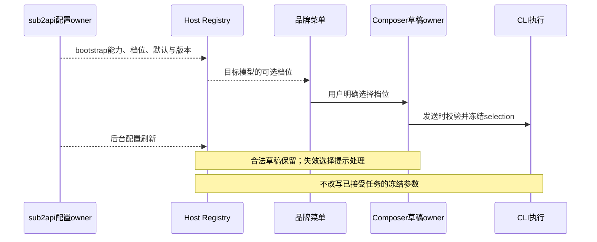

# 推理等级缺失与模型配置表单复核

调查日期：2026-11-12。模式：`impact-only`。本轮只记录源码证据与建议，没有修改运行代码、后台配置或生产环境，没有发起模型请求。本文是调查记录，不是已实施行为 spec。

## 问题与结论

用户提供三张截图：品牌客户端只有模型菜单；后台暴露完整模型能力和三个 Token 数值；期望用工具、图片、思考及预算等少量配置完成设置。

1. **推理等级缺失是品牌菜单接入遗漏。** 后台档位已投影到 Registry，但品牌控件没有接收推理回调，也没有渲染档位控件。不是后台勾选错误，也不是底层执行不支持。
2. **协议要求完整，不等于管理员必须手填全部字段。** 当前表单把基础准入条件、常用能力和协议兼容字段混在一起；四项不可取消的基础能力仍显示可取消选框，会制造无效组合。
3. **可以采用第三张图的简洁方向，但不能直接复制字段语义。** 当前 `none` 是省略 effort，不是关闭思考；上下文窗口也不是单纯输入上限。新增自动预填应复用已有元数据，并披露未知和冲突。

## Feature Summary

| 字段             | 内容                                                                                                                          |
| ---------------- | ----------------------------------------------------------------------------------------------------------------------------- |
| Developer intent | 解释推理等级缺失及表单负担，确认最小修复边界                                                                                  |
| Capability       | 品牌模型选择、推理档位、后台模型描述                                                                                          |
| Change layer     | 建议涉及 presentation / option-source；本轮不实施                                                                             |
| Operating mode   | impact-only                                                                                                                   |
| Primary seeds    | `BrandComposerModelControls`、`ConversationComposer`、`inferenceBootstrap`；sub2api `AgentModelSettingsCard`、`AgentSettings` |
| Out of scope     | 生产改配置、付费探测模型、引擎重写、账户/计费协议改造、全局改写不同供应商的 none 语义                                         |

## UI Surface Matrix

| 场景             | UI入口/共享实现                                | 草稿owner           | 默认来源                | 校验与提交                            | 权威/持久化                    | 模式隔离                        |
| ---------------- | ---------------------------------------------- | ------------------- | ----------------------- | ------------------------------------- | ------------------------------ | ------------------------------- |
| 品牌新任务选模   | BrandComposerModelControls → ModelConfigSelect | 现有 Composer draft | Registry defaultLevel   | onSelectModel → useDraftConfigControl | Host目录；发送时冻结selection  | 不挂载官方供应商/套餐/团队hooks |
| 品牌已有任务调档 | 当前缺UI；可复用纯展示控件                     | 同一 Composer draft | 已有合法显式选择        | onSelectThought → 同一草稿owner       | 下一次submission；在途配置不变 | 不增加brand专属reasoning store  |
| 普通ZCode调档    | V4ComposerToolbar → ComposerModelOptions       | 同一Composer机制    | 本模型option specs      | 现有onSelectThought                   | 与品牌共用模型合同             | 不修改其他供应商none含义        |
| 后台配置模型     | AgentSettings → AgentModelSettingsCard         | Vue页面draft        | 保存配置；新模型预算为0 | 保存API、分组目录及DTO校验            | sub2api设置持久化              | 账户/余额与目录刷新保持独立     |

## Shared And Divergent Behavior

| 关注点    | 共用部分                                        | 应有区别                 | 对本次的影响                     |
| --------- | ----------------------------------------------- | ------------------------ | -------------------------------- |
| UI        | 可复用ModelConfigSelect/ComposerModelMenu纯展示 | 品牌隐藏供应商/套餐入口  | 不能直接换回整个普通工具栏       |
| 候选来源  | 目标Host的ModelSelectionView                    | 品牌事实来自sub2api      | 不本地硬编码档位                 |
| 默认/继承 | 全新初始化/主动选模读取defaultLevel             | 历史失效选择不静默补档   | 切模型、刷新、恢复分别验收       |
| 校验      | selection完整且档位属于候选                     | none在品牌协议里是自动   | 中文标签和滑杆视觉不能误导为关闭 |
| 提交      | 同一草稿owner、发送时冻结                       | 后台配置不改写已接受任务 | 刷新不改在途调用                 |
| 恢复      | 保留有效选择；无效选择需处理                    | 不复制新的品牌状态       | 不通过刷新自动升级推理成本       |

## Feature Relationships

| 优先级         | 关系                                     | 条件/用途                                                 | 证据                                                                                                                                                                                                                                                                                            |
| -------------- | ---------------------------------------- | --------------------------------------------------------- | ----------------------------------------------------------------------------------------------------------------------------------------------------------------------------------------------------------------------------------------------------------------------------------------------- |
| must-inspect   | 后台档位 → bootstrap → Registry          | 确认能力未丢失                                            | [inferenceBootstrap.ts:274](../../packages/services/src/brand-account/inferenceBootstrap.ts#L274)                                                                                                                                                                                               |
| must-inspect   | 品牌菜单 → 父组件回调 → Composer draft   | 缺失的UI链路                                              | [BrandComposerModelControls.tsx:35](../../packages/ui/src/brand-account/BrandComposerModelControls.tsx#L35)、[ConversationComposer.tsx:2538](../../packages/ui/src/v4/ConversationComposer.tsx#L2538)                                                                                           |
| must-inspect   | 普通菜单 → 同一档位owner                 | 复用边界                                                  | [V4ComposerToolbar.tsx:1072](../../packages/ui/src/v4/composer/V4ComposerToolbar.tsx#L1072)、[useDraftConfigControl.ts:961](../../packages/ui/src/v4/composer/useDraftConfigControl.ts#L961)                                                                                                    |
| must-inspect   | ComposerModelMenu → Provider行           | 合并菜单当前总渲染Provider；仅showProviderLevel=false不足 | [ComposerModelMenu.tsx:158](../../packages/ui/src/chat-input-toolbar/ComposerModelMenu.tsx#L158)                                                                                                                                                                                                |
| must-inspect   | none → effort省略；通用标签把none视为off | 防止复用时语义错误                                        | [inferenceBootstrap.ts:278](../../packages/services/src/brand-account/inferenceBootstrap.ts#L278)、[thoughtLevelLabels.ts:6](../../packages/ui/src/chat-input-toolbar/thoughtLevelLabels.ts#L6)、[thoughtLevelOptions.ts:9](../../packages/ui/src/chat-input-toolbar/thoughtLevelOptions.ts#L9) |
| should-inspect | 模型预算 → 执行/压缩/剩余上下文          | 不能为省输入工作随意扩大数值                              | [turn-model-step.ts:173](../../apps/zcode-cli/packages/core/src/runtime/methods/turn-model-step.ts#L173)、[model-token-limits.ts:34](../../apps/zcode-cli/packages/core/src/runtime/methods/model-token-limits.ts#L34)                                                                          |
| conditional    | 模型元数据 → 分组公共ID                  | 预填时处理别名、多上游差异和未知                          | sub2api `upstream_models.go:35`、`openai_codex_model_metadata.go:188`                                                                                                                                                                                                                           |
| invariant-only | 最低允许档位 → 辅助调用                  | none不保证最低实际思考成本                                | [auxiliary-model-options.ts:9](../../apps/zcode-cli/packages/core/src/model/auxiliary-model-options.ts#L9)                                                                                                                                                                                      |

sub2api路径均相对于相邻仓库 `/Users/patrick/WorkBuddy/MiloRouter/sub2api`，以下给完整仓库相对路径，便于两个仓库分开维护。

## State Owners And Commit Sinks

| 状态/事实          | 展示/草稿owner              | 权威owner                     | 写入与缓存                                      | 证据                                                                                                                            |
| ------------------ | --------------------------- | ----------------------------- | ----------------------------------------------- | ------------------------------------------------------------------------------------------------------------------------------- |
| 模型能力/支持档位  | 后台表单draft；Host目录投影 | sub2api保存配置及有效分组目录 | 保存配置API → bootstrap → Registry              | sub2api `backend/internal/service/desktop_agent.go:425`；inferenceBootstrap:253                                                 |
| 下次消息的推理档位 | Composer draft              | 发送前的合法selection         | onSelectThought → updateDraftConfig；提交时冻结 | useDraftConfigControl:961；[composerSubmissionConfig.ts:25](../../packages/ui/src/v4/composer/composerSubmissionConfig.ts#L25)  |
| 已接受任务的参数   | UI只读投影                  | CLI/runtime冻结配置           | 现有执行链                                      | [provider-registry-model-runtime.ts:43](../../apps/zcode-cli/packages/bootstrap/src/app/provider-registry-model-runtime.ts#L43) |

建议事件顺序，不是本轮新增实现：

## 后台字段用途与简化建议

| 当前字段                           | 当前用途/填写边界                                                    | 建议展示                                           |
| ---------------------------------- | -------------------------------------------------------------------- | -------------------------------------------------- |
| 模型ID、显示名、默认模型           | ID必须来自已选分组下拉；显示名可默认等于ID                           | 保留当前添加/删除模式；显示名可选                  |
| 文本输入、文本输出、流式、工具调用 | 后端强制true；不支持的模型不适合本Agent                              | 固定为基础要求，隐藏可取消选框                     |
| 图片输入                           | 模型接收图片；不是图片生成                                           | 常用“图片理解”开关                                 |
| supports_reasoning、档位、默认档位 | 控制是否发送effort、允许值及新选择默认                               | 常用“可设置思考强度”；关闭设置不承诺模型不思考     |
| context_window                     | 上下文总预算；用于压缩与输入/输出预算                                | 可信元数据预填；未知时要求确认；不得简写成输入上限 |
| max_output_tokens                  | 物理输出能力上限；当前用于DTO一致性校验                              | 高级区/元数据；保留底层校验                        |
| default_max_output_tokens          | 当前直接成为optionSpecs.maxOutputTokens.max及CEL cap，日常执行读取它 | 改称“Agent单次输出预算”；不要误称仅建议默认值      |
| 原生PDF/音频/视频                  | 原生模型输入模态，不是本地工具读取或预览能力                         | 高级区，未知保持关闭；不能因为要做办公就全打开     |
| JSON Schema                        | 结构化输出、部分记忆召回                                             | 高级能力，按真实支持确认；与工具调用不同           |
| 原生网页搜索                       | 模型网关原生工具；与浏览器工具不同                                   | 高级区，未知关闭                                   |
| MFJS工具结构、对话中system         | 特定schema与消息兼容策略                                             | 高级兼容区；未知不启用                             |

后端准入与字段关系：sub2api `backend/internal/service/desktop_agent.go:425–459`。当前表单：`frontend/src/components/admin/settings/AgentModelSettingsCard.vue:16–37`。添加模型使用空预算且不会猜其他模型能力：`frontend/src/components/admin/settings/AgentSettings.vue:156–166`。

**当前不能直接从分组自动取齐这些事实。** `backend/internal/service/desktop_agent_models.go:12` 与 `backend/internal/handler/desktop_agent_handler.go:104` 只返回 `models:string[]`。已有 `backend/internal/service/upstream_models.go:35` 含上下文/输出/推理/输入模态及来源时间，可作为建议数据源；数据可能是上游返回或外部元数据补缺，不应全部视为已验证。扩展目录时应携带来源、时间、未知/冲突；跨上游取可靠共同能力与限制，缺信息不假装已知。现有Codex聚合实现不能直接整段套用：它有名称fallback且尚未聚合输出上限（`openai_codex_model_metadata.go:188、273`）。

## Must-Preserve Invariants

| 不变量                                      | 必须覆盖的场景/证明                  | 现有证据                                                                                  |
| ------------------------------------------- | ------------------------------------ | ----------------------------------------------------------------------------------------- |
| UI候选来自目标模型，选中值来自Composer      | 新任务、已有任务、模型切换、快捷键   | V4ComposerToolbar:1084；useDraftConfigControl:961                                         |
| 自动不等于关闭；minimal/xhigh/max不互相推断 | 菜单中文标签、请求体、后台元数据转换 | inferenceBootstrap:278；sub2api `desktop_agent.go:504`、`upstream_models.go:1708`         |
| 合法显式选择不被后台默认变更覆盖            | 模型/档位刷新、失效选择、任务执行中  | [model-selection-config.ts:63](../../packages/provider/src/model-selection-config.ts#L63) |
| 不新增推理等级第二owner                     | 切任务、恢复、发送、排队             | composerSubmissionConfig:25                                                               |
| 不因隐藏字段改变完整DTO与底层能力           | 保存/重开旧配置、未知能力            | sub2api `desktop_agent.go:429`                                                            |
| 不从模型名猜1M/128K或所有档位               | 元数据缺失、多上游路由               | 分组目录仅ID；实际规格未验证                                                              |

## Codegraph Evidence

本轮没有可调用的codegraph工具，使用受控图谱与定向`rg`/源码阅读追踪，没有声称运行callers/impact查询。

| Seed       | Query   | 关键路径                                                              | 深度 | 解释                                    |
| ---------- | ------- | --------------------------------------------------------------------- | ---- | --------------------------------------- |
| 品牌控件   | rg/read | ConversationComposer → BrandComposerModelControls → ModelConfigSelect | 1–3  | 缺推理回调与composerOptions，快捷键noop |
| 普通控件   | rg/read | V4ComposerToolbar → ComposerModelOptions → onSelectThought            | 1–3  | 有可复用展示及owner                     |
| 受管元数据 | rg/read | bootstrap → Registry options → draft completion → execution           | 1–3  | 底层已支持，不需重写引擎                |

## Graph Drift Candidates

| 候选                 | 源码证据                                | 图谱差异                                                               | 后续                                 |
| -------------------- | --------------------------------------- | ---------------------------------------------------------------------- | ------------------------------------ |
| 品牌推理控件缺失关系 | BrandComposerModelControls:35、138、141 | brand节点未明确缺失控件与共享展示关系                                  | 实施时补边                           |
| 新选择默认档位       | model-selection-config:70–72            | capability.model-selection仍概括为最高公开档；受管模型优先defaultLevel | 后续规划时更新，保留普通fallback区别 |

## Graph Delta

| 状态     | Node/edge                              | 原因                   | 动作                |
| -------- | -------------------------------------- | ---------------------- | ------------------- |
| proposed | 品牌菜单 → 共享推理展示/Composer owner | 表达真实复用与模式隔离 | impact-only：仅记录 |
| proposed | 元数据 → 建议值/未知状态               | 区分可路由与已验证能力 | impact-only：仅记录 |

## Unresolved Questions

| 问题                                     | 候选/影响                                                         | Owner                  |
| ---------------------------------------- | ----------------------------------------------------------------- | ---------------------- |
| 两个生产模型的实际上下文、输出和推理集合 | 必须从所用上游/可信元数据确认；截图配置不是能力证明               | 模型运营与后续运行验证 |
| 预算预填的可靠来源是否齐全               | 有可靠元数据则预填；缺失才补执行必需数值，不静默猜测              | 后端元数据调查         |
| 当前已打开会话实际使用哪个档位           | 默认high可用于新建/主动选模；历史有效选择会保留；本轮未发请求验证 | 后续本地验收           |

## Planning Handoff

本轮是`impact-only`，没有实施交接。后续若进入实现：先更新18/19及相关spec/验收场景，再接品牌推理展示与既有owner，处理自动标签和隐藏Provider；随后简化后台表单并验证旧配置不丢字段。优先验证菜单选择真正改变下一次请求、后台刷新不改在途任务，再考虑带来源的元数据预填。不能以纯界面截图代替请求语义验收。

## 本轮验证记录

源码与截图调查完成；未修改产品代码/配置，未消费模型。freshness检查通过（相对当前origin/main ahead 0 / behind 0；当前分支无tracking）。`pnpm typecheck`通过；`pnpm lint`退出0，84 warnings、0 errors。本篇经oxfmt格式化；源码路径/行号及本轮文档修改的空白检查通过。没有运行菜单交互或请求体回归，不能将本次调查视作修复验收。
