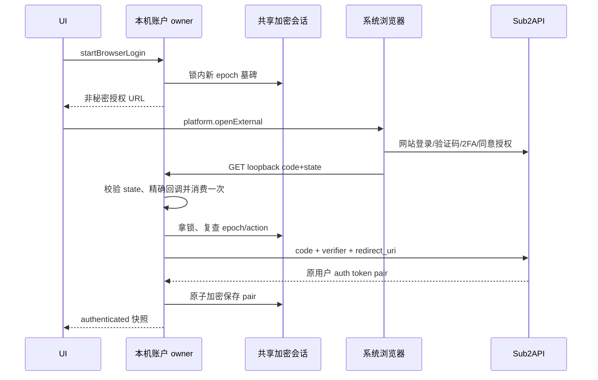

# 桌面浏览器授权登录

本节为 2026-11-13 新合同，替代品牌登录页内邮箱密码主入口与“网页无法同步客户端登录”的历史说明。保留旧 `login` / `completeTwoFactor` 服务方法以兼容现有调用，不更改模型网关、余额、工具运行时或 CLI 协议。

## 所有者与接口

- 本机 window Host 的品牌账户服务拥有一次浏览器登录：随机 state、PKCE verifier、127.0.0.1 临时监听和有效期都只在 Host 内存。Main 继续只提供平台操作，不拥有账户状态。
- `startBrowserLogin()` 创建或复用同一未完成操作，返回 `{authorizationUrl, expiresAt}`。URL 仅包含公开 client ID、loopback 回调、随机 state 与 SHA256 challenge；不含 token、密码、推理 Key 或 verifier。
- UI 用已有 `usePlatform().openExternal()` 打开系统浏览器。`snapshot.browserLogin` 为 `idle` 或 `waiting`，不另存第二份业务状态。`cancelBrowserLogin()` 撤销本机操作、关闭监听并废弃晚到响应。
- 监听只绑定 `127.0.0.1` 的随机空闲端口，回调路径固定 `/callback`；仅接受 GET、精确 Host/路径、单值 code/state，state 恒定时间比较。错误方法、Origin、路径、参数、state 不得消费本机操作。OAuth 拒绝只在 state 有效时取消。
- 本机操作最长五分钟；服务器端授权码应短期、单次且绑定 PKCE 和精确 redirect URI。超时、取消、退出、dispose 或另一窗口登录使旧操作无法提交。

## 端到端合同

浏览器 URL：`<trusted-account-origin>/desktop/authorize?client_id=zcode-desktop&response_type=code&redirect_uri=http://127.0.0.1:<port>/callback&code_challenge=<S256>&code_challenge_method=S256&state=<random>`。

网站复用网站原登录、验证码和 2FA；用户确认后跳转 loopback，携带一次性 `code` 和原 `state`。Host POST `/api/v1/desktop/auth/token`，JSON `{code,code_verifier,redirect_uri}`，收取现有 auth envelope 中的 access/refresh pair、user 和 expires_in。令牌交换不自动重放，网络未知结果要求重新发起授权。

换证后仍使用现有 secretRepo 的原子 token pair、跨进程锁与 epoch。开始登录先在锁内写新 epoch 的未登录墓碑，随后释放锁等待浏览器；完成时再次拿锁、验证原 epoch/action，交换并保存，避免长期持锁和晚到登录覆盖另一窗口新账户。过期/取消授权不得写回凭据。

此阶段复用现有网站 auth refresh/logout，不引入设备专用推理 token，也不宣称退出本机等于作废用户普通 Agent Key。账户凭据不发送到远程 workspace。移动远控不启动第二账户 owner 或第二 Agent。

## 验收

### 授权网页与本机回调显示

2026-11-13：网页授权和本机回调的用户可见品牌统一为 **MiloCode**，底层 `client_id=zcode-desktop` 不变。本机回调使用自包含的简洁卡片，支持系统浅/深主题和窄屏；不加载远程资源、不执行脚本、不自动关闭浏览器，不在页面反射 code/state/verifier/token 或原始错误。每次响应生成随机 style nonce，保留 no-store、no-referrer 和其余严格 CSP。

合法回调显示“授权已接收”，明确客户端仍在完成登录、最终状态以客户端为准；它不是“登录成功”页面。取消和错误使用固定安全原因与返回 MiloCode 的指引。`afterReply` 仍在响应 finish/close 后执行一次换证，不改变回调消费、取消、epoch 或迟到响应规则。

扩展既有真实 HTTP E2E 验证标题/品牌、三态、CSP、敏感内容不反射；本地浏览器查看浅深主题、桌面/390px截图和无横向溢出。只使用合成授权，不完成真实账户登录或模型调用。

验收结果：现有loopback E2E 7/7通过，补充页面品牌、接收/取消/错误状态、nonce CSP与授权参数不反射断言；目标oxlint 0错误/0警告。配套Sub2API真实授权组件与本机HTTP响应的Playwright合成验收22/22通过，代表截图已人工检查，脚本与证据位于兄弟仓库 `sub2api/output/playwright/desktop-auth-brand/`。全局架构检查当时因另外两个未归属新文件失败，未把该结果报告为通过；最终全局检查由父任务汇总。

新增本地真实 HTTP/loopback E2E，零生产账户/付费请求：

1. 网站启用验证码仍能开始浏览器授权；校验 S256，完成后原用户余额可同步，磁盘无明文 token。
2. 同一 Host 重复开始返回同一授权；错误 state、重复参数、POST、错误路径/Host 拒绝且不交换；合法回调只交换一次。
3. 用户取消、退出、另一 Host 换号后旧回调不可覆盖；dispose 关闭 loopback。
4. UI 显示浏览器登录、等待和取消，不再要求密码；中英文及明暗主题使用现有组件。

本次文档与 E2E 是实施合同，真实平台浏览器跳回、生产网站授权与 Windows/macOS 安全存储仍分别验收，不以本地 fixture 成功冒充生产验收。

## 账号布局收口与嵌入登录

2026-11-13，按25号已授权方案实施。`BrandAccountLogin` 共用同一浏览器登录内容与 Host 命令，独立入口和设置内嵌入口只区分布局：独立入口保留全页高度、拖拽区及桌面窗控；嵌入入口使用设置内容宽度，不创建第二个 `main`、全屏最小高度、拖拽区或窗控。等待、取消、过期和打开失败的语义不变。

浏览器验收补充独立/嵌入两种外壳，390px与桌面、中英文、Zai浅深主题；嵌入登录不得撑出横向滚动或把宿主设置页扩展为额外一屏。此验收不替代真实原生窗控及网站跳回验证。
