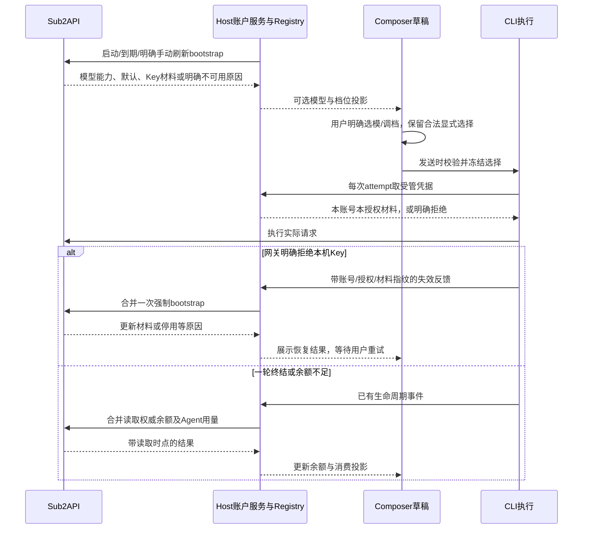

# ZCode 客户端接入复核与界面收口方案

2026-11-13。本文为当前工作区的只读审查与下一步设计，未实施产品代码、修改后台配置或部署。保留工作区已有改动。结论以源码为主；登录页补跑浏览器验收，完整工作区参考既有原生截图并核对当前组件，未重新构建安装包。

用户随后批准实施；本文件保留设计时点，实际模块、分层验证及未完成范围见 [26 客户端收口实施交接](26-client-refinement-implementation.md)。

## 结论与完成边界

接入的分层可以保留：Sub2API 管账号、钱包、模型策略和真实扣费；本机 Host 管登录材料及同步；原有 Composer、Registry、CLI 执行任务。当前欠缺主要是客户端功能与恢复体验的收尾，不需要再做一套账号、账本或 Agent 引擎。

| 事项                                              | 当前状态                                | 本次判断                                                          |
| ------------------------------------------------- | --------------------------------------- | ----------------------------------------------------------------- |
| 系统浏览器登录、PKCE/loopback、取消和迟到结果隔离 | 源码已实现，见23/24；本轮登录UI 9/9通过 | 保留；正式包真实跳回仍待验收                                      |
| 账号、余额、充值、服务端消费记录                  | 源码已接入                              | 余额完成后刷新未闭环，页面信息需要合并                            |
| 托管模型选择和在线目录刷新                        | 源码已实现，见18–21                     | 继续复用目标Host目录与既有刷新锁                                  |
| 可信模型能力、支持档位、默认值                    | 上一轮Sub2API改造已实现，客户端能读取   | 无需普通用户填写高级参数；22中的后台手填/元数据建议已有部分被替代 |
| 品牌模式推理强度选择                              | **未实现**                              | 22是调查记录，并没有修复此项                                      |
| 普通用户布局统一收口                              | 尚未完成                                | 侧栏与账号页有重复信息，模型操作应集中在输入区                    |
| 新版正式桌面安装包                                | 本轮未构建/发布                         | 后端上线不等于安装在用户电脑上的客户端同步更新                    |

“不能选推理强度”不等于请求没有使用推理：新选择会使用后台的合法默认档位，历史合法选择也可能被保留。目前缺的是用户看到、调整及修复失效档位的完整入口。

## 已确认的问题及影响

### 1. 模型菜单遗漏推理强度及失效恢复

证据：[品牌控件props](../../packages/ui/src/brand-account/BrandComposerModelControls.tsx#L35)没有`onSelectThought`，快捷键循环强度是`noop`（同文件138），传入`ModelConfigSelect`时也没有`composerOptions`；[父组件品牌分支](../../packages/ui/src/v4/ConversationComposer.tsx#L2537)只传选模回调，普通分支则传递推理回调。

底层已经具备能力：bootstrap投影`reasoningLevel.values/defaultLevel`，选模补齐默认，[Composer草稿](../../packages/ui/src/v4/composer/useDraftConfigControl.ts#L927)保存选择，发送时冻结，执行侧再映射为Responses的`reasoning.effort`。因此应补齐投影与回调，不另造推理参数通道。

另外有两项相连的体验问题：

- 旧会话档位被后台移除时，提交会正确拦截；品牌菜单只判断模型存在与否，模型看着正常，却没有告诉用户需要重选强度。
- 重复点击当前模型也会走“新选择默认补齐”，把用户显式强度恢复成后台默认（[选模处理](../../packages/ui/src/v4/composer/useDraftConfigControl.ts#L936)）。这不是请求随机丢参，但不符合保留当前选择的预期。

### 2. 不可用原因被抹平，用户被引导反复同步

Sub2API已有停用、过期、Key额度耗尽、分组无权等结构化原因；[客户端解析](../../packages/services/src/brand-account/inferenceBootstrap.ts#L138)除配置竞争外都压成`inference_unavailable`，[状态组件](../../packages/ui/src/brand-account/BrandInferenceStatus.tsx#L19)只给同步动作。

被管理员停用、登录过期和临时断网需要不同处理。它们不是同一种“连接不好”，只给刷新会让用户误以为软件卡住。应白名单映射安全原因与恢复动作，不直接展示任意服务端错误正文。

### 3. 网站重置Key后，客户端可能继续取旧材料

[逐attempt凭据解析](../../packages/services/src/brand-account/managedInference.ts#L250)会到Host取材料，但取的是Host内存缓存。新轮准入超过60秒、手动刷新、前台5分钟同步可以更新；数据面鉴权拒绝目前没有反向通知Host。[原账户重试](../../apps/zcode-cli/packages/adapters/src/model/account-request-retry.ts#L78)只处理原Coding Plan模式。

结果是：用户刚在网站重置Key，立即重试仍可能失败，界面却保留已配置状态。旧Key会被网关拒绝，不是越权；缺的是及时失效反馈和恢复。

### 4. 连续在前台使用时，余额和消费记录可能一直陈旧

[Provider触发器](../../packages/ui/src/brand-account/BrandAccountProvider.tsx#L72)在回前台、恢复网络时更新余额；5分钟定时器只刷新模型。没有订阅执行完成或余额不足事件。因此用户一直留在窗口完成多轮任务，余额可能没有更新，`fresh`只表示过去某次读取成功。

这项已经列入[钱包规格](09-account-wallet-spec.md#L81)，尚未落地。应补执行结束后的服务端权威读取；不能用本地token数、余额差或任务估价做扣费。

### 5. 次优先项

- [初始化](../../packages/services/src/brand-account/service.ts#L653)等待公共设置和已保存会话一起成功才做首次推理同步。公共设置暂时失败会延迟已有合法会话的连接，之后菜单/手动/定时刷新能恢复。可以拆开启动依赖。
- [未登录账号设置](../../packages/ui/src/brand-account/BrandAccountSection.tsx#L98)嵌入全页登录组件，而组件包含`min-h-dvh`和桌面窗控。源码有布局冲突风险；本轮没有运行复现为严重错误，应拆共享内容和独立/嵌入外壳。
- 账号页服务端消费记录与原本本地使用统计同时保留。两者有价值，但应在名称和范围上区分，避免看起来像两套账。

## 建议的界面结构

正常状态保持简洁；信息放在用户需要操作的位置。延续当前工作区和设置框架，不另加首页或连接控制中心。

| 区域               | 建议内容                                         | 交互                                                                     |
| ------------------ | ------------------------------------------------ | ------------------------------------------------------------------------ |
| 首次登录           | 品牌、简短说明、“使用浏览器登录”                 | 保留现有等待、取消、重试；密码/验证码/2FA由网站处理                      |
| 侧栏底部           | 两行：头像与姓名；可用余额与小充值动作           | 点击身份打开账号页；余额旁保留小刷新，更新时间放提示；正常模型就绪不常驻 |
| 输入框现有模型位置 | 一个组合入口“模型 · 当前强度 ▾”                  | 一次打开完成选模/调档；刷新和同步时间放弹层底部                          |
| 输入区错误         | 当前阻止发送的具体原因和一个主动作               | 需要登录、重选档位、重新同步或联系管理员，各用对应动作                   |
| 设置→账户与用量    | 身份+余额一张概览，下方“消费记录 / 充值记录”页签 | 复用现有充值弹窗、分页与记录组件；退出放底部次要操作                     |
| 原使用统计         | 更明确命名为“本地使用统计”                       | 账号页记录名为“账户消费记录”，保留当前Agent Key及跨设备/辅助请求范围说明 |

账号设置页不再常驻一张“模型已就绪”卡；模型详情、刷新和问题放到模型菜单。侧栏只在登录失效、余额读取失败时给简短提示，不重复铺开所有模型状态。

布局示意（不是本轮实施效果）：

```text
┌─侧栏────────────────┬─任务区─────────────────────────────────┐
│ 新建任务 / 项目 / 历史 │ 原有消息、工具进度、成果及预览             │
│                      │                                         │
│                      │ ┌─输入框──────────────────────────────┐ │
│                      │ │ 任务描述 / 附件                       │ │
│                      │ │ 权限确认     [GPT-6.1 Sol · 高 ▾] [↑]│ │
│ [头像] 用户        ⚙ │ └─────────────────────────────────────┘ │
│ 余额 $…  ⟳    充值   │                                         │
└──────────────────────┴─────────────────────────────────────────┘
```

窄窗口优先保留发送按钮、强度与状态，模型长名可截断并提供完整提示；弹层模型列表和档位区上下排列，不加供应商导航。复用现有Popover/Menu/Button/Tabs、设计token与`text-ui-*`字阶，覆盖中英文、浅深主题、键盘及390px窄屏。

## 推理强度规则

1. 选项只来自目标Host当前模型的Registry，客户端不硬编码“所有模型都有五档”。显示中文名称时保留值的原样提交，`xhigh`和`max`不能合并。
2. 全新任务使用服务端指定默认模型及其默认档位；切到不同模型采用目标模型默认。弹层标出“默认”，触发器始终展示实际档位。
3. 点击当前模型保留仍合法的显式档位；如果当前档位失效，明确提示重选，不把此点击当成静默成本重置。
4. 合法历史选择保留；后台只修改默认值不覆盖已有选择。移除当前档位时，保留历史意图和失效提示，禁止提交直到用户处理。
5. 单一档位只展示固定状态；不支持可调推理的模型不展示可交互的强度控件，不暗示模型完全不思考。
6. 品牌协议里的`none`当前是“不传effort，让上游决定”，**不是关闭思考**。当前可信profile没有把它暴露为可用档位；后续自定义配置包含时，只能标为“上游默认”，不能沿用通用“关闭”标签。
7. 调档只影响下一次提交。已接受的队列和已发送请求保持冻结配置，不能因菜单操作或默认更新被重写。
8. 当前模型的实际能力、预算或档位集合发生变化时，已有运行句柄可能在下一次模型请求被配置指纹校验拒绝。应提示“模型配置已更新，请确认后继续”，保留成果；不静默切模型/档位，也不承诺所有配置刷新均不影响运行。

主任务与显式子任务继续使用既定继承规则；标题等辅助调用目前取允许档位的首项，不必跟随主任务调高。自定义配置若将`none`放在首项，不能承诺该辅助档位实际消耗最低，不能靠菜单改造悄悄改变辅助策略。

实现入口：复用`ModelConfigSelect`的`composerOptions`、现有纯展示控件和`onSelectThought`。`ComposerModelMenu`需要可选隐藏供应商导航；不要为此挂载整套普通账户工具栏及原套餐hooks。与Composer共用唯一草稿，不新增品牌专属强度store。

## 错误与恢复规则

| 原因                        | 建议面向用户的解释                          | 主动作                                          |
| --------------------------- | ------------------------------------------- | ----------------------------------------------- |
| 本机登录会话失效            | 登录已过期，请重新登录；已有任务记录保留    | 浏览器重新登录                                  |
| Agent Key被停用 / 分组无权  | 当前账号的Agent访问暂不可用，需要管理员处理 | 查看说明/联系管理员                             |
| Agent Key过期 / Key额度耗尽 | 明确是Agent访问凭据的问题，不能混同账户余额 | 按实际运营规则处理；重置Key不等于续期或补充配额 |
| 账户余额不足                | 可用余额不足，并触发一次权威余额新读        | 充值（可用时）                                  |
| 临时网络失败                | 暂时无法同步；有旧目录时说明沿用上次信息    | 重试同步                                        |
| 模型/档位被移除或能力变更   | 当前选择不再可用，需要确认模型配置          | 打开模型菜单                                    |

Key失效反馈只处理**网关明确的本机Key鉴权拒绝**。现有网关提供`INVALID_API_KEY`、`API_KEY_DISABLED`等结构化码；不能把任何上游401或普通403都当成登录失效。按账号epoch、授权scope及被拒Key材料指纹匹配反馈，合并一次强制bootstrap；迟到的旧账号、旧Key失败不能污染新账号或新材料。

仅凭错误码本身也不能证明来源：上游可能使用同类网关或透传相同代码。来源无法确定时，只把错误当作有界同步候选，最终由同身份bootstrap确认是否材料更新、停用或配置变化；不能据此清登录或标记管理员停用。

第一版恢复只刷新材料和状态，提示用户重试，不自动重放失败的付费模型请求；被管理员停用不能通过刷新或重新登录自动恢复。不要把Key、完整认证头或服务端任意错误体传入Renderer/日志。

## 唯一所有者与事件顺序

| 事实                              | 唯一所有者                     | UI角色                     |
| --------------------------------- | ------------------------------ | -------------------------- |
| 账号、Key生命周期、真实余额和用量 | Sub2API                        | 读取并展示，不估算记账     |
| 登录秘密、策略目录、同步锁/代际   | 本机Host账户服务及既有Registry | 发起意图并订阅快照         |
| 下一条未提交消息的模型/档位       | 既有Composer draft             | 菜单写回同一owner          |
| 已接受任务、执行参数、取消/恢复   | 原CLI/runtime                  | 展示进度，不复制已接受队列 |



余额读取复用已有单飞及“事件后排队新读”的机制；完成前已发出的读取不能被当作完成后的读取结果。相同规则必须扩到消费记录：[当前usageReader](../../packages/services/src/brand-account/usageReader.ts#L24)直接复用旧flight，尚无事件后的补读，不能只更新余额却遗漏记录。子任务/多窗口密集事件应合并，不在每个token或工具步骤刷接口。结算可能晚于执行结束，使用真实服务端结果和同步时间，不伪造“本任务已精确扣费”；必要时按已有服务合同做有界补读，不能无限轮询。

跨账号epoch、Host身份、workspaceIdentity、CLI配置应用回执、远程attachment及现有取消语义继续保持。远程工作区不接收本机登录秘密。

## 实施次序与验收

建议按三个可独立审查的切片完成，UI与服务端协议保持兼容；客户端首要变化不要求重新设计后端。

| 切片             | 主要模块                                                                                                 | 完成标准                                                    |
| ---------------- | -------------------------------------------------------------------------------------------------------- | ----------------------------------------------------------- |
| A 模型与强度闭环 | `BrandComposerModelControls`、`ConversationComposer`、`ComposerModelMenu`纯展示参数、既有draft路径、i18n | 菜单选中值、草稿、CLI最终请求一致；失效有明确修复入口       |
| B 账号布局收口   | `BrandAccountSummary`、`BrandAccountSection`、共享登录内容与外壳、设置标题                               | 两行侧栏摘要、单概览与记录页签；充值/设置/退出不丢入口      |
| C 恢复与权威同步 | `inferenceBootstrap`、账户service/contract、现有CLI→Host私有事件/接口、生命周期订阅                      | 原因正确、Key失效有界同步、任务后余额更新、旧账号反馈被丢弃 |

实施前把选定规则同步到14/15/19/23及钱包规格，并先维护现有浏览器/E2E和CLI场景。用architecture-governance取得受控上下文；不增加退役App业务单测。

| 场景组     | 必验场景                                                                                                                     |
| ---------- | ---------------------------------------------------------------------------------------------------------------------------- |
| 模型与推理 | 两个模型不同合法档位/默认；点击同模型保留选择；切不同模型取目标默认；单档/不可调模型；`none`语义；键盘循环只在合法候选间切换 |
| 请求保真   | 菜单选档后检查Responses请求体；运行中改档只作用后续提交；busy排队、编辑重放、恢复历史及子任务继承；辅助调用继续既定策略      |
| 配置刷新   | 默认变更不改合法历史选择；移除模型/档位有明确提示；实际能力变更拒绝旧句柄后可恢复；无静默回退或升级强度                      |
| 恢复与安全 | 同用户另一设备重置Key；旧Key迟到401；管理员停用；上游401不误触发重登；换号时旧刷新和消费结果迟到                             |
| 钱包       | 持续前台执行完成后更新；余额不足立即新读；多子任务合并；完成前在途读取不能吞掉事件后新读；失败保留旧值并标明时点             |
| 布局       | 390/720/1200宽、中英文、浅深主题、长模型/邮箱、菜单键盘/焦点、未登录嵌入页、支付关闭/打开/订单恢复                           |
| 发布       | 根typecheck/lint、受影响CLI和浏览器场景；重建当前CLI/桌面后原生验收；Windows/macOS真实网站登录跳回和安全存储                 |

## 本轮实际验证与限制

- 磁盘：只清可重建Go编译缓存，约8.7GB；Mac数据卷可用由约4.2GiB回到13GiB。没有删除项目依赖、当前构建产物或未知数据卷。
- freshness已执行：相对缓存`origin/main`为ahead0/behind0，分支无tracking，不能据此声称已核验远端最新。
- 登录页：`node --test packages/ui/test/browser/manual-review/pending/brand-browser-login.test.mjs`，使用本机Node24.19.0；9/9通过。覆盖390/1200、中英文、浅深主题、等待/取消/打开失败重试、溢出及pageerror。Vite/Chrome已关闭。
- 模型默认档位场景MM05：1项通过；queue-input-fidelity及v4-input-admission：12项通过。CLI部分依赖既有`dist`，这些结果不能冒充当前全部dirty运行时源码已重建验收。
- 全工作区布局证据：[既有侧栏/模型菜单截图](../../packages/desktop/.e2e-artifacts/brand-model-refresh-ui-1794470553822/01-two-models-dark.png)、[既有窄屏账号页截图](../../packages/desktop/.e2e-artifacts/brand-model-refresh-ui-1794470553822/05-account-narrow-dark.png)；结合本轮源码核对，截图不是本轮新打包结果。
- 本轮没有改产品代码、运行新的全量typecheck/lint、正式打包、真实付费推理/充值或操作生产；前次检查结果见24，不能算作本次新验证。后续实施需重新执行相应门禁。

以上是可以落到现有模块的收口设计；布局和恢复属于同一条用户流程，实施应同时检查正常态、失败态及恢复后状态。
