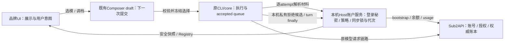
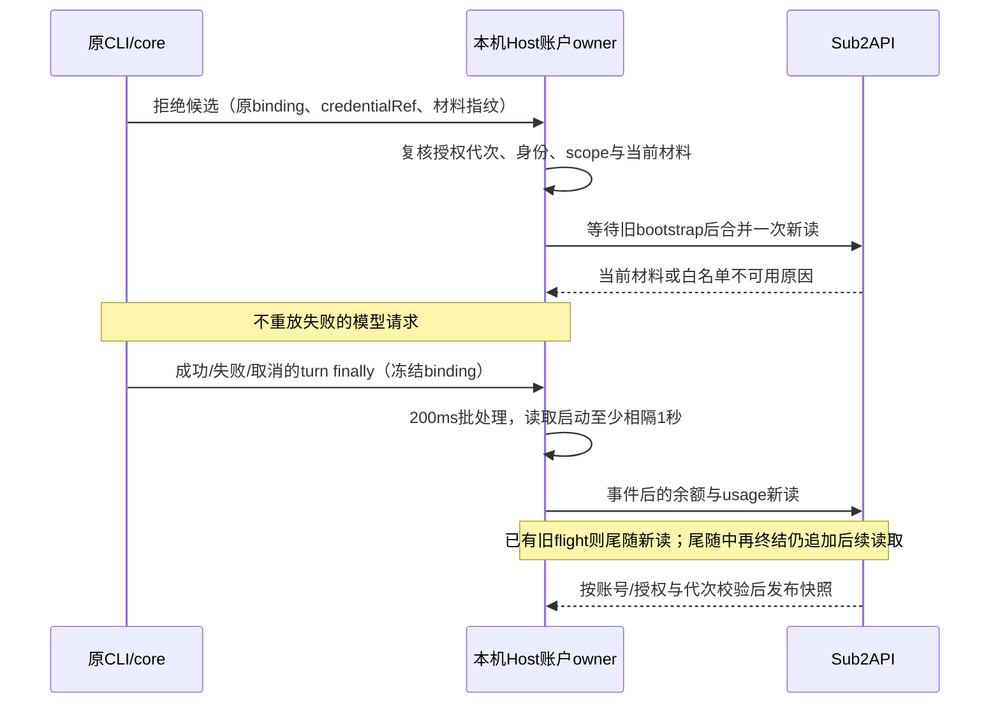

# 客户端界面收口、恢复与结算同步实施交接

2026-11-13，按 [25 号方案](25-client-review-and-refinement-design.md) 在 `codex/desktop-managed-agent` 的已有工作区上实施。此前账号、浏览器登录和模型刷新改动一并保留；当前改动尚未提交，基线 commit 不能代表全部工作区内容。本轮只改 ZCode 客户端与测试文档，继续使用现有 Sub2API 登录、bootstrap v3、余额及用量接口，无需本轮后端增量。

## 实际变化

| 切片             | 实现与入口                                                                                                                                                                     | 行为边界                                                                                                                                                                                           |
| ---------------- | ------------------------------------------------------------------------------------------------------------------------------------------------------------------------------ | -------------------------------------------------------------------------------------------------------------------------------------------------------------------------------------------------- |
| A 模型与推理强度 | `BrandComposerModelControls` 装配共享模型/强度菜单；`ComposerModelMenu` 可选隐藏供应商导航，显示当前档位、默认值及失效修复；`useDraftConfigControl` 保留同一受管模型的原始选择 | 选项来自目标 Host Registry。切不同模型采用目标默认；后台默认变化不改已有合法选择；失效档位不静默补齐。`none` 是“上游默认”。单档不显示可调滑杆或循环快捷键。普通 API-key 模式重选仍按原默认规则处理 |
| B 账号布局       | 侧栏改为身份、余额两行，刷新与充值独立；设置合并身份/钱包概览，消费记录与充值记录使用 Tabs；登录支持独立页和设置内嵌外壳                                                       | 复用同一账户快照、消费读取、订单查询及充值弹窗，不新增账本或支付路径。更新时间移入提示，失败仍可见；原本地使用统计保留并另行命名                                                                   |
| C 恢复与权威同步 | `managedInference` 接收受限私有反馈，`settlementRefresh` 合并终结信号，`usageReader` 支持事件后新读；`zcodeAgentService` 校验本机通知归属；原 core turn finally 发送冻结归属   | 只同步权威状态，不重放付费请求，不用本地 token 或余额差估价；不新增执行、任务或队列 owner。公共设置失败不阻挡已有合法会话初始化推理                                                                |

恢复界面区分重新登录、重新同步与联系管理员。允许“浏览本地内容”时，未登录/过期状态保留通向原账号设置的登录入口；推理恢复和钱包的“重新登录”均在成功退出后导航，避免只退出却仍停留本地工作区。钱包两入口覆盖侧栏和设置概览；失败仍归属于原账号 epoch。

服务端原因只映射固定安全文案，任意错误正文不进入展示。错误码映射增加 `Object.hasOwn`，`constructor` 等原型键回退到通用错误。独立复核还补齐两项：共享单档修复按钮与 handler 均遵守 `providerMenu.pending`，连接切换期间不写旧档位；账号 epoch 改变时清除本机余额及尾随 flight 引用，旧账号等待不阻挡新登录首次余额读取，旧返回仍由代次隔离。

## 状态所有者与时序

私有通知使用严格 schema，必须来自当前本机 CLI，并匹配 workspace identity；远程链路、错误归属、旧进程及附加秘密字段不能进入账户反馈。鉴权候选只证明“值得重新确认”，无法证明错误来自自有网关；Host 按账号 epoch、完整授权 binding、credentialRef 和当前 Key 的 SHA-256 指纹复核，冷却5秒并合并在途恢复。只有 bootstrap 决定可用状态，数据面401/403不直接清登录或认定管理员停用；停用、过期、Key配额耗尽也不因重置Key或重新登录自动恢复。

UI只接收安全投影，私有端口未注册通用 Service RPC；反馈不写 Renderer 历史或手机可重放事件。余额和 usage 各自保留权威读取者，失败保留旧值并标记过期；执行终结不等于服务端账单已立即完成结算。

## 已执行验证

下列本机合成控制面/模型、真实组件或Host/CLI证据不等于生产扣费、充值或正式安装包验收。候选仍位于 `manual-review/pending`，未自动准入CI或升级为正式fixture。

| 范围                         | 实际结果                     | 证据与范围                                                                                                                                                                                                                                                                                                                                                                                                                                                                                                            |
| ---------------------------- | ---------------------------- | --------------------------------------------------------------------------------------------------------------------------------------------------------------------------------------------------------------------------------------------------------------------------------------------------------------------------------------------------------------------------------------------------------------------------------------------------------------------------------------------------------------------- |
| A 模型/强度浏览器            | **17/17通过**                | [候选入口](../../packages/ui/test/browser/manual-review/pending/brand-model-reasoning.test.mjs)；真实草稿owner、目录订阅与提交校验，覆盖同模型保留/不同模型默认、非法与单档修复、普通模式默认策略、冻结选择、快捷键与Escape焦点、390/720/1200 × 中英文 × 深浅主题。[截图目录](../../packages/desktop/.e2e-artifacts/brand-model-reasoning/)；pending修复另有定向2/2回归，不重复累计                                                                                                                                   |
| B 账号布局浏览器             | **12/12通过**                | [日志](../../packages/desktop/.e2e-artifacts/brand-account-layout/result.tap)；原11项覆盖390/1200 × 中英文 × 深浅主题、Tabs/键盘、刷新/充值/订单、旧账号结果隔离与内嵌登录；新增一项覆盖侧栏/概览钱包真实logout后的设置导航。[修前红证据](../../packages/desktop/.e2e-artifacts/brand-account-layout/reauth-red.tap)稳定失败于设置页未打开                                                                                                                                                                            |
| C Host恢复/结算              | **29/29通过**                | [日志](../../packages/desktop/.e2e-artifacts/client-refinement/runtime-recovery-settlement.tap)；安全原因、Key轮换与候选合并、确证停用不复活、公共设置独立初始化、余额/usage旧读及尾随期间再事件、跨账号余额队列。最后构建后与私有交付合并再跑 [40/40通过](../../packages/desktop/.e2e-artifacts/client-refinement/final-host-regression.tap)，属于重复确认，不累计新覆盖                                                                                                                                             |
| C 私有通知交付               | **11/11通过**                | [日志](../../packages/desktop/.e2e-artifacts/client-refinement/private-outcome-delivery.tap)；真实Host/stdin-out交付，错误字段与远程身份拒绝                                                                                                                                                                                                                                                                                                                                                                          |
| C CLI adapter/core/bootstrap | **41/41通过**                | [日志](../../packages/desktop/.e2e-artifacts/client-refinement/cli-outcome-regression.log)；真实SDK generate/stream的受限候选、无自动重放、成功/失败/取消终结与child根会话归属、runtime-headers协议。C三组共 **81项**，命令见 [15号验收](15-managed-agent-inference-cases.md#2026-11-13-请求恢复与结算同步验收)                                                                                                                                                                                                       |
| 登录与恢复浏览器             | **19/19通过**                | [日志](../../packages/desktop/.e2e-artifacts/client-refinement/browser-login-recovery.tap)；停用/网络/重新授权、允许本地浏览时signedOut/expired恢复、同步失败保留时间及双语主题布局。新增constructor白名单回退；首次错误预期文案断言失败，修正断言后重跑，未改产品文案迁就测试                                                                                                                                                                                                                                        |
| 当前CLI构建                  | **成功，Node24.14.0**        | [日志](../../packages/desktop/.e2e-artifacts/client-refinement/cli-build.log)；最终按仓库锁定的Node24.14.0完整重建，bundle与stage SHA-256均为`cb0f516f3ce596fe9175e5169beb2a872c91ec18df049e841698e1cadd77f21b`，与最终原生result一致                                                                                                                                                                                                                                                                                 |
| 当前Desktop构建              | **成功，Node24.14.0**        | [日志](../../packages/desktop/.e2e-artifacts/client-refinement/desktop-build.log)；钱包最后修复后已重建，`build:no-runtime-assets`产出Main/Host/Preload/Renderer。bundle/chunk与插件耗时警告未导致失败                                                                                                                                                                                                                                                                                                                |
| macOS原生模型/工具链路       | **最终重建后1/1通过，9.7秒** | [结果](../../packages/desktop/.e2e-artifacts/brand-model-reasoning-ui-1794546249062/result.json)、[截图](../../packages/desktop/.e2e-artifacts/brand-model-reasoning-ui-1794546249062/completed.png)、[日志](../../packages/desktop/.e2e-artifacts/client-refinement/native-reasoning-final.tap)：菜单选择high，真实Write权限批准、Write→Read完成；3条stream main Responses均为high，最后携带Read结果，标题调用仍为low；errors/violations为空。未在原生审批期间改变草稿，下一次草稿与accepted冻结由17项浏览器场景验证 |
| 工程门禁收口                 | **最终全部退出0**            | 父任务提供最后typecheck通过、lint84 warnings/0 errors、架构0违规、diff与目标格式通过；统一回归重跑CLI41项与Host40项均通过，最终锁定Node的CLI产物与原生验收所用SHA一致。钱包目标lint为0/0。最后Desktop重建后的原生重跑也已1/1通过，见上一行                                                                                                                                                                                                                                                                            |

独立只读复核未发现私有反馈串账号、无限恢复或usage旧flight吞掉结算后新读。另用真实Host/HTTP gate检查“A余额在途→结算排队→登录B→释放A”，最终B钱包fresh、余额56.78；只使用合成用户，不替代上述候选。

## 交接与未完成范围

- 最后钱包源码已重新构建Desktop并补跑原生1/1通过。若后续改变源码，以最后一次结果为准。
- 本轮三个原生artifact仅清理9个可重建的data/session/electron目录，释放226.2MiB，保留result、截图、workspace及提取的Host日志；[清理记录](../../packages/desktop/.e2e-artifacts/client-refinement/native-artifact-cleanup.json)。报告不承诺清理后的原始缓存路径仍可打开。
- 仅本地源码、构建及验收；未发布新安装包、未签名/公证、未部署生产或修改线上配置，未进行本轮真实付费推理/充值。用户已安装的旧客户端不会因源码变化自动更新。
- Windows正式包、真实系统浏览器跳回、安全存储、干净环境工具依赖及完整跨平台发行仍待后续验收，本机fixture不能代替。
- 保留既有dirty工作区，没有commit、push、合并或回滚其他agent变动。下一次提交应结合全部差异与25号范围审查。
