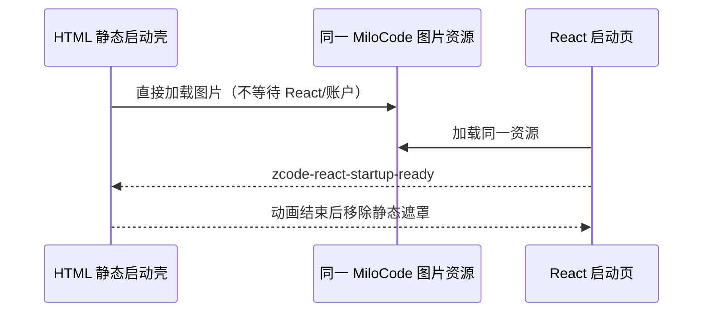
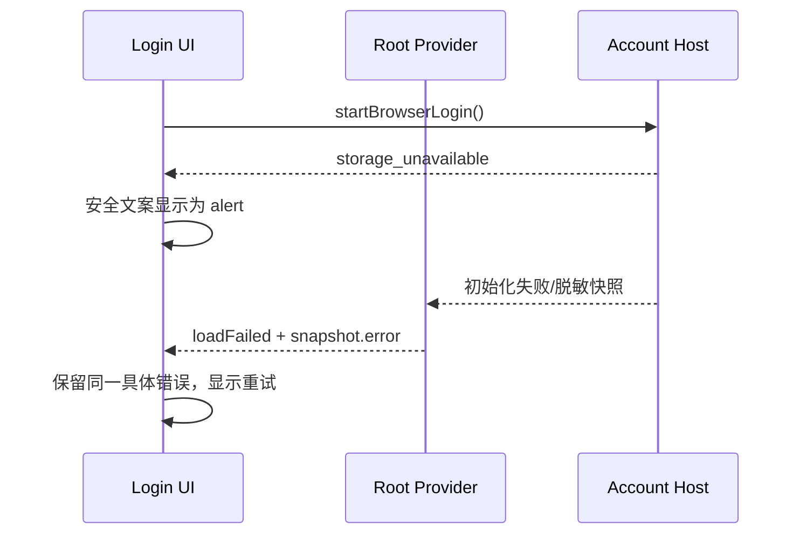
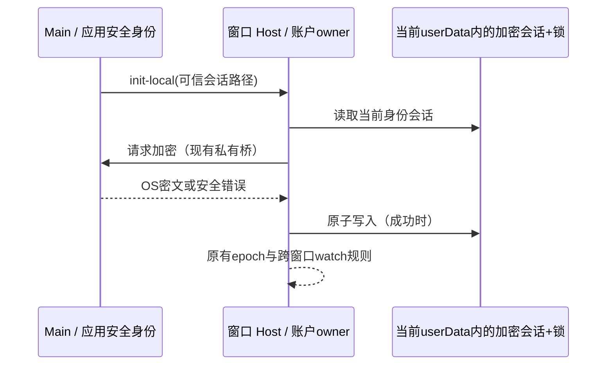

# 已安装客户端登录与启动修复

2026-11-13，用户安装27号交付的 MiloCode 后反馈：启动先出现 ZCode Logo，随后切为 MiloCode；浏览器登录提示安全存储不可用，错误很快被账号加载失败覆盖。本文件记录经实际源码和运行证据确认后的修复边界。

## 启动品牌一致性

### 根因与规则

桌面 `packages/desktop/src/renderer/index.html` 在 React 加载前显示内联 ZCode SVG，React 的 `RootStartupLoading` 则已使用 `packages/ui/src/assets/milo-logo.png`。HTML 与 React 是前后两个阶段，Logo 不一致会稳定产生用户看到的闪换；页面标题同样残留 `ZCode`。

本轮复用同一张现有 `milo-logo.png` 资源，由 Vite 按 HTML 资源引用打包，不复制图片、不增加品牌缓存或账户/网络依赖。静态启动壳与 React 启动阻塞页的徽标尺寸和底壳沿用现有规则，页面标题为 MiloCode。保留当前动画完成与 React ready 的双条件交接、降级时序、reduced-motion 语义及 update-status 窗口免启动壳行为。



### 验收合同

先维护浏览器回归，再修改 HTML。浏览器使用真实桌面 HTML，仅以实际 `RootStartupLoading` 组件替换主入口，显式控制 React 接管，验证普通和 reduced-motion 场景：静态 Logo 为可解码 MiloCode 图片、无旧 SVG；React Logo 与静态图片内容一致；首次接管前保持静态启动壳、ready 后正确退场；update-status 不显示启动壳。记录修前失败与修后结果，最终由父任务补真实生产安装包首屏验收，不将浏览器场景当作完整打包登录验收。

本轮浏览器回归已完成：`packages/ui/test/browser/manual-review/pending/brand-startup-logo.test.mjs` 修前两种动效场景均稳定失败（旧静态 SVG），update-status 通过；修后 **3/3通过**，验证两阶段图片 SHA 均等于现有品牌 PNG、图片可解码、遮罩退场及 update-status 免壳。日志为 `output/startup-brand-red.log`、`output/startup-brand-green.log`，首屏/React截图在 `output/playwright/brand-startup-logo/`，已人工检查。只修改桌面 HTML 的图片引用与 title，不改变 React 逻辑、启动门禁或账户服务。

## 登录错误展示规则

Host 仍是账户状态和安全错误码的唯一 owner。UI 仅保存本次平台动作（例如打开系统浏览器）的交互失败，通过现有 `brandErrorMessageId` 白名单转为本地化文案，不显示原始异常正文。

已有问题：`BrandAccountLogin` 将明确错误提示放在 ready 分支内。根 Provider 发生初始化异常后即使公共展示配置已加载，也会把 `initializationFailed` 设为 true；登录页随后切到 loadFailed 分支，具体安全存储错误因此被通用的“暂时无法加载账号服务”替换。

修复规则：具体错误提示与 loading/loadFailed/ready 的内容分支平级，任何分支变化都不能隐藏同一 Host 安全错误；loadFailed 已有明确错误时展示该原因与原有重试动作，不叠加笼统错误。用户主动开始新的登录、账户 epoch 改变时仍遵循现有交互错误清理规则；不增加超时或第二份账号 owner。



先在现有 `brand-browser-login` 浏览器 fixture 增加 ready → 点击登录返回 `storage_unavailable` → 后续初始化失败，以及初始化直接失败两种场景。修前原有19项通过，新增2项均因找不到错误 alert 稳定失败；只移动统一错误提示的渲染位置后，**21/21通过**。明确原因持续可见、没有暴露合成的原始异常正文，保留重试；成功浏览器授权、打开浏览器失败取消、等待/取消、中英文及浅深主题保持通过。日志为 `logs/login-ui-browser-{red,green}.log`，截图为 `.e2e-artifacts/brand-browser-login/{failStorage,initializationError}-storage-error.png`。这些是 UI 状态回归，不代表实际钥匙串或浏览器登录已通过，后者由安装包原生验收补齐。

## 凭据与系统安全存储作用域

### 运行证据

从 `/Applications/MiloCode.app` 启动隔离实例，仅对非敏感测试文字进行系统加解密：`safeStorage.isEncryptionAvailable()=true`、加密/解密往返成功；同一安装身份解密现有 `~/.zcode/v2/brand-account/session.json` 失败。只记录布尔值与固定OS错误，不输出或修改原会话。证据在 `output/playwright/milo-installed-fix-20261113/diagnosis.json`。因此已确认的是共享旧会话密文不属于当前可读的安全存储作用域；无法仅凭密文判断它最初由哪次开发版或旧运行身份写入。

旧代码把账户凭据放在所有运行身份共用的 `.zcode/v2`，而 OS safeStorage 绑定应用身份。初始化和开始登录都先读取旧会话，因此旧密文不可读时，新登录也被拒绝；不应把这种情况误导为整台机器的钥匙串不可用。

### 单一所有者与修复规则

Main 在 `init-local` 中提供 `app.getPath("userData")/brand-account/session.json` 的可信路径，Host 仅消费该路径，继续通过原 `createBrandAccountService`、跨窗口锁和 Main safeStorage 桥读写。Electron 已有 userData 隔离正式版、Preview、开发版和显式测试身份，同一应用身份的各窗口仍共享同一会话。Host 不再从共享业务根推断凭据路径；没有该路径的初始化消息应拒绝。

不改变业务 `.zcode` 根、项目或任务历史，不删除/覆盖原共享会话，不自动跨身份迁移登录材料，也不降级明文存储。首次进入新隔离作用域需要重新登录，后续相同身份升级沿用该路径。OS实际拒绝加密时仍安全失败并提供可见错误和重试。



### 验收合同

先补真实安装包回归脚本：隔离业务数据中放入旧的不可读会话，记录其摘要；点击登录应调用真实 Host→Main 加密并打开授权页（拦截系统浏览器，仅检查可信origin/路径，不完成真实用户登录），当前应用userData生成可解密的签出epoch记录。取消后重启应能读取该记录并再次开始登录；旧共享文件摘要不变。真实安全错误场景继续不可登录但错误持久可见。前端与Main/Host共享协议须有类型/架构检查，不以开发环境假cipher通过代替最终安装包验证。

## 安装包完整性门禁

实际 DMG 启动验收发现 fix1 的 Mac 包不能启动：归档内 `package.json` 和主进程 JS 混入前一文件尾部。首个损坏文件为 `out/e2e/tsconfig.e2e.tsbuildinfo`；其归档尺寸仍为593742字节，实际内容却精确等于类型检查更新后593900字节文件的前593742字节，余下158字节出现在后续两个 JS 文件开头。类型检查与 Mac 打包时间重叠；Electron Builder 使用收集阶段的 `stat.size` 生成偏移，写入阶段重新读取完整文件，构建元数据在两阶段之间增长即导致后续偏移错位。后续 sourcemap 解包/重包为损坏内容重新计算了 hash，因此只检查最终 hash 无法发现此次初始归档损坏。

时间线证据（本机日志时区 +0800）：`typecheck.log` 修改时间14:11:02，增量文件修改时间14:11:04；`mac-build-final.log` 结束于14:13:04，记录 Builder 耗时122923ms，故 Builder 从约14:11:01开始，覆盖增量文件更新时段。旧 Mac unpacked 与 DMG 安装副本的 asar 摘要相同，均为 `9f820bf53fd0a38158a4922255dcf5e87d2537dc00b1e4cd1f934bb0804cbc40`，确认问题已经进入实际交付包，非挂载/安装引入。

打包配置排除所有 `*.tsbuildinfo`：它们是构建工具状态，不是应用运行资源。发布构建与会改写输出目录的类型检查串行执行。`afterPack` 在任何解包或重写前，按初始归档头记录的尺寸、偏移和 SHA256 校验每个 packed 文件；尺寸超出归档、缺少校验值或 hash 不符时立即失败，不允许将损坏输入继续重包。现有重包函数也在替换旧归档前验证候选归档。校验只属于发布工程，不增加运行时状态或恢复分支。

工程回归使用真实 `@electron/asar.createPackageFromStreams`，将写入前采集的旧 stat 与增长后的真实文件流组合，稳定复现后续 `package.json` 不能解析的错位归档，并确认新门禁在初始增长文件处拒绝；正常归档与 native sidecar 重包继续通过。最终 Mac 包须重新构建，再从实际 DMG 安装副本完成启动与登录验收，不能交付旧 fix1 Mac 产物。

## 最终交付与验收结果

最终交付目录为 `packages/desktop/dist-milo-20261113-fix2/`，不要使用旧 fix1 Mac 安装包。Windows EXE 为已完整验证的 fix1 产物原样复制，Mac 则在类型检查完成后串行重新打包；两者包含同一份本轮 Logo、登录错误与凭据隔离修复。本轮没有修改 Sub2API、替换 `/Applications/MiloCode.app`、提交推送或发布远端版本。

- `pnpm typecheck` 退出0；全量 `pnpm lint` 退出0（84条既有警告、0错误）；架构检查0违规。ASAR/清理工程回归共5/5通过；UI登录21/21、启动品牌3/3回归证据保留。
- Mac 新构建初始归档门禁通过，后处理后的最终归档31,617个packed文件、363,942,695字节全部校验通过。DMG校验、只读挂载、产品身份/ARM64/当前CLI/原生依赖通过，随后从实际DMG复制出的可写安装副本运行。
- 真实安装副本的两次启动通过：合成不可读旧共享记录不阻塞浏览器授权启动，新路径写入可由真实OS safeStorage解密的签出epoch；取消后重启再次发起授权正常，旧共享记录摘要保持不变。强制Main安全存储不可用后，登录安全失败、没有再次打开授权页，具体错误在1.5秒后仍可见，两个启动均无Renderer `pageerror`。这里只拦截系统浏览器打开并核对可信origin、授权路径、S256及loopback，没有完成真实用户登录/换证或付费模型请求。
- 真实安装副本reload首帧观察通过：静态启动壳与真实React启动页均加载同一可解码Milo PNG，未出现旧SVG，最终正常进入登录页，截图已检查。该验收不替换主入口、账号服务或产品启动时序。
- Windows直接从最终EXE提取归档复核：NSIS外层和内嵌7z完整，31,627个packed文件全部SHA校验通过；启动PNG逐字节等于源码，Main两分支/Host的凭据路径一致且没有旧共享路径。Windows x64原生资源离线校验通过；本机无Windows环境，未做原生安装运行验收。

本轮证据在交付目录 `logs/`；原生登录与启动观察分别为 `output/playwright/milo-installed-fix-20261113/final/result.json` 和 `startup-final/result.json`，同目录保留截图与可复跑脚本。`release-manifest.json`、`source-manifest.json`、`SHA256SUMS.txt`记录来源和摘要；实际打包包含未提交的工作区改动，不能只按包内基础commit重现。已删除本轮坏Mac包和验收解包副本，保留故障日志、摘要、回归证据与交付安装包。

首次更新后需重新登录一次，项目与历史仍使用原业务数据根。两个平台安装包均没有发行证书签名，Mac未公证；Windows运行验收和真实账号授权换证仍是未覆盖范围。

本轮工程回归与 sourcemap 回归合计 **5/5通过**（`logs/asar-integrity-{red,green}.log`），目标文件 oxlint 为0警告/0错误，架构检查为0违规。使用现有正常 Windows asar 全量验证31627个 packed 文件、365136315字节，耗时566ms；这验证门禁可消费实际 Builder 归档。旧 Mac 归档已被重包重算 hash，不能用最终 checksum 的通过替代重建与启动验收。

## 后续授权网页品牌收口

本轮随后统一Sub2API授权页、管理端说明和客户端loopback回调的可见品牌为MiloCode，保留底层 `zcode-desktop` ID。网页复用现有卡片/按钮主题，本机回调为无脚本、无外部资源、每响应nonce样式的自包含卡片。合法回调明确“授权已接收”，不提前宣称登录成功；换证仍由既有Host流程完成。实现与验收详见23号规格；既有7项HTTP E2E与22项浏览器合成场景通过。这里的网页与回调修改发生在fix2交付之后，需要最终重构建才能进入新的安装包；不声称旧fix2已经包含这些后续修改。

## 后台工作流的原始扣费归属

工作流服务是一次 run 的内存生命周期 owner。submit / amend 在第一个 await 之前克隆
父 runtime 的执行 scope；scope 存在而 binding 缺省代表明确的普通 API admission，scope 缺席代表
没有新 admission。同 run 恢复仅延续其原 scope（无论 GUI、自动或工具入口），冷恢复没有可信原 scope 时保持缺失，交由既有
托管鉴权门拒绝，不能读当前登录账户补签。scope 不写 journal、会话事件、模型文本或日志。

```mermaid
sequenceDiagram
    participant Parent as 父 runtime
    participant Run as 工作流服务/run owner
    participant Actor as 延迟创建的 actor
    participant Sink as 进度通知
    Parent->>Run: 同步捕获执行 scope A
    Run->>Run: 冻结到本次 launch（await 前）
    Parent->>Parent: 空闲或切换至 B
    Run->>Actor: 始终传 A（不读当前父轮）
    Run->>Sink: routing 携带 A（事件正文不含凭据）
    Sink->>Parent: 任务登记之前的通知也沿用 A
```

回归覆盖延迟首次 actor 创建、异账户父轮、普通 API 的显式无绑定、idle resume 及 await 期间
账号变化。进度通知即使早于 tool executor 的 task 登记，也必须携带相同冻结 scope；不新增队列。
