# MiloCode 无付费证书的应用内更新方案

状态：已实施客户端、发布工具及 Sub2API 发布存储配置，2026-11-13。用户暂不购买 Apple / Windows 发行证书。隔离 Mac 原生两跳升级已通过；正式完整应用的两平台安装升级、公网对象发布仍需按验收门槛验证。未修改系统信任。

## 1. 决策

采用「一个用户入口、两种成熟平台更新引擎、一个发布流程」。

| 范围         | 首期选择                                                   | 理由                                                                       |
| ------------ | ---------------------------------------------------------- | -------------------------------------------------------------------------- |
| Windows x64  | 保留 electron-updater / NSIS，改用免费发布清单签名验证更新 | 复用已有 UI、退出进程和安装逻辑，首期只下载完整安装包                    |
| macOS ARM64  | 集成 Sparkle 2，使用免费 EdDSA 更新签名及其原生更新窗口    | 避开当前 Squirrel.Mac 的应用代码签名要求，复用成熟安装机制，不自写替换助手 |
| 下载与元数据 | 独立的软件发布对象存储 / HTTPS 下载域名                    | 不复用私有图库桶，不经 Sub2API 代理安装包                                  |
| Sub2API      | 新增独立发布存储卡片及短时上传授权，不加表或版本云控               | 仅管理员发布需要鉴权；客户端检查和下载不依赖用户账号                                   |
| 发布范围     | stable；检查、下载、安装由用户控制                         | 首期隐藏预览通道和自动下载/自动安装开关，避免两套策略                      |
| 增量         | Windows 完整 NSIS；Mac 完整 ZIP 归档更新                 | 先验证可靠升级，不启用差分、web installer 或自研补丁算法    |

这里的「不买证书」不代表不验证更新：仍免费生成发布密钥、签署更新资源。更新签名用于证明文件来自 MiloCode，不能替代 Apple Developer ID / 公证或 Windows 系统信任。

不选两条路线：不把自签证书能否兼容 Squirrel 当作正式方案前提；不自行开发常驻高权限更新助手。Sparkle 需要一个薄原生桥接，但下载、校验和应用替换交给框架。

**Mac 方案必须先通过两次真实版本升级验证，才进入正式接入。**官方文档和安装器源码支持无 Developer ID 的路径，不等于当前 Electron 包已集成、所有 macOS 都已验证。验证失败时保留下载并手动覆盖安装的路径，不要求用户关闭 Gatekeeper、SIP 或安装自签根证书。

## 2. 改造前基线（2026-11-13）

| 已确认事实                                                          | 位置                                                                                                                                  |
| ------------------------------------------------------------------- | ------------------------------------------------------------------------------------------------------------------------------------- |
| 已有检查、下载、进度、取消、跳过版本、重启安装和任务退出流程        | `packages/desktop/src/main/autoUpdater.ts`、`packages/ui/src/UpdateStatusDialog.tsx`、`packages/ui/src/hooks/useDesktopUpdateMenu.ts` |
| 构建开关默认关闭，fix3 实际编译为关闭                               | `scripts/build-time-config.mjs`、`packages/shared/src/env.ts`；前轮对 fix3 ZIP 的 ASAR 检查                                           |
| 正式包忽略调试更新源，限制到原 ZCode 的更新入口                     | `autoUpdater.ts` 的 `resolveUpdateFeedSourceFromStartupConfig` / `applyManifestUpdateProvider`                                        |
| Windows 存在构建配置、下载验证、安装前验证多处 Authenticode 要求    | `electron-builder.config.js`、`autoUpdater.ts`、`scripts/powershell-command.mjs`                                                      |
| 依赖中 NSIS 的自定义签名 hook 仅在存在 publisherName 时被调用       | `node_modules/electron-updater/out/NsisUpdater.js` 的 `verifySignature`，版本 `6.8.10`                                                |
| Mac 目前使用 electron-updater → Electron autoUpdater → Squirrel.Mac | `node_modules/electron-updater/out/MacUpdater.js`                                                                                     |
| 启动强更 gate 独立于普通自动更新开关                                | `packages/desktop/src/main/index.ts`、`forceUpdateGuard.ts`                                                                           |
| 发行身份已为 MiloCode / app.milo.code，数据与程序分开               | `scripts/desktop-product-identity.mjs`、`desktopHostProcess.ts`；登录在 userData 下，业务数据在 `~/.zcode/v2`                         |
| fix3 仍为 3.17.2，两平台均无商业发行签名                            | `packages/desktop/dist-milo-20261113-fix3/release-manifest.json`                                                                      |

根分支基线为 `codex/desktop-managed-agent`，相对 origin/main ahead 0 / behind 0；已有大量其他未提交改动，本方案不恢复、提交或改写这些改动。

## 3. 用户看到什么

客户端沿用现有「检查更新」入口。Sub2API 桌面端配置新增独立发布存储卡片，不混入 Agent 模型和能力配置。

1. 进入客户端后可后台检查版本，检查失败不阻止启动、登录和使用。
2. 发现新版，入口显示新版本；用户点击后查看版本说明并决定下载。
3. 下载支持进度、取消和重试；下载不会中断 Agent 任务。
4. 下载就绪后，用户明确选择「安装并重启」。有任务时先提示中断风险，允许稍后。
5. 确认后执行既有退出屏障，停止 Host / Agent，再交给平台安装器。
6. 重新打开新版本；失败时提供可理解的原因和手动下载安装入口。

Windows 沿用当前更新窗口。Mac 使用 Sparkle 标准原生更新窗口，菜单和产品名称保持 MiloCode；同一次检查不得再弹 React 更新窗口。首期不为了窗口样式一致去重写 Sparkle User Driver。

macOS / Windows 的系统授权或安全提示仍可能出现，不能把「应用内更新」宣传成「永远没有系统弹窗」。

## 4. 状态、责任与事件顺序

- **Electron Main**：更新入口路由、任务活动检查、安装准入、退出屏障。决定何时可以安装，不持有另一份下载队列。
- **平台更新引擎**：唯一拥有该次检查、下载、校验、缓存和安装事务；Windows 为现有 updater，Mac 为 Sparkle。
- **UI / 菜单**：通过现有 `IPlatformService` 接口发命令、显示状态，不直连存储或启动安装器。
- **发布流程**：拥有版本元数据和发布密钥；客户端只有公钥。对象存储只负责分发。
- **Sub2API**：拥有发布桶配置与管理员上传授权，复用备份 S3 连接和凭据；不接收安装包正文，不参与客户端的下载、安装或更新状态事务。

```mermaid
sequenceDiagram
    participant U as 用户
    participant M as Electron Main
    participant E as Windows updater / Mac Sparkle
    participant R as 发布存储/CDN
    participant H as Host / Agent
    U->>M: 检查更新
    M->>E: 检查（单次在途）
    E->>R: 获取并验证更新元数据
    E-->>U: 新版本与说明
    U->>E: 下载
    E->>R: 获取更新包
    E->>E: 校验发布签名及文件完整性
    U->>E: 安装并重启
    E->>M: 请求安装准入，暂停后续安装
    M-->>U: 有运行任务时确认中断
    M->>H: prepareAppQuit，等待退出完成
    H-->>M: 已退出
    M->>E: 放行本次冻结版本的安装
    E->>E: 安装并重新启动
```

同一进程每个平台只有一个引擎实例；重复点击聚焦现有窗口，不创建第二个下载或安装。安装开始后冻结版本、文件和已验证元数据，旧检查结果不得覆盖它。取消/稍后不结束任务；退出准备失败不得放行安装。

Mac 桥接使用 Sparkle 的 `updater:shouldPostponeRelaunchForUpdate:untilInvokingBlock:` 延迟放行，等异步退出屏障成功后调用框架 continuation。不能在 `updaterWillRelaunchApplication` 通知中异步清理后立即继续安装。框架某些恢复/不重启分支不调用 postpone，因此还需保留全局退出屏障，实包测试覆盖恢复路径。

同一安装事务只放行一次。用户取消中断确认时，不执行退出准备，也不调用安装 continuation；必须保留或恢复可稍后再次安装的状态，不能永久挂起更新窗口。

首期关闭后台自动下载、自动安装及退出即装；框架原生窗口不得暴露会绕开上述准入的自动安装行为。若原生窗口无法完整遵守，必须在 Mac 验证阶段收口，不能靠假定 delegate 永远会触发。

## 5. Windows 接入边界

保留 NSIS、现有状态机和 Windows 子进程/文件锁清理。首期显式禁用差分下载，只获取可独立校验的完整安装包。

将 MiloCode 这一发行形态切换到「免费发布清单签名策略」，同时调整 builder 的 `verifyUpdateCodeSignature`、初始化时的 Authenticode hook、缓存安装前的 Authenticode 检查。不是只删除一行配置，也不把校验函数简单改成永远通过。

自有静态源返回签名封装：内含原始清单字节、Ed25519 签名和受信任 keyId。客户端内嵌公钥，先验原始字节再解析，不对重新序列化后的 JSON / YAML 验签。清单绑定产品、平台/架构、stable、实际版本号、文件 URL、长度和 SHA512。

`ManifestUpdateProvider` 的适配层负责把已验证内容转换为原生 `UpdateInfo`；保留现有 channel 标记和迟到结果防护。公钥和正式源不接受登录深链、启动参数或远端随意覆盖。

下载完成、缓存命中和实际安装前，均把安装包的完整 SHA512 与被冻结的已验签清单绑定。不能只放进 NSIS 的自定义验签 hook，因为无 publisherName 时原依赖会跳过该 hook。签名缺失、未知 keyId、错误平台、文件损坏均拒绝安装，不降级到「只验证 HTTPS」。

只使用完整 NSIS 安装器，禁用 web installer 和差分。后续若启用差分，拼出完整文件后仍须验证同一签名清单绑定的整包。系统可能显示未知发布者、SmartScreen 或提权提示，这不由免费更新签名解决。

## 6. Mac 接入边界

固定并校验一个维护中的 Sparkle 2 版本及其发布资源，保留许可信息。薄原生桥在主线程管理框架与代理，将现有检查更新命令交给 Sparkle；不创建第二个常驻下载或高权限安装服务。

将框架、公钥、feed URL 和需要的嵌套组件打入应用，保留 executable bit、symlink 和资源结构。更新包使用普通 `.app` 归档，不先引入 `.pkg`、脚本安装器或 delta。

使用 Sparkle 官方工具生成、保存和备份 EdDSA 密钥，配置 `SUPublicEDKey`。更新归档必须有有效签名，并启用解压前验证 `SUVerifyUpdateBeforeExtraction`。如果所选稳定版本支持强制验证签名 feed，优先采用其官方功能；不得自行宣称未签名 appcast 中的文案、链接和调度字段也已获得归档签名保护。

现包使用 `hardenedRuntime=false`；仍要验证实际嵌入后框架加载、arm64 的本地代码签名、嵌套 helper 和 entitlement 组合。免费更新签名不提供 Developer ID 或公证，不要求用户在系统中安装信任根或关闭安全功能。

安装位置为正常可更新的 Applications 安装；从 DMG、只读卷或临时转移位置运行时，明确提示先完成安装。需要系统写入授权时走框架/系统标准提示，不偷偷提升权限。

Sparkle 安装器已有原子交换和替换失败恢复逻辑，沿用它。**不能将其描述成「新版本启动崩溃一定自动回滚」。**程序文件替换失败恢复与用户数据库迁移回退是两件事，首期不做任意自动降级。

## 7. 版本、发布与密钥

- 引导版必须使用真正递增的版本号，例如在确认无其他发版占用后从 3.17.2 到 3.17.3；fix3 目录名不参与版本排序。
- macOS 的 `CFBundleVersion`、展示版本和平台清单需要统一递增，Windows 遵守原 updater 的 SemVer 规则；不发布同版本的不同字节包。
- 发布脚本一次生成两平台各自的原生格式：Windows 签名清单，Mac Sparkle appcast/签名归档。不同框架使用自己的规范，不强行让两者互相读取元数据。
- 更新包以不可变版本路径存储；先构建、验证、签署并上传资源，下载抽检后最后更新 latest 清单 / appcast。
- 最新清单短缓存，带版本资源长缓存；支持 HTTP Range，保留合理数量旧资源供恢复下载和差分使用。无登录 Token、Agent Key 或用户信息参与下载。
- 发布私钥不进入源码、安装包、对象存储、Sub2API 配置或日志；使用发布机钥匙串/受保护环境并做独立加密备份。Sparkle 和 Windows 使用各自官方/标准工具，不手写密码算法或强行转换私钥格式。
- 不承诺无证书情况下总能无缝轮换 Sparkle 密钥。私钥丢失可能要求再手动安装引导版；轮换必须事先验证所选框架支持的过渡路径，不能从网络直接接受新公钥。
- 停止发布坏版本可以阻止尚未安装者继续更新；已安装者发布更高的修复版本，不默认强制降级。
- 普通更新只接受比当前安装版本高的版本；不宣称签名能防止攻击者冻结旧 feed。首期不加入整套 TUF/灰度/强更控制面。

用户已创建发布桶 `milocode-releases` 和域名 `https://download.editor.vip`，客户端根固定为 `https://download.editor.vip/milocode/`。后台只存独立桶与域名，备份 S3 Secret 只在服务端解密，不返回给发布机；发布机用管理员短时授权获取 PUT URL 后直传 R2。正式签名密钥已在本机受保护目录和登录钥匙串生成，独立加密备份尚未完成，不能误称已备份。

## 8. 引导与数据保留

目前已发 3.17.2 fix3 没有启用更新，无法只在网站上开一个开关让旧客户端获得新能力。用户需最后一次手动覆盖安装包含框架、公钥和自有源的引导版，随后才走应用内更新。

保持 `MiloCode` / `app.milo.code`、登录凭据服务名、安装范围、`userData` 和 `~/.zcode/v2`。只替换程序文件，不卸载清除数据，不把缓存清理扩大到会话或项目目录。

数据路径不变并不能证明钥匙串访问、屏幕录制/辅助功能等系统权限一定不变。未采用稳定 Apple 发行身份尤其需要验证这一点。权限重授权可以明确提示；静默丢登录、丢历史或破坏 Agent 是发布阻塞项。

## 9. 实施顺序与验收门槛

### A. 先验证 Mac，避免先铺完整工程后才发现不可用

隔离测试副本和用户数据，不覆盖当前 `/Applications/MiloCode.app`。用真实打包的两个后续版本验证 `引导版 → B → C`，分别验证主机和至少一个干净的受支持 macOS 环境。测试资源、版本和密钥与正式发布隔离，不添加任何系统信任根。

确认以下条件后才接正式窗口和发布源：框架可加载；两次连续向更高版本升级成功；不关闭系统安全；安装后可启动；登录/会话/权限行为可接受；退出屏障可阻止任务被越过；取消授权/替换失败保留可用程序。

### B. 接两平台发布链与用户入口

维护目标 spec / E2E 后改代码。实现时执行架构检查、读取受控上下文，新增原生桥/更新适配须登记模块边界。运行根 typecheck / lint、工程门禁及必要 E2E。不能把本轮仅文档检查当作这些运行验证。

### C. 真实安装验收

| 场景                     | 发布要求                                                      |
| ------------------------ | ------------------------------------------------------------- |
| Windows 引导版 → B → C   | Windows x64 实机安装、更新、重新启动，不能只离线检查 EXE      |
| Mac 引导版 → B → C       | 真实 .app、实际 Applications 安装、系统拦截和权限行为可见     |
| 用户数据                 | 登录、余额同步、模型选择、会话历史、本地项目和随包 Agent 正常 |
| 在途任务                 | 下载不影响任务；取消中断确认不退出；退出准备失败不安装        |
| 重复与迟到请求           | 单次事务，旧检查结果不改变正在安装的目标                      |
| 错签名/损坏包/缓存被换   | 拒绝安装，不能被无证书策略绕过                                |
| 网络、空间、写入权限失败 | 清楚报错并可重试；按解压体积、缓存和目标卷检查空间            |
| 框架替换失败             | 验证框架恢复路径，不以强杀进程后的偶然成功代替证据            |
| 完整版本启动失败         | 有明确修复包/手动安装路径，不声称自动数据库回滚               |
| 私钥丢失/换钥            | 演练备份恢复；不可恢复时明确手动引导版边界                    |

## 10. 官方依据与本轮边界

- [Electron autoUpdater](https://www.electronjs.org/docs/latest/api/auto-updater)：macOS 标准更新链路要求应用签名。
- [electron-builder Windows](https://www.electron.build/docs/win/)：Windows 更新签名校验配置；具体实现仍以本仓库 electron-updater 6.8.10 为准。
- [Sparkle 基本接入与安全](https://sparkle-project.org/documentation/)：Developer ID / 公证为尽可能采用的建议，提供独立 EdDSA 更新验证；库验证、资源结构和密钥轮换有约束。
- [Sparkle 配置](https://sparkle-project.org/documentation/customization/)：feed、公钥、解压前校验和自动更新选项。
- [Sparkle 发布流程](https://sparkle-project.org/documentation/publishing/)：归档与 appcast 发布。
- [Sparkle 重启代理](https://github.com/sparkle-project/Sparkle/blob/2.x/Sparkle/SPUUpdaterDelegate.h)：延迟重启 continuation 及不调用它的分支说明。
- [Sparkle 安装器](https://github.com/sparkle-project/Sparkle/blob/2.x/Autoupdate/SUPlainInstaller.m)：应用交换及替换失败的恢复机制。

本轮已实现并验证协议、发布工具、真实 Electron Provider、Main 安装准入及更新 UI；Mac Sparkle 2.10.1 隔离 fixture 完成 `1.0.0 → 1.0.1 → 1.0.2` 两次真实替换重启和取消后重试，并保留测试 userData。它不等同于完整 MiloCode 生产包或另一台干净 Mac 的验收。Windows 尚未执行 x64 实机升级；未发布正式 feed、未替换真实已安装应用。最终命令和验收边界见实施记录。

## 11. 更新退出准入的严格边界

复核发现原普通退出屏障会记录错误后继续，Host 等待到预算也会结束，不能把这直接当作“真实进程已退出”。普通退出保持原行为；更新安装另加最终准入：

- Host 生命周期模块唯一拥有实际 `exit` 事件记录，不能用 `kill()` 返回、计时器结束、窗口关闭或 Map 中消失推断退出。
- Main 保留本次退出屏障涉及的 Host 对象快照与失败标记。每次 `update-install` 都在屏障收口后检查，不论新建退出、加入已在途的普通退出，还是复用已经完成的普通退出。
- 清理 Promise 拒绝或任一快照中的 Host 尚未实际退出，更新准入必须拒绝；不得因普通退出的 catch 或超时 resolve 放行 Sparkle / NSIS。
- 准入失败后沿用更新模块的恢复逻辑，重新打开原版本；不启动新安装、不回滚用户数据。确认取消仍不进入退出准备。
- 验收运行真实源码函数，覆盖三种屏障入口、实际 exit、超时、清理拒绝及普通退出原有行为；不以模拟一个永远会 reject 的回调替代真实 Main 收口验证。
