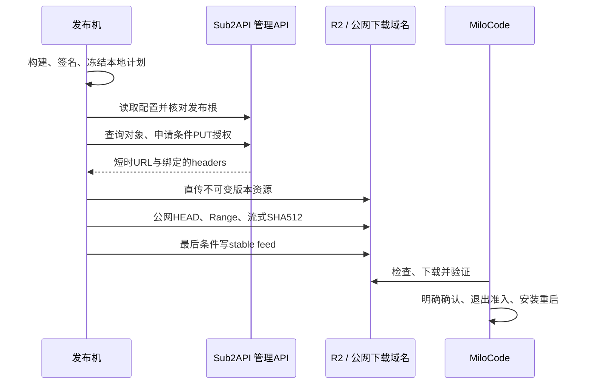

# MiloCode 应用内更新实施与验证

实施日期：2026-11-13—14。对应 [产品合同](30-client-update-without-paid-certificates.md)、[发布操作](31-client-update-release-guide.md) 与相邻 Sub2API 的 `docs/DESKTOP_RELEASES.md`。客户端构建已升至 3.17.3；Windows x64 与 Mac ARM64 正式资源均已发布，Mac 解锁后的实际登录入口与旧加密测试会话兼容验收通过。当前进展与具体边界见 [3.17.3 发布记录](33-client-update-release-3.17.3.md)，下方早期验证记录按各自日期理解。

## 实际落地

客户端继续使用一个检查更新入口。Windows x64 复用 electron-updater / NSIS，只下载完整安装器；原始清单先验 Ed25519 签名，再解析产品、平台、stable、版本、URL、长度与 SHA512。下载后、缓存命中、安装准入前和退出准备后重复绑定冻结目标并校验整包。没有把付费 Authenticode 校验简单替换成永久通过。

Mac ARM64 使用固定 Sparkle 2.10.1（下载归档校验固定 SHA256）和薄 Node-API 桥。归档与 feed 都用 Sparkle 官方工具签名；强制 signed feed、解压前验证，禁未签名 feed 回退、delta、脚本安装包和自动安装。原生事务先暂停，Main 确认用户意图、完成退出准入后才放行同一 requestId。

正式 MiloCode Mac 引导包使用免费 ad-hoc 签名封装完整应用，保持 `hardenedRuntime:false`。不把 Electron 原始可执行文件的 linker 签名当作改名后应用的完整资源签名；打包器须接受真实 schema，DMG 内应用须通过 `codesign --verify --deep --strict`。这不是付费 Developer ID 或公证，首次安装仍受系统正常验证约束。

所有更新均允许检查，用户明确下载、安装并重启。旧预览、自动下载、退出即装偏好不能覆盖策略；隐藏对应控件。更新失败不切回原 ZCode 发布源，原 ZCode 的启动强更不再介入 MiloCode。

Sub2API 桌面端设置新增独立「MiloCode 发布存储」卡片，仅存桶名与 HTTPS 公网 origin，固定 `milocode/` 前缀。它不写入 Agent 模型配置或 bootstrap，不加数据库表。凭据、endpoint、region 和 path-style 运行时继承备份 S3，只在后端解密；独立桶不能等于备份桶。保存、测试和上传授权复用现有完整管理员权限及 step-up。

管理员 JWT 或已有完整管理员 API Key 只发给 Sub2API；两者严格互斥，分别使用 Bearer 与 `x-api-key`，不可与直接 S3 环境混配。启用 step-up 时仍由后端拒绝未验证会话及管理员 Key，CLI 遇 403 停止，绝不切换凭据或绕过；临时取得的旧 Key 仅放发布进程环境，结束后清除临时材料。包正文直接在发布机与 R2 间传输，任何管理员凭据都不随上传或公网校验请求发送。发布脚本核对后台 release_base_url 和签名计划，条件写避免覆盖同版本不同字节或并发改写 feed；公网实际字节不符时停止发布。dry-run 不读凭据、不联网、不修改存储。

## 用户已提供的存储

- 桶：`milocode-releases`。
- 公网 origin：`https://download.editor.vip`。
- 客户端发布根：`https://download.editor.vip/milocode/`。

后台表单将前两项作为示例，不擅自保存。现有备份 S3 凭据必须允许此独立桶的对象读写。域名根路径 HTTPS 可达并返回 404，空桶根目录 404 正常；尚未用真实对象确认域名映射或执行正式上传。

本机 `config/private/build-defaults.json` 已写入上述公共发布根、两平台公钥及更新开关，文件受 Git 忽略；不包含私钥、S3 Secret、管理员会话或遥测地址。环境变量仍可显式覆盖。正式客户端的来源和公钥不能通过登录深链或后台随意改写。

Windows 正式私钥位于本机 `Library/Application Support/MiloCode/ReleaseKeys/`，目录 0700、私钥 0600；Mac 位于登录钥匙串 account `milocode-updates`。没有把私钥写入源码、安装包或 R2。独立加密备份尚未完成。

## 已执行的验证

| 范围                     | 结果                                                                                                                                                                                                                                                        |
| ------------------------ | ----------------------------------------------------------------------------------------------------------------------------------------------------------------------------------------------------------------------------------------------------------- |
| 签名协议与发布工具       | `pnpm test:milocode-updates`：31/31（30项协议/发布用例及1个工程脚本，脚本内13场景），包括篡改包、错签名、平台不符、不可变资源冲突、降级、同尺寸错误公网字节、JWT / 管理员 Key 隔离、鉴权互斥、step-up 403 不回退与条件上传                                  |
| 构建期配置               | `node --test scripts/test/build-time-config.test.mjs`：6/6                                                                                                                                                                                                  |
| builder与构建工具        | `pnpm test:engineering packages/desktop/test/electronBuilderSecurity.test.ts packages/desktop/test/run-production-build.test.ts`：20/20                                                                                                                     |
| Electron真实网络Provider | 9/9，证据 `.e2e-artifacts/milocode-release-trust-FzQB5G/result.json`（Desktop目录下）                                                                                                                                                                       |
| Main更新接线             | `node packages/desktop/scripts/milocode-auto-updater-smoke.mjs`：12/12，证据 `packages/desktop/.e2e-artifacts/milocode-updater-wiring-V4aOKG/result.json`                                                                                                   |
| 更新UI                   | 16/16 浏览器验收，包括取消安装确认后可再次操作；不以渲染触发下载                                                                                                                                                                                            |
| Mac原生两次升级          | 隔离 fixture 1.0.0→1.0.1→1.0.2，真实替换与重启、每跳取消再重试、userData sentinel保留；证据 `.cache/milocode-sparkle/smoke-dk8tnk/result.json`                                                                                                              |
| Go SDK与Node adapter     | 真 AWS SDK 用假凭据签出的上传响应，原样由Node接受并模拟流式上传；签名头一致，JWT未到对象存储，临时材料已删除                                                                                                                                                |
| 真实Main退出准入         | 13/13场景，含normal在途/已完成复用、超时/异常拒绝与真实exit；`packages/desktop/.e2e-artifacts/milocode-shutdown-admission-HNDfZu/result.json`                                                                                                               |
| 既有退出工程门禁         | `e2eProcessCleanup`：28/28                                                                                                                                                                                                                                  |
| Sub2API后端              | 4个目标包 `go test -tags=unit ./internal/service ./internal/repository ./internal/handler ./internal/server/routes -run TestDesktopRelease -count=1` 通过；`go build -tags embed -o /tmp/milocode-update-sub2api-check ./cmd/server` 通过，临时二进制已移除 |
| Sub2API前端              | 类型检查通过；62/62范围测试；新增卡片/接口/国际化范围eslint通过；完整前端production build通过                                                                                                                                                               |

`pnpm typecheck` 通过；`pnpm lint` 退出0（84条既有warning、0 error）；`pnpm architecture:check --changed` 为0违规。`ZCODE_ENV=production ZCODE_PREVIEW_IDENTITY=0 pnpm --filter @zcode/desktop build:no-runtime-assets` 通过，实际输出为production身份；日志 `output/milocode-update-production-build-20261114.log`。本次只构建应用代码，没有生成正式递增版本安装包。既有大量未提交改动均保留，没有恢复或擅自提交。后端构建后的可再生Go编译缓存已清理，磁盘恢复到约9GiB可用。

## 发布前仍需验收的边界

旧 3.17.2 安装包未携带新更新引擎和公钥，需要最后一次手动安装真实递增版本的引导包。不能仅保存网站配置让旧客户端获得更新能力。

Mac fixture 通过不代表完整 MiloCode 的 Host / Agent、登录钥匙串和权限在另一台干净 Mac 上已验收。Windows 尚未执行 x64 实机安装升级；不能用离线 EXE、mock Main 或签名测试代替。正式生产 feed 尚未发布，真实已安装应用与用户数据未被本任务替换。免费更新签名不提供 Apple Developer ID / 公证或 Windows SmartScreen 的发行身份。
