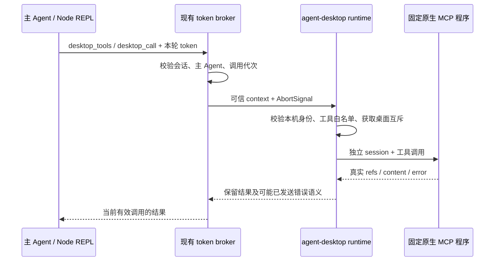
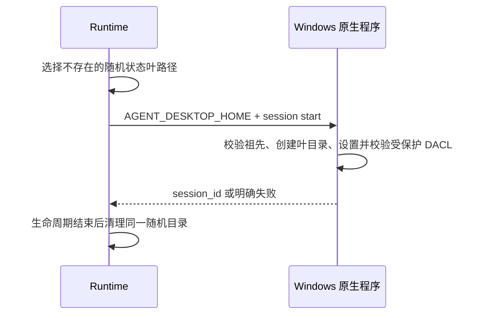

# Computer Use：接入 Vercel agent-desktop

状态：Mac ARM64 / Windows x64 的 3.17.7 已发布，最终包验收与公网核验通过，见 [40 号记录](40-client-release-3.17.7.md)。目标版本固定为 agent-desktop v1.3.1（Apache-2.0），commit `b0b7277bea09b770ef9d1fb45aad667bc432cd57`。本次不修改 Sub2API 或模型计费。

## 产品与接口

- 本机 macOS / Windows 使用随 MiloCode 分发的原生程序，不要求用户安装 npm、Python、额外模型服务。Linux、远程工作区、subagent 继续拒绝桌面控制。
- 用 Vercel 的真实工具 schema 与 snapshot refs；不模拟旧私有 Helper 的 AX 索引、frame_id、持续按键或后台输入能力。
- Node REPL 中通过 `agent.computerUse.desktop.tools()` 获取允许的工具，通过 `agent.computerUse.desktop.call(name, arguments, { headed?: boolean })` 执行。调用返回原始 MCP content/structuredContent；截图由 SDK 的 `emit` 方法显示。`stop()` 结束本会话控制并清理运行进程。
- 默认后台模式。只有明确需要前台操作且用户任务允许时，才单次传 headed；不因后台失败自动抢前台，不自动重试已发送动作。旧技能、SDK和文档同步替换。
- 固定允许桌面观察、应用窗口和有界输入工具；不开放 exec、sandbox、任意进程参数、升级/下载或模型提供方配置。工具名与参数由固定版本的 MCP schema校验。
- 设置页复用插件启停和权限状态入口，必须报告真实提供方/资源缺失/系统权限，不再假称旧 Helper 可用。macOS 授权主体是实际执行程序；Windows 不展示 macOS 权限项。

## 唯一所有者及事件顺序

- 既有 broker ledger 是会话与 workspaceIdentity 的事实来源，Worker 参数不能覆盖。身份 key 为 `workspaceIdentity?.trim() || workspacePath`，并包含 sessionId。
- Runtime 是原生客户端、refs session、进行中调用与停止状态的唯一所有者。每个可信会话使用私有、随机隔离的原生 session；每次调用启动 MCP 并在返回前终止，跨 REPL cell 只复用同 namespace 的磁盘 refs，不常驻原生进程。空闲 refs 保留十分钟，最多保留十六个 inactive namespace；到期后旧 ref 失效，必须重新观察。
- 通过用户身份派生的固定 loopback TCP exclusive listener 作为跨进程桌面 lease，不收取数据，接受连接即关闭；冲突立即报 busy，不排队留下迟到操作。锁只由取得它的调用释放；进程终止后由操作系统释放，不留 PID 文件竞争。refs 的 unref 定时器只清理 inactive 资源，不执行或重试桌面动作。
- 取消、stop、closeSession、dispose 终止受控子进程、废弃该 session refs，最后释放互斥。取消发生在提交后时报告 possibly_sent，不能回放。持续 key-down/up 不暴露。
- Broker 双向 socket 使用流式 UTF-8 解码，避免 chunk 边界切断中文或 emoji 后损坏输入/观察结果；请求 1 MiB、响应 32 MiB 的限制仍按解码文本的 UTF-8 字节数计算。
- Worker 请求交给 socket 后，连接中断、取消（含调用超时）或无法确认的响应必须保守报告 `possibly_sent`；写出前失败和 broker 明确拒绝报告 `not_sent`，不根据失联推断动作未执行，也不自动重试。
- 仅本机 desktop-continuous 可执行；远程 replayable 与 remoteSessionId 不控制另一台机器。本次不改变手机恢复链路或 owner/lease。
- 启停插件复用原设置唯一来源；关闭后不再创建 runtime，已有调用在会话关闭/取消时清理。权限查询只读，不启动桌面动作。

## 分层与资源

- `@zcode/zcode-cua` 的公开 runtime/provider contract 隔离原生执行；新模块 `milocode-computer-use` 管理该适配器。Services 只依赖公开入口，不导入实现文件。
- Desktop main 负责固定资源路径与权限入口，Services 复用权限查询服务，UI 通过现有 hook/service 获取状态。
- 原闭源 producer 标记继续保持占位，避免误启其 Helper 构建；新增独立 agent-desktop provider 元数据与资源检测。
- 原生资源固定版本、平台、架构和 SHA-256，构建时准备并验证，运行时不联网安装、不搜索 PATH。打包保留同目录伴随资源与许可证。Mac ARM64 / Windows x64 是本次验收目标，其他架构缺资源时明确不可用。

### 原生状态目录创建与 Windows ACL

Runtime 只选定随机隔离的 `AGENT_DESKTOP_HOME` 路径并拥有其清理生命周期。macOS 保留初始化前以 `0700` 创建该目录。Windows 必须把尚不存在的随机叶目录交给固定原生程序在 `session start` 中创建并保护 DACL，不能由 Node 提前创建叶目录：Windows 不将 `mkdir` 的 POSIX mode 转成私有 ACL，已有目录会继承父目录的 ACE；上游只为自己新建的叶目录设置受保护 DACL，对已有目录严格校验且拒绝不受信任主体。

这是宿主与原生程序之间的目录创建顺序修复，不改上游校验、不主动放宽 ACL、不提高权限、不更换目录来绕过原始失败。父路径与既有目录仍由上游验证重解析点、owner 和私有 ACL；最终随机叶目录的 ACL 只有原生程序创建。初始化完成或失败后的清理仍归同一 Runtime，停止时先等待创建结束再删除，防止迟到的创建留下残留。只读权限查询不预建状态目录、不创建原生 session。

## 验收

1. CUA/工程回归覆盖工具白名单、schema错误、工作区会话隔离、subagent/remote拒绝、冲突锁、取消/停止、进程退出、资源hash/布局和SDK桥接；不新增已退役的 App 业务单测。
2. Mac 用独立临时测试窗口验证 snapshot → 语义输入 → 再观察，以及权限拒绝时可理解的错误；不得操作用户真实工作内容。
3. Windows 检查固定资产、打包路径和适配契约；如无 Windows 实机则明确未完成动态验收，不把Mac结果当Windows结果。
4. 必须通过 `pnpm typecheck`、`pnpm lint` 和 `pnpm architecture:check --changed`，记录真实结果。
5. 不修改现有会话、账户数据、钥匙串、更新密钥、应用内部 Logo 或已发布 3.17.6 下载资产。
6. CUA 协议 fixture 分别断言 Windows `session start` 前状态叶目录不存在、由原生 fixture 创建，macOS 已有目录保持 `0700`；权限查询仍无预创建。Windows 最终安装包再以真实原生程序验证 DACL 和完整 Computer Use 链，fixture 不能替代 Windows 动态验收。

## 首轮接入验证记录（2026-11-14，发行前）

- 全仓 `pnpm typecheck` 通过；`pnpm lint` 为 0 errors、84 个既有 warnings。CUA 包独立 lint 为 0 errors / 0 warnings，Node REPL 独立类型检查与修改文件定向 lint 通过。
- `pnpm architecture:check --changed` 通过，0 violations；`git diff --check` 通过。
- CUA provider 13/13、Node REPL / broker / SDK / 实际 bundle 回归 62/62、bootstrap 能力注入 8/8、原生资源工程回归 6/6、Computer Use 浏览器界面验收 8/8 通过。协议 fixture 不等于真实桌面操作验收。
- 实际 Node REPL 构建产物经 SDK → 可信 token broker → 随包 Mac 原生程序联调通过：发现 41 个允许工具、未暴露 sandbox、subagent 被拒绝、stop 成功；测试没有读取用户桌面或发送桌面动作。输出证据位于本地 `output/cua-integration-audit/bundle-smoke.json`。
- Mac 原生权限读取通过：Accessibility 为 denied、Screen Recording 为 granted。仅对不存在的独立测试应用执行定向观察，返回真实 `PERM_DENIED` 与 `not_sent`；未回退到用户桌面。尚未完成 snapshot → 语义输入 → 再观察的成功路径，需用户先授予辅助功能权限。证据位于本地 `output/cua-integration-audit/native-smoke.json`。
- Mac ARM64 与 Windows x64 固定发行资产均完成 SHA-256、许可证、同目录 sidecar 和模拟包内布局检查。未进行完整安装包构建、Mac 最终签名包冷启动或 Windows 实机键鼠操作验收。
- 本次退出后无残留 agent-desktop 进程；临时原生 session 目录已清理。正式客户端仍为 3.17.6，本分支代码尚未发包。

## 最终安装包验证（2026-11-14）

业务提交 `1ba26548035a9675264232c836cf0afeeb079d72` 修正 Windows 叶目录创建顺序并重新构建双平台包；新增回归先红后绿，CUA 用例 15/15 通过，全仓类型检查、lint（0 errors / 84 既有 warnings）及架构检查通过。Windows 同 SHA256 最终安装器在真实 runner 完成安装、登录页、限定窗口的中文 / emoji 物理输入、新观察与独立回显、停止清理及卸载。Mac 最终签名包经用户手动辅助功能授权，以包内 Node REPL / SDK / 原生程序完成限定进程与唯一窗口的中文 / emoji 语义输入及双重结果核对；隔离冷启动、真实 secure storage、PKCE 登录发起 / 取消、菜单及布局通过。

最终证据位于 `output/3.17.7-aclfix-audit/`，文件摘要、CI 地址、更新验签及发布结果见 40。Mac 当前未授权屏幕录制，真实截图未验证；没有交换真实用户登录 token、执行付费模型调用或验证完整原位升级。首轮未发布候选与其失败记录保留，不作为最终包成功证据。
- 后续 Windows 最终包动态验收定位到状态叶目录被 Node 提前创建、继承 DACL 被原生程序拒绝。目录创建顺序回归先在旧实现上明确失败（`homeExisted: true`），修复后 CUA 包 15/15 通过，定向 lint 0 warnings / 0 errors、CUA 类型检查及架构检查通过；只读权限查询无预建目录的回归也通过。这些 fixture 结果不代替修复后重新构建安装包的 Windows 原生动态验收。
