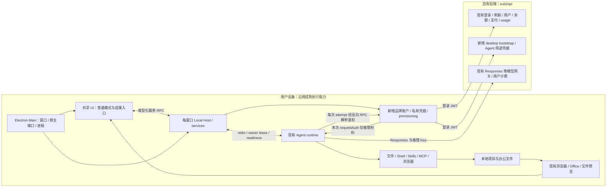

# 品牌桌面 Agent：源码审计与最小改造计划

调查与复核：2026-11-10—2026-11-12。产品目标：Windows/macOS 普通用户安装后，使用自有账号登录、充值，以自然语言完成开发与办公任务，预览、继续修改并导出成果。第一版同时包含网站/小工具/已有项目修改和 Word/Excel/PPT/PDF；生图、设计、网页游戏、专业 3D 与游戏引擎按阶段扩展。

**建议继承当前 Agent 与桌面运行架构，以独立账户/计费适配和受管工具环境形成产品。** 初始审计完成的是源码调查、接口设计、取舍矩阵和切片合同；已实施的W1/W2账号钱包见11，W3托管推理见14–16，在线刷新见18–20，生产模型、真实文件工具与账单交叉核对见21，未删除功能。后续应验证具体开发/办公场景、正式包和依赖再分发，再收口普通用户界面。

## 阅读入口

| 文档                                                                     | 内容与用途                                                                                 |
| ------------------------------------------------------------------------ | ------------------------------------------------------------------------------------------ |
| [01 桌面架构、双平台运行与发行](01-desktop-architecture.md)              | 主要包职责/运行位置、启动链、系统依赖、构建签名更新、独立品牌与数据根                      |
| [02 Agent 执行与模型路由](02-agent-execution.md)                         | 执行/权限/恢复、主辅模型逐入口、现有凭据限制、最小 managed access 改点                     |
| [03 官方服务依赖与替换清单](03-official-services.md)                     | 能力、调用方、地址、认证、核心性与替换/关闭建议；覆盖后台请求生产者                        |
| [04 办公、成果预览与未来扩展](04-office-and-extensions.md)               | 四种格式生产/修改/预览/导出、生产与查看依赖、许可、插件/生图/设计/游戏边界                 |
| [05 sub2api 接入与接口缺口](05-sub2api-integration.md)                   | 已有接口与新增合同、账户/推理材料隔离、刷新与付款时序、实际消费及错误恢复                  |
| [06 分阶段路线与第一条切片](06-roadmap-and-first-slice.md)               | F00–F14 任务、依赖/验收/风险、具体改动模块、A01–A09 场景、下一轮联调输入                   |
| [07 功能保留/隐藏/关闭/删除矩阵](07-feature-matrix.md)                   | 首版功能决策、裁剪收益/影响、删除门槛与普通用户应见界面                                    |
| [08 具体源码裁剪清单](08-pruning-plan.md)                                | 按风险排序的目录/功能删除候选、依赖陷阱、实际源码体积与删除顺序                            |
| [09 自有账号、余额与充值设计](09-account-wallet-spec.md)                 | 后续设计：侧栏余额与⟳、每次加载同步、账号页、原生充值弹窗、接口精确语义与W1–W4切片         |
| [10 账号钱包影响与验收](10-account-wallet-impact-and-cases.md)           | UI/服务影响、跨Host状态边界、AW01–AW19目标场景与真实验证记录                               |
| [11 账号钱包实施与验证](11-account-wallet-implementation.md)             | 实际模块、原生/运行时/Host边界证据、支付与跨平台限制、W3未就绪门禁                         |
| [12 托管 Agent 推理设计](12-managed-agent-inference-design.md)           | 下一步方案：独立Agent Key、最小后端增量、受管模型/逐请求授权、换号边界、现有余额的工具闭环 |
| [13 账号钱包生产化缺口](13-account-wallet-production-gaps.md)            | 复核W1/W2：建单幂等、渠道能力/支付恢复、浏览器登录挑战、历史快照与实际消费                 |
| [14 受管推理实施合同](14-managed-agent-inference-spec.md)                | 独立Agent用途Key、bootstrap DTO、Host/CLI状态与账单绑定、只读与取消边界                    |
| [15 受管推理验收](15-managed-agent-inference-cases.md)                   | MI01–MI14稳定编号、分层用例/证据与未覆盖范围                                               |
| [16 受管推理实施交接](16-managed-agent-implementation.md)                | 两仓库实际模块、运行结果、后台配置与不部署交接                                             |
| [17 ZCode 与 sub2api 协作复核](17-integration-design-review.md)          | 两个连接控件的真实语义、目录/Key/分组边界、在线刷新与运行状态缺口                          |
| [18 Agent 配置与模型刷新方案](18-agent-model-refresh-design.md)          | 不扩展停服/Key ACL；启动、手动、执行前同步，缓存失败与在途任务规则，MR01–MR08 验收计划     |
| [19 模型刷新 UI 验收](19-agent-model-refresh-ui-acceptance.md)           | 模型菜单、失效选择、独立同步、草稿owner与原生Electron验证范围                              |
| [20 模型刷新实施交接](20-agent-model-refresh-implementation.md)          | v3有效子集、授权scope与配置指纹、两仓库变更、工程/原生验证和发布顺序                       |
| [21 生产后端联调验收](21-agent-model-refresh-production-verification.md) | 真实登录/余额/目录同步、生产模型Write→Read、网站与桌面消费核对及未验范围                   |
| [22 推理等级与模型配置复核](22-reasoning-controls-config-impact.md)      | 品牌菜单推理控件遗漏、完整协议与简洁表单边界、自动档位语义、预算与元数据预填限制           |
| [23 桌面浏览器授权登录](23-desktop-browser-login-spec.md)                | 系统浏览器登录、S256 PKCE、临时loopback、取消/跨窗口 epoch 与现有账户复用                  |
| [24 浏览器登录实施与验证](24-desktop-browser-login-implementation.md)    | 两阶段RPC、本地真实HTTP与UI验收、兼容与生产验证边界                                        |
| [25 客户端复核与界面收口](25-client-review-and-refinement-design.md)     | 推理入口遗漏、账号布局、Key恢复与余额同步的当前证据、最小改造方案及验收范围                |
| [26 客户端收口实施交接](26-client-refinement-implementation.md)          | 模型/强度、账号记录布局、私有恢复及结算后新读的实现、分层验收与发布边界                    |
| [27 双平台本地安装包](27-desktop-installers-2026-11-13.md)               | Windows x64/macOS ARM64 构建、运行身份修复、实际安装包验收与签名边界                       |
| [28 安装版登录与启动修复](28-installed-login-and-startup-fixes.md)        | 首屏品牌一致、凭据按应用安全身份隔离、错误持久展示与重新打包验收                         |
| [30 无付费证书的应用内更新](30-client-update-without-paid-certificates.md) | Windows NSIS / Mac Sparkle 已实施；免费发布签名、引导版及真实升级验收门槛 |
| [31 更新发布操作](31-client-update-release-guide.md) | 后台继承备份 S3、独立公开发布桶、管理员临时上传授权、签名与条件发布操作 |
| [32 更新实施与验证](32-client-update-implementation.md) | 两仓库实际落地、验证证据、公钥配置、真实发布与完整安装验收边界 |
| [账号钱包交互原型](prototypes/account-wallet.html)                       | 纯本地示例：登录、余额同步、充值等待/到账、断网和过期；不连接真实账号/支付                 |

当前进展：W1/W2账号钱包本机链路见11；W3独立Agent Key/受管推理/近期消费见14–16；18–20的在线刷新改造已连接用户部署的生产后端验收，macOS隔离开发版完成真实文件读写，并与网站按Agent Key筛选的消费记录交叉核对，见21。充值仍关闭，未下单或付款；正式包、Windows、实际到账及生产配置故障场景仍未完整验证。以下基线和初始验证表保留历史审计口径，不能覆盖后续实施证据。

## 基线、方法与证据口径

| 项目            | 固定状态                                                                                                                                       |
| --------------- | ---------------------------------------------------------------------------------------------------------------------------------------------- |
| ZCode           | `main`，`a9fe401eede6e6e5e01be9048679c206fe6f02d9`；开始时工作区干净                                                                           |
| 发行版本        | 根 `package.json:3` 为 `3.17.2`；`apps/zcode-cli/package.json:3` 为 `0.17.1`；README:18 声明 2026-11-03 更新至该桌面版本，未核验远端最新发行物 |
| 开发工具        | `mise.toml:1` pin Node `24.14.0`、pnpm `10.33.2`；调查机实际 Node `24.19.0`，没有项目 `node_modules`                                           |
| sub2api（只读） | 相邻仓库 `../sub2api`，`main`，`c32e6296da8293e2a8a7d661c3c4da1dd3ebfaa1`；开始与结束工作区干净                                                |
| 本轮变更范围    | 仅新增 `docs/fork/` 文档；未改变运行代码、原用户数据或后端                                                                                     |

方法采用“全局目录与依赖扫描 → 关键链路追踪 → 针对性深读 → 并行交叉复核”。按 `pnpm-workspace.yaml:1` 的应用/包/Agent 子工作区边界扫描目录和 package manifests（`packages`、`apps` 下共发现 57 份源码 manifest），再沿 Main/Host/RPC/CLI、Provider/辅助请求、官方账号与外呼、办公插件/查看器/构建资源追调用。四线并行覆盖桌面发行、Agent 执行、账号与云服务、办公与扩展，统一汇总后才决定建议；没有机械逐文件通读，也没有把历史报告当当前实现。

已读取根 `AGENTS.md`、`README.md`、`NOTICE.md`、`LICENSE`、`mise.toml`、workspace/主要包 manifests、桌面构建配置和适用 services/UI 约束；参考现有架构/测试/发行文档并与源码交叉核对。sub2api 阅读了 README_CN 的接口/编译/部署说明、LICENSE、实际路由/handler/service/repository/DTO；其 `README_CN.md:222` 的 Go 描述与 `backend/go.mod:3` 不同，后者实际为 `1.27.3`，后续编译以源码为准。旧调研 `../sub2api/output/research/desktop-agent-evaluation-2026-11-10.md` 仅作搜索线索。未读取真实凭据、环境私密配置或账户数据库。

统一证据标记：**S**=源码已实现；**D**=文档/界面声明；**N**=需要新增/修改；**U**=本轮未验证，需构建/运行。**S 不等于安装包、线上服务或干净机器已经通过验收。** 引用默认相对于 ZCode 根；包内短写由所在章节说明；`sub2api/` 指上述相邻只读仓库。源码行号绑定此 commit，后续重构需同步更新。

## 整体边界与关键判断

具体事件顺序见 02、04、05。Main 不接管任务/账户业务；sub2api 不执行本地工具、不保存 CLI 队列或替代 Host。`packages/server` 是本地/远端通用 HTTP/WebSocket 传输与服务托管能力（`packages/server/src/http.ts:344`、`:369`），不是必须另行部署的官方账户服务器。

| 决定                                       | 原因与重要证据                                                                                                                                                                                                                                                                                                                             |
| ------------------------------------------ | ------------------------------------------------------------------------------------------------------------------------------------------------------------------------------------------------------------------------------------------------------------------------------------------------------------------------------------------ |
| **继承执行器，扩展鉴权边界**               | CLI 已具 admission、权限、持久化、恢复与多协议 adapter。当前普通 `api-key` 仍为明文配置值（`packages/provider/src/config/provider-config.ts:36`），不会进入 Host 动态鉴权（`apps/zcode-cli/packages/adapters/src/model/runner.ts:190`）；需新增 managed access/ref，沿用反向 RPC 和 Responses adapter，不能只自动填写 Key 后宣称凭据已隔离 |
| **账户与推理材料独立**                     | sub2api JWT/refresh 与模型 Key 是不同协议。官方登录还依赖 ZAI/BigModel 的项目/团队/业务 token（`packages/shared/src/project-access-token-client.ts:45`、`:272`），不能只替换 `ZCODE_BASE_URL`；新增独立 account/commerce/provisioning 服务见05                                                                                             |
| **主辅请求统一管理**                       | 标题、压缩、记忆、Git/目标验证、子代理、workflow 有不同选择入口；02逐项列出处。Provider 默认失效还能回退（`packages/provider/src/model-selection-config.ts:28`），必须限制到授权集合并明确失败；默认推理档位也要显式给定                                                                                                                   |
| **App 内置运行时不等于任务工具链齐备**     | Agent 使用 Electron Node；npm fallback 限于 stdio MCP；Git 从机器查找；办公脚本检测/安装 Python、库、LO、字体等。01/04逐项区分随包、脚本安装、用户环境与未知，不承诺干净机已经零配置                                                                                                                                                       |
| **办公是可继承能力，但还不是完整办公产品** | 四类实际本地插件、MCP 工具和 JS/WASM 查看器存在；面板主要是只读预览→向 Agent 提修改→重新加载。生成依赖、复杂格式保真、Excel落盘公式缓存和导出限制需另验，不能按技能说明直接交付，见04                                                                                                                                                      |
| **品牌发行需独立生命周期和数据根**         | appId/name 不改变默认 `.zcode` 业务目录和所有用户指令路径（`packages/services/src/paths.ts:36`、`:60`、`:251`）；普通自动更新关闭也不关闭启动强更（`packages/desktop/src/main/index.ts:2300`、`:2614`）。正式包还限制更新 origin（`autoUpdater.ts:839`、`:851`），见01                                                                     |
| **签名/许可材料并非已齐套**                | Windows hook 引用缺失签名脚本；macOS 独立公证/预签名只见流程说明，见01。根 Apache-2.0 要保留适用许可/NOTICE、标注修改，且不授商标权（`LICENSE:90`、`:139`）；第三方、Office元数据冲突、PyMuPDF、字体需按实际产物核定，见04和 `third-party/README.md:49`                                                                                    |

sub2api 根 `LICENSE:1` 是 LGPL-3.0，README_CN:864 声明或更高版本。本方案保持它为独立服务，通过 HTTP 接口接入，不把其后端代码打入桌面包；后续若复制代码或改变分发方式，应重新核对相应义务，不能套用 ZCode 的 Apache 结论。

## 首版取舍

完整理由、依赖与验收见07，此处用于产品决策：

- **必须继承：** Agent loop、文件/Shell/浏览器工具、权限/取消、任务队列和恢复、上下文压缩、Git差异与必要检查点、网站预览、四类办公插件/预览与文件导出、现有构建闭包校验。
- **底层保留、普通用户隐藏：** Provider/Key/模型参数配置、Skills/MCP/插件技术配置、终端设置、专业Git/worktree与子代理管理。改成由产品准备依赖、选择模型、显示进度与成果；不靠删工具实现简单界面。
- **首版关闭并保留源码：** 原官方团队/套餐/支付/营销/闲时/高速卡、SSH/WSL/远程/手机、Bots、本地定时派发、任意市场安装、官方分享/站点发布、默认长期记忆与原遥测。关闭服务和后台触发，不能只隐藏菜单；自有更新在正式发行前补齐。
- **后续可裁候选：** 被适配替代后、只服务原厂商商品/营销/分享的实现和旧宣传素材。先关闭、查引用与动态注册、跑受影响验收，再物理删除。本轮不支持整包清空或删除 `server`、插件框架、多协议、远端身份边界。
- **暂不能算已继承：** Computer Use 已接入 Vercel agent-desktop，构建联调与回归通过，但完整桌面操作仍有平台验收限制，尚未发布新包（见39）；图片搜索不是生图，Gen UI不是专业设计文件系统；未找到稳定 Blender/专业游戏引擎集成，见04。

## 最值得先改的切片

**独立产品/数据身份 → 自有测试账户登录/刷新 → bootstrap 领取 Agent 用途凭据 → Host 私有解析 → 受管默认模型 ready → 创建文件并读回 → 多轮完成 → 服务端核查实际消费。** 切片模块、状态规则和9组验收场景已落入06，可作为下一轮 spec/PR 的输入。

sub2api 现有登录/2FA/刷新、用户余额、充值下单与履约、网关、usage 可以复用。真正缺的是独立的 desktop bootstrap/Agent 托管 Key 合同；先采用每用户独立 Agent 用途 Key，设备独立撤销按产品要求前移。严格任务总账仍缺 session过滤/父子归属聚合；不是完全没有会话关联，因为 usage 已持有 session_id（`../sub2api/backend/internal/service/session_id.go:35`）。充值展示以 COMPLETED 后刷新权威余额为准，不以收银台返回或 PAID 状态直接加余额。

与账户并行验证：固定四格式文件在生产包离线预览 → 托管脚本生成/修改/导出重开 → 模型自然语言闭环；避免把查看器缺资源、工具缺依赖和模型质量混成同一问题。网站闭环随后验证无系统 Node/Git 的安装环境。没有构建证据前不提供精确工期。

## 未知项与下一份证据

| 未知/风险                                        | 下一步验证与归属                                                                                                                                      |
| ------------------------------------------------ | ----------------------------------------------------------------------------------------------------------------------------------------------------- |
| 源码能否在固定工具版本构建、两平台原生包是否完整 | F00：安装锁定依赖、类型/Lint/基础构建、各平台未签名内部包；不以源码阅读代替                                                                           |
| 干净环境的网站与四种办公任务                     | F07–F09：无全局开发工具的VM/测试机；离线预览与确定性脚本先验，模型任务后验                                                                            |
| 官方请求实际实例化时机/动态插件外呼              | F01/F04：生产形态下启动、登录、任务、设置/帮助、退出请求记录；03静态清单作为对照                                                                      |
| Office默认插件跨 services/CLI 列表漂移           | `packages/services/src/plugins/officialPluginCache.ts:10` 仍用旧集合，而CLI已四拆分；先查消费者并跑首次安装/跨入口验收，不能只用CLI定义证明可见性一致 |
| sub2api部署策略与兼容性                          | 联调确认 origin、余额组、模型/能力/推理档位、验证码/2FA、refresh绑定、计费单位与支付渠道；本轮不读真实秘密也不调用线上账户                            |
| 签名、公证、更新与第三方分发条件                 | F01/F08/F11：补自有供应链脚本与材料，产物上验签/公证/升级；严格许可检查与Office依赖选型                                                               |
| 品牌名/包身份、是否要求单设备立即吊销            | 不阻塞调查；进入实现前集中确认。若要求设备即时吊销，不能用清本地Key/撤JWT代替服务端设备凭据生命周期                                                   |

## 本轮验证记录与维护方式

| 检查                                                  | 真实结果                                                                                                                                                                                   |
| ----------------------------------------------------- | ------------------------------------------------------------------------------------------------------------------------------------------------------------------------------------------ |
| `node scripts/check-workspace-freshness.mjs`          | 失败：`git fetch origin --prune` 连接 GitHub 超时                                                                                                                                          |
| 同脚本 `--no-fetch`                                   | 通过：仅相对已缓存 `origin/main` ahead 0 / behind 0；无法保证远端最新                                                                                                                      |
| `pnpm typecheck`                                      | 未通过：`tsc: command not found`，当前无 workspace依赖；未得到类型检查结果                                                                                                                 |
| `pnpm lint`                                           | 未通过：`oxlint: command not found`，当前无 workspace依赖；未得到Lint结果                                                                                                                  |
| 文档相对链接、源码路径/行号、空白与差异               | 追加裁剪清单后共9份文档、27处相对链接均可解析；153处完整源码引用的路径/行号检查、围栏与空白检查无问题；刻意披露的缺失签名/CI脚本不计作有效实现；`git diff --check`无错误。不是代码门禁通过 |
| Desktop/CLI运行、真实模型/支付、安装包/签名/部署/发布 | 均未执行，保持U；sub2api未改动                                                                                                                                                             |

这组文档是可维护的调查与决策记录。后续先把选定切片冻结成行为 spec（规则/owner/接口/状态/异常/验收），维护对应E2E/CLI或工程回归，再按 architecture-governance 获取受控上下文实施。每条 Fxx/Axx 补 PR、固定commit、运行平台与证据；结论从 U/D 升为通过必须链接真实日志/文件/截图，不能只改状态字样。产品范围改变时先更新07和06，再更新接口及实现；不因首版隐藏功能就删除共享边界或恢复已退役 App业务单测。

## 后续进展（不覆盖上面的初始审计记录）

- 用户随后决定先保留各功能源码，不实施裁剪；07/08中的取舍是评估建议，不是已执行删除清单。
- 2026-11-11已安装锁定依赖，构建Agent/办公插件并启动macOS arm64开发版，独立数据目录，欢迎登录页可见。这只验证开发启动，不代表干净Windows/macOS零配置发行已通过。
- 当前设计优先级细化为09中的W1账号/只读钱包、W2充值，再衔接W3推理凭据与工具调用。W1/W2不需等待desktop bootstrap；本轮没有修改sub2api、登录真实账号或创建真实订单。
- 依赖安装后的 `pnpm typecheck` 通过；`pnpm lint` 退出0（84 warnings、0 errors）。初始审计表中的缺依赖失败保留为当时记录，不能与本次检查混淆。

- 2026-11-11账号/钱包实施：见 [11实施记录](11-account-wallet-implementation.md)。原生登录、余额加载与手动同步、充值渠道/二维码/订单/到账新读已接入，macOS本机fixture通过；9项runtime和5项Host admission通过。默认连接milorouter.com，正式站当时充值关闭，未真实登录或付款。W3模型接入和Windows发行验收仍待后续，当前品牌版明确禁发推理。

- 2026-11-12生产联调：见 [21验收记录](21-agent-model-refresh-production-verification.md)。用户自行登录并保存线上Agent配置后，桌面刷新得到 `gpt-6.1-sol`，真实模型执行Write→Read→正文；4条Agent Key结算记录与网站交叉核对一致。已具备推进开发/办公场景验收的条件，未做真实充值、生产故障注入或双平台发行验收。
- 2026-11-13 按25号方案实施客户端收口，见 [26实施交接](26-client-refinement-implementation.md)：模型/强度与失效修复、两行账号/记录页签、Key候选恢复及终结后余额/usage新读已落地；A浏览器17/17、B浏览器12/12、C三组81项、登录/恢复浏览器19/19、macOS原生模型与Write/Read链路1/1通过。钱包最后修复后的typecheck、CLI/Desktop构建及工程门禁通过，最后构建原生重跑1/1通过；保留已有未提交改动，未发安装包、未改生产，本轮无需Sub2API增量。
