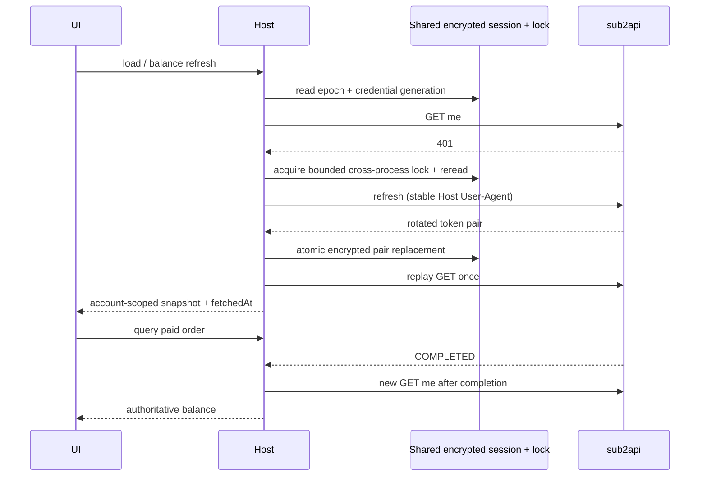

# Brand account

Recovery (2026-11-13): known bootstrap failure reasons are fixed safe public error codes; credential reset neither extends expiry nor replenishes quota, and disabled credentials require administrator restoration. The private inference host accepts `ManagedInferenceOutcome` from the currently routed local CLI only. Rejection candidates carry the original managed access and SHA-256 fingerprint of the material actually used; same identity, full authorization scope, credential reference and current material must match. Codes do not establish upstream provenance: a candidate only coalesces a bounded bootstrap refresh, which alone decides availability. There is no inference replay or login invalidation from data-plane errors. Turn settlement carries the original billing binding and uses the existing turn finalization path, never the replayable UI event stream. The account owner batches settlement/balance feedback for 200ms and requests event-after reads of both balance and usage, tailing any older flights. Initialization of an existing valid session starts inference independently of public settings. No new task/account/ledger owner is introduced.

Browser authorization (2026-11-13): `startBrowserLogin()` is the primary login command. The local Host owns one five-minute attempt, a random loopback listener, state and S256 PKCE verifier; RPC receives only the authorization URL and expiry. The website owns password, captcha and 2FA. A valid single-use callback is exchanged once at `/desktop/auth/token` and saved through the existing encrypted repo and epoch lock. Beginning an attempt writes a new signed-out epoch before releasing the lock to wait; cancellation, logout, disposal and sibling login invalidate late results. `snapshot.browserLogin` is the only public waiting state. Existing password/2FA methods remain compatibility commands; inference Key, bootstrap, CLI and billing ownership are unchanged. Spec and local acceptance: docs/fork/23 and 24.

Online refresh (2026-11-12): Host owns one account-scoped single-flight coordinator, successful time, and automatic retry backoff. Public `refreshAgentConfig({force?})` returns the existing snapshot with independent refresh status/time/error. Temporary control-plane failure preserves a same-account ready policy. Admission older than 60 seconds must complete refresh; ordinary attempts validate current membership/configuration without depending on a new network check. Protocol 3 supports effective model subsets, unavailable model reasons, and a nullable default. Authorization scope is separate from catalog revision; the legacy billing binding field `policyRevision` carries the stable authorization scope for v3. Every attempt compares its model execution fingerprint against current policy. CLI owns queue/runtime and acknowledges publication; Host does not create another accepted queue. This paragraph supersedes historical protocol-2-only/global-invalidation statements below. Spec and acceptance: docs/fork/14, 15, 18.

Owner: local window Host. One shared, OS-encrypted private session file represents the current brand account across windows **of the same application security profile**. Desktop Main supplies its Electron `userData/brand-account/session.json` path in trusted local initialization; development, Preview and production must not read a common business-root credential file because OS encryption belongs to the application identity. Legacy common-root sessions remain untouched and are not automatically imported across identities; the new profile starts signed out. Business project/history storage is unchanged. No account secrets enter RPC, generic credentials, settings, remote hosts, task state, logs, or URLs. `createBrandAccountService` returns an explicit public facade and a separate dispose function.

Admission is an identity-only, key-free handshake after freshness and the target CLI's Registry ACK. It checks origin/accountRef/epoch while allowing a same-account authorization-scope change. CLI freezes a new input's scope after the ACK; already accepted queue/retry bindings remain immutable and must still match in full. Physical attempts always check the full latest binding, credential reference and execution fingerprint.

Factory: `createBrandAccountService({ baseUrl, filePath, fetch?, encrypt, decrypt, onInvalidate? })` returns `{ service: IBrandAccountService, dispose: () => void }`. `encrypt` and `decrypt` are asynchronous trusted OS-cipher ports and must reject when protection is unavailable. `onInvalidate` notifies sibling Hosts after a shared-session commit; receivers call initialize to reread the private store. Filesystem watching also invalidates sibling projections. `fetch` is an optional native Fetch-compatible injection for deterministic local harnesses.

W3 adds an optional Desktop-only `managedInference: { clientVersion, platform }` port and returns a separate **private** `inference: BrandManagedInferenceHost`. This port is never registered with RPC. It exposes non-secret policy changes and resolves one physical model attempt only after rereading the current account identity. Bootstrap inference keys remain in Host memory, separate from the encrypted login pair, and are cleared on account invalidation/dispose. Public snapshots expose `inference` connection state only; reconnect reuses the existing `initialize()` command rather than creating another initialization writer. Backend model semantics are mapped to fixed client option maps; a bootstrap cannot supply scripts or arbitrary trusted origins. `configured` is Host readiness, while each target CLI must separately acknowledge actual Registry application. Spec: `docs/fork/14-managed-agent-inference-spec.md`.

Since 2026-11-12 the Desktop requests bootstrap protocol 2 and publishes one canonical `models:[{modelId,modelConfig}]` collection plus a member `defaultSelection`. Every model is validated before publication, receives its own fixed option maps and output-budget clamp, and must be present for the CLI applied acknowledgement. The private resolver allows only collection members under the current credential/billing binding. Protocol-1 single-model responses remain readable without an automatic downgrade retry; the server serves the configured default alone to old clients. Admin catalog selection, model-card editing and atomic configuration-preserving disable are owned by sub2api, outside this Host module.

The private resolver's `accountScope` is the lowercase SHA-256 digest of the JSON tuple `[origin, accountRef]`, matching the existing shared runtime-headers response schema. It never returns the raw account identity, remains stable through credential/policy rotation and same-account login, and does not replace the separate epoch/revision fence in `billingBinding`.

The account service also owns the synchronous inference IO generation. The private coordinator checks it across its final identity await and again immediately before returning admission, usage scope or inference material. Same-account refresh can leave epoch and policy unchanged; its pending boundary must still reject an earlier authorization continuation. Bootstrap may perform its permitted refresh before starting that final generation check.

Public methods and DTOs are frozen in contract.ts. Snapshot events contain safe projections only. Login challenge tokens remain in Host memory; `completeTwoFactor` accepts only the code. An access-only login is supported without claiming permanent login. Failures expose fixed safe messages/codes, never raw backend response or thrown causes. GETs and the idempotent desktop bootstrap POST may be replayed once after refresh; payment mutation POSTs are not automatically repeated.

Refresh/login/logout share a bounded cross-process lock (40-second contention wait, 10-second HTTP deadline). Main uses asynchronous OS safeStorage on Mac/Windows. Linux retains the existing synchronous protected backend and rejects `basic_text`, because Electron's asynchronous Linux provider can fall back to a fixed key; this is an explicit platform boundary, never a failure fallback on Mac/Windows. Host and repo use the same shared-protocol 120-second cipher request deadline, including first-use OS authorization; the independent lock contention budget remains 40 seconds and returns retryable `busy` rather than waiting through multiple cipher budgets or stealing a live owner. The lock covers reread → network exchange → atomic replacement, so logout is ordered after a pending refresh and writes a higher epoch tombstone. Every asynchronous read is fenced by account epoch and request generation; writes recheck the initiating action generation after OS encryption and before atomic replacement, so cancellation/disposal cannot commit late credentials. Main rechecks the original child lifecycle after every OS await. Old `os:v1:` envelopes remain readable through async decryption; no plaintext fallback is allowed. Same-Host balance reads share one flight, while order completion queues a new flight after an older read. No local ledger, inferred deductions, optimistic recharge credits or double subtraction of frozen balance. An uncertain refresh outcome returns `reauthentication_required` and preserves the encrypted session for diagnosis without replaying the possibly consumed token. HTTP 429 from auth's pre-handler rate limiter resets that marker so a later manual retry is allowed.

Balance uses server `balance`/`frozen_balance` USD-equivalent values under all billing engines. Public settings supply display currency conversion. The balance projection does not consume the legacy numeric int64 ledger credits because JavaScript JSON parsing cannot preserve oversized integers. For recent Agent usage, W3 reads the new exact decimal-string credits fields and projects safe display amounts using BigInt; it never infers task cost from balance differences. Payment currency is separate: create input amount is channel base amount; response amount includes bonus in USD-equivalent credits; pay_amount is actual channel money. No copied recharge quote algorithm. `enabled` comes from payment/config; limits do not invent remaining allowance. `COMPLETED` alone triggers post-fulfillment balance refresh. When a provider omits currency in its create-order response, the client reads the authenticated order detail rather than guessing its currency.

Payment actions expose only HTTPS pay URLs without embedded user credentials, or bounded QR strings. OAuth/JSAPI/provider SDK responses have an explicit unsupported result; client secrets/intent tokens are not returned. Desktop does not pass JWTs to browser or custom return URLs. API origin must be HTTPS, except loopback HTTP for local engineering fixtures.

Validation uses a local fake control plane; no production login, order, or payment is necessary. Acceptance scope: docs/fork/09-account-wallet-spec.md and docs/fork/10-account-wallet-impact-and-cases.md (AW01–AW19). App business unit tests are retired; engineering harness owns persistence/concurrency/adapter regressions.
